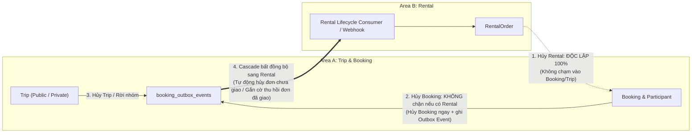

# Phân Tích Toàn Diện Luồng Hủy Đơn & Hoàn Tiền (Booking, Rental, Trip)

Tài liệu này tổng hợp kết quả kiểm tra toàn bộ mã nguồn (`api/` và `web/`) cho luồng hủy đơn giữa **Booking**, **Rental** và **Trip (Public / Private)**.

---

## 1. Tổng Quan Kiến Trúc: Booking và Rental Độc Lập Hay Móc Nối?

Thiết kế của hệ thống là **Bất đối xứng 1 chiều (One-way Asynchronous Cascade: Area A [Trip / Booking] $\rightarrow$ Area B [Rental])**:



### 1.1. Chiều Rental $\rightarrow$ Booking: Độc lập 100%
- Khi khách hủy đơn thuê thiết bị qua [`CancelRentalOrderUseCase`](file:///d:/SESSION_8/TREK_GO/api/src/modules/rental/ordering/application/use-cases/cancel-rental-order.use-case.ts#L19-L41) $\rightarrow$ [`PrismaRentalOrderAdapter.cancelOrder`](file:///d:/SESSION_8/TREK_GO/api/src/modules/rental/ordering/infrastructure/adapters/prisma-rental-order.adapter.ts#L644-L769):
  - Hệ thống chỉ cập nhật `rental_orders`, nhả giữ chỗ tồn kho (`rental_quantity_reservations`), đóng `inventory_tasks`, hủy `rental_extension_requests`, hủy hóa đơn chưa trả và đặt lệnh hoàn tiền (`Refund` với `purpose: 'RENTAL_CANCELLATION'`).
  - **Tuyệt đối không đọc hay sửa đổi `Booking`, `BookingParticipant` hay `Trip`**. Khách hủy thuê đồ vẫn giữ nguyên vé đi trekking.

### 1.2. Chiều Booking / Trip $\rightarrow$ Rental: Không chặn lúc hủy Booking, nhưng có cơ chế Cascade sang Rental
- **Tại thời điểm hủy Booking** ([`BookingCancellationService.cancel`](file:///d:/SESSION_8/TREK_GO/api/src/modules/bookings/booking-cancellation.service.ts#L21-L205)):
  - **Không kiểm tra điều kiện bên Rental**: Dù khách đang có đơn thuê đồ ở trạng thái chờ thanh toán, đang chuẩn bị hàng hay thậm chí **đã nhận thiết bị (`ACTIVE`)**, lệnh hủy Booking vẫn được chấp nhận ngay lập tức (`HTTP 202 Accepted`), chuyển `Booking` sang `CANCELLED` và trả lại slot cho `Trip`.
  - **Lý do nghiệp vụ**: Không được khóa quyền hủy vé chuyến đi chỉ vì khách đang thuê đồ; thay vào đó, Booking phát sự kiện `BOOKING_CANCELLED` vào bảng `booking_outbox_events` ([`booking-cancellation.service.ts`](file:///d:/SESSION_8/TREK_GO/api/src/modules/bookings/booking-cancellation.service.ts#L89-L106)) để module Rental xử lý hệ quả theo trạng thái vật lý của thiết bị.
- **Cách Rental xử lý khi nhận sự kiện hủy từ Booking / Trip** ([`PrismaTripLifecycleAdapter`](file:///d:/SESSION_8/TREK_GO/api/src/modules/rental/lifecycle/infrastructure/adapters/prisma-trip-lifecycle.adapter.ts#L780-L1254)):
  - **Trường hợp 1 — Đơn thuê CHƯA bàn giao cho khách (`PENDING_PAYMENT`, `PAID`, `PREPARING`, `READY_FOR_HANDOVER`)**:
    - Tự động chuyển `RentalOrder.status` sang `CANCELLED`.
    - Hủy các khoản thu chưa thanh toán (`cancelPendingRentalChargesWithTx`) và yêu cầu gia hạn đang chờ (`releaseExtensionWithTx`).
    - Giải phóng số lượng đặt giữ (`RentalQuantityReservation` $\rightarrow$ `RELEASED`).
    - Tự động tính toán và tạo lệnh hoàn tiền (`reserveLifecycleRentalRefundWithTx`).
    - **Kiểm tra vị trí vật lý của thiết bị**:
      - Nếu hàng còn ở kho chính: Đóng `RentalUnitAssignment` và trả các thiết bị nguyên vẹn (`PICKED`/`PACKED`) về `AVAILABLE`.
      - Nếu kho đã chuyển hàng cho bộ phận giao nhận (`TRANSFERRED_TO_DELIVERY`): Vẫn hủy đơn nhưng bật cờ `exceptionStatus = ACTION_REQUIRED` và gắn ghi chú `RETURN_TO_INVENTORY_LOCATION_REQUIRED` trên `DeliveryTask` để nhân viên mang đồ về kho kiểm tra trước khi mở bán lại.
  - **Trường hợp 2 — Đơn thuê ĐÃ bàn giao cho khách (`ACTIVE` / đã có `rentalHandoverViaOrderId`)**:
    - **Không chuyển đơn sang `CANCELLED`** và không tự động hoàn tiền/cọc ngay (vì khách đang cầm thiết bị thực tế).
    - Giữ nguyên hạn trả hợp đồng (`rentalEndAt`), đảm bảo sinh tác vụ thu hồi (`ensureReturnTaskWithTx`), bật cờ `exceptionStatus = ACTION_REQUIRED` và gắn mã ngoại lệ trên `DeliveryTask` (`BOOKING_CANCELLED_WITH_ACTIVE_RENTAL` / `TRIP_CANCELLED_WITH_ACTIVE_RENTAL` / `MEMBERSHIP_REVOKED_WITH_ACTIVE_RENTAL`) để vận hành thu hồi đồ và quyết toán cọc sau.

> [!WARNING]
> **Lưu ý quan trọng về trạng thái kết nối thực tế trong code**: Mặc dù toàn bộ logic xử lý nối sang Rental ở trên đã được viết đầy đủ trong `rental/lifecycle`, hiện tại tầng nối tự động giữa Outbox của Booking/Trip và Consumer của Rental đang có một số điểm chưa khép kín ở runtime (xem chi tiết tại **Mục 5**).

---

## 2. Chi Tiết Luồng Hủy & Hoàn Tiền Bên Booking

### 2.1. Sơ đồ luồng thực thi Booking Cancellation & Refund

```mermaid
sequenceDiagram
    autonumber
    actor Actor as User / Organizer / Admin
    participant API as BookingCancellationsController
    participant BCS as BookingCancellationService
    participant DB as PostgreSQL (Transaction)
    participant Worker1 as BookingCancellationService.tick (2s)
    participant RS as RefundsService
    participant Worker2 as PaymentRecoveryService.tick (2s)
    participant GW as PaymentProviderGateway

    Actor->>API: POST /api/v1/bookings/:id/cancellations
    API->>BCS: cancel(bookingId, actorId, actorRole, reason)
    BCS->>DB: Lock Booking row (FOR UPDATE)
    alt Booking == PENDING_PAYMENT
        BCS->>DB: Booking -> CANCELLED, Participants -> CANCELLED
        BCS->>DB: Invalidate Public Invitations, Cancel Draft/Pending Invoices
        BCS->>DB: Sync Trip status (FULL -> OPEN nếu còn chỗ & trước deadline)
        BCS->>DB: Insert BookingCancellation (refundableAmount = 0) & Outbox (BOOKING_CANCELLED)
    else Booking == CONFIRMED
        BCS->>BCS: Tính % hoàn tiền (100% nếu ADMIN/ORGANIZER, hoặc theo tier policySnapshot nếu USER)
        BCS->>DB: Booking -> CANCELLED, Participants -> CANCELLED
        BCS->>DB: Invalidate Public Invitations, Sync Trip status
        BCS->>DB: Insert BookingCancellation (refundableAmount) & Outbox (BOOKING_CANCELLED)
    end
    BCS-->>Actor: 202 Accepted { status: 'CANCELLED', refundableAmount, refundStatus }

    loop Mỗi 2 giây
        Worker1->>DB: Quét BookingOutboxEvent (BOOKING_CANCELLED, PENDING)
        alt Có refundableAmount > 0 & paymentId
            Worker1->>RS: requestRefund(paymentId, refundableAmount, 'BOOKING_CANCELLATION')
            RS->>DB: Tạo Refund (status: PENDING, reconcileStatus: SCHEDULED)
        end
        Worker1->>DB: BookingOutboxEvent -> PROCESSED
    end

    loop Mỗi 2 giây
        Worker2->>DB: Claim Refund (reconcileStatus: SCHEDULED -> PROCESSING)
        Worker2->>GW: provider.refund(...)
        GW-->>Worker2: Provider Refund Event (SUCCEEDED / FAILED)
        Worker2->>RS: applyEvent(...)
        RS->>DB: Refund -> SUCCEEDED, Invoice -> REFUNDED / PARTIALLY_REFUNDED
    end
```

### 2.2. Điều kiện & Quy tắc tính tiền hoàn bên Booking
Được cài đặt tại [`BookingCancellationService.cancel`](file:///d:/SESSION_8/TREK_GO/api/src/modules/bookings/booking-cancellation.service.ts#L31-L203) và [`refundPercentAt`](file:///d:/SESSION_8/TREK_GO/api/src/modules/bookings/booking-policy.ts#L61-L72):

| Tiêu chí | Chi tiết xử lý trong Code |
| :--- | :--- |
| **Trạng thái được phép hủy** | Chỉ `PENDING_PAYMENT` (chưa quá hạn `expiresAt` và trước `trip.startAt`) hoặc `CONFIRMED`. Các trạng thái `PARTIAL_CHECKIN`, `CHECKED_IN`, `COMPLETED` bị chặn (`BOOKING_CANCELLATION_NOT_ALLOWED`). |
| **Xác định nguồn hủy (`source`)** | • `ADMIN`: `actorRole === 'ADMIN'`<br>• `ORGANIZER`: `actorId === booking.trip.creatorId && booking.trip.status === 'CANCELLED'`<br>• `USER`: `actorId === booking.userId` |
| **Thời điểm được hủy (`startAt`)** | • Nếu `source === 'USER'`: Bắt buộc `booking.trip.startAt > now` (quá giờ khởi hành bị chặn).<br>• Nếu `source === 'ADMIN'` hoặc `'ORGANIZER'`: Cho phép hủy kể cả sau `startAt`. |
| **Tỷ lệ hoàn tiền (`percent`)** | • **`ADMIN` / `ORGANIZER`**: Luôn hoàn **`100%`**.<br>• **`USER`**: Tính số giờ còn lại `hours = (trip.startAt - now) / 3_600_000`, đối chiếu với mảng `cancellationRules.tiers` trong `booking.policySnapshot` (sắp xếp `minHoursBeforeStart` giảm dần, lấy mốc đầu tiên thỏa `hours >= minHoursBeforeStart`). |
| **Số tiền hoàn (`refundableAmount`)** | `max(0, floor(payment.amount * percent / 100) - reservedRefunds)` (trong đó `reservedRefunds` là tổng các lệnh hoàn tiền `PENDING` hoặc `SUCCEEDED` trước đó của cùng `Payment`). |
| **Hệ quả phụ trong Transaction** | • Đổi toàn bộ `BookingParticipant` thuộc đơn sang `CANCELLED` (nhả slot trên Trip).<br>• Gọi [`invalidatePublicBookingInvitations`](file:///d:/SESSION_8/TREK_GO/api/src/modules/bookings/public-invitations.service.ts#L287-L320) để hủy các lời mời nhận vé (`BookingInvitation`) và thu hồi token.<br>• Gọi [`syncTripRegistrationState`](file:///d:/SESSION_8/TREK_GO/api/src/modules/bookings/booking-participation-context.service.ts#L312-L343): Nếu Trip đang `FULL` mà sau khi nhả slot số người `< maxParticipants` (và chưa quá `registrationDeadline`), Trip tự động mở lại thành **`OPEN`**. |

---

## 3. Chi Tiết Luồng Hủy & Hoàn Tiền Bên Rental

Bên Rental có **2 con đường hủy đơn** (chỉ hủy đơn khi ở giai đoạn **trước bàn giao**: `PENDING_PAYMENT`, `PAID`, `PREPARING`, `READY_FOR_HANDOVER`):

### 3.1. Con đường 1: Khách hàng chủ động bấm hủy đơn thuê (`Direct Cancellation`)
- **API**:
  1. Xem trước số tiền hoàn: `GET /api/v1/rental-orders/:id/cancellation-preview` ([`PreviewRentalCancellationUseCase`](file:///d:/SESSION_8/TREK_GO/api/src/modules/rental/ordering/application/use-cases/preview-rental-cancellation.use-case.ts#L15-L34)).
  2. Xác nhận hủy kèm `previewVersion`: `POST /api/v1/rental-orders/:id/cancel` ([`CancelRentalOrderUseCase`](file:///d:/SESSION_8/TREK_GO/api/src/modules/rental/ordering/application/use-cases/cancel-rental-order.use-case.ts#L19-L41)).
- **Điều kiện chặn khi khách tự hủy** ([`PrismaRentalOrderAdapter.cancelOrder`](file:///d:/SESSION_8/TREK_GO/api/src/modules/rental/ordering/infrastructure/adapters/prisma-rental-order.adapter.ts#L653-L699)):
  - Đơn đã có biên bản bàn giao (`rentalHandoverViaOrderId`) hoặc ở trạng thái `ACTIVE`, `RETURNED_PENDING_INSPECTION`, `COMPLETED`, `DISPUTED`, `CANCELLED`.
  - Kho đã xuất giao cho vận chuyển (`inventoryTask.status === 'TRANSFERRED'`) $\rightarrow$ Báo lỗi `CANCELLATION_REQUIRES_CUSTODY_RETURN` (yêu cầu thu hồi kiện hàng về kho trước).
  - Đơn đã có yêu cầu gia hạn được áp dụng (`extensionRequests` có `status === 'APPLIED'`) $\rightarrow$ Báo lỗi `EXTENSION_CANCELLATION_REVIEW_REQUIRED` (vì phát sinh nhiều hóa đơn, cần xử lý thủ công).
  - Nếu `order.version !== previewVersion` $\rightarrow$ Báo lỗi `STALE_CANCELLATION_PREVIEW` (bắt khách xem lại preview mới nhất).

### 3.2. Con đường 2: Hủy tự động theo Lifecycle của Chuyến đi / Booking (`Lifecycle Cascade`)
- Được thực thi bởi [`PrismaTripLifecycleAdapter`](file:///d:/SESSION_8/TREK_GO/api/src/modules/rental/lifecycle/infrastructure/adapters/prisma-trip-lifecycle.adapter.ts) và hàm tính tiền hoàn [`reserveLifecycleRentalRefundWithTx`](file:///d:/SESSION_8/TREK_GO/api/src/modules/rental/payments/rental-cancellation-refund.ts#L14-L101).

### 3.3. Bảng so sánh quy tắc hoàn tiền của Rental (Phí thuê vs. Tiền cọc)

> [!IMPORTANT]
> **Nguyên tắc vàng của Rental trước bàn giao**:
> - **Tiền đặt cọc (`totalDeposit`)**: Luôn được hoàn **100%** trong mọi trường hợp hủy trước khi bàn giao thiết bị (vì khách chưa nhận đồ, không có rủi ro hư hỏng/mất mát).
> - **Phí thuê (`rentalFee`)**: Chỉ có 2 mức là **100%** hoặc **0%** dựa trên mốc miễn phí hủy `freeCancelDeadline = rentalStartAt - freeCancellationHours` và nguyên nhân hủy.

| Kịch bản hủy đơn Rental (trước khi bàn giao) | Hoàn Tiền Cọc (`totalDeposit`) | Hoàn Phí Thuê (`rentalFee`) | Tham chiếu Code |
| :--- | :---: | :---: | :--- |
| **1. Khách tự hủy trực tiếp** TRƯỚC hạn `rentalStartAt - freeCancellationHours` | **100%** | **100%** | [`calculateCancellationPreview`](file:///d:/SESSION_8/TREK_GO/api/src/modules/rental/ordering/infrastructure/adapters/prisma-rental-order.adapter.ts#L1069-L1099) |
| **2. Khách tự hủy trực tiếp** SAU hạn `rentalStartAt - freeCancellationHours` | **100%** | **0%** (Mất phí thuê) | [`calculateCancellationPreview`](file:///d:/SESSION_8/TREK_GO/api/src/modules/rental/ordering/infrastructure/adapters/prisma-rental-order.adapter.ts#L1083-L1090) |
| **3. Hủy do Chuyến đi bị hủy (`source = 'TRIP'`)** | **100%** | **100%** (Bất kể sát giờ) | [`reserveLifecycleRentalRefundWithTx`](file:///d:/SESSION_8/TREK_GO/api/src/modules/rental/payments/rental-cancellation-refund.ts#L38-L41) |
| **4. Hủy do Booking bị hủy bởi `ORGANIZER` hoặc `ADMIN`** | **100%** | **100%** (Bất kể sát giờ) | [`reserveLifecycleRentalRefundWithTx`](file:///d:/SESSION_8/TREK_GO/api/src/modules/rental/payments/rental-cancellation-refund.ts#L50-L53) |
| **5. Hủy do Booking bị hủy bởi `USER`** | **100%** | **100%** nếu `cancelledAt <= deadline`<br>**0%** nếu `cancelledAt > deadline` | [`reserveLifecycleRentalRefundWithTx`](file:///d:/SESSION_8/TREK_GO/api/src/modules/rental/payments/rental-cancellation-refund.ts#L54-L60) |
| **6. Hủy do Rời / Bị xóa khỏi Private Trip (`source = 'MEMBERSHIP'`)** | **100%** | **100%** nếu `effectiveAt <= deadline`<br>**0%** nếu `effectiveAt > deadline` | [`reserveLifecycleRentalRefundWithTx`](file:///d:/SESSION_8/TREK_GO/api/src/modules/rental/payments/rental-cancellation-refund.ts#L67-L71) |

- **Cách thực thi hoàn tiền của Rental** ([`reserveRentalCancellationRefundWithTx`](file:///d:/SESSION_8/TREK_GO/api/src/modules/rental/payments/rental-cancellation-refund.ts#L124-L185)):
  - Ngay trong DB transaction hủy đơn, hệ thống tạo bản ghi `Refund` (`purpose: 'RENTAL_CANCELLATION'`, `status: 'PENDING'`, `reconcileStatus: 'SCHEDULED'`) kèm các dòng `RefundAllocation` (ưu tiên phân bổ vào `RENTAL_DEPOSIT` trước, phần còn lại vào `RENTAL_FEE`), đồng thời chuyển `RentalOrder.financialStatus` sang `'REFUND_PENDING'`.
  - Worker [`PaymentRecoveryService.tick()`](file:///d:/SESSION_8/TREK_GO/api/src/modules/payments/payment-recovery.service.ts#L392-L426) (chạy mỗi 2 giây) sẽ tự động lấy bản ghi `Refund` này để gọi cổng thanh toán. Khi cổng thanh toán báo thành công, [`RefundsService.applyEvent`](file:///d:/SESSION_8/TREK_GO/api/src/modules/payments/refunds.service.ts#L512-L532) cập nhật `RentalOrder.financialStatus` thành `'REFUNDED'` (nếu hoàn đủ 100%) hoặc `'PARTIALLY_REFUNDED'` (nếu chỉ hoàn cọc, giữ lại phí thuê).
  - *(Lưu ý riêng: Với đơn đã bàn giao `ACTIVE`, tiền cọc được xử lý sau khi trả đồ qua luồng quyết toán cọc [`RentalRefundsService`](file:///d:/SESSION_8/TREK_GO/api/src/modules/payments/rental-refunds.service.ts) và [`RentalDepositWorker`](file:///d:/SESSION_8/TREK_GO/api/src/modules/rental/payments/rental-deposit.worker.ts) với `purpose: 'RENTAL_DEPOSIT'`, tách biệt hoàn toàn với luồng hủy đơn trước bàn giao).*

---

## 4. Phân Biệt User Hủy vs. Leader / Host Hủy Chuyến Đi

Hệ thống phân tách rõ hành vi giữa **Public Trip (Chuyến đi công khai - CF01)** và **Private Trip (Chuyến đi cá nhân - CF02)**:

| Kịch bản | Tác nhân & API | Chuyện gì xảy ra ở Trip / Booking? | Chuyện gì xảy ra ở Rental? |
| :--- | :--- | :--- | :--- |
| **1. User tự hủy Booking (Public Trip)** | **User (Buyer)**<br>`POST /api/v1/bookings/:id/cancellations` | • `Booking` $\rightarrow$ `CANCELLED`.<br>• Tính hoàn tiền theo bậc thời gian (`policySnapshot.cancellationRules.tiers`).<br>• Nhả slot `BookingParticipant`; nếu Trip đang `FULL` thì mở lại `OPEN`.<br>• Ghi `BookingOutboxEvent` (`BOOKING_CANCELLED`, `source: 'USER'`). | • Thiết kế: Hủy các đơn thuê chưa bàn giao của Booking đó (hoàn cọc 100%, phí thuê tính theo `freeCancellationHours`); gắn cờ `ACTION_REQUIRED` nếu đã nhận đồ. *(Xem thêm Gap 2, 3, 4 ở Mục 5)*. |
| **2. User tự rời hoặc bị Host xóa khỏi Private Trip** | **Member / Host**<br>`POST /api/v1/private-trips/:id/leave` hoặc `DELETE .../members/:memberId` | • [`PrismaPrivateMembershipAdapter`](file:///d:/SESSION_8/TREK_GO/api/src/modules/trips/infrastructure/adapters/prisma-private-membership.adapter.ts#L445-L491) đổi `TripMember.status` $\rightarrow$ `'LEFT'` hoặc `'REMOVED'`.<br>• Không có tiền vé Booking.<br>• Ghi `BookingOutboxEvent` (`PRIVATE_TRIP_MEMBER_LEFT` / `PRIVATE_TRIP_MEMBER_REMOVED`). | • Thiết kế: [`HandleMembershipSourceChangedUseCase`](file:///d:/SESSION_8/TREK_GO/api/src/modules/rental/lifecycle/application/use-cases/handle-membership-source-changed.use-case.ts) hủy đơn thuê chưa bàn giao của thành viên đó (hoàn cọc 100%, phí thuê xét theo `freeCancellationHours`); nếu đang `ACTIVE` thì gắn cờ thu hồi. |
| **3. Host hủy toàn bộ Private Trip** | **Host (Creator)**<br>`POST /api/v1/private-trips/:id/cancel` | • [`PrismaPrivateTripAdapter.cancel`](file:///d:/SESSION_8/TREK_GO/api/src/modules/trips/infrastructure/adapters/prisma-private-trip.adapter.ts#L227-L242) chỉ cho phép khi `status === 'OPEN'` và `startAt > now`.<br>• Đổi **trực tiếp** `Trip.status` $\rightarrow$ **`CANCELLED`**.<br>• Thu hồi toàn bộ mã mời (`REVOKED`) và lời mời đang chờ.<br>• Ghi `BookingOutboxEvent` (`PRIVATE_TRIP_CANCELLED`). | • Chặn tạo đơn Rental mới / chặn bàn giao thiết bị.<br>• *(Lưu ý: Sự kiện `PRIVATE_TRIP_CANCELLED` hiện chưa được nối vào `HandleTripCancelledUseCase` — xem Gap 5 ở Mục 5)*. |
| **4. Leader hủy Public Trip (CF01)** | **Leader (Creator)**<br>`POST /api/v1/leader/public-trips/:id/cancellation-requests` | • [`PublicTripUseCase.cancel`](file:///d:/SESSION_8/TREK_GO/api/src/modules/trips/application/use-cases/public-trip.use-case.ts#L254-L280) $\rightarrow$ [`PrismaTripAdapter.cancel`](file:///d:/SESSION_8/TREK_GO/api/src/modules/trips/infrastructure/adapters/prisma-trip.adapter.ts#L437-L448).<br>• Chỉ cho phép khi Trip ở `DRAFT`, `OPEN`, `FULL`, `CLOSED` và chưa có yêu cầu hủy `PENDING`.<br>• **KHÔNG chuyển trực tiếp sang `CANCELLED`!** Thay vào đó tạo `TripCancellationRequest` (`status: 'PENDING'`) và đổi `Trip.status` $\rightarrow$ **`CANCEL_PENDING`** (Chờ duyệt hủy). | • Ngay khi ở `CANCEL_PENDING`: Chặn khách đặt Booking mới, chặn tạo đơn Rental mới ([`TERMINAL_TRIP_STATUSES`](file:///d:/SESSION_8/TREK_GO/api/src/modules/rental/ordering/infrastructure/adapters/prisma-rental-context.adapter.ts#L19)), và chặn nhân viên bàn giao thiết bị ([`prisma-delivery.adapter.ts`](file:///d:/SESSION_8/TREK_GO/api/src/modules/rental/fulfillment/infrastructure/adapters/prisma-delivery.adapter.ts#L1179)).<br>• **Tuy nhiên**, vì chưa chuyển sang `CANCELLED`, các Booking và Rental đã đặt vẫn đứng yên chờ duyệt *(xem Gap 1 ở Mục 5)*. |

---

## 5. Phát Hiện 6 Điểm Đứt Gãy (Integration Gaps) Giữa Thiết Kế và Code Hiện Tại

Qua rà soát chi tiết toàn bộ luồng code, các hàm xử lý nghiệp vụ cốt lõi đều đã được viết rất kỹ, nhưng **tầng kết nối tự động giữa các module ở runtime** đang tồn tại 6 điểm đứt gãy sau:

### Gap 1: Luồng Leader hủy Public Trip dừng ở `CANCEL_PENDING` (Chưa có luồng duyệt sang `CANCELLED` & hoàn tiền hàng loạt)
- Khi Leader gửi yêu cầu hủy tại [`PrismaTripAdapter.cancel`](file:///d:/SESSION_8/TREK_GO/api/src/modules/trips/infrastructure/adapters/prisma-trip.adapter.ts#L437-L448), Trip chuyển sang `CANCEL_PENDING` và tạo bản ghi `TripCancellationRequest` (`PENDING`).
- Trong toàn bộ codebase `api/src` hiện **chưa có API hay UseCase nào** để duyệt (`APPROVE` / `REJECT`) `TripCancellationRequest` nhằm:
  1. Đổi `Trip.status` từ `CANCEL_PENDING` $\rightarrow$ `CANCELLED`.
  2. Tự động kích hoạt `BookingCancellationService.cancel` cho các Booking thuộc Trip đó với `source = 'ORGANIZER'` (để hoàn 100% tiền vé cho khách theo đúng thiết kế tại [`booking-cancellation.service.ts#L39-L40`](file:///d:/SESSION_8/TREK_GO/api/src/modules/bookings/booking-cancellation.service.ts#L39-L40)).
  3. Phát sự kiện hủy chuyến đi sang Rental (`HandleTripCancelledUseCase`) để hoàn 100% phí thuê + cọc cho các đơn thuê thiết bị của chuyến đi.

### Gap 2: `BookingMembershipEventConsumer.consumePendingEvents()` chưa gắn `@Interval` (Worker chưa tự chạy)
- Class [`BookingMembershipEventConsumer`](file:///d:/SESSION_8/TREK_GO/api/src/modules/rental/lifecycle/infrastructure/consumers/booking-membership-event.consumer.ts#L98-L130) có hàm `consumePendingEvents()` để đọc bảng `booking_outbox_events` và gọi `HandleBookingCancelledUseCase` / `HandleMembershipSourceChangedUseCase`.
- Tuy nhiên, hàm này **không có decorator `@Interval(...)`** và không được bất kỳ background worker nào gọi định kỳ (khác với `BookingCancellationService.tick()` hay `PaymentRecoveryService.tick()` đều có `@Interval(2000)`).
- Hệ quả: Khi User hủy Booking hoặc rời Private Trip, sự kiện được ghi vào `booking_outbox_events` nhưng phía Rental không tự động quét để hủy đơn thuê tương ứng (trừ khi gọi tay qua internal webhook).

### Gap 3: Lệch tên trường payload của sự kiện `BOOKING_CANCELLED` giữa Booking và Rental Consumer
- Khi tạo outbox event `BOOKING_CANCELLED`, [`BookingCancellationService.cancel`](file:///d:/SESSION_8/TREK_GO/api/src/modules/bookings/booking-cancellation.service.ts#L95-L104) ghi payload:
  ```ts
  { bookingVersion: booking.version + 1, cancelledAt: now.toISOString(), cancelSource: source, ... }
  ```
- Nhưng khi đọc sự kiện này, [`BookingMembershipEventConsumer.consume`](file:///d:/SESSION_8/TREK_GO/api/src/modules/rental/lifecycle/infrastructure/consumers/booking-membership-event.consumer.ts#L45-L54) lại đọc:
  ```ts
  entityVersion: payload.version ?? 1,
  effectiveAt: payload.effectiveAt ? new Date(payload.effectiveAt) : new Date()
  ```
- Hệ quả: `entityVersion` luôn bị rơi về `1` thay vì `bookingVersion`, và thời điểm hủy thực tế (`cancelledAt`) bị thay bằng `new Date()` lúc consumer chạy.

### Gap 4: `processBookingCancelled` bên Rental chưa khớp `membershipKind = 'PUBLIC_PARTICIPANT'`
- Khi tạo đơn thuê thiết bị cho khách đi Public Trip, [`PrismaRentalContextAdapter`](file:///d:/SESSION_8/TREK_GO/api/src/modules/rental/ordering/infrastructure/adapters/prisma-rental-context.adapter.ts#L324-L344) luôn gán `membershipKind = 'PUBLIC_PARTICIPANT'`, `membershipRef = participant.id` và `bookingId = booking.id` (còn `PUBLIC_BOOKING_BUYER` không có slot tham gia thì không được thuê đồ).
- Tuy nhiên, câu truy vấn tìm đơn Rental để hủy trong [`PrismaTripLifecycleAdapter.processBookingCancelled`](file:///d:/SESSION_8/TREK_GO/api/src/modules/rental/lifecycle/infrastructure/adapters/prisma-trip-lifecycle.adapter.ts#L1068-L1090) hiện chỉ tìm:
  - `membershipKind: 'PUBLIC_BOOKING_BUYER', membershipRef: bookingId` HOẶC
  - `bookingId, OR: [{ membershipKind: null }, { membershipKind: 'LEGACY' }]`
- Hệ quả: Các đơn Rental mới có `membershipKind = 'PUBLIC_PARTICIPANT'` gắn với `bookingId` đó bị bỏ sót khi Booking bị hủy.

### Gap 5: Sự kiện `PRIVATE_TRIP_CANCELLED` chưa được nối vào `HandleTripCancelledUseCase`
- Khi Host hủy Private Trip, [`PrismaPrivateTripAdapter.cancel`](file:///d:/SESSION_8/TREK_GO/api/src/modules/trips/infrastructure/adapters/prisma-private-trip.adapter.ts#L238-L240) ghi `booking_outbox_events` với `eventType: 'PRIVATE_TRIP_CANCELLED'`.
- Nhưng [`BookingMembershipEventConsumer`](file:///d:/SESSION_8/TREK_GO/api/src/modules/rental/lifecycle/infrastructure/consumers/booking-membership-event.consumer.ts#L10-L15) hiện mới chỉ đăng ký lắng nghe `BOOKING_CANCELLED`, `PRIVATE_TRIP_MEMBER_LEFT`, `PRIVATE_TRIP_MEMBER_REMOVED`, `BOOKING_PARTICIPANT_REASSIGNED`, `BOOKING_PARTICIPANT_CLAIMED` — chưa lắng nghe `PRIVATE_TRIP_CANCELLED` để gọi `HandleTripCancelledUseCase`.

### Gap 6: Giao diện Frontend (`web/`) chưa hiển thị nút bấm Hủy cho User
- **Bên Booking UI**: Trong [`booking.api.ts`](file:///d:/SESSION_8/TREK_GO/web/src/features/bookings/services/booking.api.ts#L140-L143) và [`useBookingMutations.ts`](file:///d:/SESSION_8/TREK_GO/web/src/features/bookings/hooks/useBookingMutations.ts#L81-L87) đã viết sẵn hook `cancelBooking`, nhưng trên giao diện [`BookingCheckout.tsx`](file:///d:/SESSION_8/TREK_GO/web/src/features/bookings/components/BookingCheckout.tsx) và [`MyBookings.tsx`](file:///d:/SESSION_8/TREK_GO/web/src/features/bookings/components/MyBookings.tsx) hiện chưa gắn nút "Hủy đặt chỗ".
- **Bên Rental UI**: Trên trang chi tiết đơn thuê [`RentalOrderDetailPage.tsx`](file:///d:/SESSION_8/TREK_GO/web/src/features/rentals/components/RentalOrderDetailPage.tsx) hiện chưa có nút xem preview hoàn tiền (`GET .../cancellation-preview`) và xác nhận hủy đơn thuê (`POST .../cancel`).

---

## 6. Kế Hoạch Đề Xuất (Nếu Bạn Muốn Khắc Phục Các Điểm Đứt Gãy)

Nếu mục tiêu của bạn trong phiên này không chỉ là kiểm tra/nắm rõ luồng mà còn muốn **sửa và khép kín các điểm đứt gãy** trên, chúng ta có thể thực hiện theo từng hạng mục độc lập dưới đây (tuân thủ nghiêm ngặt quy ước trong [`AGENTS.md`](file:///d:/SESSION_8/TREK_GO/AGENTS.md)):

1. **Hạng mục A (Scope Booking & CF01 Backend)**:
   - Chuẩn hóa payload `BOOKING_CANCELLED` trong [`booking-cancellation.service.ts`](file:///d:/SESSION_8/TREK_GO/api/src/modules/bookings/booking-cancellation.service.ts) (bổ sung `version` và `effectiveAt` bên cạnh `bookingVersion` / `cancelledAt` để tương thích 100% với consumer).
   - Bổ sung cơ chế duyệt hủy Public Trip (hoặc cho phép chuyển sang `CANCELLED` và tự động gọi `BookingCancellationService.cancel` với `source = 'ORGANIZER'` cho toàn bộ các Booking `PENDING_PAYMENT` / `CONFIRMED` của chuyến đi đó).
2. **Hạng mục B (Scope Rental Lifecycle Backend — nếu bạn cho phép sửa bên `rental/lifecycle`)**:
   - Gắn `@Interval(2000)` cho `BookingMembershipEventConsumer` để tự động tiêu thụ `booking_outbox_events`.
   - Cập nhật query trong [`PrismaTripLifecycleAdapter.processBookingCancelled`](file:///d:/SESSION_8/TREK_GO/api/src/modules/rental/lifecycle/infrastructure/adapters/prisma-trip-lifecycle.adapter.ts#L1068-L1090) để bao gồm cả các đơn thuê có `bookingId = command.payload.bookingId` và `membershipKind = 'PUBLIC_PARTICIPANT'`.
   - Nối sự kiện `PRIVATE_TRIP_CANCELLED` và `TRIP_CANCELLED` vào `HandleTripCancelledUseCase`.
3. **Hạng mục C (Scope Frontend `web/`)**:
   - Bổ sung nút & hộp thoại xác nhận "Hủy đặt chỗ" trên [`BookingCheckout.tsx`](file:///d:/SESSION_8/TREK_GO/web/src/features/bookings/components/BookingCheckout.tsx) / [`MyBookings.tsx`](file:///d:/SESSION_8/TREK_GO/web/src/features/bookings/components/MyBookings.tsx) sử dụng `@/components/ui`.
   - Bổ sung luồng "Hủy đơn thuê" (hiển thị preview tiền cọc + phí thuê được hoàn trước khi xác nhận) trên [`RentalOrderDetailPage.tsx`](file:///d:/SESSION_8/TREK_GO/web/src/features/rentals/components/RentalOrderDetailPage.tsx).
