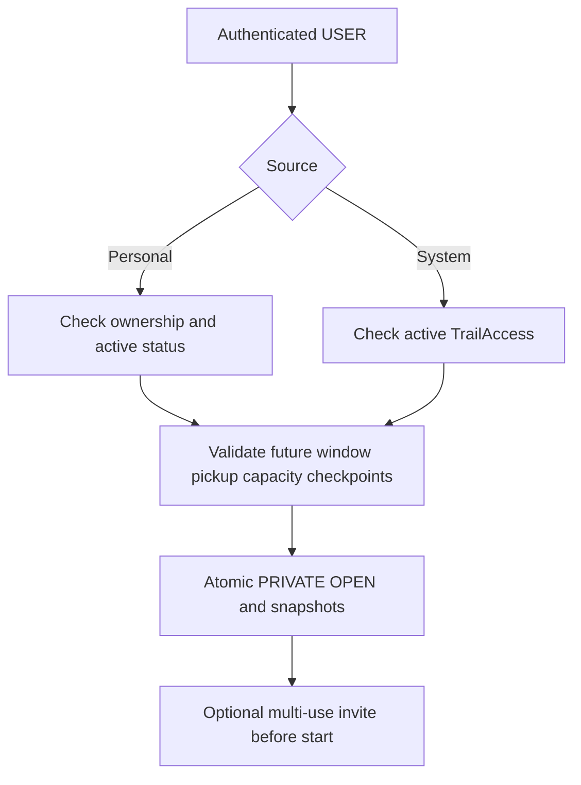
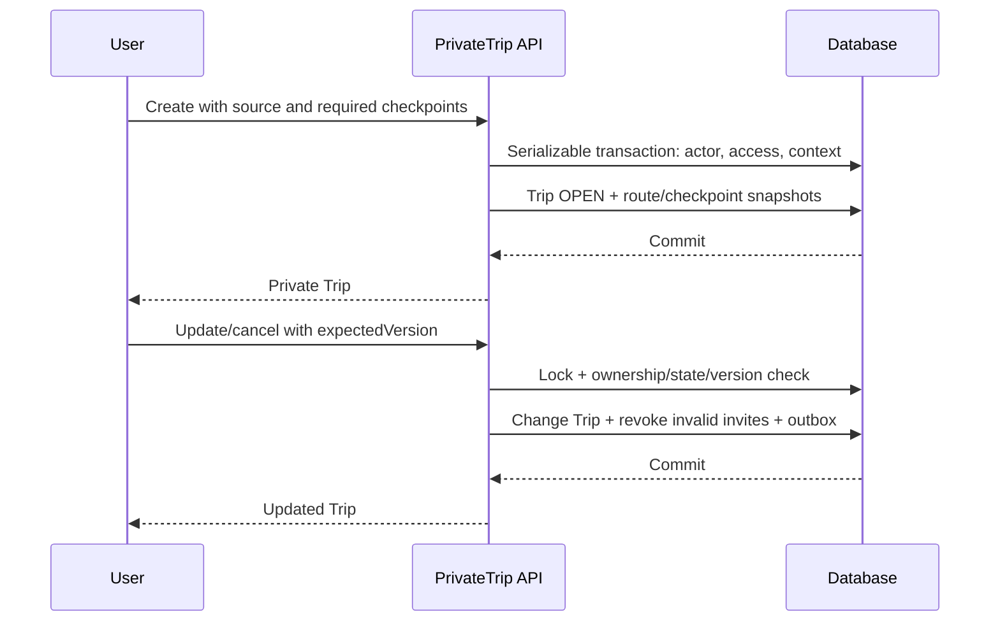
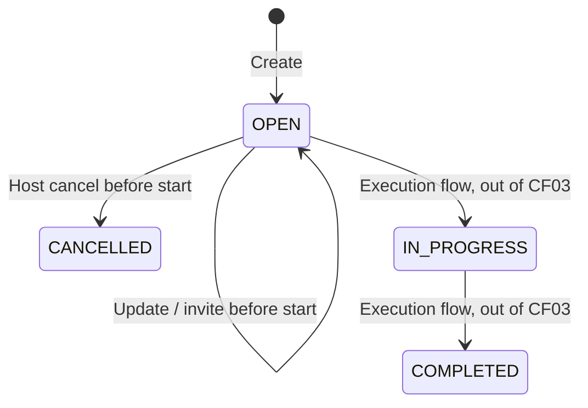

# CF03 — User Create Private Trip

## Scope and decisions

- Create directly OPEN; require >= 1 checkpoint in source trail order, no duplicate IDs.
- Only an ACTIVE USER may create/manage; no LEADER, ADMIN or staff bypass.
- Creator is Host via Trip.creatorId. Creation does not insert TripMember, Booking or Payment. Joining and eligibility are CF04, not CF03. Host membership/seat treatment remains for CF04; capacity enforcement here never permits fewer slots than existing ACTIVE TripMember rows.
- Personal source must belong to the current user, be ACTIVE and not archived. System source requires ACTIVE, non-revoked TrailAccess and active, non-archived trail. No copying trails into user ownership.
- Source snapshot is immutable in CF03 updates; changing route while executing belongs to execution flow. Personal trail without destination requires an explicit active destination; pickup must belong to it. Optional personal difficulty remains null instead of inventing a value.
- Required checkpoints are selected from the source trail, server snapshots coordinates/content in source order. Future source edits do not alter existing snapshots.
- Host may change title, description, time, pickup, capacity before start while OPEN. Optimistic expectedVersion and serializable transactions protect concurrent actions. All writes recheck actor role/status in DB.
- Cancellation is immediate CANCELLED (no admin approval) and revokes active invitations. Reschedule revokes invites that would expire at/after the new start.
- Invitations are multi-use (maxUses=null), 256-bit random codes, expiry strictly between now and start. Default expiry is min(now+7 days,start-1 second). Regeneration revokes previous active codes; version increments prevent stale concurrent regeneration. CF04 must enforce capacity/status/expiry atomically when redeeming.

## Schema impact

Existing Trip, PrivateTripInvite, TripMember, TrailAccess and BookingOutboxEvent are reused.
New migration `20260928120000_cf03_private_trip_sources` adds PersonalTrail/PersonalCheckpoint foreign keys to snapshot tables, permits null system source/difficulty, and checks exactly one route source / at most one checkpoint source. Existing system snapshots remain unchanged. CF01 migration is a prerequisite. No existing migrations were edited.

## API

All routes below require shared Bearer authentication; global prefix `/api/v1` is added by main.ts. Success responses are the returned JSON, errors use shared `{error:{code,message,details,retryable},meta:{requestId,serverTime,contractVersion}}`.

| Method | Path | Purpose |
| --- | --- | --- |
| GET | /me/personal-trails?page=1 | Active personal trails + ordered checkpoints |
| GET | /me/trail-accesses?page=1 | Active purchased access + system trail/checkpoints |
| GET | /trails/:trailId/access | Access check, no private master route exposure |
| GET | /private-trip-options/pickup-points?destinationId=UUID&page=1 | Active pickup choices |
| POST | /private-trips | Create OPEN, snapshot plan/checkpoints |
| GET | /private-trips?page=1 | Current host's private trips |
| GET | /private-trips/:id | Host-only trip detail |
| PATCH | /private-trips/:id | Update allowed fields with expectedVersion |
| POST | /private-trips/:id/invitations | Generate/regenerate; expectedVersion, expiresAt optional |
| POST | /private-trips/:id/invitations/revoke | Revoke active invitations; expectedVersion |
| POST | /private-trips/:id/cancel | Cancel; expectedVersion, reason optional |

Create payload: `{type:"PERSONAL"|"SYSTEM",trailRef,destinationId,title,description?,startAt,endAt,pickupPointId,capacity,checkpointIds}`. Times are ISO8601 with timezone. Paging is 20 rows. Swagger includes command body schemas. Invalid payload uses shared ZodValidationPipe; business errors use registered AppError codes.

## Downstream boundary

PRIVATE_TRIP_UPDATED and PRIVATE_TRIP_CANCELLED are inserted into BookingOutboxEvent in the same transaction, with tripId, creatorId, old/new time windows, status, version and optional cancellation reason. Unique deduplicationKey = eventType:tripId:version.
Events are persisted PENDING, not claimed delivered. Rental/GPS consumer/dispatcher is an integration dependency outside this change. CF03 does not silently change reservations, issue refunds or start GPS. Events are written even when no dependency exists so consumers can safely no-op.

## Web and verification

- `/private-trips`: source/checkpoint selection, create, host list, update, invite regeneration/revocation, cancel. Reuses auth store and Axios; reads shared error envelope. Existing auth is still mocked in the shared feature, so real-token browser acceptance depends on the auth owner. No auth bypass is introduced.
- One test file `test/cf03.spec.ts`: database integration and global error contract. Auth boundary is fixture-only, not a real Supabase test. Run `npm run test:cf03` with `CF03_TEST_DATABASE_URL=postgresql://...@127.0.0.1:PORT/cf03_test`; test refuses remote databases. Run `prisma migrate deploy` against that isolated DB first.
- Deploy production with `prisma migrate deploy` only after checking pending history and schema; never db push/reset production. Application deployment is separate from migration deployment.

## Diagrams

Verification on 2026-09-28: CF03 integration/HTTP tests 10/10 pass; existing API unit tests 26/26 pass; API TypeScript and targeted lint pass. CF03 web files have zero TypeScript diagnostics and pass targeted lint. Full web compilation is blocked by existing BookingFlow/BookingForm.tsx syntax error (and other pre-existing project diagnostics), so browser end-to-end acceptance is not claimed.

Production migration deploy applied the previously missing `20260927120000_cf01_trip_planning` and new CF03 migration successfully. Counts for trips, plans, checkpoints and bookings were all zero before and after; both new CHECK constraints were verified. No production fixture data was inserted. This does not deploy the API/web application or connect downstream consumers.

