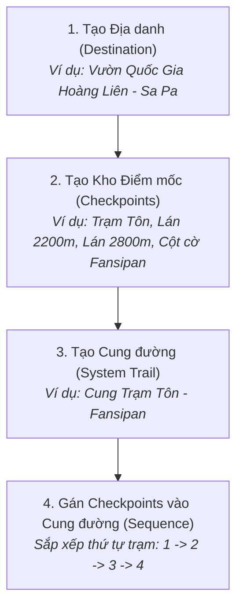

# Hướng Dẫn Sử Dụng API: Destination, Checkpoint & System Trail

Tài liệu này cung cấp đầy đủ hướng dẫn thực tế, luồng nghiệp vụ và các mẫu Request / Response JSON để kiểm thử và tích hợp các API quản lý Địa danh (**Destination**), Điểm mốc dừng chân (**Checkpoint**) và Cung đường trekking hệ thống (**System Trail**) trong hệ thống **Vina_TrekGO**.

---

## 📌 1. Tổng quan & Luồng Nghiệp Vụ Chuẩn (Workflow)

Trong hệ sinh thái TrekGO, dữ liệu địa lý trekking được tổ chức theo cấu trúc phân cấp:



### Phân quyền (RBAC)
- **Public (Không cần Token)**: Xem danh sách và chi tiết (`GET`). Khách trekking hoặc người dùng vãng lai có thể xem bản đồ.
- **Yêu cầu ADMIN (`Bearer Token`)**: Tạo mới (`POST`), Cập nhật (`PATCH`), Vô hiệu hóa (`DELETE`).

### Môi trường API
- **Base URL**: `http://localhost:3000/api/v1`
- **Swagger UI**: `http://localhost:3000/docs`
- **Header xác thực Admin**:
  ```http
  Authorization: Bearer <ADMIN_JWT_TOKEN>
  Content-Type: application/json
  ```

---

## 🗺️ 2. Module 1: Destination (Địa danh / Điểm đến)

Quản lý các khu vực địa danh trekking lớn (ví dụ: Fansipan, Tà Xùa, Núi Bà Đen, Bidoup Núi Bà,...).

### 2.1. Lấy danh sách Destination (Public)
- **Method**: `GET`
- **URL**: `{{baseUrl}}/destinations`
- **Query Parameters**:
  - `page`: Trang hiện tại (mặc định: `1`)
  - `pageSize`: Số bản ghi/trang (mặc định: `20`, tối đa `100`)
  - `status`: Lọc theo trạng thái (`ACTIVE` | `INACTIVE` | `ARCHIVED`, mặc định `ACTIVE`)
  - `region`: Lọc theo vùng (`NORTH` | `CENTRAL` | `SOUTH`)
  - `keyword`: Tìm kiếm theo tên hoặc mô tả

**Ví dụ Request:**
```http
GET http://localhost:3000/api/v1/destinations?page=1&pageSize=20&status=ACTIVE&region=NORTH
```

**Response mẫu (200 OK):**
```json
{
  "items": [
    {
      "id": "33333333-3333-3333-3333-333333333333",
      "name": "Vườn Quốc Gia Hoàng Liên - Sa Pa",
      "description": "Dãy Hoàng Liên Sơn hùng vĩ với nóc nhà Đông Dương Fansipan cao 3.143m",
      "region": "NORTH",
      "centerLat": 22.3512,
      "centerLng": 103.7745,
      "status": "ACTIVE",
      "trailCount": 2,
      "createdAt": "2026-03-01T08:00:00.000Z",
      "updatedAt": "2026-03-01T08:00:00.000Z"
    }
  ],
  "pagination": {
    "page": 1,
    "pageSize": 20,
    "totalItems": 1,
    "totalPages": 1
  }
}
```

---

### 2.2. Lấy chi tiết Destination theo ID (Public)
- **Method**: `GET`
- **URL**: `{{baseUrl}}/destinations/{destinationId}`

**Ví dụ Request:**
```http
GET http://localhost:3000/api/v1/destinations/33333333-3333-3333-3333-333333333333
```

---

### 2.3. Tạo Destination mới (Yêu cầu ADMIN)
- **Method**: `POST`
- **URL**: `{{baseUrl}}/destinations`
- **Header**: `Authorization: Bearer {{adminToken}}`

**Request Body:**
```json
{
  "name": "Núi Tà Xùa - Bắc Yên",
  "description": "Thiên đường săn mây Bắc Yên, Sơn La với sống lưng khủng long nổi tiếng",
  "region": "NORTH",
  "centerLat": 21.2833,
  "centerLng": 104.3833,
  "status": "ACTIVE"
}
```

**Response mẫu (201 Created):**
```json
{
  "id": "a1b2c3d4-0000-4000-8000-000000000001",
  "name": "Núi Tà Xùa - Bắc Yên",
  "description": "Thiên đường săn mây Bắc Yên, Sơn La với sống lưng khủng long nổi tiếng",
  "region": "NORTH",
  "centerLat": 21.2833,
  "centerLng": 104.3833,
  "status": "ACTIVE",
  "trailCount": 0,
  "createdAt": "2026-10-02T15:00:00.000Z",
  "updatedAt": "2026-10-02T15:00:00.000Z"
}
```

---

### 2.4. Cập nhật thông tin Destination (Yêu cầu ADMIN)
- **Method**: `PATCH`
- **URL**: `{{baseUrl}}/destinations/{destinationId}`
- **Header**: `Authorization: Bearer {{adminToken}}`

**Request Body:** *(Chỉ cần truyền các trường muốn thay đổi)*
```json
{
  "name": "Khu Bảo Tồn Núi Tà Xùa",
  "description": "Đỉnh Tà Xùa cao 2.865m, ranh giới tự nhiên giữa Sơn La và Yên Bái",
  "status": "ACTIVE"
}
```

---

### 2.5. Vô hiệu hóa Destination (Yêu cầu ADMIN)
- **Method**: `DELETE`
- **URL**: `{{baseUrl}}/destinations/{destinationId}`
- **Header**: `Authorization: Bearer {{adminToken}}`
- **Lưu ý bảo vệ dữ liệu**: Nếu địa danh đang có cung đường (`trailCount > 0`) hoặc chuyến đi liên kết, hệ thống sẽ trả về lỗi `400 Bad Request` để ngăn chặn xóa nhầm.

**Response mẫu (200 OK):**
```json
{
  "success": true,
  "message": "Đã vô hiệu hóa địa danh 'Khu Bảo Tồn Núi Tà Xùa' thành công"
}
```

---

## 📍 3. Module 2: Checkpoint (Trạm dừng chân / Điểm mốc GPS)

Quản lý các tọa độ mốc kiểm soát, trạm nghỉ chân, nguồn nước, điểm cắm trại hoặc đỉnh núi thuộc về một Destination.

### 3.1. Lấy danh sách Checkpoints theo Destination (Public)
- **Method**: `GET`
- **URL**: `{{baseUrl}}/checkpoints`
- **Query Parameters**:
  - `destinationId`: **Bắt buộc** (UUID của Destination)
  - `checkpointType`: Lọc theo loại (`START` | `CAMPSITE` | `SUMMIT` | `WATER_SOURCE` | `VIEWPOINT` | `END`)
  - `status`: Lọc theo trạng thái (`ACTIVE` | `INACTIVE` | `ARCHIVED`)
  - `keyword`: Tìm theo tên hoặc mã trạm (`code`)
  - `page`, `pageSize`: Phân trang

**Ví dụ Request:**
```http
GET http://localhost:3000/api/v1/checkpoints?destinationId=33333333-3333-3333-3333-333333333333&page=1&pageSize=20&status=ACTIVE
```

**Response mẫu (200 OK):**
```json
{
  "items": [
    {
      "id": "77777777-7777-7777-7777-777777777771",
      "destinationId": "33333333-3333-3333-3333-333333333333",
      "code": "CKP-FAN-2800",
      "name": "Trạm dừng chân 2.800m",
      "description": "Lán nghỉ hạ trại và trạm tiếp nước chính",
      "latitude": 22.3155,
      "longitude": 103.7745,
      "defaultRadiusMeters": 50,
      "checkpointType": "CAMPSITE",
      "status": "ACTIVE",
      "trailCount": 1,
      "destination": {
        "id": "33333333-3333-3333-3333-333333333333",
        "name": "Vườn Quốc Gia Hoàng Liên - Sa Pa",
        "region": "NORTH"
      },
      "createdAt": "2026-10-02T15:00:00.000Z",
      "updatedAt": "2026-10-02T15:00:00.000Z"
    }
  ],
  "pagination": {
    "page": 1,
    "pageSize": 20,
    "totalItems": 1,
    "totalPages": 1
  }
}
```

---

### 3.2. Lấy chi tiết Checkpoint theo ID (Public)
- **Method**: `GET`
- **URL**: `{{baseUrl}}/checkpoints/{checkpointId}`

---

### 3.3. Tạo Checkpoint mới (Yêu cầu ADMIN)
- **Method**: `POST`
- **URL**: `{{baseUrl}}/checkpoints`
- **Header**: `Authorization: Bearer {{adminToken}}`

**Request Body:**
```json
{
  "destinationId": "33333333-3333-3333-3333-333333333333",
  "code": "CKP-FAN-DINH",
  "name": "Đỉnh Cột Cờ Fansipan (3.143m)",
  "description": "Nóc nhà Đông Dương, điểm check-in đích đến của toàn bộ hành trình",
  "latitude": 22.3033,
  "longitude": 103.7753,
  "defaultRadiusMeters": 50,
  "checkpointType": "SUMMIT",
  "status": "ACTIVE"
}
```

> **Ghi chú các loại `checkpointType` hợp lệ:**
> - `START`: Điểm xuất phát
> - `CAMPSITE`: Điểm cắm trại / hạ trại
> - `SUMMIT`: Đỉnh núi
> - `WATER_SOURCE`: Trạm tiếp nước / nguồn suối
> - `VIEWPOINT`: Điểm ngắm cảnh / sống ảo
> - `END`: Điểm kết thúc hành trình

---

### 3.4. Cập nhật Checkpoint (Yêu cầu ADMIN)
- **Method**: `PATCH`
- **URL**: `{{baseUrl}}/checkpoints/{checkpointId}`
- **Header**: `Authorization: Bearer {{adminToken}}`

**Request Body:**
```json
{
  "name": "Đỉnh Cột Cờ Fansipan (Mốc 3.143m - Đã cải tạo)",
  "defaultRadiusMeters": 60,
  "checkpointType": "SUMMIT",
  "status": "ACTIVE"
}
```

---

### 3.5. Vô hiệu hóa Checkpoint (Yêu cầu ADMIN)
- **Method**: `DELETE`
- **URL**: `{{baseUrl}}/checkpoints/{checkpointId}`
- **Header**: `Authorization: Bearer {{adminToken}}`
- **Quy tắc an toàn**: Nếu checkpoint này đang nằm trong bất kỳ cung đường `SystemTrail` nào, backend sẽ từ chối xóa và báo danh sách liên kết đang phụ thuộc.

---

## 🥾 4. Module 3: System Trail (Cung đường hệ thống)

Quản lý các tuyến đường trekking chính thức của hệ thống (kèm toạ độ GeoJSON để hiển thị bản đồ 3D MapLibre).

### 4.1. Lấy danh sách System Trails (Public)
- **Method**: `GET`
- **URL**: `{{baseUrl}}/system-trails`
- **Query Parameters**:
  - `destinationId`: Lọc theo Địa danh
  - `difficulty`: Lọc theo độ khó (`EASY` | `MEDIUM` | `HARD` | `EXTREME`)
  - `minDistance`, `maxDistance`: Lọc theo cự ly (km)
  - `keyword`: Tìm theo tên hoặc mã code
  - `page`, `pageSize`: Phân trang

**Ví dụ Request:**
```http
GET http://localhost:3000/api/v1/system-trails?destinationId=33333333-3333-3333-3333-333333333333&page=1&pageSize=20&status=ACTIVE
```

---

### 4.2. Lấy chi tiết System Trail theo ID (Public)
- **Method**: `GET`
- **URL**: `{{baseUrl}}/system-trails/{trailId}`

**Response mẫu (200 OK):**
```json
{
  "id": "5555aaaa-1111-1111-1111-111111111111",
  "code": "TRAIL-FAN-TRAMTON-01",
  "name": "Cung Trạm Tôn - Đỉnh Fansipan (2 Ngày 1 Đêm)",
  "difficulty": "MEDIUM",
  "distanceKm": 11.5,
  "elevationGainM": 1243,
  "estimatedDurationMinutes": 480,
  "price": 150000,
  "status": "ACTIVE",
  "checkpointCount": 1,
  "checkpoints": [
    {
      "checkpointId": "77777777-7777-7777-7777-777777777771",
      "sequence": 1,
      "isRequired": true,
      "name": "Trạm dừng chân 2.800m",
      "latitude": 22.3155,
      "longitude": 103.7745,
      "radiusMeters": 50,
      "checkpointType": "CAMPSITE"
    }
  ]
}
```

---

### 4.3. Tạo System Trail mới (Yêu cầu ADMIN)
- **Method**: `POST`
- **URL**: `{{baseUrl}}/system-trails`
- **Header**: `Authorization: Bearer {{adminToken}}`

> **Lưu ý**: Khi tạo mới cung đường, bạn **không cần truyền checkpoints** (danh sách trạm có thể gán sau qua lệnh PATCH).

**Request Body:**
```json
{
  "destinationId": "33333333-3333-3333-3333-333333333333",
  "code": "TRAIL-FAN-TRAMTON-01",
  "name": "Cung Trạm Tôn - Đỉnh Fansipan (2 Ngày 1 Đêm)",
  "description": "Cung đường chinh phục đỉnh Fansipan phổ biến nhất, xuất phát từ Trạm Tôn lên đỉnh.",
  "difficulty": "MEDIUM",
  "distanceKm": 11.5,
  "elevationGainM": 1243,
  "estimatedDurationMinutes": 480,
  "price": 150000,
  "status": "ACTIVE",
  "routeGeojson": {
    "type": "FeatureCollection",
    "features": [
      {
        "type": "Feature",
        "geometry": {
          "type": "LineString",
          "coordinates": [
            [103.7745678, 22.3512345],
            [103.7745, 22.3155],
            [103.7753, 22.3033]
          ]
        },
        "properties": {
          "name": "Tuyến đường Trạm Tôn lên Đỉnh"
        }
      }
    ]
  }
}
```

---

### 4.4. Gán Checkpoints hoặc Cập nhật Cung đường (Yêu cầu ADMIN)
- **Method**: `PATCH`
- **URL**: `{{baseUrl}}/system-trails/{trailId}`
- **Header**: `Authorization: Bearer {{adminToken}}`

Sau khi đã tạo xong các Checkpoint riêng lẻ, bạn dùng API này để **gán danh sách Checkpoint theo thứ tự di chuyển (`sequence`)**:

**Request Body:**
```json
{
  "name": "Cung Trạm Tôn - Đỉnh Fansipan (Lộ trình chuẩn)",
  "price": 180000,
  "checkpoints": [
    {
      "checkpointId": "77777777-7777-7777-7777-777777777771",
      "sequence": 1,
      "isRequired": true
    },
    {
      "checkpointId": "77777777-7777-7777-7777-777777777772",
      "sequence": 2,
      "isRequired": true
    }
  ]
}
```

---

### 4.5. Vô hiệu hóa System Trail (Yêu cầu ADMIN)
- **Method**: `DELETE`
- **URL**: `{{baseUrl}}/system-trails/{trailId}`
- **Header**: `Authorization: Bearer {{adminToken}}`

---

## ⚠️ 5. Bảng Mã Lỗi Phổ Biến & Cách Xử Lý

| HTTP Status | Mã lỗi (`error.code`) | Nguyên nhân | Cách khắc phục |
| :---: | :--- | :--- | :--- |
| `400` | `VALIDATION_ERROR` | Dữ liệu gửi lên sai định dạng Zod (thiếu trường bắt buộc, sai UUID, vĩ độ/kinh độ ngoài phạm vi) hoặc sai cú pháp JSON (dấu phẩy thừa ở cuối). | Kiểm tra lại chi tiết trong trường `error.details` để sửa đúng định dạng. |
| `401` | `UNAUTHORIZED` | Không có Bearer Token hoặc Token đã hết hạn. | Đăng nhập tài khoản Admin và truyền header `Authorization: Bearer <TOKEN>`. |
| `403` | `FORBIDDEN` | Tài khoản đăng nhập không có quyền `ADMIN`. | Kiểm tra role tài khoản trong DB bảng `users` (`role = 'ADMIN'`). |
| `404` | `NOT_FOUND` | Không tìm thấy Destination / Checkpoint / Trail với ID đã truyền. | Kiểm tra lại UUID đã tạo trong cơ sở dữ liệu. |
| `409` | `CONFLICT` | Mã định danh (`code`) của Checkpoint hoặc Trail bị trùng lặp. | Đặt lại mã `code` duy nhất khác. |
| `400` | `BAD_REQUEST` | Xóa đối tượng đang có liên kết phụ thuộc (vd: xóa Destination đang chứa Trail). | Gỡ bỏ hoặc hoàn thành các liên kết trước khi xóa mềm. |
