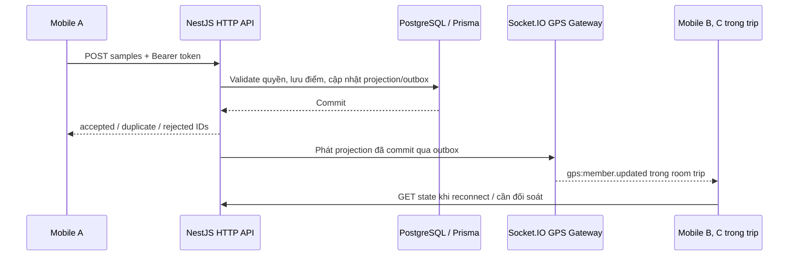

# GPS trong public trip và private trip — nghiệp vụ và contract BE/mobile

Phiên bản thiết kế: `trip-gps/1.0.0` · Cập nhật: 18/10/2026.

**Trạng thái: đặc tả đề xuất để triển khai, chưa phải API đã có hoặc đã deploy.** Tài liệu dựa trên backend trong `api/` và các cập nhật của chủ dự án. Không dùng thư mục `mobile/` hiện tại làm căn cứ cho ứng dụng mobile chính thức ở repo khác.

Định nghĩa đầy đủ request, response và Socket.IO payload được nhúng trực tiếp tại mục 19 của tài liệu này. Bản có thể chuyển sang repo mobile: [trip-gps.contract.ts](./trip-gps.contract.ts). TypeScript ở đây mô tả JSON contract, không bắt buộc mobile sử dụng React Native hay TypeScript; Flutter/native có thể ánh xạ sang model tương ứng.

## 1. Quy tắc đã được xác nhận và giả định thiết kế

### 1.1. Đã xác nhận bởi chủ dự án

1. GPS áp dụng cho cả public trip và private trip.
2. Private trip đã chọn nguồn tuyến khi tạo: `PERSONAL` hoặc `SYSTEM`. Khi bắt đầu GPS không chọn lại loại tuyến.
3. Private trip dùng personal trail **bắt buộc chọn ít nhất một checkpoint hợp lệ của personal trail**. Trail chưa có checkpoint chưa thể dùng để tạo private trip; chủ trail bổ sung checkpoint trước khi tạo chuyến.
4. Private trip dùng system trail cũng bắt buộc chọn ít nhất một checkpoint. Với cả hai nguồn tuyến private, đến vùng bán kính checkpoint là hoàn thành checkpoint đó; không yêu cầu trả lời câu hỏi, ảnh minh chứng hoặc host xác nhận thêm trong luồng này.
5. Mỗi người chỉ được xác nhận đi qua mỗi checkpoint một lần trong cùng trip, kể cả đổi phiên GPS hoặc quay lại checkpoint.
6. Tất cả người tham gia hợp lệ xem được vị trí của tất cả người tham gia trong trip, gồm host/leader khi họ có gửi vị trí.
7. Đường kết quả nối liên tục qua khoảng tạm dừng hoặc mất tín hiệu, lưu theo từng người trong `TripActualRoute`.

### 1.2. Giả định đề xuất cho bản v1

Các quyết định dưới đây chưa được chủ dự án xác nhận riêng; được đặt thành phương án cụ thể để hai phía có thể triển khai thống nhất:

| Vấn đề | Phương án v1 đề xuất |
|---|---|
| Thời điểm bắt đầu ghi | Trip phải `IN_PROGRESS`; tài khoản và tư cách tham gia còn hợp lệ |
| Bắt buộc điểm danh/check-in | Chưa dùng làm điều kiện GPS riêng trong v1; GPS không tự điểm danh/check-in |
| Bắt đầu phiên hoàn toàn offline | Chưa hỗ trợ; cần online để mở phiên, sau đó được ghi offline |
| Sau khi bấm kết thúc | Không mở lại phiên trong cùng trip; hỗ trợ resume trước khi finish |
| Phiên cũ do khôi phục/hệ thống | Kết quả vẫn có khả năng tổng hợp nhiều phiên thuộc cùng user/trip |
| Điện thoại cùng ghi | Một thiết bị ghi cho một phiên; thiết bị khác vẫn được xem bản đồ |
| Tham gia đồng thời nhiều trip | Một user chỉ có một phiên `ACTIVE/PAUSED` trên toàn hệ thống |
| Thứ tự checkpoint private/system | Sequence phục vụ hiển thị; đến checkpoint nào xác nhận checkpoint đó, không chặn vì chưa qua checkpoint trước |
| Chia sẻ đường lịch sử | Cả đoàn xem vị trí gần nhất và tiến độ; v1 chỉ người sở hữu xem/tải toàn bộ đường của mình |
| Sau khi trip kết thúc | Ngừng phát vị trí trực tiếp; người tham gia lịch sử còn hợp lệ xem snapshot cuối, mỗi người xem kết quả của mình |
| Public checkpoint | GPS xác nhận **đã đến**; không thay điều kiện nhiệm vụ/hoàn thành checkpoint public đang do module checkpoint quản lý |
| Cách tính khoảng nối | Cộng khoảng cách thẳng giữa hai điểm hợp lệ liên tiếp, kể cả khoảng pause/mất tín hiệu; công bố đây là số ước tính |

Nếu muốn checkpoint public cũng chỉ cần vào vùng là hoàn thành, cần cập nhật quy tắc của module checkpoint public tương ứng. Không tự xóa điều kiện nhiệm vụ của module khác dựa trên thay đổi dành cho private trip.

## 2. Mục tiêu và ranh giới nghiệp vụ

Mỗi user có phiên ghi riêng, vị trí riêng, tiến độ checkpoint riêng và kết quả riêng theo `(tripId, userId)`. Đường leader/host không đại diện cho hành trình của thành viên khác.

Tuyến dự kiến lấy từ snapshot `TripTrailPlan` của trip, không lấy trực tiếp bản trail có thể bị sửa sau khi tạo chuyến. Public trip có thể có nhiều plan; nếu có `TripActiveTrailPlan`, dùng plan hiện hành để đánh giá lệch tuyến. Nếu chưa có active plan, dùng plan đầu tiên theo sequence; tuyến không có geometry dùng được thì trạng thái lệch tuyến là `NOT_APPLICABLE`.

GPS không tự thay đổi booking, thanh toán, membership, attendance hoặc kết quả hoàn thành trip. Việc kết thúc ghi chỉ kết thúc phiên cá nhân. Không bật GPS, từ chối quyền vị trí hoặc hết pin không tự biến người đó thành `NO_SHOW`.

## 3. Luồng private trip

### 3.1. Private trip dùng personal trail

1. Host tạo trip và chọn personal trail; lưu geometry snapshot của tuyến.
2. Host bắt buộc chọn ít nhất một checkpoint hợp lệ từ PersonalCheckpoint theo thứ tự tuyến, không trùng; chụp dữ liệu sang TripCheckpoint của chuyến đi. Trail chưa có checkpoint thì chặn tạo trip và hướng dẫn bổ sung checkpoint cho trail trước.
3. Host/thành viên vào phòng qua membership hiện có; host bắt đầu trip qua nghiệp vụ vòng đời trip.
4. Mỗi người tự cấp quyền vị trí và bấm bắt đầu ghi.
5. Mỗi người thấy tuyến dự kiến, đường mình đang ghi và vị trí gần nhất của cả đoàn.
6. Có thể phát hiện lệch tuyến nếu snapshot personal trail có geometry hợp lệ.
7. Hiển thị tiến độ checkpoint; dùng quy tắc vào vùng và xác nhận một lần cho mỗi user/trip/checkpoint như private system trail.
8. Khi kết thúc ghi, tổng hợp đường nối liền và lưu `TripActualRoute` của chính người đó.

Chỉ các checkpoint được chọn vào trip mới tham gia tính tiến độ; không tự động đưa mọi điểm đánh dấu của personal trail vào chuyến đi. Bỏ checkpointIds, gửi mảng rỗng hoặc chọn checkpoint không thuộc trail đều không được tạo trip. Việc thêm chức năng cập nhật checkpoint cho personal trail là hạng mục sau, không tự tạo checkpoint giả để vượt điều kiện này.

### 3.2. Private trip dùng system trail

1. Host chọn system trail và checkpoint thuộc tuyến khi tạo trip; chụp tên, vị trí, bán kính và sequence vào trip.
2. Khi trip đang diễn ra, mọi thành viên hợp lệ được tự ghi và xem vị trí cả đoàn.
3. Backend xét từng điểm GPS được chấp nhận với các checkpoint đang bật của trip.
4. Với điểm đủ độ chính xác, nếu `distance(point, checkpointCenter) <= radiusMeters`, ghi nhận đến checkpoint.
5. Một điểm có thể xác nhận nhiều checkpoint nếu các vùng chồng nhau; không có quy tắc chỉ chọn một checkpoint gần nhất trong v1.
6. Một người qua checkpoint không tự hoàn thành checkpoint cho cả đoàn.
7. Dùng unique `(tripId, tripCheckpointId, userId)` để bảo đảm chỉ ghi nhận một lần, kể cả request đồng thời hoặc retry.
8. Kết thúc ghi không cần đợi tất cả checkpoint. Kết quả thể hiện rõ đã qua bao nhiêu checkpoint; không ép thành 100%.

Không suy ra đã qua checkpoint từ đường nối qua vùng mất tín hiệu. Chỉ điểm GPS thực tế được chấp nhận mới là bằng chứng đến vùng. `arrivalAt` là thời điểm điểm GPS hợp lệ đầu tiên nằm trong vùng, không phải lúc upload. Nếu điểm cũ đến muộn chứng minh thời điểm sớm hơn, cập nhật thời điểm bằng `min`, không tạo lần hoàn thành thứ hai.

## 4. Luồng public trip

1. Leader được phân công và người tham gia hợp lệ vào màn hình bản đồ.
2. Người tham gia được xác định bằng `BookingParticipant.userId`, trạng thái participant và trạng thái booking tương ứng. Không cấp quyền chỉ vì user là người đặt booking cho nhóm.
3. Booking nằm trong các trạng thái cho phép như `CONFIRMED`, `PARTIAL_CHECKIN`, `CHECKED_IN`; người tham gia phải `ACTIVE`. Khi xem lịch sử, cho phép booking `COMPLETED` và participant `ACTIVE/COMPLETED` còn quyền lịch sử. Private tương ứng dùng membership `ACTIVE/COMPLETED`; không cho `LEFT/REMOVED/NO_SHOW`.
4. Leader được phân công có quyền tham gia GPS dù không có booking. Người tạo public trip chỉ có quyền nếu đồng thời là leader được phân công hoặc participant hợp lệ.
5. Trip chuyển sang `IN_PROGRESS` qua nghiệp vụ trip; mỗi người chủ động bắt đầu ghi.
6. Tất cả người tham gia xem vị trí cả đoàn như private trip; leader không có độc quyền xem.
7. GPS xác nhận đến các `TripCheckpoint` đang bật, theo cùng quy tắc bán kính và chống trùng.
8. Nếu public checkpoint có nhiệm vụ, phần `arrivedCheckpointIds` chỉ thể hiện đã đến. Hoàn thành nhiệm vụ và hoàn thành trip vẫn do module nghiệp vụ hiện có quyết định.
9. Mỗi người kết thúc ghi và có `TripActualRoute` riêng.

Participant không có tài khoản (`userId=null`) không có GPS cá nhân trên ứng dụng. Người đặt hộ không được gửi GPS thay; trên roster GPS chỉ liệt kê các tài khoản có thể sử dụng GPS, không tạo marker giả cho khách không có tài khoản.

## 5. Quyền xem, ghi và thu hồi quyền

| Đối tượng | Xem vị trí cả đoàn | Ghi cho mình | Điều khiển phiên người khác |
|---|---|---|---|
| Private host/member hợp lệ | Có | Có khi trip đang diễn ra | Không |
| Public leader được phân công | Có | Có khi trip đang diễn ra | Không |
| Public participant hợp lệ có tài khoản | Có | Có khi trip đang diễn ra | Không |
| Người đặt hộ nhưng không tham gia | Không | Không | Không |
| Người ngoài, `LEFT`, `REMOVED`, participant bị hủy | Không | Không | Không |
| Admin không thuộc đoàn | Không tự động qua GPS API | Không | Không |

Không cần cấp quyền GPS thiết bị để **xem** vị trí đoàn. Người chưa bật GPS vẫn xuất hiện với `NO_DATA`; các thành viên khác không thể xem một tọa độ chưa từng được thu.

Backend xác thực Supabase access token rồi ánh xạ sang `users.id` nội bộ, giống HTTP guard hiện có. Không dùng `authUserId` làm `GpsSession.userId`. Mọi thao tác ghi lấy user từ token, không nhận `userId` trong body.

Kiểm tra quyền tại HTTP request, socket subscribe và khi tư cách tham gia thay đổi. Khi mất quyền: dừng phiên đang mở theo thời điểm thu hồi, loại socket của user khỏi phòng trên mọi instance, gửi `gps:access.revoked` tới socket cá nhân, mobile xóa vị trí đoàn đã cache. Không cho upload muộn sau khi mất quyền trong v1. Quyền lịch sử của người bị loại không được tự khôi phục khi trip hoàn tất.

## 6. Vòng đời ghi, mất mạng và kết thúc

```text
Chưa có phiên --start online--> ACTIVE --pause--> PAUSED
                                  ^                |
                                  +----resume------+
ACTIVE/PAUSED --finish hoặc trip kết thúc--> STOPPED
```

### 6.1. Bắt đầu và điều khiển

- `start` trả thời điểm server làm `startedAt`, khóa policy cho phiên và bind `deviceId`.
- `clientSessionId` ổn định khi retry; cùng key/body trả cùng phiên, không tạo lại. Cùng key khác body trả conflict.
- Nếu có phiên mở cùng trip/thiết bị, trả phiên đó; ở thiết bị khác trả `GPS_DEVICE_CONFLICT`; trip khác trả `GPS_ACTIVE_SESSION_EXISTS`.
- `pause/resume/finish` dùng `commandId`, `expectedVersion`, `occurredAt`. Version chỉ tăng khi đổi trạng thái; upload điểm không tăng version điều khiển.
- Lưu command đã thực thi để retry trả đúng response cũ trước khi kiểm tra version/trạng thái mới. Cùng commandId với payload khác là conflict.
- Thời điểm điều khiển phải không trước thao tác điều khiển trước đó, không trước phiên, không vượt thời điểm server quá giới hạn lệch đồng hồ.
- Pause/resume phải được lưu thành các khoảng thời gian, không chỉ ghi đè enum; cần chúng để xử lý điểm offline đúng khoảng `ACTIVE`.

### 6.2. Hàng đợi mobile

Lưu bền vững tại máy cả điểm và thao tác điều khiển, không chỉ giữ trong RAM. Gửi tuần tự theo thời gian người dùng thao tác: upload các điểm trước pause, gửi pause, gửi resume, upload điểm sau resume, cuối cùng finish. Gán `expectedVersion` theo response thao tác trước khi gửi thao tác kế tiếp.

Khi offline, người dùng vẫn pause/resume/finish trên máy. UI ghi rõ trạng thái local và trạng thái chờ đồng bộ. Chỉ báo hoàn tất đồng bộ khi tất cả điểm đã được phân loại và server nhận finish. Không chỉ dựa vào việc socket đã reconnect.

Mất mạng không đổi `ACTIVE` thành `PAUSED`. Mất socket không có nghĩa GPS đã dừng. Mở lại app phải khôi phục phiên, điểm chưa gửi và pending commands; không tự mở phiên mới.

### 6.3. Trip kết thúc trước khi mobile đồng bộ

`COMPLETED` hoặc `INTERRUPTED` đóng phiên tại thời điểm kết thúc thực tế `T` của trip. Ngừng nhận điểm mới có `recordedAt > T`; vẫn nhận dữ liệu lịch sử có `recordedAt <= T` đến `T + lateSyncGraceSeconds`, nếu người gửi vẫn có quyền.

Pending pause/resume được phép bổ sung các khoảng lịch sử trước `T` trong thời hạn này, không chuyển phiên đã đóng trở lại `ACTIVE`. Mỗi command vẫn idempotent, tuần tự và có kiểm tra version; xung đột với thao tác đóng tự động trả `GPS_VERSION_CONFLICT`, mobile lấy lại phiên, giữ nguyên hàng đợi rồi gửi lại command chưa được áp dụng với version mới. Backend lưu lịch sử điều khiển và việc đóng tự động riêng để tái dựng interval.

User finish khi trip chưa kết thúc cũng đóng tại `occurredAt`; `uploadDeadline = endedAt + lateSyncGraceSeconds`. Chấp nhận upload bổ sung trước thời điểm đóng trong thời hạn này và dựng lại kết quả; không mở lại ghi. Một finish khác commandId trên phiên đã STOPPED trả snapshot hiện tại, không thay thời điểm kết thúc.

Trip `CANCELLED` hoặc membership bị thu hồi đóng phiên và không cho bổ sung điểm. Các kết quả đã lưu không bị xóa.

### 6.4. UI trạng thái vị trí

Ưu tiên `NO_DATA` nếu chưa có điểm; sau đó `STOPPED`/`PAUSED` theo phiên; nếu phiên active, suy ra `LIVE`, `STALE`, `OFFLINE` từ tuổi của `recordedAt`. `OFFLINE` ở đây nghĩa vị trí quá cũ, không khẳng định thiết bị đã ngắt Internet.

Mobile tự cập nhật nhãn tuổi dữ liệu theo đồng hồ đã hiệu chỉnh từ `serverTime`, không chờ một socket event mới. Marker cũ vẫn được thấy nhưng có nhãn “Cập nhật N phút trước”.

## 7. Chất lượng điểm, đường nối và quãng đường

### 7.1. Nhận điểm

- Toàn bộ payload phải đúng schema: UUID, ISO time, latitude `[-90,90]`, longitude `[-180,180]`, accuracy không âm, heading `[0,360)`, speed không âm nếu có. Thiếu field bắt buộc hoặc vượt batch limit trả HTTP 400, không nhận bất kỳ điểm nào trong request đó.
- Với payload hợp lệ, phân loại từng điểm: accepted, duplicate hoặc rejected. `accuracyM` bắt buộc; điểm vượt `maxAcceptedAccuracyM` không tính đường/checkpoint/marker.
- Chống trùng bằng `(sessionId, clientSampleId)`. Cùng ID khác nội dung trả reject `SAMPLE_ID_CONFLICT`; không ghi đè điểm cũ.
- Điểm nằm trong khoảng pause, trước phiên, sau khi đóng hoặc quá xa trong tương lai bị loại với lý do cụ thể.
- Sắp xếp accepted points theo `recordedAt`, tie-break bằng `clientSampleId`. Điểm đến muộn có thể làm thay đổi đường, quãng đường và arrivalAt.
- Phát hiện nhảy điểm chỉ so trong cùng khoảng ghi liên tục; không loại một điểm sau pause/mất tín hiệu dài chỉ vì cách xa điểm trước. Thuật toán và ngưỡng lọc nhảy cần cấu hình và thử bằng dữ liệu trekking trước khi bật production.
- Marker chỉ tiến lên theo thời gian ghi; upload điểm cũ không kéo vị trí thành viên về quá khứ. `lastSyncAt` không được dùng thay `recordedAt` để kết luận vị trí còn mới.

### 7.2. Đường hiển thị theo yêu cầu đã cập nhật

Khi có từ hai điểm hợp lệ, tạo **một GeoJSON `LineString`** nối tất cả điểm theo thứ tự. Không xuất `MultiLineString` chỉ vì pause/mất tín hiệu. Đường này lưu vào `TripActualRoute.routeGeojson` khi kết thúc.

Ví dụ: ghi A → B, tạm dừng, di chuyển đến C, tiếp tục ghi C → D. Kết quả hiển thị A → B → C → D; B → C là đoạn nối thẳng.

`totalDistanceMeters = Σ distance(point[i], point[i+1])`, dùng khoảng cách địa lý, làm tròn hai chữ số sau khi tổng hợp. Bao gồm B → C theo phương án v1. Đây là quãng đường ước tính trên polyline đã nối; GPS không chứng minh người dùng đã đi đúng đường thẳng trong khoảng thiếu dữ liệu. Không lấy khoảng cách tuyến dự kiến để tự bù.

Giữ `gapConnections` để biết đoạn nào được nối qua pause/mất tín hiệu; mobile vẫn vẽ liền cùng đường như yêu cầu. Metadata này phục vụ giải thích kết quả, không bắt buộc vẽ nét đứt.

Đường nối không được dùng để xác nhận checkpoint hoặc giả lập điểm GPS, tốc độ, cảnh báo lệch tuyến. Nếu chỉ có 0–1 điểm hợp lệ: trả `EMPTY`, geometry `null`, quãng đường `null`; không tạo LineString sai chuẩn. Điểm đơn vẫn có thể đã xác nhận checkpoint.

## 8. Lệch tuyến và checkpoint

### 8.1. Checkpoint

Chỉ xét điểm được chấp nhận và khoảng ACTIVE. Bán kính dùng snapshot của `TripCheckpoint`, fallback policy khi snapshot không có. Với v1, kiểm tra độ chính xác trước rồi so khoảng cách tâm; không tự mở rộng bán kính bằng accuracy.

Tiến độ private/system là `passed / total * 100`, làm tròn số nguyên. Không áp dụng checkpoint thì `percentage=null`, không trả 100%. Public chỉ số này cũng là tỷ lệ **đã đến**, không phải tỷ lệ hoàn thành nhiệm vụ.

Backend là nơi xác nhận chính thức. Mobile offline có thể đánh dấu “Chờ xác nhận”, không tự lưu completion chính thức. Dùng chung dịch vụ checkpoint hiện có qua port/use case phù hợp; không mở thêm một kho completion cạnh tranh.

### 8.2. Lệch tuyến

Đo khoảng cách tới geometry của active trail plan. Đủ `deviationConsecutiveSamples` liên tiếp vượt ngưỡng mới mở một sự kiện `DEVIATED`; cập nhật sự kiện đang mở thay vì tạo sự kiện mỗi điểm. Trở lại dưới `recoveryThresholdM` đủ số mẫu thì ghi `RECOVERED`. Khoảng pause, khoảng mất mẫu dài hoặc thay active plan reset chuỗi mẫu liên tiếp.

Điểm lịch sử vẫn bổ sung lịch sử lệch tuyến, nhưng không phát thông báo nguy hiểm như đang xảy ra. Chỉ điểm mới trong `liveLocationMaxAgeSeconds` và mới hơn điểm kiểm tra hiện tại được tác động trạng thái cảnh báo trực tiếp. Điểm đến muộn cần tái xử lý lịch sử theo thời gian để không sinh sự kiện trùng.

`UNKNOWN` khi chưa đủ dữ liệu hoặc dữ liệu quá cũ; `NOT_APPLICABLE` khi không có geometry. Không mặc định `NORMAL` khi chưa từng kiểm tra. V1 cung cấp trạng thái trên bản đồ của cả đoàn; push notification/SOS là hạng mục riêng.

## 9. Kiến trúc và công nghệ



- **NestJS + Prisma + PostgreSQL:** nguồn dữ liệu chính; giữ kiến trúc module hiện có.
- **HTTP:** mở/điều khiển phiên, upload batch, snapshot và kết quả. Một đường upload chính thức để mobile retry đơn giản.
- **Socket.IO 4.x:** đẩy vị trí/trạng thái mới sau khi commit; không phải nơi lưu duy nhất của điểm. Không thêm `gps:location.send` trong v1.
- **Mobile storage:** SQLite hoặc kho local bền vững tương đương cho outbox điểm và command.
- **Redis:** chỉ cần adapter pub/sub khi chạy nhiều API instance; không thay PostgreSQL làm nguồn điểm. Dùng shared Redis hiện có nếu phù hợp.
- **Outbox:** lưu công việc phát sự kiện cùng transaction với cập nhật state, phát lại được nếu worker/server lỗi; tái sử dụng hạ tầng outbox phù hợp thay vì tạo broker riêng.

Socket.IO mặc định không bảo đảm phát lại mọi sự kiện bị lỡ. Vì vậy mobile luôn có snapshot HTTP để đồng bộ lại; recovery chỉ là tối ưu. Xem [delivery guarantees](https://socket.io/docs/v4/delivery-guarantees/) và [connection state recovery](https://socket.io/docs/v4/connection-state-recovery/).

## 10. Quy ước API chung

- HTTP base URL: `https://<host>/api/v1`.
- Header: `Authorization: Bearer <Supabase access token>`, `Content-Type: application/json` cho body. Mutation trên phiên đã mở gửi thêm `X-GPS-Device-Id`.
- UUID là string; timestamps ISO-8601 UTC có `Z`; mobile hiển thị theo múi giờ người dùng.
- Khoảng cách mét, tốc độ m/s, độ cao mét, heading độ. Decimal database chuyển thành JSON number.
- GeoJSON dùng `[longitude, latitude]`; object location dùng field `latitude`, `longitude`.
- Success response là object DTO trực tiếp, không tự bọc thêm `{data: ...}`. Axios: `response.data` chính là DTO.
- Tên field không tồn tại trong contract bị từ chối với request strict schema.
- HTTP lỗi theo shared `GlobalErrorFilter`; không dùng envelope legacy của `TripErrorFilter` cho API GPS mới.
- `contractVersion` trong context/event là `trip-gps/1.0.0`. `meta.contractVersion` trong lỗi do shared global filter quyết định; hiện code dùng `0.2.0-final-flow`, không đổi toàn hệ thống chỉ để khớp tên tài liệu này.
- Dùng `ZodValidationPipe`, shared `AppError`, đăng ký code/status/message/retryability vào shared `ERROR_DEFINITIONS` khi triển khai.

## 11. HTTP API contract

Tất cả path dưới đây tương đối với `/api/v1`; toàn bộ DTO được khai báo trực tiếp tại mục 19. Các ví dụ JSON tại mục 11.6 minh họa dữ liệu trên đường truyền.

| Method | Path | Request → Response | HTTP thành công |
|---|---|---|---|
| GET | `/geo/trips/:tripId/gps/context` | không body → `GpsContextResponse` | 200 |
| GET | `/geo/trips/:tripId/gps/state` | không body → `GpsStateResponse` | 200 |
| POST | `/geo/trips/:tripId/gps/sessions` | `StartSessionRequest` → `SessionResponse` | 200, kể cả lần tạo mới |
| GET | `/geo/trips/:tripId/gps/sessions/:sessionId` | không body → `SessionResponse` | 200 |
| POST | `/geo/trips/:tripId/gps/sessions/:sessionId/samples` | `SamplesRequest` → `SamplesResponse` | 200 |
| POST | `/geo/trips/:tripId/gps/sessions/:sessionId/pause` | `SessionControlRequest` → `SessionResponse` | 200 |
| POST | `/geo/trips/:tripId/gps/sessions/:sessionId/resume` | `SessionControlRequest` → `SessionResponse` | 200 |
| POST | `/geo/trips/:tripId/gps/sessions/:sessionId/finish` | `FinishSessionRequest` → `FinishSessionResponse` | 200 |
| GET | `/geo/trips/:tripId/gps/my-route` | không body → `LiveRouteResponse` | 200 |
| GET | `/geo/trips/:tripId/gps/actual-routes/me` | không body → `ActualRouteResponse` | 200 |

### 11.1. Context và snapshot

`context` trả tuyến snapshot, checkpoint, policy và permissions của caller. Private PERSONAL và SYSTEM tạo mới đều phải có checkpoint và dùng `GEOFENCE_ONCE`. Giá trị `NONE` và `checkpoints=[]` chỉ mô tả trường hợp dữ liệu lịch sử/không còn checkpoint đang bật; không có nghĩa API tạo private trip cho phép bỏ checkpoint. Chưa tới lúc ghi trả `canRecord=false` với lý do, vẫn có thể xem context nếu có quyền.

`state` trả toàn bộ roster GPS một lần, gồm các thành viên chưa bật GPS. Khử trùng một user xuất hiện trong nhiều participant/role; leader/host ưu tiên role tương ứng. Snapshot cần nhất quán giữa danh sách thành viên, `rosterVersion` và các `memberVersion`.

Không nhét toàn bộ raw points vào state hoặc socket event. `my-route` tải lại đường cá nhân khi khôi phục ứng dụng; không lấy `lastLocation` để giả dựng toàn bộ đường. V1 tải geometry đã tối giản cho hiển thị khi đang ghi, giữ điểm đầu/cuối và khoảng nối; kết quả cuối dựng từ toàn bộ accepted points. Chỉ có 0–1 điểm thì geometry null.

### 11.2. Mở phiên

```json
{
  "clientSessionId": "2d21e2df-0366-4371-848e-bf07bd4ecda7",
  "deviceId": "app-installation-94a1"
}
```

Backend tự gán `tripId`, `userId`, `gpsPolicyId`, `startedAt`, `version`. Session endpoint chỉ chủ sở hữu được xem/ghi chi tiết; thành viên khác thấy summary qua state. Các mutation session phải có header `X-GPS-Device-Id` khớp device bind lúc start; deviceId không thay quyền xác thực token.

### 11.3. Upload batch

```json
{
  "samples": [
    {
      "clientSampleId": "6d191ca1-8912-4280-bc1a-84c9d97d79f0",
      "recordedAt": "2026-10-17T03:10:00.000Z",
      "latitude": 11.8341,
      "longitude": 108.4252,
      "accuracyM": 8.5,
      "altitudeM": 1420.3,
      "speedMps": 1.1,
      "headingDeg": 125
    }
  ]
}
```

Batch có 1 đến `maxBatchSamples` điểm; không yêu cầu batchId vì đã có ID từng điểm. Mỗi ID trong request phải khác nhau. Response liệt kê mỗi điểm đúng một nhóm accepted/duplicate/rejected. Mobile chỉ xóa điểm khỏi pending sau khi nhận phân loại; rejected lưu lý do để hiển thị/chẩn đoán, không retry vô hạn. Timeout hoặc lỗi retryable giữ nguyên ID và gửi lại.

Nếu request đúng schema nhưng mọi điểm bị loại nghiệp vụ, vẫn HTTP 200 với danh sách reject; nếu hết quyền, hết hạn upload hoặc phiên không thuộc user thì từ chối cả request bằng lỗi HTTP.

`sampleCount` là tổng accepted points duy nhất. `totalDistanceMeters` có thể là giá trị đã dựng gần nhất khi `routeRebuildPending=true`; mobile chờ snapshot/kết quả cập nhật, không coi giá trị này là kết quả cuối.

### 11.4. Pause, resume, finish

```json
{
  "commandId": "0180d866-f62b-414c-a631-cf428d75efc0",
  "expectedVersion": 1,
  "occurredAt": "2026-10-17T03:20:00.000Z"
}
```

Finish có cùng field và thêm `"reason":"USER_FINISHED"`. Pause chỉ từ ACTIVE, resume chỉ từ PAUSED. Mọi command gửi lại cùng ID/payload phải idempotent, kể cả sau khi version đã tăng.

Finish trả ngay phiên STOPPED và `resultStatus`. Nếu `PROCESSING`, mobile chờ `gps:route.ready` hoặc GET actual route để đối soát. Finish không đóng trip của cả đoàn.

### 11.5. Kết quả

`actual-routes/me` trả 200 ngay cả khi chưa có kết quả: `NOT_STARTED`, `actualRouteId=null`, geometry null. Đang có phiên mở trả `RECORDING`; có công việc dựng đường trả `PROCESSING`; lỗi dựng trả `FAILED`. `READY` chỉ khi có ít nhất hai điểm hợp lệ và geometry đã lưu. `EMPTY` khi đã kết thúc nhưng chưa đủ hai điểm.

Kết quả tính trên tất cả phiên hợp lệ của user/trip. Khi nhận thêm điểm lịch sử trong hạn, tăng result version, dựng lại, lưu upsert theo `[tripId,userId]`, rồi phát kết quả mới. `READY` nghĩa đã xử lý dữ liệu server hiện có; trước `uploadDeadline` vẫn có thể có phiên bản mới. Sau deadline hệ thống chốt, dựng lại lần cuối nếu cần.

Nếu không có hai điểm, không tạo bản ghi `TripActualRoute` với LineString giả; trạng thái EMPTY được giữ ở metadata tổng hợp. Nếu đã có route nhưng tái xử lý lỗi, giữ bản READY gần nhất và đánh dấu kết quả đang lỗi/chờ xử lý thay vì xóa route.

### 11.6. Response JSON mẫu để tích hợp mobile

Các UUID và tọa độ dưới đây là dữ liệu minh họa. Field có kiểu `T | null` vẫn xuất hiện với giá trị null khi chưa có dữ liệu; chỉ field có dấu `?` trong mục 19 mới được phép bỏ. Mọi GET trong bảng API không có body và không yêu cầu query parameter trong v1. Path tripId/sessionId phải là UUID hợp lệ; backend kiểm tra session thuộc đúng trip và đúng người gọi.

**GET state — HTTP 200:** ví dụ private personal trail đã chọn một checkpoint và người dùng chưa đi qua. Mảng members thực tế chứa toàn bộ tài khoản trong đoàn, kể cả người chưa ghi; ví dụ rút số lượng thành viên xuống một người, không rút field của DTO.

```json
{
  "tripId": "d3b07384-d113-494d-9c32-b7b5f54316d2",
  "tripStatus": "IN_PROGRESS",
  "routeVersion": 1,
  "rosterVersion": 4,
  "serverTime": "2026-10-18T03:10:02.000Z",
  "selfUserId": "13d25e15-2eaa-4eb1-b7f9-b271f934de2b",
  "members": [
    {
      "userId": "13d25e15-2eaa-4eb1-b7f9-b271f934de2b",
      "fullName": "Nguyễn An",
      "avatarUrl": null,
      "tripRole": "MEMBER",
      "memberVersion": 8,
      "session": {
        "id": "9970b7db-1212-49af-8611-f12c92d13993",
        "status": "ACTIVE",
        "startedAt": "2026-10-18T03:00:00.000Z",
        "endedAt": null,
        "sampleCount": 1,
        "totalDistanceMeters": null
      },
      "lastLocation": {
        "latitude": 11.8341,
        "longitude": 108.4252,
        "accuracyM": 8.5,
        "altitudeM": 1420.3,
        "speedMps": 1.1,
        "headingDeg": 125,
        "recordedAt": "2026-10-18T03:10:00.000Z",
        "receivedAt": "2026-10-18T03:10:01.000Z"
      },
      "locationStatus": "LIVE",
      "lastSyncAt": "2026-10-18T03:10:01.000Z",
      "checkpointProgress": {
        "applicable": true,
        "total": 1,
        "passed": 0,
        "percentage": 0,
        "arrivedCheckpointIds": [],
        "lastArrival": null
      },
      "deviation": {
        "status": "UNKNOWN",
        "eventId": null,
        "distanceToRouteMeters": null,
        "checkedAt": null
      }
    }
  ]
}
```

**POST samples — HTTP 200:** ví dụ batch có một điểm mới và một điểm gửi lại. Ba nhóm phân loại phải bao phủ toàn bộ điểm trong request.

```json
{
  "sessionId": "9970b7db-1212-49af-8611-f12c92d13993",
  "acceptedSampleIds": ["6d191ca1-8912-4280-bc1a-84c9d97d79f0"],
  "duplicateSampleIds": ["15b6928e-5274-4d43-a187-bf277f02fc5b"],
  "rejectedSamples": [],
  "sampleCount": 2,
  "totalDistanceMeters": 15.57,
  "lastLocation": {
    "latitude": 11.8342,
    "longitude": 108.4253,
    "accuracyM": 8.5,
    "altitudeM": null,
    "speedMps": null,
    "headingDeg": null,
    "recordedAt": "2026-10-18T03:10:10.000Z",
    "receivedAt": "2026-10-18T03:10:11.000Z"
  },
  "memberVersion": 9,
  "routeRebuildPending": false,
  "serverTime": "2026-10-18T03:10:11.000Z"
}
```

**GET actual-routes/me — HTTP 200:** ví dụ đã kết thúc, có hai điểm hợp lệ. Khoảng cách minh họa đã làm tròn; số chính thức tính bởi backend.

```json
{
  "tripId": "d3b07384-d113-494d-9c32-b7b5f54316d2",
  "userId": "13d25e15-2eaa-4eb1-b7f9-b271f934de2b",
  "actualRouteId": "52164132-1085-43ea-aa57-c294b811c266",
  "resultStatus": "READY",
  "version": 1,
  "generatedAt": "2026-10-18T03:11:01.000Z",
  "routeGeojson": {
    "type": "LineString",
    "coordinates": [[108.4252, 11.8341], [108.4253, 11.8342]]
  },
  "pointCount": 2,
  "distanceMethod": "SUM_CONSECUTIVE_VALID_POINTS",
  "totalDistanceMeters": 15.57,
  "gapConnections": [],
  "checkpointProgress": {
    "applicable": true,
    "total": 1,
    "passed": 0,
    "percentage": 0,
    "arrivedCheckpointIds": [],
    "lastArrival": null
  },
  "sourceSessionIds": ["9970b7db-1212-49af-8611-f12c92d13993"],
  "uploadDeadline": "2026-10-19T03:11:00.000Z"
}
```

**Quy ước response cho từng bước điều khiển:**

| Thao tác | Body | Response đầy đủ ở mục 19 | Quy tắc trạng thái |
|---|---|---|---|
| Start | clientSessionId, deviceId | SessionResponse: session và policy | Phiên mới ACTIVE, version=1 |
| GET session | Không body | SessionResponse | Trả trạng thái server hiện tại |
| Pause | commandId, expectedVersion, occurredAt | SessionResponse | ACTIVE → PAUSED, version tăng 1 |
| Resume | commandId, expectedVersion, occurredAt | SessionResponse | PAUSED → ACTIVE, version tăng 1 |
| Finish | commandId, expectedVersion, occurredAt, reason | FinishSessionResponse: session, resultStatus, actualRouteId | STOPPED, endedAt được chốt; route có thể PROCESSING |

Các quy tắc ở bảng áp dụng cho thao tác mới; retry cùng key trả response đã lưu theo mục 6.1. Request start không có userId, startedAt hoặc policyId; mobile không tự gán các field server quản lý.

## 12. Socket.IO contract

### 12.1. Kết nối và xác thực

```ts
import { io } from 'socket.io-client';

const socket = io(`${API_ORIGIN}/gps`, {
  path: '/socket.io',
  auth: { token: accessToken },
  reconnection: true,
});
```

`API_ORIGIN` chỉ gồm scheme/host/port, không chứa `/api/v1`. Namespace là `/gps`; transport path là `/socket.io`. Dùng client tương thích Socket.IO 4.x, không dùng raw WebSocket client thay thế. Không đưa token vào query string hoặc log handshake.

Gateway xác thực token thật, ánh xạ profile nội bộ và kiểm tra tài khoản active. Token hết hạn phải ngừng quyền socket; `connect_error.data` có cùng cấu trúc `ErrorBody`. Mobile refresh token qua auth hiện có rồi cập nhật `socket.auth` và connect lại; không lặp refresh vô hạn với lỗi forbidden.

### 12.2. Client → server

| Event | Payload | ACK |
|---|---|---|
| `gps:subscribe` | `{requestId, tripId}` | `SocketAck<SubscriptionDto>` |
| `gps:unsubscribe` | `{requestId, tripId}` | `SocketAck<{tripId}>` |

Sau kiểm tra quyền, server join room nội bộ `trip-gps:<tripId>`. Không nhận roomName hoặc userId do client chỉ định. Subscribe/unsubscribe lặp lại có cùng hiệu lực, không tạo subscription trùng. ACK timeout đề xuất 10 giây; timeout không chứng minh server chưa join, mobile được retry.

```json
{
  "ok": true,
  "requestId": "0180d866-f62b-414c-a631-cf428d75efc0",
  "data": {
    "tripId": "d3b07384-d113-494d-9c32-b7b5f54316d2",
    "rosterVersion": 4,
    "serverTime": "2026-10-17T03:20:00.000Z"
  }
}
```

### 12.3. Server → client

| Event | Data bên trong `EventEnvelope` | Phạm vi |
|---|---|---|
| `gps:member.updated` | `{member: MemberStateDto}` — full projection thay thế của một user | Tất cả socket trong trip, gồm chính người gửi |
| `gps:trip.changed` | `{tripStatus, routeVersion, rosterVersion}` | Cả trip; mobile tải lại context/state |
| `gps:route.ready` | `{userId, actualRouteId, version, resultStatus}` | Socket cá nhân của chủ route |
| `gps:route.failed` | `{userId, code, retryable}` | Socket cá nhân của chủ route |
| `gps:access.revoked` | `{code}` | Socket cá nhân bị thu hồi quyền với trip tương ứng |

Envelope luôn có `eventId`, `contractVersion`, `tripId`, `occurredAt`, `data`. `occurredAt` là thời điểm sự kiện server; thời điểm vị trí vẫn là `member.lastLocation.recordedAt`.

Không cần event riêng cho từng raw point. Khi checkpoint hoặc trạng thái lệch tuyến đổi, phát `gps:member.updated` với full member projection gồm checkpoint/deviation mới. Điều này giúp mobile không phải ráp các patch rời dễ sai thứ tự.

### 12.4. Snapshot, reconnect và chống race

1. Đăng ký listener **một lần**, trước subscribe; không đăng ký lại listener bên trong mỗi callback connect.
2. Subscribe và buffer events trong lúc tải `GET gps/state`.
3. Cài snapshot; với member.updated đã buffer chỉ áp dụng nếu `memberVersion` lớn hơn version tương ứng trong snapshot.
4. Full member projection có version bền vững, tăng đơn điệu tại database theo mỗi user/trip, không reset khi reconnect hay mở phiên.
5. Event trùng/cũ bị bỏ; event mới thay toàn bộ member projection. `eventId` hỗ trợ khử trùng thêm nhưng không thay version.
6. Nhận `trip.changed` thì tải lại context/state. Nếu thay roster/route trong lúc snapshot đang tải, tải lại cho tới khi nhận snapshot ít nhất bằng version thay đổi đã thấy. Không đưa user không nằm trong roster mới vào map từ một event cũ.
7. Mỗi reconnect/foreground đều subscribe và tải snapshot lại. Không phụ thuộc recovery có thành công hay không.
8. Khi màn hình mở và HTTP còn hoạt động nhưng socket hỏng, poll state mỗi 30 giây; có thể đối soát cùng chu kỳ ngay khi socket hoạt động để bù event lỡ. Chặn request chồng nhau; retry có backoff khi mất mạng.
9. Thoát màn hình unsubscribe nhưng không finish phiên GPS. Bộ ghi và upload nền độc lập vòng đời màn hình.

Phiên bản roster/trip và snapshot phải được commit trước khi phát trip.changed. Nếu dùng Redis adapter nhiều instance, room và thu hồi quyền phải hoạt động xuyên instance; không chỉ cập nhật socket trên một process. Redis adapter thông thường không hỗ trợ connection-state recovery; thiết kế snapshot vẫn áp dụng. Xem [rooms](https://socket.io/docs/v4/rooms/) và [Redis adapter](https://socket.io/docs/v4/redis-adapter/).

## 13. Lỗi và hành vi mobile

```json
{
  "error": {
    "code": "GPS_VERSION_CONFLICT",
    "message": "Trạng thái phiên đã thay đổi.",
    "details": { "currentVersion": 3 },
    "retryable": false
  },
  "meta": {
    "requestId": "request-id",
    "serverTime": "2026-10-17T03:20:00.000Z",
    "contractVersion": "0.2.0-final-flow"
  }
}
```

| Code đề xuất | HTTP | Retryable | Mobile xử lý |
|---|---|---|---|
| `VALIDATION_ERROR` | 400 | false | Sửa payload; giữ thông tin lỗi |
| `UNAUTHENTICATED` | 401 | false | Refresh token một lần rồi thử lại |
| `FORBIDDEN` | 403 | false | Dừng truy cập; xóa cache đoàn nếu mất quyền |
| `GPS_TRIP_NOT_FOUND` | 404 | false | Đóng màn hình trip |
| `GPS_SESSION_NOT_FOUND` | 404 | false | Tải state để đối soát; không tự tạo phiên |
| `GPS_TRIP_NOT_RECORDABLE` | 409 | false | Tải context, hiển thị trạng thái trip |
| `GPS_ACTIVE_SESSION_EXISTS` | 409 | false | Chuyển tới phiên đang mở; không tự đóng phiên |
| `GPS_DEVICE_CONFLICT` | 409 | false | Cho biết thiết bị khác đang ghi; v1 không tự tiếp quản |
| `GPS_VERSION_CONFLICT` | 409 | false | GET session, đối soát command rồi gửi lại nếu còn hợp lệ |
| `GPS_INVALID_SESSION_STATE` | 409 | false | Khôi phục UI theo state chính thức |
| `GPS_IDEMPOTENCY_CONFLICT` | 409 | false | Lỗi key được dùng với payload khác; không tự đổi key rồi ghi lại |
| `GPS_UPLOAD_WINDOW_CLOSED` | 409 | false | Giữ bản local để chẩn đoán; dừng retry upload |
| `GPS_RATE_LIMITED` | 429 | true | Retry sau `Retry-After`, có jitter |
| `GPS_TEMPORARILY_UNAVAILABLE` | 503 | true | Giữ queue, exponential backoff |
| `INTERNAL_ERROR` | 500 | false | Giữ queue, báo lỗi; không retry dồn dập hoặc xóa điểm |

Đây là danh sách cần đăng ký khi triển khai, chưa phải code đã có. Socket ACK dùng `ok:false` kèm `error` và `meta`, dùng chung định nghĩa code. Shared GlobalErrorFilter là HTTP filter; gateway cần ánh xạ lỗi socket riêng sang cùng cấu trúc, không gọi HTTP filter trên WsContext.

Mobile Axios đọc `error.response?.data.error`; network timeout có thể không có response. Một request timeout có thể đã commit, nên retry phải giữ nguyên clientSampleId/clientSessionId/commandId.

## 14. Tham số vận hành đề xuất

Các con số dưới đây là cấu hình khởi đầu để thử nghiệm, không phải quy tắc đã được xác nhận hoặc cấu hình đã tồn tại trên database. Backend trả giá trị thực qua policy; mobile không hard-code.

| Tham số | Giá trị thử nghiệm |
|---|---|
| Lấy điểm khi ACTIVE | Mỗi 5 giây nếu hệ điều hành cho phép |
| Upload khi online | Mỗi 10 giây |
| Max batch | 200 điểm |
| Max accepted accuracy | 50 m |
| Live location max age | 30 giây |
| STALE / OFFLINE | Sau 30 / 120 giây kể từ recordedAt |
| Max future clock skew | 120 giây |
| Late sync grace | 24 giờ sau endedAt |
| Deviation | >50 m trong 3 điểm liên tiếp |
| Recovery | <=30 m trong 3 điểm liên tiếp |
| Gap metadata | Khoảng thời gian >120 giây, hoặc có pause, hoặc khác phiên |
| Fallback checkpoint radius | 30 m; ưu tiên bán kính snapshot |
| Raw point retention | 30 ngày sau khi kết quả đã được chốt; job không xóa điểm của phiên còn mở |

Tần suất thực tế phụ thuộc quyền và chế độ nền; không hứa luôn có điểm đúng mỗi 5 giây. Mobile cần triển khai thu vị trí nền theo nền tảng, không dựa vào JS timer/socket để giữ ứng dụng sống. Tham khảo [Android background location](https://developer.android.com/develop/sensors-and-location/location/background) và [Apple background location](https://developer.apple.com/documentation/corelocation/handling-location-updates-in-the-background).

## 15. Database và khoảng cách so với backend hiện tại

### 15.1. Có sẵn trong code

- `GpsSession` gắn `tripId`, `userId`, policy; có ACTIVE/PAUSED/STOPPED.
- `GpsLocation` có recordedAt/receivedAt và unique session/clientSampleId.
- `CheckpointEvent` có unique trip/checkpoint/user và arrivalAt.
- `TripActualRoute` đã thêm userId, unique `[tripId,userId]` và quan hệ một trip nhiều route.
- `TripTrailPlan` có snapshot geometry, nguồn personal/system; có mô hình active plan/switch.
- HTTP prefix `/api/v1`, Supabase bearer authentication, shared error framework.
- Có hạ tầng Socket.IO nhưng notification gateway chỉ là ví dụ, middleware hiện chưa thực sự xác minh token. Không dùng nguyên trạng để phát dữ liệu GPS.

### 15.2. Cần thay đổi khi triển khai

1. **Private creation:** DTO hiện bắt checkpointIds ít nhất một phần tử cho cả PERSONAL/SYSTEM; adapter kiểm tra checkpoint thuộc đúng trail, theo thứ tự và không trùng. Giữ nguyên các điều kiện này vì đã khớp quy tắc được chốt. Mobile phải chặn tạo nếu personal trail chưa có checkpoint và hướng dẫn bổ sung checkpoint trước.
2. **Private trip cũ:** giữ nguyên checkpoint và lịch sử của trip PERSONAL đã có; không tự xóa hoặc tạo checkpoint giả. Việc bổ sung/chỉnh checkpoint trên trail sau này không tự sửa snapshot checkpoint của trip đã tạo.
3. **Membership:** map-state hiện kiểm tra cả người sở hữu booking, chưa đủ điều kiện participant. Cần dùng chung resolver quyền tham gia từ module trip/booking, không rải logic khác nhau giữa HTTP và socket.
4. **Session idempotency:** bổ sung clientSessionId, lưu command receipts, khoảng pause/resume, upload deadline và cơ chế bind thiết bị. Unique theo user/clientSessionId và xử lý concurrency tại database.
5. **Một phiên mở trên toàn hệ thống:** schema hiện mô tả giới hạn theo user/trip; cần audit dữ liệu rồi thêm partial unique theo user cho ACTIVE/PAUSED nếu chốt phương án v1. Không cưỡng ép đóng dữ liệu cũ để chạy migration.
6. **Projection:** cần memberVersion, rosterVersion, routeVersion và result version bền vững; lưu đủ metadata tổng hợp/EMPTY/PROCESSING/FAILED. Có thể đặt trong bảng projection liên quan thay vì nhét mọi field vào bảng raw GPS.
7. **Route:** routeGeojson giữ LineString; thêm metadata gap/result/source session nếu cần qua migration additive. `sourceSessionId` hiện chỉ trỏ một phiên; dùng làm nguồn đại diện, không giả định nó là toàn bộ nguồn nếu tổng hợp nhiều phiên. `sourceSessionIds` DTO được lấy từ nguồn phiên của user/trip.
8. **Result rebuild:** xử lý late points, build theo đúng thứ tự và serialize theo user/trip để bản build cũ không ghi đè bản mới. Event ready chỉ sau commit, có version.
9. **Checkpoint:** tái sử dụng module checkpoint hiện có; arrival private/system đánh dấu hoàn thành đúng rule mới, public giữ điều kiện mission hiện hành. Không tự tạo enum mission mới từ tài liệu này.
10. **GPS gateway:** namespace /gps, xác thực thật, join room có quyền, token expiry, thu hồi quyền nhiều instance, outbox publish.
11. **API:** thêm endpoints /gps/... như contract; cho phép header `X-GPS-Device-Id` trong CORS nếu có client web/debug cần preflight. API `/geo/trips/:tripId/map-state` hiện chỉ trả trạng thái cá nhân, còn filter legacy; chưa thay nó thành response mới âm thầm. Nếu chọn migrate API cũ, phải migrate client cùng lúc theo quy ước repo.
12. **Retention:** chỉ xóa raw points sau chốt kết quả thành công; không xóa nguồn còn cần rebuild. Giữ route và metadata theo policy lịch sử của sản phẩm; job cleanup phải idempotent.
13. **Vòng đời trip:** cần xác định API/use case có thẩm quyền chuyển trip sang IN_PROGRESS và kết thúc với thời điểm thực tế. Các controller public/private đã đọc chưa có start/complete endpoint; không coi chúng là đã có. Contract GPS chỉ tiêu thụ trạng thái/sự kiện vòng đời, không tự thêm endpoint thay thế cho module trip. Đây là phụ thuộc cần hoàn thành trước khi chạy luồng GPS thật từ đầu đến cuối.

Các field policy mới như sampleIntervalSeconds, signalGapSeconds, ngưỡng stale/recovery và late-sync hiện chưa nằm đầy đủ trong GpsPolicy. Cần cấu hình được và đóng băng theo phiên qua cơ chế shared phù hợp hoặc migration additive; không trả một policy DTO có field giả chưa được backend áp dụng.

Tài liệu này không tự áp dụng migration hoặc sửa auth/trail/checkpoint/rental. Những thay đổi trên là backlog triển khai có phạm vi cần phối hợp, không phải khẳng định code đã hỗ trợ.

## 16. Checklist bàn giao mobile

- Dùng base HTTP và Socket.IO namespace/path riêng đúng mục 10–12.
- Sinh clientSessionId, clientSampleId, commandId dạng UUID và giữ nguyên khi retry.
- Persist queue và deviceId; khóa upload cùng phiên để không chạy nhiều worker chồng nhau.
- Phân biệt local state, server session state và result state.
- Một người chỉ gửi GPS của chính mình; xem marker của mọi user trong roster.
- Ẩn checkpoint khi checkpointMode=NONE; hiển thị arrived progress khi GEOFENCE_ONCE, kể cả PERSONAL. Public arrived không đồng nghĩa mission complete.
- Vẽ tuyến dự kiến và actual route khác nhau; đường actual là LineString nối liền theo yêu cầu.
- Không đưa điểm local chưa được server chấp nhận vào kết quả chính thức; có thể hiển thị tạm thời trên máy với trạng thái pending.
- Không lấy socket online/offline làm trạng thái GPS; dùng recordedAt và session state.
- Subscribe trước snapshot, merge theo memberVersion; reconnect/foreground đối soát lại.
- Finish offline vẫn giữ queue; chỉ báo READY sau khi xử lý response/event hoặc GET kết quả.
- Ngừng truy cập và xóa vị trí đoàn khi bị thu hồi quyền; không xóa hàng đợi cá nhân chưa xử lý mà không báo.
- Màn hình nên có: bản đồ đoàn, điều khiển ghi, trạng thái đồng bộ, tiến độ checkpoint nếu có, kết quả cá nhân.

## 17. Tiêu chí nghiệm thu chính

| Tình huống | Kết quả phải đạt |
|---|---|
| Private PERSONAL chưa có checkpoint hoặc không chọn checkpoint | Từ chối tạo trip; cần bổ sung/chọn ít nhất một checkpoint hợp lệ trước |
| Private PERSONAL có chọn checkpoint | Vào vùng xác nhận cho từng user một lần, hiển thị tiến độ như private SYSTEM |
| Private SYSTEM | Một điểm trong vùng xác nhận cho đúng user, chỉ một lần |
| Hai người cùng qua checkpoint | Hai completion độc lập, không hoàn thành thay nhau |
| Quay lại checkpoint / retry / đổi phiên | Không tạo completion thứ hai cho cùng user/trip/checkpoint |
| Đường nối cắt qua checkpoint | Không tự xác nhận checkpoint |
| Public đặt hộ | Người đặt không tham gia không có quyền GPS đoàn |
| Member thường | Thấy host/leader và mọi member có vị trí, giống quyền xem của host/leader |
| Chưa bật GPS | Xem được đoàn; marker bản thân NO_DATA |
| Mất mạng rồi gửi trùng | Điểm được lưu một lần, tổng quãng đường không cộng lặp |
| Upload lịch sử sau điểm mới | Đường được dựng lại, marker không lùi về vị trí cũ |
| Pause rồi tiếp tục ở xa | Đường cuối nối liền, cộng đoạn nối theo phương án đã nêu |
| Finish request timeout | Retry không tạo thêm phiên/kết quả hoặc đổi endedAt |
| Trip đóng khi user offline | Nhận điểm trước T trong hạn, từ chối điểm sau T |
| Socket reconnect / event bị lỡ | Snapshot khôi phục đúng roster, marker và checkpoint |
| Event cũ đến sau snapshot | Không ghi đè memberVersion mới |
| User bị loại khỏi trip | Mất quyền HTTP và room trên mọi instance |
| Chỉ 0–1 điểm hợp lệ | EMPTY, geometry null, không tạo LineString giả |
| Hai thiết bị cùng start | Một phiên ghi hợp lệ, thiết bị còn lại nhận conflict |
| Late sync sau READY | Cập nhật cùng TripActualRoute với version cao hơn |
| Kết thúc GPS cá nhân | Không tự hoàn tất trip/booking của cả đoàn |

## 18. Thứ tự triển khai

1. Chốt các giả định mục 1.2 và đồng bộ quy tắc private creation/checkpoint với đội sở hữu module.
2. Backend triển khai resolver quyền, migration additive, phiên + batch + result + HTTP contract và test luồng chính.
3. Mobile triển khai model/queue/map bằng contract này; dùng mock để không phụ thuộc repo mobile hiện tại.
4. Bổ sung GPS gateway, cập nhật cả đoàn, reconnect/snapshot và thu hồi quyền.
5. Tích hợp checkpoint, lệch tuyến, late sync và đối soát bằng bộ tiêu chí mục 17.
6. Xuất OpenAPI từ implementation, kiểm tra khớp file contract, thử trên thiết bị thật khi chạy nền và mất mạng trước khi phát hành.

## 19. API contract đầy đủ — request, response và Socket.IO payload

Các khai báo dưới đây là bản nhúng nguyên văn từ trip-gps.contract.ts. Đây là đặc tả JSON: UUID và ISODateTime là string; dấu ? là field tùy chọn; union với null cho phép giá trị null. Khi chỉnh contract, cập nhật đồng thời hai bản. Endpoint và sự kiện vẫn ở trạng thái đề xuất, chưa triển khai.

```ts
/**
 * Trip GPS contract 1.0.0 — 2026-10-23.
 * Implemented REST/Socket.IO contract; deployment and mobile integration are separate.
 * All IDs are UUID strings; timestamps are ISO-8601 UTC; distances are meters.
 */
export type UUID = string
export type ISODateTime = string
export type SessionStatus = 'ACTIVE' | 'PAUSED' | 'STOPPED'
export type TripType = 'PUBLIC' | 'PRIVATE'
export type TripStatus =
  'DRAFT' | 'OPEN' | 'FULL' | 'CLOSED' | 'CANCEL_PENDING' | 'IN_PROGRESS' | 'COMPLETED' | 'CANCELLED' | 'INTERRUPTED'
export type Position = [longitude: number, latitude: number]
export interface LineString {
  type: 'LineString'
  coordinates: Position[]
}
export type RouteGeometry = LineString | null

export interface ErrorBody {
  error: {
    code: string
    message: string
    details?: Record<string, unknown> | { field: string; message: string }[]
    retryable: boolean
  }
  meta: { requestId: string; serverTime: ISODateTime; contractVersion: string }
}

export interface GpsPolicyDto {
  id: UUID
  versionNo: number
  sampleIntervalSeconds: number
  syncIntervalSeconds: number
  maxBatchSamples: number
  maxAcceptedAccuracyM: number
  maxFutureSkewSeconds: number
  liveLocationMaxAgeSeconds: number
  staleAfterSeconds: number
  offlineAfterSeconds: number
  lateSyncGraceSeconds: number
  deviationThresholdM: number
  deviationConsecutiveSamples: number
  recoveryThresholdM: number
  recoveryConsecutiveSamples: number
  signalGapSeconds: number
  defaultCheckpointRadiusM: number
  rawLocationRetentionDays: number
}

export interface PlannedRouteDto {
  trailPlanId: UUID
  source: 'PERSONAL' | 'SYSTEM'
  sourceTrailId: UUID
  sequence: number
  name: string
  // Original snapshot geometry, not the user's actual LineString.
  geometry: LineString | { type: 'MultiLineString'; coordinates: Position[][] } | null
}

export interface TripCheckpointDto {
  id: UUID // TripCheckpoint.id, not SystemCheckpoint.id
  name: string
  sequence: number
  latitude: number
  longitude: number
  radiusMeters: number
  isRequired: boolean
}

export interface GpsContextResponse {
  contractVersion: 'trip-gps/1.0.0'
  tripId: UUID
  tripType: TripType
  tripStatus: TripStatus
  routeSource: 'PERSONAL' | 'SYSTEM'
  routeVersion: number
  rosterVersion: number
  routePlans: PlannedRouteDto[]
  activeTrailPlanId: UUID | null
  checkpointMode: 'NONE' | 'GEOFENCE_ONCE' // New private PERSONAL/SYSTEM trips require checkpoints; NONE is a fallback for no enabled checkpoints.
  checkpoints: TripCheckpointDto[]
  permissions: {
    canViewGroupLocations: boolean
    canRecord: boolean
    cannotRecordReason: string | null
    canManageTrip: boolean
  }
  policy: GpsPolicyDto
  serverTime: ISODateTime
}

export interface LastLocationDto {
  latitude: number
  longitude: number
  accuracyM: number
  altitudeM: number | null
  speedMps: number | null
  headingDeg: number | null
  recordedAt: ISODateTime
  receivedAt: ISODateTime
}

export interface CheckpointProgressDto {
  applicable: boolean
  total: number
  passed: number
  percentage: number | null
  arrivedCheckpointIds: UUID[]
  lastArrival: {
    checkpointId: UUID
    arrivalAt: ISODateTime
    distanceToCheckpointM: number
  } | null
}

export interface SessionDto {
  id: UUID
  tripId: UUID
  userId: UUID
  clientSessionId: UUID
  deviceId: string
  gpsPolicyId: UUID
  status: SessionStatus
  version: number // State-control version, not sample count/memberVersion.
  recordingIntervals?: { start: ISODateTime; end: ISODateTime | null }[]
  startedAt: ISODateTime
  endedAt: ISODateTime | null
  uploadDeadline: ISODateTime | null
  sampleCount: number
  totalDistanceMeters: number | null
}

export interface MemberStateDto {
  userId: UUID
  fullName: string
  avatarUrl: string | null
  tripRole: 'HOST' | 'LEADER' | 'MEMBER'
  memberVersion: number
  session: Pick<SessionDto, 'id' | 'status' | 'startedAt' | 'endedAt' | 'sampleCount' | 'totalDistanceMeters'> | null // Prefer open session, else latest.
  lastLocation: LastLocationDto | null
  locationStatus: 'NO_DATA' | 'LIVE' | 'STALE' | 'OFFLINE' | 'PAUSED' | 'STOPPED'
  lastSyncAt: ISODateTime | null
  checkpointProgress: CheckpointProgressDto
  deviation: {
    status: 'UNKNOWN' | 'NORMAL' | 'DEVIATED' | 'NOT_APPLICABLE'
    eventId: UUID | null
    distanceToRouteMeters: number | null
    checkedAt: ISODateTime | null
  }
}

export interface GpsStateResponse {
  tripId: UUID
  tripStatus: TripStatus
  routeVersion: number
  rosterVersion: number
  serverTime: ISODateTime
  selfUserId: UUID
  members: MemberStateDto[]
}

export interface StartSessionRequest {
  clientSessionId: UUID // Stable across retries.
  deviceId: string // App installation identifier, not a hardware secret.
}

export interface SessionResponse {
  session: SessionDto
  policy: GpsPolicyDto // Frozen policy for this session.
}

export interface GpsSample {
  clientSampleId: UUID
  recordedAt: ISODateTime
  latitude: number
  longitude: number
  accuracyM: number
  altitudeM?: number | null
  speedMps?: number | null
  headingDeg?: number | null
}

export interface SamplesRequest {
  samples: GpsSample[]
}
export type SampleRejectCode =
  | 'LOW_ACCURACY'
  | 'OUTSIDE_ACTIVE_INTERVAL'
  | 'FUTURE_TIMESTAMP'
  | 'IMPLAUSIBLE_JUMP'
  | 'BEFORE_SESSION_START'
  | 'AFTER_SESSION_END'
  | 'SAMPLE_ID_CONFLICT'
export interface SamplesResponse {
  sessionId: UUID
  acceptedSampleIds: UUID[]
  duplicateSampleIds: UUID[]
  rejectedSamples: { clientSampleId: UUID; code: SampleRejectCode }[]
  sampleCount: number
  totalDistanceMeters: number | null
  lastLocation: LastLocationDto | null
  memberVersion: number
  routeRebuildPending: boolean
  serverTime: ISODateTime
}

export interface SessionControlRequest {
  commandId: UUID
  expectedVersion: number
  occurredAt: ISODateTime
}
export interface FinishSessionRequest extends SessionControlRequest {
  reason: 'USER_FINISHED'
}
export interface FinishSessionResponse {
  session: SessionDto
  resultStatus: 'PROCESSING' | 'READY' | 'EMPTY' | 'FAILED'
  actualRouteId: UUID | null
}

export interface GapConnectionDto {
  fromSampleId: UUID
  toSampleId: UUID
  fromCoordinateIndex: number
  toCoordinateIndex: number
  reason: 'PAUSE' | 'SIGNAL_GAP' | 'BETWEEN_SESSIONS'
  durationSeconds: number
  straightDistanceMeters: number
}

export interface ActualRouteResponse {
  tripId: UUID
  userId: UUID
  actualRouteId: UUID | null
  resultStatus: 'NOT_STARTED' | 'RECORDING' | 'PROCESSING' | 'READY' | 'EMPTY' | 'FAILED'
  version: number
  generatedAt: ISODateTime | null
  routeGeojson: RouteGeometry // One continuous LineString when >= 2 valid points.
  pointCount: number
  distanceMethod: 'SUM_CONSECUTIVE_VALID_POINTS'
  totalDistanceMeters: number | null // Includes straight connectors per business rule.
  gapConnections: GapConnectionDto[]
  checkpointProgress: CheckpointProgressDto
  sourceSessionIds: UUID[]
  startedAt: ISODateTime | null // Earliest session start.
  movingDurationSeconds: number | null // Recording intervals only; null while a session is open.
  uploadDeadline: ISODateTime | null
}

export interface LiveRouteResponse {
  tripId: UUID
  userId: UUID // Caller only in v1.
  version: number
  routeGeojson: RouteGeometry
  pointCount: number
  totalDistanceMeters: number | null
  serverTime: ISODateTime
}

export interface SocketRequest {
  requestId: UUID
  tripId: UUID
}
export type SocketAck<T> =
  | { ok: true; requestId: UUID; data: T }
  | { ok: false; requestId: UUID; error: ErrorBody['error']; meta: ErrorBody['meta'] }
export interface SubscriptionDto {
  tripId: UUID
  rosterVersion: number
  serverTime: ISODateTime
}
// Client event handlers receive the request plus a Socket.IO acknowledgement callback.
export interface GpsClientEvents {
  'gps:subscribe': (request: SocketRequest, ack: (response: SocketAck<SubscriptionDto>) => void) => void
  'gps:unsubscribe': (request: SocketRequest, ack: (response: SocketAck<{ tripId: UUID }>) => void) => void
}
export interface EventEnvelope<T> {
  eventId: UUID
  contractVersion: 'trip-gps/1.0.0'
  tripId: UUID
  occurredAt: ISODateTime
  data: T
}
export interface GpsServerEvents {
  'gps:member.updated': EventEnvelope<{ member: MemberStateDto }>
  'gps:trip.changed': EventEnvelope<{
    tripStatus: TripStatus
    routeVersion: number
    rosterVersion: number
  }>
  'gps:route.ready': EventEnvelope<{
    userId: UUID
    actualRouteId: UUID | null
    version: number
    resultStatus: 'READY' | 'EMPTY'
  }>
  'gps:route.failed': EventEnvelope<{ userId: UUID; code: string; retryable: boolean }>
  'gps:access.revoked': EventEnvelope<{ code: string }>
}

/** REST path suffixes, relative to https://<host>/api/v1. */
export interface RestContract {
  'GET /geo/trips/:tripId/gps/context': { response: GpsContextResponse }
  'GET /geo/trips/:tripId/gps/state': { response: GpsStateResponse }
  'POST /geo/trips/:tripId/gps/sessions': {
    body: StartSessionRequest
    response: SessionResponse
  }
  'GET /geo/trips/:tripId/gps/sessions/:sessionId': { response: SessionResponse }
  'POST /geo/trips/:tripId/gps/sessions/:sessionId/samples': {
    body: SamplesRequest
    response: SamplesResponse
  }
  'POST /geo/trips/:tripId/gps/sessions/:sessionId/pause': {
    body: SessionControlRequest
    response: SessionResponse
  }
  'POST /geo/trips/:tripId/gps/sessions/:sessionId/resume': {
    body: SessionControlRequest
    response: SessionResponse
  }
  'POST /geo/trips/:tripId/gps/sessions/:sessionId/finish': {
    body: FinishSessionRequest
    response: FinishSessionResponse
  }
  'GET /geo/trips/:tripId/gps/my-route': { response: LiveRouteResponse }
  'GET /geo/trips/:tripId/gps/actual-routes/me': { response: ActualRouteResponse }
}
```
