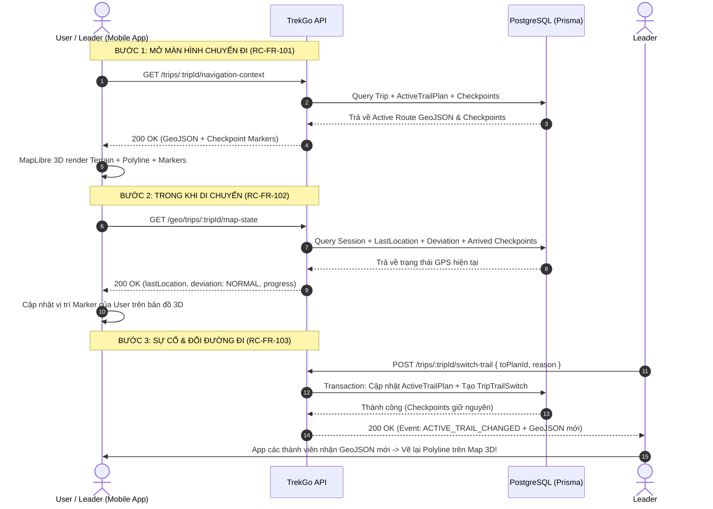
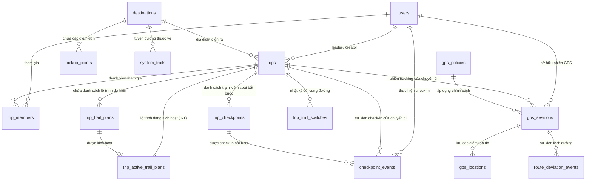

# Hướng dẫn sử dụng Bộ 3 API Phase 1: Navigation Context & MapLibre 3D

Tài liệu này hướng dẫn chi tiết cách sử dụng 3 API cốt lõi trong **PHASE 1 - LOAD TRIP NAVIGATION CONTEXT / MAP 3D** (Mảng C - Luật & Mảng A - Bảo).

---

## 📌 Tổng quan 3 API

| STT | Mã chức năng | Method + Route | Actor | Mục đích |
| :--- | :--- | :--- | :--- | :--- |
| **1** | **RC-FR-101** | `GET /api/v1/trips/:tripId/navigation-context` | Member / Leader / Admin | Lấy GeoJSON tuyến đường 3D, danh sách Checkpoints để khởi tạo MapLibre 3D. |
| **2** | **RC-FR-102** | `GET /api/v1/geo/trips/:tripId/map-state` | Member / Leader / Admin | Lấy GPS session, vị trí gần nhất, cảnh báo lệch đường và tiến độ checkpoint. |
| **3** | **RC-FR-103** | `POST /api/v1/trips/:tripId/switch-trail` | Leader / Admin | Leader đổi sang cung đường dự phòng khi gặp sự cố mà **không mất checkpoint**. |

---

## 1. RC-FR-101: Load Navigation Context

Lấy toàn bộ dữ liệu lộ trình không gian (GeoJSON 3D) và điểm kiểm soát để Mobile dựng bản đồ địa hình MapLibre.

- **HTTP Method**: `GET`
- **URL**: `/api/v1/trips/:tripId/navigation-context`
- **Header**:
  ```http
  Authorization: Bearer <access_token>
  ```
- **Path Parameters**:
  - `tripId` *(UUID, bắt buộc)*: ID của chuyến đi.

### Ví dụ Request (cURL):
```bash
curl -X GET "http://localhost:3000/api/v1/trips/d3b07384-d113-494d-9c32-b7b5f54316d2/navigation-context" \
  -H "Authorization: Bearer YOUR_ACCESS_TOKEN"
```

### Response mẫu (200 OK):
```json
{
  "tripId": "d3b07384-d113-494d-9c32-b7b5f54316d2",
  "title": "Chinh phục Fansipan 2N1D Trạm Tôn",
  "tripStatus": "IN_PROGRESS",
  "activeTrail": {
    "planId": "7e4f16b2-6c3e-4b2a-89a1-0e1234567890",
    "name": "Cung Trạm Tôn - Đỉnh Fansipan",
    "difficulty": "HARD",
    "distanceKm": 11.5,
    "elevationGainM": 1200,
    "routeGeojson": {
      "type": "LineString",
      "coordinates": [
        [103.7745, 22.3512, 1900],
        [103.7758, 22.3534, 2200],
        [103.7770, 22.3567, 2800],
        [103.7785, 22.3590, 3143]
      ]
    }
  },
  "plannedTrails": [
    {
      "planId": "7e4f16b2-6c3e-4b2a-89a1-0e1234567890",
      "sequence": 1,
      "name": "Cung Trạm Tôn - Đỉnh Fansipan (Chính)",
      "difficulty": "HARD",
      "distanceKm": 11.5,
      "elevationGainM": 1200
    },
    {
      "planId": "9a1b2c3d-4e5f-6789-abcd-ef0123456789",
      "sequence": 2,
      "name": "Cung Tránh sạt lở lán 2800m",
      "difficulty": "MEDIUM",
      "distanceKm": 12.8,
      "elevationGainM": 1100
    }
  ],
  "requiredCheckpoints": [
    {
      "id": "c1a2b3c4-d5e6-7890-abcd-ef1234567890",
      "sequence": 1,
      "name": "Trạm dừng chân 2200m",
      "latitude": 22.3534,
      "longitude": 103.7758,
      "radiusMeters": 50,
      "isRequired": true,
      "mission": {
        "title": "Chụp ảnh điểm danh trạm 2200m",
        "description": "Chụp ảnh tại biển báo độ cao 2200m cùng thẻ thành viên",
        "type": "PHOTO",
        "rewardPoints": 50
      }
    },
    {
      "id": "c2a2b3c4-d5e6-7890-abcd-ef1234567891",
      "sequence": 2,
      "name": "Cột mốc Đỉnh Fansipan 3143m",
      "latitude": 22.3590,
      "longitude": 103.7785,
      "radiusMeters": 50,
      "isRequired": true,
      "mission": {
        "title": "Check-in Nóc nhà Đông Dương",
        "description": "Quét mã QR tại chóp inox đỉnh Fansipan",
        "type": "QR_CODE",
        "rewardPoints": 100
      }
    }
  ]
}
```

---

## 2. RC-FR-102: Lấy Trạng thái Bản đồ & GPS (`map-state`)

Trả về trạng thái hoạt động hiện tại của User đối với chuyến đi: có phiên GPS nào đang mở không, vị trí gần nhất ở đâu, có đang đi lệch cung đường không, và đã qua được bao nhiêu trạm kiểm soát.

- **HTTP Method**: `GET`
- **URL**: `/api/v1/geo/trips/:tripId/map-state`
- **Header**:
  ```http
  Authorization: Bearer <access_token>
  ```
- **Path Parameters**:
  - `tripId` *(UUID, bắt buộc)*: ID của chuyến đi.

### Ví dụ Request (cURL):
```bash
curl -X GET "http://localhost:3000/api/v1/geo/trips/d3b07384-d113-494d-9c32-b7b5f54316d2/map-state" \
  -H "Authorization: Bearer YOUR_ACCESS_TOKEN"
```

### Response mẫu (200 OK):
```json
{
  "tripId": "d3b07384-d113-494d-9c32-b7b5f54316d2",
  "gpsSession": {
    "id": "b1c2d3e4-f5a6-7890-abcd-ef1234567890",
    "status": "ACTIVE",
    "startedAt": "2026-09-29T07:30:00.000Z",
    "totalDistanceMeters": 4350.2
  },
  "lastLocation": {
    "latitude": 22.353412,
    "longitude": 103.775821,
    "accuracyM": 4.5,
    "speedMps": 1.2,
    "headingDeg": 45.0,
    "altitudeM": 2205.3,
    "recordedAt": "2026-09-29T09:15:30.000Z"
  },
  "deviation": {
    "status": "NORMAL",
    "maxDeviationDistanceM": null,
    "lastCheckedAt": null
  },
  "progress": {
    "totalCheckpoints": 2,
    "passedCheckpoints": 1,
    "completedPercentage": 50,
    "arrivedCheckpointIds": [
      "c1a2b3c4-d5e6-7890-abcd-ef1234567890"
    ]
  }
}
```

> **Ghi chú về `deviation.status`**:
> - `NORMAL`: Đang đi đúng tuyến đường quy định.
> - `DEVIATED`: Đang đi lệch khỏi cung đường lớn hơn ngưỡng an toàn (ví dụ > 50m) và chưa quay trở lại.

---

## 3. RC-FR-103: Leader Chuyển Cung Đường (`switch-trail`)

Cho phép Leader đổi sang cung đường dự phòng khi tuyến đường chính gặp sự cố (thời tiết xấu, sạt lở, tắc đường).

- **HTTP Method**: `POST`
- **URL**: `/api/v1/trips/:tripId/switch-trail`
- **Header**:
  ```http
  Authorization: Bearer <leader_access_token>
  Content-Type: application/json
  ```
- **Path Parameters**:
  - `tripId` *(UUID, bắt buộc)*: ID của chuyến đi.
- **Request Body (JSON)**:
  ```json
  {
    "toPlanId": "9a1b2c3d-4e5f-6789-abcd-ef0123456789",
    "reason": "Mưa lớn sạt lở đoạn dốc 2500m, chuyển sang cung đường tránh số 2"
  }
  ```

### Quy tắc nghiệp vụ (Business Rules):
1. **Phân quyền**: Chỉ **Leader** được phân công của chuyến đi, Creator hoặc Admin mới có quyền gọi API này (User thường gọi sẽ nhận `403 Forbidden`).
2. **Trạng thái Trip**: Chuyến đi phải ở trạng thái `OPEN` hoặc `IN_PROGRESS`.
3. **Plan đích**: `toPlanId` phải thuộc danh sách `plannedTrails` của chuyến đi và không được trùng với cung đường đang kích hoạt.
4. **Bảo toàn điểm kiểm soát**: Các `TripCheckpoint` và lịch sử check-in `CheckpointEvent` của các thành viên **được giữ nguyên vẹn 100%**, không bị mất hay reset.

### Ví dụ Request (cURL):
```bash
curl -X POST "http://localhost:3000/api/v1/trips/d3b07384-d113-494d-9c32-b7b5f54316d2/switch-trail" \
  -H "Authorization: Bearer LEADER_ACCESS_TOKEN" \
  -H "Content-Type: application/json" \
  -d '{
    "toPlanId": "9a1b2c3d-4e5f-6789-abcd-ef0123456789",
    "reason": "Mưa lớn sạt lở đoạn dốc 2500m, chuyển sang cung đường tránh số 2"
  }'
```

### Response mẫu (200 OK):
```json
{
  "event": "ACTIVE_TRAIL_CHANGED",
  "message": "Chuyển đổi cung đường thành công, bảo toàn toàn bộ điểm kiểm soát bắt buộc",
  "tripId": "d3b07384-d113-494d-9c32-b7b5f54316d2",
  "fromPlanId": "7e4f16b2-6c3e-4b2a-89a1-0e1234567890",
  "toPlanId": "9a1b2c3d-4e5f-6789-abcd-ef0123456789",
  "changedAt": "2026-09-29T09:30:00.000Z",
  "reason": "Mưa lớn sạt lở đoạn dốc 2500m, chuyển sang cung đường tránh số 2",
  "preservedCheckpointsCount": 2,
  "activeTrail": {
    "planId": "9a1b2c3d-4e5f-6789-abcd-ef0123456789",
    "name": "Cung Tránh sạt lở lán 2800m",
    "difficulty": "MEDIUM",
    "distanceKm": 12.8,
    "elevationGainM": 1100,
    "routeGeojson": {
      "type": "LineString",
      "coordinates": [
        [103.7745, 22.3512, 1900],
        [103.7758, 22.3534, 2200],
        [103.7801, 22.3575, 2750],
        [103.7785, 22.3590, 3143]
      ]
    }
  }
}
```

---

## 4. Kịch bản phối hợp thực tế (End-to-End Workflow trên Mobile)



---

## 5. Các mã lỗi thường gặp

| HTTP Code | Error Code | Nguyên nhân & Cách xử lý |
| :--- | :--- | :--- |
| `400` | `VALIDATION_ERROR` | `tripId` hoặc `toPlanId` không đúng chuẩn UUID, hoặc `reason` vượt quá 500 ký tự. |
| `400` | `BAD_REQUEST` | Cung đường đổi đến (`toPlanId`) không thuộc chuyến đi này, hoặc chuyến đi không ở trạng thái `OPEN`/`IN_PROGRESS`. |
| `401` | `UNAUTHENTICATED` | Thiếu Header Authorization hoặc Token Supabase hết hạn/không hợp lệ. |
| `403` | `FORBIDDEN` | Người dùng không phải là thành viên của chuyến đi, hoặc User thường cố tình gọi API đổi đường của Leader. |
| `404` | `NOT_FOUND` | Chuyến đi với `tripId` không tồn tại trong hệ thống. |

---

## 6. Các bảng trong Cơ sở Dữ liệu liên quan (Database Schema & Mock Data)

Dựa trên kịch bản khởi tạo dữ liệu mẫu trong file [`navigation-phase1.seed.ts`](file:///c:/Users/Admin/Documents/tuHocNestJs/Vina_TrekGO/api/prisma/seeds/navigation-phase1.seed.ts), dưới đây là chi tiết toàn bộ các bảng trong cơ sở dữ liệu PostgreSQL tham gia vào quy trình hoạt động của bộ 3 API **RC-FR-101**, **RC-FR-102** và **RC-FR-103**.

### 📊 Sơ đồ Quan hệ Thực thể (ERD Context)



---

### 📋 Bảng tổng hợp các Bảng Database & Dữ liệu Mock

| STT | Tên bảng (PostgreSQL) | Model Prisma | API liên quan | Mô tả & Dữ liệu đã Seed trong `navigation-phase1.seed.ts` |
| :--- | :--- | :--- | :--- | :--- |
| **1** | `users` | `User` | **101, 102, 103** | Tài khoản hệ thống: <br>• Leader: `luatluat304@gmail.com` (`role: LEADER`)<br>• Member: `luatluat3042@gmail.com` (`role: USER`) |
| **2** | `trip_members` | `TripMember` | **101, 102, 103** | Quan hệ thành viên chuyến đi:<br>• Leader với vai trò `HOST`<br>• Member với vai trò `MEMBER` (`status: ACTIVE`) |
| **3** | `destinations` | `Destination` | **101** | Điểm đến du lịch Fansipan:<br>• ID: `33333333-3333-3333-3333-333333333333`<br>• Vườn Quốc Gia Hoàng Liên - Sa Pa |
| **4** | `pickup_points` | `PickupPoint` | **101** | Điểm xuất phát đón đoàn:<br>• ID: `44444444-4444-4444-4444-444444444444`<br>• Trạm Tôn Sa Pa (Độ cao 1900m) |
| **5** | `system_trails` | `SystemTrail` | **101, 103** | Thư viện cung đường gốc (LineString GeoJSON 3D):<br>• Cung Trạm Tôn: `5555aaaa-1111-1111-1111-111111111111`<br>• Cung tránh sạt lở: `5555aaaa-2222-2222-2222-222222222222` |
| **6** | `trips` | `Trip` | **101, 102, 103** | Chuyến đi chính được test:<br>• ID: `55555555-5555-5555-5555-555555555555`<br>• Trạng thái `IN_PROGRESS`, do Leader quản lý |
| **7** | `trip_trail_plans` | `TripTrailPlan` | **101, 103** | Snapshot danh sách lộ trình của chuyến đi:<br>• Plan 1 (Chính): `66666666-6666-6666-6666-666666666661`<br>• Plan 2 (Dự phòng): `66666666-6666-6666-6666-666666666662` |
| **8** | `trip_active_trail_plans` | `TripActiveTrailPlan` | **101, 103** | Lộ trình đang active (quan hệ 1-1 với `Trip`):<br>• Ban đầu trỏ tới Plan 1 (`version: 1`)<br>• Cập nhật sang Plan 2 khi gọi RC-FR-103 (`version: 2`) |
| **9** | `trip_trail_switches` | `TripTrailSwitch` | **103** | Nhật ký kiểm toán (audit log) ghi lại lịch sử Leader đổi đường (`fromPlanId`, `toPlanId`, `actorId`, `reason`, `changedAt`). |
| **10** | `trip_checkpoints` | `TripCheckpoint` | **101, 102, 103** | 2 trạm kiểm soát bắt buộc (bảo toàn 100% khi switch-trail):<br>• Trạm 2200m: `77777777-7777-7777-7777-777777777771` (Nhiệm vụ `PHOTO`)<br>• Đỉnh Fansipan: `77777777-7777-7777-7777-777777777772` (Nhiệm vụ `QR_CODE`) |
| **11** | `gps_policies` | `GpsPolicy` | **102** | Cấu hình quy tắc tracking GPS chuyến đi:<br>• ID: `88888888-8888-8888-8888-888888888888`<br>• Ngưỡng lệch đường `deviationThresholdM = 50.0m`, chu kỳ `syncIntervalSeconds = 30s` |
| **12** | `gps_sessions` | `GpsSession` | **102** | Phiên tracking GPS mở của Member:<br>• ID: `99999999-9999-9999-9999-999999999999`<br>• Trạng thái `ACTIVE`, tích lũy `totalDistanceMeters: 4250.5m` |
| **13** | `gps_locations` | `GpsLocation` | **102** | Tọa độ GPS mới nhất của Member trong chuyến đi:<br>• Tọa độ: `lat: 22.353412`, `lng: 103.775821`, `altitude: 2205.3m` |
| **14** | `checkpoint_events` | `CheckpointEvent` | **102** | Lịch sử check-in trạm thành công của Member:<br>• Check-in tại Trạm 1 (2200m) với `missionStatus: COMPLETED` -> Tiến độ `50%` |
| **15** | `route_deviation_events` | `RouteDeviationEvent` | **102** | Lịch sử sự kiện lệch khỏi tuyến đường quy định (phục vụ đánh giá trường `deviation.status`). |

---

### 🔍 Chi tiết Vai trò từng Bảng theo Nhóm Nghiệp vụ

#### 1. Nhóm Định danh & Thành viên (`users`, `trip_members`)
- **`users`**: Chứa hai tài khoản thực nghiệm Supabase:
  - **Leader**: `luatluat304@gmail.com` (Role `LEADER`, authUserId `4f00a265-acaa-4f5a-a334-621cc4e9715d`).
  - **Member**: `luatluat3042@gmail.com` (Role `USER`, authUserId `76c3c85d-527b-4788-b25b-dd45787ab19d`).
- **`trip_members`**: Liên kết `tripId` với `userId`. Hệ thống dựa vào trường `role` (`HOST` hoặc `MEMBER`) để kiểm tra quyền hạn (Authorization) ở API `POST /switch-trail` (chỉ `HOST`/Leader mới được phép đổi cung đường).

#### 2. Nhóm Hạ tầng Địa lý & Tuyến mẫu (`destinations`, `pickup_points`, `system_trails`)
- **`destinations`**: Vườn Quốc Gia Hoàng Liên Sơn (Sa Pa), đóng vai trò khu vực điểm đến định vị toàn bộ chuyến đi.
- **`pickup_points`**: Điểm hẹn đón khách "Trạm Tôn Sa Pa (Độ cao 1900m)" - nơi bắt đầu hành trình trekking.
- **`system_trails`**: Chứa 2 tuyến đường chuẩn hóa do ban quản lý / admin định nghĩa sẵn, bao gồm tọa độ GeoJSON 3D (`[lng, lat, elevation]`):
  - Tuyến 1: Tuyến Trạm Tôn chính (11.5 km, độ dốc 1200m).
  - Tuyến 2: Tuyến tránh sạt lở lán 2800m (12.8 km, độ dốc 1100m).

#### 3. Nhóm Điều phối Chuyến đi & Cung đường 3D (`trips`, `trip_trail_plans`, `trip_active_trail_plans`, `trip_trail_switches`)
- **`trips`**: Chuyến đi Fansipan 2N1D đang hoạt động (`status: IN_PROGRESS`), làm gốc tham chiếu cho mọi endpoint thông qua `:tripId`.
- **`trip_trail_plans`**: Khi chuyến đi được tạo, hệ thống clone (snapshot) tuyến đường từ `system_trails` sang `trip_trail_plans` để cô lập dữ liệu chuyến đi khỏi những thay đổi sau này của thư viện mẫu:
  - `Plan 1` (`...6661`): Lộ trình chính ban đầu.
  - `Plan 2` (`...6662`): Lộ trình dự phòng để phục vụ test tính năng chuyển đổi cung đường.
- **`trip_active_trail_plans`**: Bảng quan hệ 1-1 với chuyến đi, chỉ ra cung đường đang được hiển thị và điều hướng trên MapLibre 3D.
- **`trip_trail_switches`**: Bảng nhật ký ghi lại sự kiện chuyển đổi đường trong `POST /switch-trail`. Lưu lại `fromPlanId`, `toPlanId`, `actorId`, lý do (`reason`) và thời gian thực hiện nhằm phục vụ an toàn và kiểm tra sau chuyến đi.

#### 4. Nhóm Điểm Kiểm soát & Tiến độ Check-in (`trip_checkpoints`, `checkpoint_events`)
- **`trip_checkpoints`**: Lưu 2 trạm kiểm soát bắt buộc trên hành trình Fansipan:
  1. Trạm 1 (2200m): Yêu cầu chụp ảnh check-in (`PHOTO`), thưởng 50 điểm.
  2. Trạm 2 (Đỉnh 3143m): Yêu cầu quét mã QR (`QR_CODE`), thưởng 100 điểm.
  > ⚠️ **Đặc tính cốt lõi**: Khi đổi cung đường qua RC-FR-103, toàn bộ dữ liệu trong bảng này **được bảo toàn tuyệt đối** để không làm xáo trộn tiến trình của đoàn.
- **`checkpoint_events`**: Ghi nhận sự kiện Member đã chạm mốc Trạm 1 thành công (khoảng cách 4.8m, `missionStatus: COMPLETED`), từ đó giúp API RC-FR-102 tính toán tỷ lệ hoàn thành đạt `50%` (1/2 trạm).

#### 5. Nhóm Giám sát GPS & An toàn (`gps_policies`, `gps_sessions`, `gps_locations`, `route_deviation_events`)
- **`gps_policies`**: Chính sách GPS mặc định (`deviationThresholdM = 50m`, `syncIntervalSeconds = 30s`) kiểm soát tần suất gửi định vị và ngưỡng phát hiện lệch tuyến.
- **`gps_sessions`**: Phiên GPS đang hoạt động (`ACTIVE`) của Member, giúp máy chủ quản lý thời gian bắt đầu di chuyển và tổng quãng đường đã đi được.
- **`gps_locations`**: Lưu tọa độ GPS tức thời mới nhất (`lat: 22.353412`, `lng: 103.775821`, `altitude: 2205.3m`), cung cấp dữ liệu cho `lastLocation` trên bản đồ 3D.
- **`route_deviation_events`**: Lưu vết các trường hợp thành viên đi lệch ra khỏi bán kính cho phép của cung đường (trạng thái `NORMAL` hoặc `DEVIATED`).

---

## 7. Hướng dẫn Test thực tế trên Swagger với Mock Data Seeded

Dữ liệu mẫu đã được nạp sẵn vào Database qua script [`navigation-phase1.seed.ts`](file:///c:/Users/Admin/Documents/tuHocNestJs/Vina_TrekGO/api/prisma/seeds/navigation-phase1.seed.ts) (lệnh `npx prisma db seed`). Dưới đây là thông tin tài khoản đăng nhập, bộ ID cố định và quy trình test từng bước trên Swagger UI.

---

### 🔑 Thông tin 2 Tài khoản Test (Supabase Auth)

> Cả 2 tài khoản đều đã được kích hoạt, xác thực và phân quyền chính xác trong Database:

| Thông tin | Tài khoản 1: Leader (Trưởng đoàn) | Tài khoản 2: Member (Thành viên) |
| :--- | :--- | :--- |
| **Email** | `luatluat304@gmail.com` | `luatluat3042@gmail.com` |
| **Mật khẩu** | `SecretPassword123@` | `SecretPassword123@` |
| **Supabase `authUserId`** | `4f00a265-acaa-4f5a-a334-621cc4e9715d` | `76c3c85d-527b-4788-b25b-dd45787ab19d` |
| **Role hệ thống (`UserRole`)** | **`LEADER`** | **`USER`** |
| **Vai trò chuyến đi (`TripMember`)** | **`HOST`** (Trưởng đoàn kiêm người tạo chuyến) | **`MEMBER`** (Thành viên chính thức đoàn) |
| **Mục đích sử dụng khi Test** | Dùng để test **RC-FR-101** và quyền đổi đường của **RC-FR-103** | Dùng để test **RC-FR-101**, xem GPS/Map State **RC-FR-102**, và test chặn quyền `403` ở **RC-FR-103** |

---

### 🗺️ Bộ ID Mock Data cố định

| Tên thực thể | UUID cố định | Ghi chú |
| :--- | :--- | :--- |
| **`tripId`** | `55555555-5555-5555-5555-555555555555` | Chuyến đi Fansipan (`status: IN_PROGRESS`) |
| **`Plan 1` (Lộ trình chính ban đầu)** | `66666666-6666-6666-6666-666666666661` | Cung Trạm Tôn 11.5km (Đang Active) |
| **`Plan 2` (Lộ trình dự phòng)** | `66666666-6666-6666-6666-666666666662` | Cung đường tránh sạt lở 12.8km (Dùng để test Switch Trail) |
| **Checkpoint 1** | `77777777-7777-7777-7777-777777777771` | Trạm nghỉ 2200m (Member đã check-in hoàn thành) |
| **Checkpoint 2** | `77777777-7777-7777-7777-777777777772` | Đỉnh Fansipan 3143m (Chưa check-in) |

---

### 🧪 Quy trình 5 bước Test trên Swagger UI

Mở trình duyệt truy cập Swagger UI: `http://localhost:3000/docs` (hoặc cổng chạy NestJS API của bạn).

---

#### 🔐 Bước 0: Đăng nhập lấy Bearer Token trên Swagger

Để gọi các API có bảo vệ `@Auth([AuthType.Bearer])`, bạn cần đăng nhập để lấy `accessToken`:

1. Trên Swagger, tìm nhóm **Auth** -> Endpoint `POST /api/v1/auth/login`.
2. Bấm **Try it out**.
3. Nhập payload đăng nhập:
   - **Để đăng nhập Leader**:
     ```json
     {
       "email": "luatluat304@gmail.com",
       "password": "SecretPassword123@"
     }
     ```
   - **Để đăng nhập Member**:
     ```json
     {
       "email": "luatluat3042@gmail.com",
       "password": "SecretPassword123@"
     }
     ```
4. Bấm **Execute**. Copy chuỗi `accessToken` từ JSON phản hồi.
5. Kéo lên góc trên cùng bên phải giao diện Swagger, bấm nút **Authorize** (hình ổ khóa màu xanh lá).
6. Dán `accessToken` vào ô Value (không cần gõ thêm chữ `Bearer `) -> bấm **Authorize** -> bấm **Close**.

---

#### Bước 1: Test RC-FR-101 - Lấy Navigation Context & GeoJSON bản đồ 3D
> **Tài khoản sử dụng**: Sử dụng Token của **Leader** (`luatluat304@gmail.com`) hoặc **Member** (`luatluat3042@gmail.com`) đều được.

1. Mở endpoint `GET /api/v1/trips/{tripId}/navigation-context` (Nhóm **Trip Navigation**).
2. Bấm **Try it out**.
3. Nhập `tripId`: `55555555-5555-5555-5555-555555555555`.
4. Bấm **Execute**.
5. **Kiểm tra kết quả (200 OK)**:
   - `tripStatus` là `"IN_PROGRESS"`.
   - `activeTrail.planId` là `66666666-6666-6666-6666-666666666661` (Plan 1 chính ban đầu).
   - `activeTrail.routeGeojson` chứa LineString 4 tọa độ 3D.
   - `requiredCheckpoints` chứa 2 điểm kiểm soát (Trạm 2200m và Đỉnh 3143m).

---

#### Bước 2: Test RC-FR-102 - Lấy trạng thái Bản đồ & GPS của Member
> **Tài khoản sử dụng**: **BẮT BUỘC DÙNG TOKEN CỦA MEMBER** (`luatluat3042@gmail.com` / `SecretPassword123@`) vì phiên GPS và lịch sử check-in trạm 2200m được tạo gắn với User Member này.

1. Đăng nhập và Authorize bằng token của **`luatluat3042@gmail.com`**.
2. Mở endpoint `GET /api/v1/geo/trips/{tripId}/map-state` (Nhóm **Geo & Map Tracking**).
3. Bấm **Try it out**.
4. Nhập `tripId`: `55555555-5555-5555-5555-555555555555`.
5. Bấm **Execute**.
6. **Kiểm tra kết quả (200 OK)**:
   - `gpsSession.status` là `"ACTIVE"`.
   - `lastLocation` có tọa độ gần nhất: `latitude: 22.353412`, `longitude: 103.775821`.
   - `deviation.status` là `"NORMAL"`.
   - `progress.totalCheckpoints` = `2`, `passedCheckpoints` = `1`, `completedPercentage` = `50` (vì trạm 2200m đã được check-in mẫu).

---

#### Bước 3: Test RC-FR-103 - Leader chuyển cung đường sang Plan 2
> **Tài khoản sử dụng**: **BẮT BUỘC DÙNG TOKEN CỦA LEADER** (`luatluat304@gmail.com` / `SecretPassword123@`).

1. Đăng nhập và Authorize lại bằng token của **`luatluat304@gmail.com`**.
2. Mở endpoint `POST /api/v1/trips/{tripId}/switch-trail` (Nhóm **Trip Navigation**).
3. Bấm **Try it out**.
4. Nhập `tripId`: `55555555-5555-5555-5555-555555555555`.
5. Nhập Request body (JSON):
   ```json
   {
     "toPlanId": "66666666-6666-6666-6666-666666666662",
     "reason": "Mưa lớn sạt lở đoạn Km5, chuyển sang cung đường tránh số 2"
   }
   ```
6. Bấm **Execute**.
7. **Kiểm tra kết quả (200 OK)**:
   - Trả về sự kiện `event: "ACTIVE_TRAIL_CHANGED"`.
   - `fromPlanId`: `66666666-6666-6666-6666-666666666661`.
   - `toPlanId`: `66666666-6666-6666-6666-666666666662`.
   - `preservedCheckpointsCount` = `2` (Chứng minh 2 checkpoint bắt buộc được bảo toàn).
   - `activeTrail.name` đổi thành `"Cung đường tránh dốc sạt lở số 2 (Dự phòng)"`.

> 💡 **Thử nghiệm phân quyền (Test case 403 Forbidden)**: Nếu bạn Authorize bằng token của Member (`luatluat3042@gmail.com`) rồi bấm Execute API này, hệ thống sẽ trả về lỗi `403 Forbidden` với thông báo: *"Chỉ Trưởng đoàn (Leader) mới có quyền đổi cung đường khi đang di chuyển"*.

---

#### Bước 4: Kiểm tra tính toàn vẹn (Verification)
> **Tài khoản sử dụng**: Sử dụng Token của **Leader** hoặc **Member** đều được.

1. Quay lại gọi lại API `GET /api/v1/trips/{tripId}/navigation-context` (Bước 1).
2. **Quan sát thấy ngay**:
   - `activeTrail.planId` đã được cập nhật sang Plan 2 (`...6662`) với GeoJSON của đường tránh.
   - Toàn bộ danh sách `requiredCheckpoints` vẫn giữ nguyên 2 điểm mốc cũ, không hề bị mất mát hay reset.

