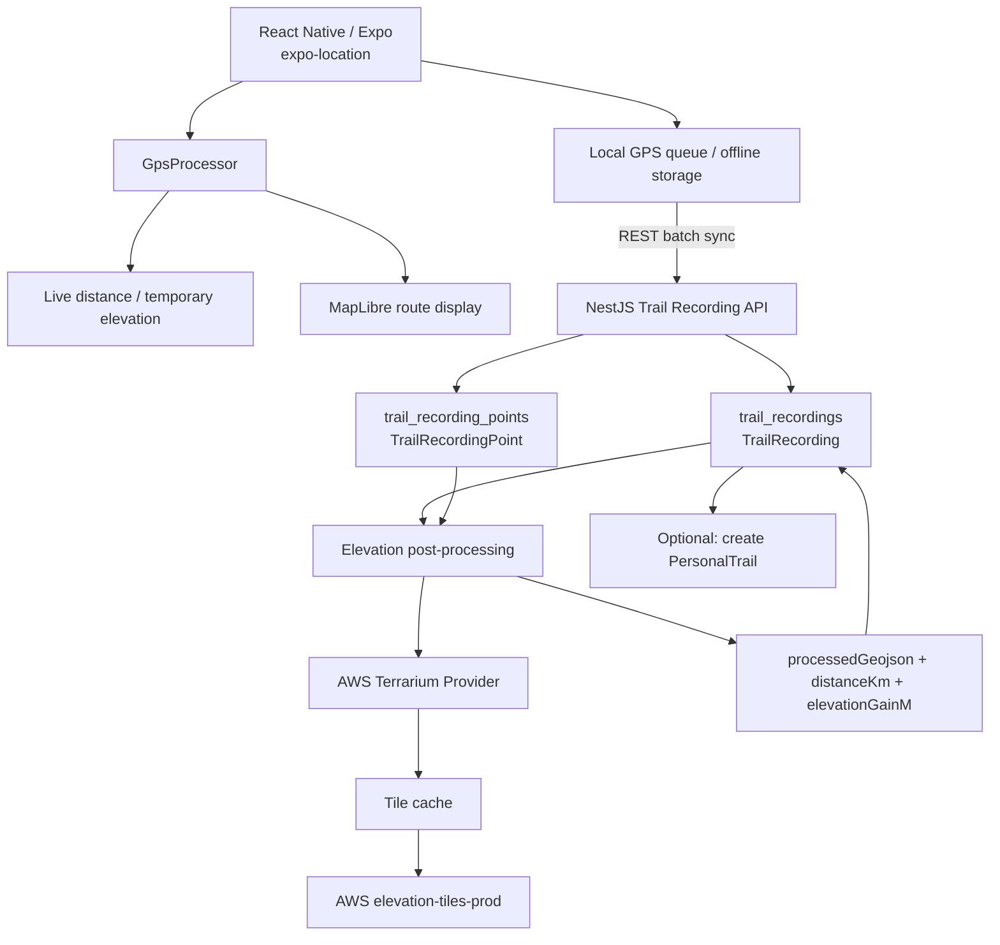
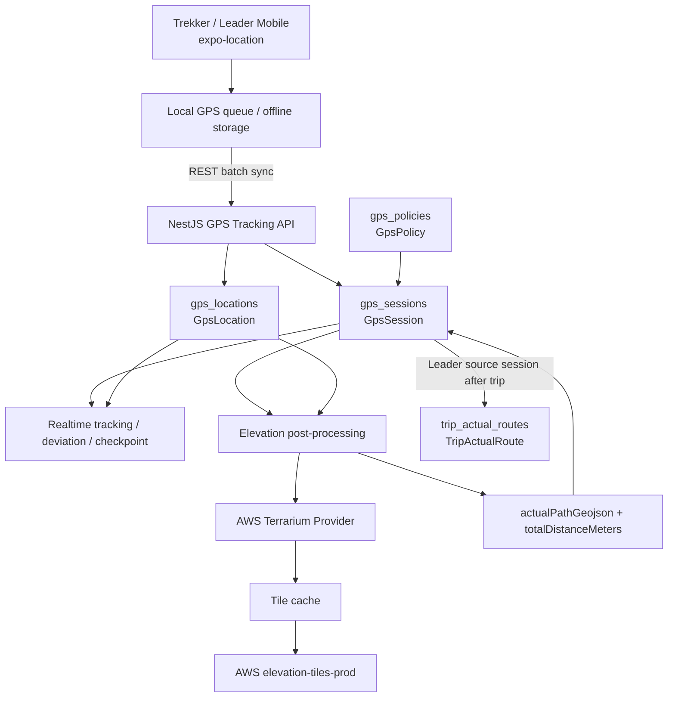
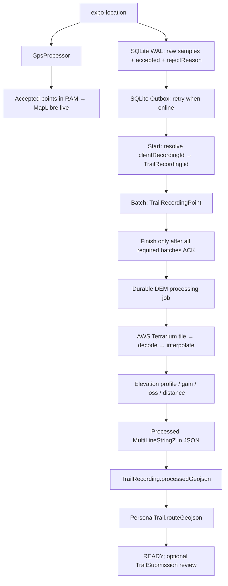

# TrekGO — Tài liệu triển khai AWS Terrarium DEM & Elevation Processing

**Phiên bản:** 2.1 — bản tích hợp API contracts Mobile final (16/10/2026), đối chiếu `schema.prisma` hiện tại  
**Phạm vi:** React Native/Expo (`expo-location`) → NestJS → PostgreSQL/Prisma → AWS Terrain Tiles (Terrarium).  
**Nguồn đối chiếu:** `banfinalPersonaltrail.md` (Mobile/BE contract v2.1) và `schema.prisma` hiện tại. Các thay đổi API/schema bên dưới là **đề xuất triển khai**, chưa xác nhận đã có trong source code.  
**Mục tiêu:** tích hợp AWS Terrarium vào đúng hai luồng GPS đang tồn tại của TrekGO: (1) ghi tuyến cá nhân qua `TrailRecording`/`TrailRecordingPoint`; (2) GPS trong chuyến qua `GpsSession`/`GpsLocation`, sau đó tạo `TripActualRoute`. GPS gốc được giữ nguyên; DEM chỉ dùng cho hậu xử lý độ cao, elevation profile và elevation gain/loss.

> **Nguyên tắc:** Không ghi đè GPS gốc. Độ cao DEM không mặc nhiên chính xác hơn độ cao thiết bị. Chỉ số realtime là **tạm tính**, chỉ số hậu xử lý là **đã xử lý** và phải ghi rõ nguồn dữ liệu.

## 1. Phạm vi và đầu ra

### Trong phạm vi MVP
- Mobile thu nhận `latitude`, `longitude`, `timestamp`, `accuracy`, `altitude`, `altitudeAccuracy`, `speed` từ `expo-location`.
- Lưu điểm **raw** ngay cả khi bộ lọc không chấp nhận (có trạng thái và lý do), nhưng bỏ các bản ghi hỏng hoàn toàn theo chính sách lưu trữ.
- `GpsProcessor` quyết định điểm dùng cho tuyến, tính quãng đường và elevation tạm tính.
- Đồng bộ offline theo lô với khóa chống trùng, tách segment khi pause/resume hoặc mất tín hiệu lâu.
- Backend giải mã AWS Terrarium, cache theo tile, nội suy bilinear, tạo elevation profile, gain/loss, thống kê chất lượng.
- Lưu bản kết quả có `processingVersion`, `demSource`, `status` để chạy lại được.

### Ngoài phạm vi MVP
- Không tự nhận độ cao là chính xác đến 1 m; không cam kết Strava dùng cùng thuật toán.
- Không tự động map-match đường đi lên đường mòn hoặc thay đổi tọa độ GPS bằng DEM.
- Không bắt buộc xử lý nền trên điện thoại ở PR đầu tiên; background tracking là hạng mục riêng.

## 2. Luồng kiến trúc theo schema TrekGO hiện tại

TrekGO hiện có **hai ngữ cảnh ghi GPS khác nhau**, vì vậy không dùng một `recordingId` chung cho toàn hệ thống.

### 2.1. Ghi tuyến cá nhân — `TrailRecording`



**Khóa chính của pipeline:** `TrailRecording.id`.

**Raw GPS:** `TrailRecordingPoint`. Schema đã có `clientSampleId` và unique `(recordingId, clientSampleId)`, nên có thể dùng trực tiếp để chống trùng khi mobile retry/offline sync.

### 2.2. GPS trong Trip — `GpsSession`



**Khóa chính của pipeline:** `GpsSession.id`.

`TripActualRoute` là bản tổng hợp đường thực tế của chuyến và đã có `sourceSessionId` trỏ về `GpsSession`. Theo yêu cầu TrekGO hiện tại, sau chuyến nên ưu tiên session của **Leader** để sinh actual route.

### 2.3. Ranh giới trách nhiệm

- `TrailRecordingPoint` và `GpsLocation` là dữ liệu GPS gốc phía server. **Không ghi đè `altitudeM` bằng DEM.**
- `GpsPolicy` tiếp tục quản lý policy runtime như accuracy, sync interval, deviation và retention; Terrarium không thay thế `GpsPolicy`.
- `RouteDeviationEvent`, `CheckpointEvent` và realtime tracking vẫn dùng GPS runtime; **không chờ DEM**.
- `GpsOutboxEvent` dùng cho event publication/deduplication của Domain C, không dùng làm nơi lưu GPS point hoặc elevation profile.
- MapLibre có thể dùng DEM cho render terrain ở client, nhưng pipeline elevation backend là độc lập.


## 3. Quy ước dữ liệu và chất lượng

| Thuộc tính | Quy ước |
|---|---|
| Tọa độ | WGS84, `latitude` [-90,90], `longitude` [-180,180] |
| GeoJSON | `[longitude, latitude]` hoặc `[longitude, latitude, elevation]`; không tạo `[lng, lat, undefined]` |
| Thời gian | UTC ISO trên API, epoch milliseconds trong ứng dụng nếu tiện |
| Quãng đường | mét, số thực, chỉ làm tròn khi hiển thị |
| Độ cao | mét; `null` nếu không biết, không dùng 0 để biểu thị thiếu |
| Segment | tăng `segmentId` khi pause/resume hoặc mất tín hiệu; không nối qua khoảng trống |
| DEM source | `AWS_TERRARIUM` + zoom + phiên bản thuật toán |
| Elevation status | `PENDING`, `PROCESSING`, `COMPLETED`, `PARTIAL`, `FAILED` |

**Cảnh báo datum:** GPS altitude của nền tảng và DEM có thể dùng hệ quy chiếu độ cao khác nhau. Tránh lấy chênh lệch trực tiếp để kết luận GPS sai. Độ cao tuyệt đối và tổng độ cao tăng cần được đánh giá riêng.

## 4. Cấu trúc NestJS đề xuất

```text
api/src/modules/elevation/
├── application/
│   ├── ports/elevation-provider.port.ts
│   └── use-cases/process-trail-elevation.use-case.ts
├── domain/
│   ├── elevation.types.ts
│   └── elevation-metrics.ts
├── infrastructure/
│   ├── adapters/aws-terrarium.adapter.ts
│   └── cache/tile-cache.service.ts
├── presentation/
│   └── elevation.controller.ts
└── elevation.module.ts
```

Không chỉnh sửa các module TrekGO khác ngoài các điểm tích hợp đã xác định; giữ adapter tách khỏi use case để thay DEM provider được.

## 5. Cài thư viện

```bash
npm install sharp
```

Node.js 18+ có `fetch` toàn cục. Nếu backend dùng Node khác, dùng HTTP client tương đương. Với job chạy nhiều tuyến, có thể dùng Redis/BullMQ nếu dự án đã cấu hình; MVP có thể dùng hàng đợi nội bộ **chỉ cho phát triển**, không bảo đảm khôi phục job khi tiến trình restart.

## 6. Terrarium: công thức và tile XYZ

Nguồn ví dụ:

```text
https://s3.amazonaws.com/elevation-tiles-prod/terrarium/{z}/{x}/{y}.png
```

Giải mã kênh RGB:

```ts
export function decodeTerrarium(r: number, g: number, b: number): number {
  return r * 256 + g + b / 256 - 32768;
}
```

Chuyển WGS84 sang Web Mercator XYZ:

```ts
const MAX_MERCATOR_LAT = 85.05112878;

export function lonLatToTile(latitude: number, longitude: number, zoom: number) {
  if (!Number.isFinite(latitude) || !Number.isFinite(longitude) ||
      latitude < -90 || latitude > 90 || longitude < -180 || longitude > 180) {
    throw new Error('INVALID_COORDINATE');
  }
  if (!Number.isInteger(zoom) || zoom < 0 || zoom > 15) {
    throw new Error('INVALID_ZOOM');
  }
  const lat = Math.max(-MAX_MERCATOR_LAT, Math.min(MAX_MERCATOR_LAT, latitude));
  // Longitude 180° wraps to -180° in XYZ.
  const lon = longitude === 180 ? -180 : longitude;
  const n = 2 ** zoom;
  const xf = ((lon + 180) / 360) * n;
  const rad = lat * Math.PI / 180;
  const yf = (1 - Math.asinh(Math.tan(rad)) / Math.PI) / 2 * n;
  const x = Math.max(0, Math.min(n - 1, Math.floor(xf)));
  const y = Math.max(0, Math.min(n - 1, Math.floor(yf)));
  return { z: zoom, x, y, u: xf - Math.floor(xf), v: yf - Math.floor(yf) };
}
```

**Chọn zoom:** bắt đầu kiểm thử `z=13` (không có nghĩa độ phân giải DEM gốc là 13). Kiểm tra thực tế các zoom được endpoint hỗ trợ; không giả định `maxzoom` MapLibre hiện tại là cam kết của nguồn.

## 7. Adapter AWS Terrarium (mẫu TypeScript có cache)

Code dưới đây minh họa một provider sử dụng `sharp` và cache Promise theo tile để tránh nhiều request đồng thời cho cùng tile. Cache memory cần TTL/giới hạn dung lượng ở production.

```ts
import { Injectable } from '@nestjs/common';
import sharp from 'sharp';

export type LatLng = { latitude: number; longitude: number };
export interface ElevationProvider {
  getElevations(points: LatLng[]): Promise<(number | null)[]>;
}

type Tile = { data: Buffer; width: number; height: number; channels: number };
const MAX_LAT = 85.05112878;

@Injectable()
export class AwsTerrariumElevationProvider implements ElevationProvider {
  private readonly zoom = 13;
  private readonly cache = new Map<string, Promise<Tile>>();

  private position(p: LatLng) {
    const { latitude: lat, longitude: lng } = p;
    if (!Number.isFinite(lat) || !Number.isFinite(lng) ||
        lat < -90 || lat > 90 || lng < -180 || lng > 180) {
      throw new Error('INVALID_COORDINATE');
    }
    const n = 2 ** this.zoom;
    const clampedLat = Math.max(-MAX_LAT, Math.min(MAX_LAT, lat));
    const latRad = clampedLat * Math.PI / 180;
    const normalizedLng = lng === 180 ? -180 : lng;
    const xf = (normalizedLng + 180) / 360 * n;
    const yf = (1 - Math.asinh(Math.tan(latRad)) / Math.PI) / 2 * n;
    const x = Math.max(0, Math.min(n - 1, Math.floor(xf)));
    const y = Math.max(0, Math.min(n - 1, Math.floor(yf)));
    return { x, y, u: xf - Math.floor(xf), v: yf - Math.floor(yf) };
  }

  private async loadTile(x: number, y: number): Promise<Tile> {
    const key = `${this.zoom}/${x}/${y}`;
    let pending = this.cache.get(key);
    if (!pending) {
      pending = (async () => {
        const url = `https://s3.amazonaws.com/elevation-tiles-prod/terrarium/${key}.png`;
        const response = await fetch(url, { signal: AbortSignal.timeout(8000) });
        if (!response.ok) throw new Error(`DEM_HTTP_${response.status}`);
        const bytes = Buffer.from(await response.arrayBuffer());
        if (bytes.byteLength > 2_000_000) throw new Error('DEM_TILE_TOO_LARGE');
        const { data, info } = await sharp(bytes)
          .removeAlpha()
          .raw()
          .toBuffer({ resolveWithObject: true });
        if (info.channels < 3) throw new Error('DEM_INVALID_CHANNELS');
        return { data, width: info.width, height: info.height, channels: info.channels };
      })();
      this.cache.set(key, pending);
      pending.catch(() => this.cache.delete(key));
    }
    return pending;
  }

  private pixel(tile: Tile, x: number, y: number): number {
    const px = Math.max(0, Math.min(tile.width - 1, x));
    const py = Math.max(0, Math.min(tile.height - 1, y));
    const idx = (py * tile.width + px) * tile.channels;
    const r = tile.data[idx], g = tile.data[idx + 1], b = tile.data[idx + 2];
    return r * 256 + g + b / 256 - 32768;
  }

  async getElevations(points: LatLng[]): Promise<(number | null)[]> {
    // Phiên bản MVP: nội suy trong cùng tile; biên tile cần lấy pixel lân cận
    // từ tile kế bên để nội suy liên tục (PR nâng cao).
    return Promise.all(points.map(async (p) => {
      try {
        const { x, y, u, v } = this.position(p);
        const tile = await this.loadTile(x, y);
        const fx = u * tile.width;
        const fy = v * tile.height;
        const x0 = Math.min(tile.width - 1, Math.floor(fx));
        const y0 = Math.min(tile.height - 1, Math.floor(fy));
        const x1 = Math.min(tile.width - 1, x0 + 1);
        const y1 = Math.min(tile.height - 1, y0 + 1);
        const tx = fx - Math.floor(fx), ty = fy - Math.floor(fy);
        const a = this.pixel(tile, x0, y0);
        const b = this.pixel(tile, x1, y0);
        const c = this.pixel(tile, x0, y1);
        const d = this.pixel(tile, x1, y1);
        return (1 - ty) * ((1 - tx) * a + tx * b) +
          ty * ((1 - tx) * c + tx * d);
      } catch {
        return null; // Log nguyên nhân ở tầng observability; không biến null thành 0.
      }
    }));
  }
}
```

**Giới hạn mẫu code:**
- Cache `Map` không có TTL/LRU, không phù hợp chạy lâu với số lượng tile lớn; dùng LRU giới hạn số tile hoặc Redis/file cache.
- Nội suy tại ranh giới tile đang clamp trong tile; phiên bản production phải lấy pixel từ tile kề bên để tránh đường nối không liên tục.
- Với dữ liệu NoData/biển, cần kiểm tra metadata nguồn và chính sách loại giá trị bất thường; công thức RGB đơn thuần không đủ xác nhận độ cao hợp lệ.
- Nên tải tile theo nhóm với giới hạn đồng thời (ví dụ 4–8), timeout, retry có backoff cho lỗi tạm thời; không retry vô hạn hoặc request 1 tile cho mỗi điểm.
- Cần kiểm tra điều kiện sử dụng, attribution và tính sẵn có của endpoint công khai trước khi production.

## 8. Thuật toán hậu xử lý độ cao trong TrekGO

### 8.1. Nguồn point theo từng use case

**Trail cá nhân**

1. Nhận `TrailRecording.id`.
2. Đọc `TrailRecordingPoint[]` theo `recordedAt`.
3. Dùng `latitude`, `longitude`, `altitudeM`, `accuracyM`.
4. Lọc point cho xử lý nhưng không xóa/ghi đè raw point.
5. Lấy DEM từ AWS Terrarium.
6. Tạo GeoJSON `[lng, lat, elevation]`.
7. Cập nhật `TrailRecording.processedGeojson`, `distanceKm`, `elevationGainM`.
8. Nếu user lưu thành trail cá nhân, có thể dùng kết quả đã xử lý để tạo/cập nhật `PersonalTrail.routeGeojson`, `distanceKm`, `elevationGainM`.

**GPS trong Trip**

1. Nhận `GpsSession.id`.
2. Đọc `GpsLocation[]` theo `recordedAt`.
3. Lọc theo policy của `GpsSession.gpsPolicyId`.
4. Lấy DEM và tính profile/gain/loss.
5. Cập nhật summary phù hợp trên `GpsSession`.
6. Khi trip kết thúc, chọn session Leader làm nguồn và sinh/cập nhật `TripActualRoute` qua `sourceSessionId`.

### 8.2. Raw point và accepted point

Schema hiện tại **chưa có** `accepted`, `rejectReason`, `segmentId` hay `verticalAccuracyM` trong `TrailRecordingPoint`/`GpsLocation`.

Vì vậy implementation v2 dùng quy ước:

- Raw point luôn được lưu nếu hợp lệ ở mức database.
- Việc point có được dùng cho tính route/elevation hay không được quyết định trong `GpsProcessor`/backend processing.
- Không giả định schema đã lưu lý do reject.
- Nếu cần audit đầy đủ raw-vs-filtered hoặc pause/resume segment ở production, xem mục 9.3 về phần mở rộng schema.

### 8.3. Elevation pipeline

1. Validate tọa độ.
2. Sort theo `recordedAt`.
3. Deduplicate bằng `clientSampleId` (DB đã có unique theo parent ID).
4. Loại point có `accuracyM` vượt policy/ngưỡng xử lý.
5. Không thay đổi `altitudeM`; đây vẫn là altitude từ thiết bị.
6. Downsample DEM query khi các point quá dày.
7. Group theo Terrarium tile để tránh một HTTP request cho mỗi GPS point.
8. Decode + bilinear interpolation.
9. Giá trị DEM lỗi/thiếu = `null`, không dùng `0`.
10. Smooth DEM profile theo window có kiểm soát.
11. Tính distance và elevation gain/loss.
12. Tạo processed GeoJSON; coordinate có DEM hợp lệ dùng `[lng, lat, elevation]`, thiếu elevation dùng `[lng, lat]`.
13. Ghi summary vào đúng aggregate (`TrailRecording` hoặc `GpsSession`/`TripActualRoute`).

### 8.4. Hysteresis baseline

```ts
export function calculateGainLoss(
  elevations: Array<number | null>,
  thresholdM = 5,
): { gainM: number; lossM: number } {
  let anchor: number | null = null;
  let gainM = 0;
  let lossM = 0;

  for (const elevation of elevations) {
    if (elevation === null || !Number.isFinite(elevation)) {
      anchor = null;
      continue;
    }

    if (anchor === null) {
      anchor = elevation;
      continue;
    }

    const delta = elevation - anchor;

    if (delta >= thresholdM) {
      gainM += delta;
      anchor = elevation;
    } else if (delta <= -thresholdM) {
      lossM += -delta;
      anchor = elevation;
    }
  }

  return { gainM, lossM };
}
```

`thresholdM=5` chỉ là baseline để test. Không coi đây là hằng số chuẩn cho mọi trail.

### 8.5. Distance

- `TrailRecording.distanceKm` lưu kilomet theo schema hiện tại.
- `GpsSession.totalDistanceMeters` và `TripActualRoute.totalDistanceMeters` lưu mét.
- Không làm tròn sớm trong quá trình tính toán.
- Nếu chưa bổ sung `segmentId`, tuyệt đối không tự suy diễn rằng database hiện đã biết pause/resume segment.


## 9. Mapping trực tiếp với Prisma schema hiện tại

### 9.1. Các model **đã có — tái sử dụng**

| Mục đích | Prisma model / field hiện tại |
|---|---|
| Phiên ghi trail cá nhân | `TrailRecording` |
| Raw GPS trail cá nhân | `TrailRecordingPoint` |
| Chống trùng trail point | `@@unique([recordingId, clientSampleId])` |
| Kết quả route trail cá nhân | `TrailRecording.processedGeojson` |
| Distance trail cá nhân | `TrailRecording.distanceKm` |
| Elevation gain trail cá nhân | `TrailRecording.elevationGainM` |
| Trail do user tạo | `PersonalTrail.routeGeojson`, `distanceKm`, `elevationGainM` |
| Trail hệ thống | `SystemTrail.routeGeojson`, `distanceKm`, `elevationGainM` |
| GPS runtime policy | `GpsPolicy` |
| Phiên GPS trong trip | `GpsSession` |
| Raw GPS trong trip | `GpsLocation` |
| Chống trùng trip GPS | `@@unique([sessionId, clientSampleId])` |
| Path runtime | `GpsSession.actualPathGeojson` |
| Distance runtime | `GpsSession.totalDistanceMeters` |
| Actual route sau trip | `TripActualRoute.routeGeojson` |
| Nguồn actual route | `TripActualRoute.sourceSessionId` |
| Distance actual route | `TripActualRoute.totalDistanceMeters` |
| Event publication | `GpsOutboxEvent` |

### 9.2. Không tạo các model mẫu cũ

Bản v1 đề xuất `GpsRawSample` và `TrailElevationResult`. Với schema TrekGO hiện tại:

- **Không tạo `GpsRawSample`**: đã có `TrailRecordingPoint` và `GpsLocation`.
- **Không dùng `recordingId` cho Trip GPS**: Trip dùng `sessionId`.
- **Không tạo `TrailElevationResult` ngay trong MVP** nếu chỉ cần lưu processed route + summary. Có thể dùng các field summary hiện hữu.

### 9.3. Phần schema còn thiếu nếu muốn pipeline elevation có khả năng audit/reprocess đầy đủ

Schema hiện tại chưa lưu rõ:

- DEM source (`AWS_TERRARIUM`)
- DEM zoom
- processing version
- processing status/error
- processed timestamp
- elevation loss
- quality/missing DEM count
- `verticalAccuracyM`
- `segmentId`
- accepted/reject reason

Nếu yêu cầu của đồ án là **có thể tái xử lý và chứng minh nguồn dữ liệu**, nên bổ sung metadata tối thiểu thay vì tạo lại bảng raw GPS.

**Đề xuất ít xâm lấn nhất:** tạo một bảng metadata/result dùng chung cho processed route và giữ raw points nguyên trạng.

```prisma
enum ElevationProcessingStatus {
  PENDING
  PROCESSING
  COMPLETED
  PARTIAL
  FAILED
}

enum ElevationTargetType {
  TRAIL_RECORDING
  GPS_SESSION
  TRIP_ACTUAL_ROUTE
}

model ElevationProcessingResult {
  id                String                    @id @default(uuid()) @db.Uuid
  targetType        ElevationTargetType       @map("target_type")
  targetId          String                    @map("target_id") @db.Uuid
  status            ElevationProcessingStatus @default(PENDING)
  demSource         String                    @default("AWS_TERRARIUM") @map("dem_source") @db.VarChar(80)
  demZoom           Int                       @map("dem_zoom")
  processingVersion String                    @map("processing_version") @db.VarChar(80)
  elevationGainM    Decimal?                  @map("elevation_gain_m") @db.Decimal(12, 2)
  elevationLossM    Decimal?                  @map("elevation_loss_m") @db.Decimal(12, 2)
  missingDemPoints  Int                       @default(0) @map("missing_dem_points")
  processedPoints   Int                       @default(0) @map("processed_points")
  errorCode         String?                   @map("error_code") @db.VarChar(120)
  processedAt       DateTime?                 @map("processed_at") @db.Timestamptz(6)
  createdAt         DateTime                  @default(now()) @map("created_at") @db.Timestamptz(6)
  updatedAt         DateTime                  @default(now()) @updatedAt @map("updated_at") @db.Timestamptz(6)

  @@unique([targetType, targetId, processingVersion])
  @@index([status, createdAt])
  @@map("elevation_processing_results")
}
```

Đây là **đề xuất thay đổi schema**, không phải model đang tồn tại. Nếu nhóm không muốn thêm bảng ở MVP, bỏ bảng này và chấp nhận rằng `processedGeojson`/summary hiện tại không đủ metadata để audit nhiều phiên bản thuật toán.

### 9.4. GeoJSON trong schema TrekGO

Các field `routeGeojson`, `processedGeojson`, `actualPathGeojson` đều là `Json`, vì vậy có thể lưu `LineString` với:

```json
{
  "type": "LineString",
  "coordinates": [
    [107.2294, 10.5956, 143.6],
    [107.2295, 10.5957, 145.1]
  ]
}
```

Thứ tự luôn là `[longitude, latitude, elevation]`. Elevation là mét. Không ghi `[lng, lat, null]`; nếu chưa có elevation thì dùng `[lng, lat]`.


## 10. API contract Personal Trail — tham chiếu bản Mobile final

**Nguồn hợp đồng chính:** Mục 16 của tài liệu này sao chép đầy đủ 10 API contract từ tài liệu Mobile (bao gồm request/response). Với Personal Trail, **Mục 16 thay thế các endpoint gợi ý cũ** như `/points:batch`. Trip GPS vẫn dùng endpoint riêng tại Mục 10.1 dưới đây.

### 10.1. API Trip GPS Session (giữ nguyên phạm vi Area C)

- `POST /api/v1/gps-sessions/:sessionId/locations:batch`: nhận GPS của Trip, mapping `GpsLocation`.
- `POST /api/v1/gps-sessions/:sessionId/finish`: hoàn tất GPS session và xử lý Terrarium theo `GpsPolicy`.
- `POST /api/v1/trips/:tripId/actual-route:generate`: tạo/cập nhật `TripActualRoute` từ session Leader đủ điều kiện.

**Không dùng API Personal Trail để thay thế Trip GPS.** Các endpoint Trip là đề xuất từ tài liệu DEM trước, cần đối chiếu controller hiện hữu trước khi triển khai.

## 11. Mobile: thay đổi tối thiểu

- Dùng `expo-location` làm nguồn GPS.
- Mobile phải tạo `clientSampleId` UUID cho từng sample trước khi sync.
- Offline queue giữ nguyên point cho tới khi backend xác nhận batch.
- Khi ghi **trail cá nhân**, sync về `TrailRecordingPoint`.
- Khi đang tham gia **Trip**, sync về `GpsLocation` của `GpsSession`.
- `GpsProcessor` có thể tính live distance/elevation tạm tính để UI phản hồi nhanh.
- `altitudeM` gửi lên backend là altitude thiết bị; backend không thay giá trị này bằng DEM.
- Sau khi hậu xử lý thành công, UI dùng processed GeoJSON/summary từ server.
- MapLibre chỉ render route/terrain; không phải nguồn authoritative cho elevation processing.
- Schema hiện tại chưa có `verticalAccuracyM` và `segmentId`; mobile có thể giữ chúng local, nhưng muốn backend audit/reprocess thì phải bổ sung schema.


## 12. Kiểm thử và tiêu chí nghiệm thu

| Test | Kỳ vọng |
|---|---|
| Pixel RGB `(128,100,0)` | Giải mã ra `100m` |
| Điểm cùng tile | Chỉ tải tile một lần khi cache còn hiệu lực |
| 2.000 điểm GPS | Không gửi 2.000 HTTP request riêng nếu nhiều điểm chung tile |
| DEM trả 404/timeout | Điểm `null`, job `PARTIAL`/`FAILED`, không crash |
| GPS pause/resume | Không nối đường và không cộng khoảng cách qua pause |
| GPS mất mạng | Raw lưu offline, batch sync sau khi có mạng |
| Batch gửi lại | Không trùng điểm nhờ `recordingId + clientSampleId` |
| DEM bị thiếu một đoạn | Không tính gain/loss xuyên đoạn thiếu |
| Tuyến bằng phẳng | Gain/loss không tăng bất thường do nhiễu |
| Chạy lại job | Không mất raw, kết quả có version |
| GeoJSON thiếu altitude | Chỉ xuất `[lng, lat]`, không có `null` vị trí thứ ba |
| Sai số datum | Có metadata và không đánh đồng độ cao GPS với DEM |

**Test tích hợp thực địa:** ghi tối thiểu một tuyến phẳng và một tuyến núi trên cả iPhone lẫn Android; so sánh profile với điểm cao độ tham chiếu đáng tin cậy nếu có. Chấp nhận sai số theo tiêu chí do nhóm thống nhất trước, không lấy số liệu Strava làm ground truth tuyệt đối.

## 13. Lộ trình implementation theo schema hiện tại

1. **PR1 — Hoàn thiện batch sync hiện hữu**
   - `TrailRecordingPoint` cho trail recording.
   - `GpsLocation` cho trip session.
   - Dùng `clientSampleId` + unique hiện tại để idempotent.

2. **PR2 — Terrarium provider**
   - `ElevationProvider` port.
   - AWS Terrarium adapter.
   - Tile grouping/cache.
   - Decode + interpolation + unit test.

3. **PR3 — TrailRecording elevation processing**
   - Input `TrailRecordingPoint[]`.
   - Output `processedGeojson`, `distanceKm`, `elevationGainM`.
   - Không sửa raw `altitudeM`.

4. **PR4 — GpsSession elevation processing**
   - Input `GpsLocation[]` + `GpsPolicy`.
   - Output `actualPathGeojson`, `totalDistanceMeters`.
   - Chuẩn bị dữ liệu cho `TripActualRoute`.

5. **PR5 — TripActualRoute generation**
   - Chọn Leader session.
   - Sinh actual route sau chuyến.
   - Gắn `sourceSessionId`.

6. **PR6 — Processing metadata + hardening**
   - Chỉ thêm `ElevationProcessingResult` nếu nhóm cần version/audit/reprocess.
   - Redis/LRU cache, retry/backoff, observability, load test.


## 14. Các quyết định còn cần nhóm chốt

Các câu hỏi `recordingId` ánh xạ bảng nào và raw GPS lưu ở đâu **đã được giải quyết bởi schema hiện tại**:

- Trail recording → `TrailRecording.id` + `TrailRecordingPoint`.
- Trip GPS → `GpsSession.id` + `GpsLocation`.
- Actual route sau trip → `TripActualRoute`, nguồn `sourceSessionId`.

Các quyết định còn lại:

- Có bổ sung `ElevationProcessingResult` để lưu source/version/status hay chỉ dùng field summary hiện tại?
- Có cần lưu `verticalAccuracyM` từ `expo-location` không?
- Có cần `segmentId` server-side cho pause/resume/gap hay chỉ xử lý local?
- Có cần lưu `accepted/rejectReason` để audit bộ lọc GPS không?
- `GpsSession.actualPathGeojson` sẽ là raw-filtered route hay DEM-corrected route? Khuyến nghị: lưu **processed route dùng để hiển thị**, còn raw point vẫn ở `GpsLocation`.
- `TripActualRoute` chỉ lấy Leader hay có fallback sang member khác khi Leader thiếu dữ liệu?
- `SystemTrail.routeGeojson` có lưu elevation từ DEM ngay khi admin tạo/import trail hay xử lý ở pipeline riêng?
- Zoom Terrarium nào được benchmark tốt nhất tại các khu trekking Việt Nam?
- Chính sách cache/attribution của nguồn Terrarium trước production.


## 15. Checklist hoàn thành MVP TrekGO

- [ ] `TrailRecordingPoint` batch sync idempotent bằng `clientSampleId`
- [ ] `GpsLocation` batch sync idempotent bằng `clientSampleId`
- [ ] Không ghi đè `altitudeM` raw bằng DEM
- [ ] Terrarium decode/XYZ/interpolation có unit test
- [ ] Tile được group/cache; không request một tile cho mỗi point
- [ ] DEM missing = `null`, không phải `0`
- [ ] `TrailRecording.processedGeojson` có thể chứa `[lng, lat, elevation]`
- [ ] `TrailRecording.distanceKm` và `elevationGainM` được cập nhật sau processing
- [ ] `GpsSession.actualPathGeojson` và `totalDistanceMeters` được cập nhật sau processing
- [ ] `TripActualRoute` sinh từ Leader `GpsSession` và lưu `sourceSessionId`
- [ ] `GpsPolicy` vẫn điều khiển runtime filtering/retention
- [ ] Realtime deviation/checkpoint không phụ thuộc DEM
- [ ] UI phân biệt live/tạm tính và processed
- [ ] Test Android + iPhone, tuyến phẳng + tuyến núi
- [ ] Nếu cần audit/reprocess: có processing source/version/status trong DB

---

**Kết luận kỹ thuật:** Với schema TrekGO hiện tại, không cần tạo thêm bảng raw GPS. `TrailRecordingPoint` và `GpsLocation` đã đảm nhiệm vai trò đó và đã có khóa chống trùng theo `clientSampleId`. AWS Terrarium nên được triển khai như một **backend post-processing provider**, đọc raw GPS nhưng không sửa raw altitude; kết quả được ghi về `TrailRecording` cho tuyến cá nhân và `GpsSession`/`TripActualRoute` cho chuyến trekking. Chỉ bổ sung bảng metadata processing nếu nhóm thực sự cần versioning, audit và reprocessing.


---

# Phụ lục v2.1 — Đồng bộ với Personal Trail Mobile FINAL (15/10/2026)

> **Trạng thái:** Tài liệu thiết kế đã đối chiếu, **không phải** xác nhận backend hoặc mobile đã triển khai đầy đủ. Phụ lục này **thay thế** quyết định tích hợp Mobile cũ; các mục 1–15 phía trên vẫn giữ phần thuật toán DEM và Trip GPS, nhưng nếu có mâu thuẫn về Personal Trail thì **ưu tiên phụ lục này**. Không tự ý sửa các bảng thuộc Area C Trip.

## A. Các quyết định nghiệp vụ đã xác nhận từ tài liệu Mobile final

| Nội dung | Quyết định mới | Ảnh hưởng tới backend |
|---|---|---|
| Trekker checkpoint | **Không được tạo checkpoint khi Live Recording**; `checkpoints: []` | Không tạo `PersonalCheckpoint` trong luồng live recording; không phát sinh `CheckpointEvent` Trip. Giữ nguyên module checkpoint cho các nghiệp vụ khác. |
| GPS giả | **Cấm tạo điểm giả**; cần ít nhất **2 điểm GPS thực được chấp nhận** | Validate trước finish; không tạo GeoJSON từ tọa độ fallback. |
| Offline | **SQLite WAL** `trekgo_recordings.db` + Outbox | Ghi mẫu GPS local và retry; không yêu cầu Internet để bắt đầu/hoàn tất cục bộ. |
| Hình học | **MultiLineString 3D** theo `gpsSegments`, ngắt khi pause/resume hoặc GPS gap >15 giây | Giữ `segmentId`, không nối điểm qua segment; bỏ segment chỉ có 1 điểm khỏi geometry nhưng vẫn có thể giữ trong raw. |
| Identity | Mobile sinh `clientRecordingId` và `clientSampleId` UUID v4 | Idempotency cho start/batch/finish/create, phân biệt với server `TrailRecording.id`. |
| Trail workflow | `DRAFT → PENDING → VERIFIED/REJECTED` là trạng thái **xét duyệt**, khác processing | Ánh xạ sang `TrailSubmission` hiện hữu; không thêm `verificationStatus` vào `PersonalTrail` nếu không có quyết định migration. |
| Manual Builder | **Đã bị loại bỏ hoàn toàn trong bản Mobile mới nhất** | Không tạo API/preset mô phỏng cho Personal Trail; không nhận dữ liệu tuyến GPS giả. |

## B. Kiến trúc end-to-end sau cập nhật



**Phân biệt hai loại tọa độ:** SQLite `RawGpsSample` chứa vị trí gốc và kết quả lọc; `recordedCoordinates`/`gpsSegments` chỉ có điểm accepted để vẽ live. **Backend không lấy rejected points để dựng route mặc định**. Có thể giữ rejected tạm cho debug/audit; không nhất thiết chuyển tất cả rejected lên server trong MVP. Tài liệu Mobile final đang **đề xuất** upload toàn bộ raw, gồm rejected, nên cần chốt chính sách giữa nhóm trước khi implement.

## C. Chênh lệch giữa Mobile final và `schema.prisma` thực tế

| Mobile final mô tả | Schema hiện có | Cách tích hợp đề xuất |
|---|---|---|
| `TrailRecording` có `clientRecordingId` | **Chưa có**; `id` là UUID server | Thêm `clientRecordingId String? @unique @map("client_recording_id") @db.Uuid` và migration; hoặc bảng mapping riêng. |
| `RawGpsSample` model riêng | **Đã có** `TrailRecordingPoint` | **Tái sử dụng** `TrailRecordingPoint`; không tạo model raw trùng. |
| `accepted`, `rejectReason` | `TrailRecordingPoint` **chưa có** | Thêm hai cột nếu đồng bộ rejected; nếu chỉ sync accepted thì ghi rõ contract và không giả vờ server có reject history. |
| `segmentId`, `altitudeAccuracyM` | `TrailRecordingPoint` **chưa có** | Thêm hai cột, index `(recordingId, segmentId, recordedAt)`. |
| `RecordingStatus` enum có `STOPPED_LOCAL`, `PENDING_SYNC`, `PROCESSING`, `READY` | `TrailRecording.status` là **String** | Local statuses giữ ở SQLite; server chỉ nhận status hợp lệ theo state machine. Không buộc đổi enum DB trong MVP. |
| `PersonalTrail.gpsSegmentsJson`, PostGIS `geom` | Hiện có `PersonalTrail.routeGeojson Json` | Dùng `routeGeojson` chứa GeoJSON `MultiLineString`; **không bắt buộc PostGIS**, không tạo JSON trùng. |
| `visibility PUBLIC` và `verificationStatus` trên trail | `PersonalTrailVisibility` hiện là `PRIVATE/SHARED`; xét duyệt ở `TrailSubmission` | `PUBLIC`/`VERIFIED` không map 1:1 với `SHARED`; quy trình xét duyệt dùng `TrailSubmission`. |
| `region`, `terrainType`, `durationText` | Không có trong `PersonalTrail` | Chỉ map field có thật (`title`, `description`, `difficulty`, `destinationId`, v.v.); thêm field qua migration nếu thật sự cần. |
| Trekker `checkpoints: []` | Có bảng `PersonalCheckpoint` | Không ghi checkpoint khi live recording; **không xóa bảng** vì có thể phục vụ nghiệp vụ khác. |
| Backend `ElevationProcessingResult` | Chưa có | Tùy chọn để lưu audit/version/status, không phải prerequisite bắt buộc để thử DEM. |

### Schema delta tối thiểu (đề xuất, chưa áp dụng)

```prisma
// Thêm vào model TrailRecording hiện hữu:
clientRecordingId String? @unique @map("client_recording_id") @db.Uuid

// Thêm vào model TrailRecordingPoint hiện hữu:
segmentId         Int      @default(0) @map("segment_id")
altitudeAccuracyM Decimal? @map("altitude_accuracy_m") @db.Decimal(7, 2)
accepted          Boolean? @map("accepted")
rejectReason      String?  @map("reject_reason") @db.VarChar(40)

// Bổ sung vào TrailRecordingPoint, cùng các @@index hiện hữu:
@@index([recordingId, segmentId, recordedAt])
```

**Migration:** Với dữ liệu lịch sử, `accepted` nullable tránh đánh dấu sai các điểm cũ. Khi có chính sách backfill rõ ràng mới chuyển non-null. `clientRecordingId` nullable để không phá recording đã tồn tại. `clientSampleId` hiện đã có `@@unique([recordingId, clientSampleId])`, nên batch idempotency có thể dùng `createMany({ skipDuplicates: true })` kết hợp kiểm tra recording thuộc user.

## D. REST contract chuẩn hóa cho Offline-First

Các endpoint dưới đây bám theo tên trong Mobile final. **Đây là contract mục tiêu, cần triển khai ở NestJS**, không khẳng định các route đã tồn tại.

| Thao tác | API mục tiêu | Điều kiện quan trọng |
|---|---|---|
| Start | `POST /api/v1/trail-recordings/start` | `clientRecordingId` UUID; retry trả lại cùng server recording, không tạo trùng; có thể gọi muộn sau khi đã ghi offline. |
| Batch | `POST /api/v1/trail-recordings/:recordingId/raw-samples` | Batch 50–100; stable `clientSampleId`, ACK/duplicate counts, server kiểm tra owner. |
| Pause/Resume | `PATCH /api/v1/trail-recordings/:recordingId/status` | Optional event sync; không phụ thuộc mạng để pause/resume trên máy. |
| Finish | `POST /api/v1/trail-recordings/:recordingId/finish` | Chỉ chạy sau ACK tất cả batch yêu cầu; validate GPS thực, phân đoạn; idempotent khi retry. |
| Poll | `GET /api/v1/trail-recordings/:recordingId/status` | `PROCESSING`, `READY`, `PROCESSING_FAILED`; trả telemetry chính thức khi READY. |
| My trails | `GET /api/v1/personal-trails/my-trails` | Auth owner; phân trang; lọc trạng thái review qua `TrailSubmission`. |
| Detail | `GET /api/v1/personal-trails/:id` | Trả geometry, profile, metrics, source/provisional/processed. |
| Update/Delete | `PUT`/`DELETE /api/v1/personal-trails/:id` | Owner/Admin; không cho client sửa route đã xác minh; soft delete nếu phù hợp schema. |
| Submit review | `POST /api/v1/personal-trails/:id/submit-verification` | Kiểm tra distance ≥0.5 km, DEM READY, ownership; tạo `TrailSubmission`. |

**Chú ý:** Tài liệu Mobile final có ví dụ JSON kèm `//` comment và `coordinates: [ ... ]` — đó là **pseudocode**, không phải JSON gửi HTTP hợp lệ. Khi code DTO cần JSON hợp lệ và enum đã map với Prisma. `serverRecordingId` trong ví dụ dạng `rec_srv_...` cũng không đúng `@db.Uuid`; API thực tế phải trả UUID.

### Định dạng batch sample (một item)

```json
{
  "clientSampleId": "de9e51ae-c2cc-4aa2-aed6-67698334a291",
  "latitude": 11.58312,
  "longitude": 108.52904,
  "recordedAt": "2026-10-15T08:00:00.000Z",
  "accuracyM": 6.5,
  "altitudeM": 1120.0,
  "altitudeAccuracyM": 4.2,
  "speedMps": 1.1,
  "headingDeg": 45,
  "segmentId": 0,
  "accepted": true,
  "rejectReason": null
}
```

**Validation:** `clientSampleId` phải UUID hợp lệ; lat/lng finite, đúng phạm vi; timestamp ISO; `accepted=false` không dùng để dựng tuyến. `INVALID_COORDS` có thể không lưu tọa độ không hợp lệ xuống DB do ràng buộc số; thay bằng thống kê reject nếu cần.

## E. Finish, xử lý DEM và tạo Personal Trail

1. Mobile bấm Hoàn tất: đảm bảo mọi `insertRawSample`/outbox write đã flush; ghi `STOPPED_LOCAL` rồi `PENDING_SYNC` cục bộ. **Không** chờ Internet để xác nhận đã lưu trên máy.
2. Khi online, start/reconcile `clientRecordingId` → server UUID; gửi batch với stable IDs; chỉ đánh dấu batch ACK khi server xác nhận.
3. Gọi finish idempotent sau khi toàn bộ accepted samples đã được ACK; nếu chính sách yêu cầu upload rejected thì ACK cả chúng. Server kiểm tra **ít nhất hai điểm accepted thực tế**; đồng thời để tạo `MultiLineString` cần **ít nhất một segment có hai điểm**. Hai điểm ở hai segment riêng không tạo được đường hợp lệ.
4. Backend đọc accepted samples theo `(segmentId, recordedAt, clientSampleId)`; giữ nguyên GPS raw. Không ghép qua pause/resume hay gap >15s. Chỉ dùng `gpsSegments` client như gợi ý/đối soát, không tin tuyệt đối vào hình học do client gửi.
5. Từ các điểm accepted, truy vấn Terrarium theo tile; decode RGB, bilinear interpolation; đánh dấu missing DEM = null, không gán 0. Không chỉnh lat/lng bằng DEM; không ghi đè `altitudeM`.
6. **Tính distance/gain/loss từ tuyến đủ chi tiết trước khi simplify**; làm mượt độ cao có kiểm soát, áp dụng hysteresis. RDP chỉ áp dụng **sau** khi tính telemetry để tạo geometry nhẹ cho bản đồ; bảo toàn segment và các khúc cua quan trọng.
7. Lưu `TrailRecording.processedGeojson` với GeoJSON object `{ "type": "MultiLineString", "coordinates": [...] }`; lưu `distanceKm`, `elevationGainM` và metadata version/source nếu đã triển khai bảng audit.
8. Tạo hoặc cập nhật **một** `PersonalTrail` bằng `routeGeojson`, metadata hợp lệ, liên kết `TrailRecording.createdPersonalTrailId` theo transaction/idempotency; **không tạo checkpoint trekker**. `READY` chỉ khi dữ liệu xử lý và PersonalTrail nhất quán; khi DEM lỗi, giữ provisional data và trạng thái lỗi/retry rõ ràng.
9. Mobile nhận kết quả chính thức và cập nhật local trail. Không tự xóa raw SQLite trước khi server ACK và dữ liệu đã có chính sách retention/backup phù hợp.

### MultiLineString hợp lệ

```json
{
  "type": "MultiLineString",
  "coordinates": [
    [[108.52904, 11.58312, 1420], [108.52915, 11.58325, 1422]],
    [[108.53010, 11.58410, 1430], [108.53025, 11.58428, 1433]]
  ]
}
```

Nếu DEM thiếu cho một điểm, có thể dùng `[lng,lat]` trong GeoJSON JSON; tuy nhiên nếu cần geometry **thuần 3D** cho PostGIS thì phải chọn chính sách nội suy/fallback minh bạch, không đưa `undefined` hoặc `null` làm Z. TrekGO hiện chỉ lưu JSON nên chưa bị ràng buộc `MultiLineStringZ` của PostGIS.

## F. Chính sách rejected GPS và dữ liệu cá nhân

- **Accepted GPS:** bắt buộc lưu SQLite, đồng bộ lên server để DEM, dùng làm nguồn tạo route.
- **Rejected GPS:** Mobile final mô tả upload tất cả raw, nhưng MVP có thể chọn chỉ giữ tạm `LOW_ACCURACY`/`GPS_JUMP` trong SQLite và không upload; cần nhóm xác nhận trước khi chốt DTO. `GPS_JITTER` có thể chỉ thống kê, `INVALID_COORDS` không lưu tọa độ lỗi.
- Không lưu GPS rejected vô thời hạn nếu không có mục đích audit rõ ràng; áp dụng retention sau khi sync/processing thành công. GPS raw là dữ liệu vị trí nhạy cảm: xác thực quyền owner, hạn chế log tọa độ, có cơ chế xóa và phân quyền truy cập.
- **Không chạy RDP trước khi tính distance/elevation gain**, và không downsample quá mạnh trước khi lấy DEM; giảm số truy vấn bằng cache tile + nội suy, có thể sample DEM theo khoảng cách phù hợp độ phân giải DEM.

## G. Những điểm chưa thống nhất cần chốt

1. **Upload rejected GPS:** tài liệu Mobile final yêu cầu toàn bộ raw lên BE, còn phương án tiết kiệm dung lượng là chỉ accepted + một số rejected cần debug. Quyết định này ảnh hưởng `accepted`/`rejectReason` trong DB và retention.
2. **Manual Builder:** đã loại bỏ theo tài liệu Mobile cập nhật ngày 16/10; không triển khai API tạo thủ công hoặc `routePreset` cho Personal Trail mới.
3. **Một bước hay hai bước tạo PersonalTrail:** Mobile final muốn finish sinh `serverPersonalTrailId` và xử lý async; schema hiện hữu có liên kết `createdPersonalTrailId`. Khuyến nghị **finish kích hoạt job và job tạo trail idempotent**; không bắt mobile gọi thêm endpoint create sau READY, trừ khi nhóm chọn tách nghiệp vụ.
4. **`PROCESSING_FAILED` và `SYNC_FAILED`:** xác định trạng thái local/server; tránh gửi local-only status vào server nếu không có contract.
5. **Elevation audit:** có cần bảng `ElevationProcessingResult` (DEM zoom, processing version, source, error) ngay MVP hay chỉ lưu summary vào `TrailRecording`?
6. **Độ cao nguồn:** Terrarium và GPS altitude có thể khác datum; không tuyên bố DEM luôn chính xác hơn GPS. Chỉ số live là provisional, processed là kết quả thuật toán, có source và chất lượng.

## H. Checklist nghiệm thu cập nhật

- [ ] Offline start → pause/resume → finish → reconnect → sync thành công, không mất điểm và không tạo recording trùng.
- [ ] Crash recovery khôi phục accepted GPS, `segmentId` và counters; SQLite WAL/outbox có ACK.
- [ ] Không có nút checkpoint trong Live Recorder; `checkpoints=[]`; không tạo `PersonalCheckpoint`.
- [ ] 0/1 accepted point hoặc không có segment đủ 2 điểm → từ chối finish; không có tọa độ giả.
- [ ] Gap >15s và pause/resume → các segment độc lập, không nối đường thẳng.
- [ ] Rejected samples không xuất hiện trên route; raw altitude không bị DEM ghi đè.
- [ ] Batch retry không tạo trùng `clientSampleId`; finish retry không tạo trùng PersonalTrail.
- [ ] Terrarium tile cache, bilinear, missing DEM, hysteresis và gain/loss có unit tests.
- [ ] Tính telemetry trước simplify; MultiLineString GeoJSON hợp lệ, đúng `[lng,lat,elev]`.
- [ ] `PRIVATE/SHARED` không tự đồng nghĩa `VERIFIED`; submission qua `TrailSubmission`.
- [ ] Không sửa `GpsSession`, `GpsLocation`, `TripActualRoute`, `GpsPolicy` và Domain C trong thay đổi này.

---

**Phạm vi cập nhật:** Chỉ cập nhật tài liệu v2.1 cho luồng Personal Trail Mobile final; giữ nguyên nội dung lõi AWS Terrarium và Trip GPS. `schema.prisma` là cơ sở xác nhận model thực tế; **không có migration hoặc source code nào được thực thi trong lần cập nhật tài liệu này**.

---

# 16. API CONTRACT ĐẦY ĐỦ — PERSONAL TRAIL MOBILE FINAL (10 ENDPOINTS)

> **Nguồn:** `banfinalPersonaltrail.md` và bản Mobile cập nhật `Markdown đã dán (1)(2).md` (16/10/2026). Các ví dụ request/response dưới đây được giữ theo tài liệu Mobile, với chỉnh sửa cú pháp JSON để dùng được trong Swagger/Postman. Đây là **đặc tả đề xuất cho BE**, không khẳng định các endpoint đã được code.
>
> **Thay đổi so với tài liệu Mobile 15/10:** bản 16/10 **bỏ Manual Builder/preset 2D**, **chỉ lưu `gps_segments_json`** trong SQLite thay vì nhiều bản sao tuyến. `routePreset` không còn thuộc hợp đồng tạo/đọc Personal Trail mới.
>
> **Phân biệt ID:** `userId` lấy từ JWT; `clientRecordingId` là UUID của phiên ghi do Mobile sinh; `serverRecordingId` là ID bản ghi Backend. `:recordingId` trong URL là server ID sau khi Start/Upsert thành công; Outbox phải lưu mapping và replay đúng thứ tự.
>
> **Offline:** `start`, `raw-samples`, `status`, `finish` được xếp Outbox theo session. Backend chỉ xử lý DEM sau khi nhận đủ batch được xác nhận; `finish` phải idempotent để retry không tạo trail/job trùng.
>
> **GeoJSON:** Mỗi LineString trong MultiLineString cần ít nhất 2 tọa độ thực; các đoạn chỉ có 1 điểm không được tạo geometry. `gpsSegments` gửi từ Mobile là tuyến tạm tính; BE phải xác thực và đối chiếu với accepted raw samples, không mặc định tin tuyệt đối dữ liệu client.

Backend cung cấp prefix chung: `/api/v1`  
Header bắt buộc cho mọi request:
```http
Authorization: Bearer <JWT_ACCESS_TOKEN>
Content-Type: application/json
```

---

### 16.1. Khởi Tạo Phiên Ghi Thực Địa (Start Recording Session)
Mobile tạo session cục bộ ngay khi bấm Bắt đầu; request này được gửi khi có mạng qua Outbox (không bắt buộc có Internet để bắt đầu).

* **Endpoint:** `POST /api/v1/trail-recordings/start`
* **Mô tả:** Đăng ký phiên ghi mới trên server để đồng bộ session.

#### Request Body:
```json
{
  "clientRecordingId": "9b1deb4d-3b7d-4bad-9bdd-2b0d7b3dcb6d",
  "startedAt": "2026-10-15T14:30:00.000Z",
  "deviceInfo": {
    "platform": "ios",
    "osVersion": "18.1",
    "deviceModel": "iPhone 15 Pro"
  }
}
```

#### Response Success (`201 Created`):
```json
{
  "success": true,
  "data": {
    "serverRecordingId": "rec_srv_88392019482",
    "clientRecordingId": "9b1deb4d-3b7d-4bad-9bdd-2b0d7b3dcb6d",
    "status": "RECORDING",
    "startedAt": "2026-10-15T14:30:00.000Z"
  }
}
```

---

### 16.2. Gửi Batch Mẫu GPS Thô (Upload Raw GPS Samples Batch)
Mobile gom các điểm GPS thô trong SQLite và đẩy lên server theo từng lô (Batch: 50–100 điểm) hoặc khi kết thúc cung đường. Việc gửi rejected samples là contract Mobile đang mô tả; chính sách giữ/xóa raw lâu dài cần được thống nhất.

* **Endpoint:** `POST /api/v1/trail-recordings/:recordingId/raw-samples`
* **Mô tả:** Lưu trữ toàn bộ dữ liệu mẫu GPS gốc. Phải hỗ trợ **Idempotency** (bỏ qua nếu `clientSampleId` đã tồn tại).

#### Request Body:
```json
{
  "clientRecordingId": "9b1deb4d-3b7d-4bad-9bdd-2b0d7b3dcb6d",
  "samples": [
    {
      "clientSampleId": "smp-001-uuid",
      "latitude": 11.58312,
      "longitude": 108.52904,
      "recordedAt": "2026-10-15T14:30:05.000Z",
      "accuracyM": 4.5,
      "altitudeM": 1420.5,
      "altitudeAccuracyM": 3.2,
      "speedMps": 1.25,
      "headingDeg": 45.0,
      "segmentId": 0,
      "accepted": true,
      "rejectReason": null
    },
    {
      "clientSampleId": "smp-002-uuid",
      "latitude": 11.58390,
      "longitude": 108.52990,
      "recordedAt": "2026-10-15T14:30:10.000Z",
      "accuracyM": 35.0,
      "altitudeM": 1450.0,
      "altitudeAccuracyM": 20.0,
      "speedMps": 6.8,
      "headingDeg": 48.0,
      "segmentId": 0,
      "accepted": false,
      "rejectReason": "LOW_ACCURACY"
    }
  ]
}
```

* Các giá trị hợp lệ của `rejectReason`:
  * `LOW_ACCURACY`: Sai số GPS mặt phẳng > 25m.
  * `SPEED_OUTLIER` / `GPS_JUMP`: Vận tốc nhảy vọt vượt ngưỡng người đi bộ/chạy địa hình (> 16.2 km/h).
  * `INVALID_COORDS`: Tọa độ NaN, Infinite hoặc vượt phạm vi [-90, 90], [-180, 180].
  * `GPS_JITTER`: Rung lắc tọa độ khi người dùng đang đứng yên một chỗ (< 5m).
  * `STALE_LOCATION`: Mẫu tọa độ cũ trễ quá 45 giây hoặc bị đảo lộn thời gian.
  * `INVALID_TIME`: Khoảng thời gian delta $dt \le 0$.

#### Response Success (`200 OK`):
```json
{
  "success": true,
  "data": {
    "receivedCount": 2,
    "insertedCount": 2,
    "duplicatedCount": 0
  }
}
```

---

### 16.3. Cập Nhật Trạng Thái Phiên Ghi (Pause / Resume)
* **Endpoint:** `PATCH /api/v1/trail-recordings/:recordingId/status`

#### Request Body:
```json
{
  "clientRecordingId": "9b1deb4d-3b7d-4bad-9bdd-2b0d7b3dcb6d",
  "status": "PAUSED"
  "timestamp": "2026-10-15T15:10:00.000Z",
  "currentSegmentId": 1
}
```

#### Response Success (`200 OK`):
```json
{
  "success": true,
  "data": {
    "status": "PAUSED",
    "updatedAt": "2026-10-15T15:10:00.000Z"
  }
}
```

---

### 16.4. Hoàn Tất Phiên Ghi & Kích Hoạt Xử Lý DEM (Finish & Process DEM)
Khi người dùng bấm *"Hoàn tất"* $\rightarrow$ *"Lưu & Đồng bộ"*.

* **Endpoint:** `POST /api/v1/trail-recordings/:recordingId/finish`
* **Mô tả:** Kết thúc phiên ghi. Backend nhận bản tóm tắt hành trình và đẩy job vào Background Queue (BullMQ / RabbitMQ) để nắn chỉnh mô hình số độ cao vệ tinh (AWS Terrarium DEM).

#### Request Body:
```json
{
  "clientRecordingId": "9b1deb4d-3b7d-4bad-9bdd-2b0d7b3dcb6d",
  "endedAt": "2026-10-15T16:00:00.000Z",
  "trailMetadata": {
    "title": "Đường mòn săn mây đỉnh 986m",
    "description": "Cung đường đi qua đồi thông, dốc thoải, suối cạn mùa này.",
    "region": "Lâm Đồng",
    "difficulty": "Trung bình",
    "terrainType": "Rừng & Đồi dốc",
    "visibility": "PRIVATE"
  },
  "provisionalTelemetry": {
    "distanceKm": 4.852,
    "elevationGainM": 215,
    "duration": "1 giờ 30 phút",
    "elapsedSeconds": 5400
  },
  "gpsSegments": [
    [
      [108.52904, 11.58312, 1420],
      [108.52915, 11.58325, 1422]
    ]
  ],
  "checkpoints": []
}
```

#### Response Success (`202 Accepted`):
```json
{
  "success": true,
  "message": "Đã tiếp nhận phiên ghi. Backend đang xử lý chuẩn hóa độ cao vệ tinh DEM.",
  "data": {
    "serverRecordingId": "rec_srv_88392019482",
    "serverPersonalTrailId": "ptrail_99482019284",
    "status": "PROCESSING",
    "estimatedProcessTimeSec": 5
  }
}
```

---

### 16.5. Polling Kiểm Tra Tiến Độ Xử Lý DEM (Poll Recording Status)
Mobile định kỳ gọi mỗi 3–5 giây một lần để biết khi nào Backend xử lý xong độ cao DEM.

* **Endpoint:** `GET /api/v1/trail-recordings/:recordingId/status`

#### Response khi đang xử lý (`200 OK`):
```json
{
  "success": true,
  "data": {
    "status": "PROCESSING",
    "progressPercent": 60,
    "message": "Đang truy vấn raster độ cao AWS Terrarium..."
  }
}
```

#### Response khi hoàn tất (`200 OK`):
```json
{
  "success": true,
  "data": {
    "status": "READY",
    "serverPersonalTrailId": "ptrail_99482019284",
    "officialTelemetry": {
      "distanceKm": 4.820,
      "elevationGainM": 238,
      "elevationLossM": 45,
      "maxElevationM": 1658,
      "minElevationM": 1420
    },
    "processedGeojson": {
      "type": "MultiLineString",
      "coordinates": [[[108.52904, 11.58312, 1420], [108.52915, 11.58325, 1422]]]
    }
  }
}
```

---

### 16.6. Lấy Danh Sách Cung Đường Cá Nhân Của Tôi (Get My Personal Trails)
* **Endpoint:** `GET /api/v1/personal-trails/my-trails`
* **Query Params:**
  * `page`: Trang (default: 1)
  * `limit`: Số bản ghi mỗi trang (default: 20)
  * `verificationStatus`: `DRAFT` | `PENDING` | `VERIFIED` | `REJECTED` (Optional)

#### Response Success (`200 OK`):
```json
{
  "success": true,
  "pagination": {
    "page": 1,
    "limit": 20,
    "totalItems": 3,
    "totalPages": 1
  },
  "data": [
    {
      "id": "ptrail_99482019284",
      "name": "Đường mòn săn mây đỉnh 986m",
      "region": "Lâm Đồng",
      "difficulty": "Trung bình",
      "distanceKm": 4.82,
      "elevationGainM": 238,
      "duration": "1 giờ 30 phút",
      "terrainType": "Rừng & Đồi dốc",
      "visibility": "PRIVATE",
      "verificationStatus": "DRAFT",
      "demStatus": "READY",
      "thumbnailUrl": "https://cdn.trekgo.vn/trails/ptrail_99482019284/thumb.jpg",
      "createdAt": "2026-10-15T16:00:00.000Z",
      "updatedAt": "2026-10-15T16:00:15.000Z"
    }
  ]
}
```

---

### 16.7. Lấy Chi Tiết Cung Đường Cá Nhân (Get Personal Trail Detail)
* **Endpoint:** `GET /api/v1/personal-trails/:id`

#### Response Success (`200 OK`):
```json
{
  "success": true,
  "data": {
    "id": "ptrail_99482019284",
    "ownerId": "usr_trekker_102938",
    "name": "Đường mòn săn mây đỉnh 986m",
    "region": "Lâm Đồng",
    "difficulty": "Trung bình",
    "distanceKm": 4.82,
    "elevationGainM": 238,
    "duration": "1 giờ 30 phút",
    "terrainType": "Rừng & Đồi dốc",
    "description": "Cung đường đi qua đồi thông, dốc thoải, suối cạn mùa này.",
    "visibility": "PRIVATE",
    "verificationStatus": "DRAFT",
        "gpsSegments": [
      [
        [108.52904, 11.58312, 1420],
        [108.52915, 11.58325, 1422]
      ]
    ],
    "checkpoints": [],
    "elevationProfile": [
      { "distanceKm": 0.0, "elevationM": 1420 },
      { "distanceKm": 1.2, "elevationM": 1495 },
      { "distanceKm": 2.8, "elevationM": 1580 },
      { "distanceKm": 4.82, "elevationM": 1658 }
    ],
    "createdAt": "2026-10-15T16:00:00.000Z",
    "updatedAt": "2026-10-15T16:00:15.000Z"
  }
}
```

---

### 16.8. Cập Nhật Thông Tin Cung Đường (Update Personal Trail)
* **Endpoint:** `PUT /api/v1/personal-trails/:id`
* **Quyền hạn:** Chỉ `ownerId` của cung đường mới có quyền sửa. Quyền công khai thực tế phải tuân thủ trạng thái kiểm duyệt.
* **Ghi chú nghiệp vụ:** Chỉ cho phép sửa tiêu đề, mô tả, khu vực, độ khó, quyền riêng tư (`visibility`). **Không cho phép client sửa đè mảng toạ độ `gpsSegments`** để bảo toàn tính xác thực của dữ liệu GPS đã ghi.

#### Request Body:
```json
{
  "name": "Đường mòn săn mây đỉnh 986m (Đã cập nhật)",
  "description": "Thêm ghi chú: Điểm gửi xe cách cổng trạm 200m.",
  "visibility": "PUBLIC"
}
```

---

### 16.9. Xóa Cung Đường Cá Nhân (Delete Personal Trail)
* **Endpoint:** `DELETE /api/v1/personal-trails/:id`
* **Quyền hạn:** Chủ sở hữu hoặc Admin.
* **Nghiệp vụ:** Soft-delete bản ghi Personal Trail để phục vụ kiểm toán; **không cascade xóa recording/raw GPS ngay** nếu còn chính sách retention hoặc audit. Việc dọn dữ liệu thực hiện riêng.

---

### 16.10. Gửi Yêu Cầu Kiểm Duyệt Cung Đường (Submit For Verification)
* **Endpoint:** `POST /api/v1/personal-trails/:id/submit-verification`
* **Điều kiện hợp lệ từ Backend:**
  1. `distanceKm >= 0.5` (Cung đường phải dài tối thiểu 500m).
  2. `demStatus === "READY"` (Đã hoàn tất xử lý độ cao DEM).
  3. Trạng thái hiện tại phải là `DRAFT` hoặc `REJECTED`.

#### Request Body:
```json
{
  "noteToAdmin": "Cung đường thực tế tôi vừa đi khảo sát ngày 15/10, đường rất đẹp và an toàn."
}
```

#### Response Success (`200 OK`):
```json
{
  "success": true,
  "message": "Đã gửi cung đường cho Ban quản trị TrekGo kiểm duyệt.",
  "data": {
    "trailId": "ptrail_99482019284",
    "verificationStatus": "PENDING",
    "submittedAt": "2026-10-15T16:30:00.000Z"
  }
}
```

---

---


## 17. Các điểm cần chốt khi implement contract (không tự ý đổi payload Mobile)

| Chủ đề | Contract Mobile | Quy tắc triển khai đề xuất |
|---|---|---|
| `clientRecordingId` | UUID do Mobile sinh | Không phải `userId`; ràng buộc unique theo phiên, kiểm tra quyền bằng JWT |
| `:recordingId` | Dùng trong URL raw/status/finish | Quy ước là `serverRecordingId`; cần mapping local/server sau Start |
| `POST /start` khi offline | Tài liệu mô tả gọi khi bấm Start | Outbox retry khi online; unique `(userId, clientRecordingId)` hoặc global UUID và ownership check |
| `POST /raw-samples` | Có `accepted` và `rejectReason` | BE lưu/tùy chính sách rejected; chỉ dùng accepted hợp lệ để tính tuyến |
| `POST /finish` | Gửi `gpsSegments` + provisional telemetry | Xác nhận tất cả batch đã upload; tạo job DEM duy nhất; xử lý async 202 |
| `GET /status` | Trả `PROCESSING` hoặc `READY` | `READY` chỉ sau khi kết quả chính thức được commit; `PROCESSING_FAILED` cần retry policy |
| `checkpoints` | Luôn `[]` | Chấp nhận `[]`/omit; không tạo checkpoint từ Personal Trail |
| `MultiLineString` | `gpsSegments` dạng `[lng,lat,elev][][]` | Không nối qua pause/gap; giữ segments hợp lệ và không thêm điểm giả |
| `routePreset` | Bản cũ có trường này | Bản Mobile 16/10 đã bỏ Manual Builder; loại khỏi DTO/API mới, migration riêng nếu schema còn |
| `visibility` vs verification | `PRIVATE`/`PUBLIC` và `DRAFT/PENDING/VERIFIED` | Không cho PUBLIC bypass xét duyệt; quy định rõ public effective visibility |
| Soft delete | API delete trail | Không xóa raw GPS audit bằng cascade ngay lập tức |
| Prisma | Schema hiện có khác mô hình đề xuất Mobile | Phần schema delta tại Mục C/9 là **đề xuất**; chưa thay đổi file schema |

### Định nghĩa hoàn tất đồng bộ

1. Mobile tạo `clientRecordingId`, `clientSampleId` ổn định và ghi Outbox.
2. Backend xác nhận start và trả `serverRecordingId`.
3. Mobile upload các batch, xác nhận `receivedCount = insertedCount + duplicatedCount`; retry cùng ID không tạo trùng.
4. Sau khi tất cả batch thành công, Mobile gửi `finish`; Backend kiểm tra đủ điểm hợp lệ và nhận job DEM.
5. Worker tính độ cao từ AWS Terrarium trên tuyến GPS hợp lệ **trước khi đơn giản hóa để hiển thị**; tính gain/loss có smoothing và hysteresis; không tính xuyên segment.
6. Client poll `GET /status` đến `READY`, rồi lấy Personal Trail chính thức qua API chi tiết.
7. Chỉ dọn raw GPS cục bộ sau khi đồng bộ/khôi phục đã được xác nhận và thỏa retention policy.

### Mã lỗi theo hợp đồng Mobile

| HTTP Status | Error Code | Mô tả & Hướng dẫn xử lý cho Mobile Client |
| :---: | :--- | :--- |
| `400 Bad Request` | `INSUFFICIENT_GPS_POINTS` | Cung đường có ít hơn 2 điểm GPS hợp lệ. Không tạo được trail. |
| `400 Bad Request` | `INVALID_GEOJSON_COORDINATES` | Toạ độ nằm ngoài biên chuẩn WGS84 hoặc sai thứ tự `[lng, lat]`. |
| `401 Unauthorized`| `UNAUTHORIZED` | Token JWT hết hạn hoặc không hợp lệ. Mobile cần refresh token. |
| `403 Forbidden`   | `TRAIL_ACCESS_DENIED` | Người dùng không phải là chủ sở hữu của Personal Trail cần sửa/xóa. |
| `404 Not Found`   | `RECORDING_NOT_FOUND` | Không tìm thấy `clientRecordingId` tương ứng trên server. |
| `409 Conflict`    | `RECORDING_ALREADY_FINISHED` | Phiên ghi đã được đánh dấu kết thúc trước đó. |
| `422 Unprocessable`| `TRAIL_TOO_SHORT_FOR_VERIFY` | Cung đường ngắn hơn 500m, không đủ điều kiện gửi duyệt lên Explore. |
| `422 Unprocessable`| `DEM_NOT_READY` | Chưa xử lý xong độ cao vệ tinh, không thể gửi kiểm duyệt ngay. |
| `500 Server Error`| `DEM_PROCESSING_FAILED` | Lỗi khi fetch tile vệ tinh hoặc nắn độ cao. Server lưu provisional data làm dự phòng. |

---
