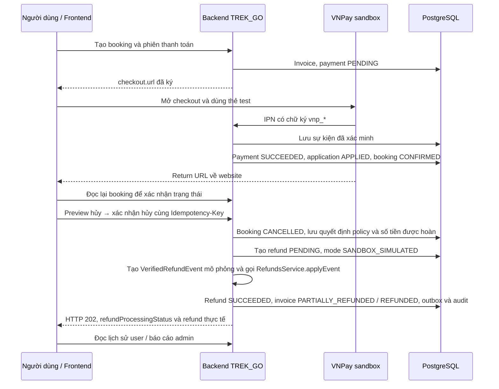

# Toàn cảnh VNPay sandbox → hủy booking → hoàn mô phỏng và hướng dẫn frontend

Đối chiếu mã nguồn workspace ngày 05/11/2026. Tài liệu mô tả code hiện có và các thay đổi FE cần thực hiện; không xác nhận frontend đã tích hợp xong hoặc server đang chạy đã được cập nhật. Lần bàn giao này chỉ bổ sung tài liệu, không sửa frontend hay dữ liệu nghiệp vụ.

## 1. Bức tranh toàn cảnh

Thanh toán đi qua cổng VNPay **sandbox thật của VNPay**; cả khoản thu lẫn khoản hoàn đều không chuyển tiền ngân hàng thật. Hoàn tiền là **giao dịch mô phỏng do backend TREK_GO ghi nhận**, không phải VNPay trả lại số dư thẻ test.



IPN và Return URL có thể đến trước hoặc sau nhau. Bộ xử lý thanh toán/outbox chạy nền nên browser trở lại website chưa đồng nghĩa booking đã CONFIRMED. FE không lấy `vnp_ResponseCode=00` trên URL làm bằng chứng cuối cùng.

Không có HTTP webhook hoàn tiền giả lập công khai. Luồng tự động gọi dịch vụ trong cùng backend; dịch vụ tạo sự kiện có dạng tương tự kết quả đã xác minh và đưa vào bộ xử lý refund chung. Không gọi HTTP vòng về chính server, không gọi VNPay refund/query-refund, và không tạo một payment mới để biểu diễn tiền hoàn.

## 2. Hoàn tự động áp dụng ở đâu?

Điều kiện chọn mode mới: payment gốc có `paymentGateway=vnpay`, `providerEnvironment=SANDBOX`, và nghiệp vụ thuộc booking.

| Tình huống | Cách xử lý hiện tại |
|---|---|
| Khách tự hủy booking đã thanh toán | Lấy policy snapshot đã lưu cùng booking, xác định tỷ lệ theo thời gian trước khởi hành, tạo refund và tự settle mô phỏng ngay trong lượt xử lý hủy |
| Admin hủy booking hợp lệ | Giữ quy tắc hoàn 100% phần còn được phép hoàn; đi cùng luồng hủy booking |
| Hủy cả chuyến được duyệt | Chuyến phát sự kiện; tác vụ nền hủy lần lượt các booking còn hợp lệ; mỗi booking tự hoàn 100% phần còn được phép hoàn |
| Thu tiền muộn, thanh toán trùng hoặc không thể áp dụng payment vào booking | Quyết định TECHNICAL_REVERSAL được worker nghiệp vụ xử lý; refund của payment booking VNPay sandbox dùng cùng mode mô phỏng |
| Chưa thanh toán hoặc policy cho hoàn 0% | Hủy hợp lệ nhưng không tạo refund |
| Rental, hoàn cọc, trail, PayOS, MoMo | Không được chuyển sang tự hoàn booking bởi thay đổi này; giữ cơ chế nghiệp vụ hiện có. API giả lập cọc cũ vẫn là chức năng riêng |
| Refund cũ ở mode PROVIDER_API | Không tự đổi mode hoặc coi như đã hoàn mô phỏng |
| Payment thuộc môi trường thanh toán PRODUCTION | Không được hoàn giả lập bằng mode này |

Các điều kiện hủy hiện có vẫn áp dụng: đúng quyền, trước khởi hành với khách tự hủy, policy hợp lệ và không còn đơn thuê liên quan đang chặn. FE dùng preview để hiển thị blockers, không bỏ qua chúng.

Hủy booking riêng khi chuyến đang chờ duyệt hủy vẫn theo policy khách tự hủy. Nếu sau đó chuyến được duyệt hủy, booking đã hủy trước đó không được tự hoàn bù lên 100%.

### Worker còn làm gì?

Vẫn có worker xử lý IPN, áp dụng payment, hủy cả chuyến, thông báo, hoàn kỹ thuật và phục hồi công việc nội bộ. **Chỉ bỏ việc worker gửi/query VNPay refund cho mode SANDBOX_SIMULATED.** Recovery provider hiện chỉ chọn refund `execution_mode=PROVIDER_API`.

## 3. Database thay đổi gì để chứng minh đã hoàn mô phỏng?

Schema mới chỉ bổ sung một giá trị enum bằng migration additive:

```sql
ALTER TYPE "refund_execution_mode"
ADD VALUE IF NOT EXISTS 'SANDBOX_SIMULATED';
```

Không tạo bảng ví, không cộng số dư `users`, không đổi số dư ngân hàng/thẻ test và không xóa payment gốc.

| Bảng | Dấu vết khi thanh toán / hoàn |
|---|---|
| `invoices` | Hóa đơn booking; sau thanh toán PAID; sau hoàn đủ REFUNDED, hoàn một phần PARTIALLY_REFUNDED |
| `payments` | Payment VNPay sandbox gốc giữ trạng thái SUCCEEDED và transaction_ref; khoản thu là sự kiện lịch sử có thật trong sandbox |
| `payment_webhook_events` | Lưu IPN thanh toán và kết quả xác minh/xử lý. Hoàn tự động không tạo IPN VNPay giả ở bảng này |
| `payment_applications` | APPLIED khi tiền được áp dụng cho booking; REJECTED nếu cần hoàn kỹ thuật. Hoàn không biến REJECTED thành APPLIED |
| `bookings` | CONFIRMED sau payment được áp dụng; CANCELLED khi hủy. Không có trạng thái booking REFUNDED trong luồng này |
| `booking_cancellations` | Ai hủy, nguồn USER/ADMIN/ORGANIZER, lý do, thời điểm, refundable_amount, policy_snapshot gồm decision.percent/paymentId/refundableAmount cho booking đã trả tiền |
| `refunds` | Gắn payment_id và booking_cancellation_id; purpose BOOKING_CANCELLATION hoặc TECHNICAL_REVERSAL; amount, execution_mode SANDBOX_SIMULATED; PENDING → SUCCEEDED; refunded_at, refund_transaction_ref, reconcile_status RESOLVED |
| `refunds.provider_payload.sandboxSimulation` | simulationId, providerEventId, status, requestedAt/committedAt, origin, trigger, beneficiaryUserId, actorAdminId, reason, warnings. Đây là dấu phân biệt kết quả mô phỏng với xác nhận ngân hàng |
| `booking_outbox_events` | Lưu việc hủy và công việc cần tiếp tục khi lỗi; hủy cả chuyến còn có sự kiện phân phối cho từng booking |
| `payment_outbox_events` | REFUND_SUCCEEDED, aggregate_type Refund, aggregate_id refundId, payload.confirmationSource SANDBOX_SIMULATION và số tiền |
| `audit_logs` | BOOKING_SANDBOX_REFUND_SIMULATION_REQUESTED/ACCEPTED cho tự động; ADMIN_SANDBOX_REFUND_SIMULATION_REQUESTED/ACCEPTED cho thao tác admin |
| `idempotency_records` | Lưu kết quả thao tác mô phỏng để replay; ngoài ra refund có unique identity theo payment và business action để chống hoàn trùng |

`refundTransactionRef` có thể là chuỗi số được backend tạo ổn định. Hình thức giống mã giao dịch không biến nó thành chứng từ VNPay; phải đọc cùng executionMode/provenance.

Ví dụ **minh họa**, không phải dữ liệu đã truy vấn: thu 100.000đ, policy cho hoàn 70% → payment vẫn SUCCEEDED 100.000đ, refund SUCCEEDED 70.000đ, invoice PARTIALLY_REFUNDED, booking CANCELLED. Dòng tiền demo admin: vào 100.000đ, ra 70.000đ, chênh lệch 30.000đ. Không có tiền thật chuyển về ngân hàng.

Refund, cập nhật invoice và sự kiện REFUND_SUCCEEDED được ghi trong transaction settlement dùng chung. Quyết định hủy, bước chuẩn bị provenance và bước lưu kết quả/idempotency là các transaction riêng. Có thể quan sát trạng thái trung gian nếu lỗi giữa các bước; không giả định toàn bộ hủy và hoàn nằm trong một transaction duy nhất.

### SQL chỉ đọc để trình bày bằng chứng

Chạy bằng công cụ quản trị DB, không gọi trực tiếp từ frontend. Thay `<BOOKING_UUID>` bằng booking cần kiểm tra. LEFT JOIN giữ lại cả booking chưa có refund.

```sql
SELECT b.id AS booking_id, b.user_id AS booking_owner, b.status AS booking_status,
       i.id AS invoice_id, i.status AS invoice_status,
       p.id AS payment_id, p.status AS payment_status,
       p.payment_gateway, p.provider_environment, p.transaction_ref,
       p.amount AS collected_amount, pa.status AS application_status,
       c.id AS cancellation_id, c.source AS cancellation_source,
       c.refundable_amount AS policy_approved_refund,
       c.policy_snapshot -> 'decision' AS policy_decision,
       r.id AS refund_id, r.purpose, r.amount AS refund_amount,
       r.status AS refund_status, r.execution_mode,
       r.refund_transaction_ref, r.refunded_at, r.reconcile_status,
       r.provider_payload -> 'sandboxSimulation' AS simulation_evidence
FROM bookings b
JOIN invoices i ON i.booking_id = b.id
LEFT JOIN payments p ON p.invoice_id = i.id
LEFT JOIN payment_applications pa ON pa.payment_id = p.id
LEFT JOIN refunds r ON r.payment_id = p.id
LEFT JOIN booking_cancellations c ON c.id = r.booking_cancellation_id
WHERE b.id = '<BOOKING_UUID>'::uuid
ORDER BY p.created_at, r.created_at;
```

Với booking hoàn 0%, xem quyết định hủy riêng vì không có refund để nối vào cancellation:

```sql
SELECT id, booking_id, source, cancelled_by, cancelled_at,
       refundable_amount, policy_snapshot
FROM booking_cancellations
WHERE booking_id = '<BOOKING_UUID>'::uuid;
```

Kiểm tra outbox/audit theo refund lấy từ truy vấn trên:

```sql
SELECT id, event_type, aggregate_type, aggregate_id, payload, status
FROM payment_outbox_events
WHERE aggregate_type = 'Refund' AND aggregate_id = '<REFUND_UUID>'::uuid;

SELECT action, entity_type, entity_id, new_values, created_at
FROM audit_logs
WHERE entity_type = 'Refund' AND entity_id = '<REFUND_UUID>'
ORDER BY created_at;
```

Chứng minh hoàn mô phỏng bằng tổ hợp: đúng payment/owner, amount đúng policy, refund SUCCEEDED + refunded_at, execution_mode, provenance, invoice và outbox/audit. Chỉ có booking CANCELLED hoặc chỉ có số tiền refundableAmount chưa đủ chứng minh hoàn tất.

## 4. Frontend hiện đã tích hợp đến đâu?

Đã có thanh toán VNPay sandbox, lựa chọn gateway, trang return, preview hủy và gọi API hủy. **Chưa tích hợp đầy đủ contract hoàn tự động mới vào UI booking/admin.**

Các điểm đã kiểm tra:

- `web/src/features/bookings/services/booking.api.ts`: cancelBooking chỉ khai báo trả status/refundableAmount; chưa khai báo refund/refundProcessingStatus.
- `web/src/features/bookings/types/booking.types.ts` và `web/src/features/bookings/booking.api.ts`: RefundItem/Booking.refunds mới có refundId/status/amount. Có hai nơi khai báo nên cần đồng bộ, không chỉ sửa một nơi.
- `web/src/features/bookings/components/BookingCancellation.tsx`: chỉ giữ refundableAmount, thông báo khoản hoàn “được xử lý riêng qua cổng thanh toán”; chưa phản ánh settlement mô phỏng.
- `web/src/features/bookings/hooks/useBookingMutations.ts`: kiểu trả về hook hủy cũng cần mở rộng để không bỏ qua thông tin mới.
- `web/src/app/(private)/(user)/payment-return/page.tsx`: hiện có chuyển tiếp tham số VNPay về backend và tải booking, nhưng nhánh isSuccess vẫn dựa query string. Việc tải booking chưa biến nó thành nguồn xác nhận thành công cuối cùng.
- Rental đã có một số nhãn SANDBOX_SIMULATED và API giả lập cọc. Chúng không chứng minh UI booking đã xử lý contract mới.
- Chưa thấy frontend gọi các endpoint admin/cashflow/summary hoặc admin/transactions trong `web/src` tại thời điểm đối chiếu. Trang hủy chuyến có hiển thị refunds cơ bản nhưng vẫn cần nhãn mô phỏng và refresh trạng thái.

### Một khác biệt API phải tính đến

`GET /bookings/:id` hiện trả refunds[].executionMode, purpose, status, refundedAt…, nhưng confirmationSource của refund mô phỏng **vẫn null** và chưa có warnings/settlementMode trong projection này.

Vì vậy, FE nhận diện loại giao dịch bằng `executionMode === 'SANDBOX_SIMULATED'`, nhưng chỉ báo hoàn thành khi `status === 'SUCCEEDED'`. Nếu cần trường xác nhận/cảnh báo đầy đủ, đọc response hủy, `/user/transactions` hoặc API detail admin theo đúng quyền. Không gọi endpoint admin bằng tài khoản user; không coi confirmationSource null ở booking detail là hoàn thất bại.

Không dùng GET `admin/payment-refunds/:id/sandbox-simulation` làm nguồn bắt buộc của UI production: endpoint legacy này hiện vẫn dùng kiểm tra môi trường cũ. Dùng admin refund detail để đọc trạng thái, và POST simulate/reconcile để phục hồi khi cần.

## 5. Contract và cách tích hợp giao diện

Mọi endpoint dưới đây có prefix `/api/v1`. API nghiệp vụ dùng Bearer token; IPN là endpoint VNPay, không phải thao tác UI để tự xác nhận tiền. Thành công thường trả object trực tiếp; riêng POST admin simulate trả `{ data: ... }`. Lỗi đọc `response.data.error` và `meta`.

### A. Thanh toán và trang return

1. `GET /payments/options`: lấy gateway đang bật; trong demo chọn VNPay SANDBOX từ kết quả backend.
2. `POST /bookings/:id/payments`, giữ cùng Idempotency-Key khi retry cùng yêu cầu:

```json
{ "paymentMethod": "REDIRECT", "gateway": "vnpay" }
```

3. Đọc `checkout.type` thực tế: REDIRECT thì mở checkout.url; không tự dựng URL, không cần hash secret ở FE. Gửi QR cũng có thể nhận REDIRECT cho VNPay.
4. Nếu HTTP 202 chưa có checkout, giữ màn hình “Đang tạo phiên thanh toán”; đọc lại trạng thái hoặc retry đúng key. Không tạo liên tiếp payment mới vì timeout.
5. Khi return về `/payment-return?bookingId=...`, đọc `GET /bookings/:id`. Đợi paymentSummary.status SUCCEEDED, applicationStatus APPLIED và booking CONFIRMED để báo booking thành công.
6. Payment SUCCEEDED nhưng application REJECTED: hiển thị “Thanh toán đã được ghi nhận nhưng không áp dụng được cho booking; đang xử lý hoàn mô phỏng”, theo dõi refund TECHNICAL_REVERSAL. Không đổi payment thành FAILED để che khoản đã thu.

Polling đề xuất: mỗi 2 giây, tối đa 30 lần; dừng khi có kết quả cuối, rời trang hoặc đổi booking. Hết thời gian chờ hiển thị “Đang xác minh”, nút tải lại; không tự kết luận thất bại. Backend IPN công khai vẫn là luồng chính; việc frontend hiện chuyển tiếp query không phải bằng chứng đã xác nhận thành công.

### B. Preview và xác nhận hủy

`GET /bookings/:id/cancellation-preview` → hiển thị canCancel, refundableAmount, rentals blockers và tripCancellationPending. Số tiền preview là dự kiến; backend tính lại tại thời điểm xác nhận, nhất là sát mốc policy.

`POST /bookings/:id/cancellations` (alias `:id/cancel`):

```http
Idempotency-Key: <uuid-giu-nguyen-khi-retry-cung-thao-tac>
Content-Type: application/json

{ "reason": "Thay đổi kế hoạch" }
```

HTTP 202 thành công, ví dụ các trường cần dùng:

```json
{
  "bookingId": "<uuid>",
  "cancellationId": "<uuid>",
  "status": "CANCELLED",
  "refundableAmount": "70000",
  "currency": "VND",
  "refundProcessingStatus": "COMPLETED",
  "refund": {
    "refundId": "<uuid>",
    "paymentId": "<uuid>",
    "purpose": "BOOKING_CANCELLATION",
    "amount": "70000",
    "status": "SUCCEEDED",
    "executionMode": "SANDBOX_SIMULATED",
    "confirmationSource": "SANDBOX_SIMULATION",
    "settlementMode": "SANDBOX_SIMULATED",
    "warnings": ["TEST_ONLY", "NO_REAL_MONEY_RETURNED"]
  }
}
```

Mở rộng type của API service và hook; giữ cả object kết quả trong component thay vì chỉ giữ refundableAmount. Ví dụ type tối thiểu cho **response hủy**, không áp nguyên xi các trường required này vào booking detail:

```ts
type CancelBookingResponse = {
  bookingId: string;
  cancellationId: string;
  status: 'CANCELLED';
  refundableAmount: string;
  currency: string;
  refundProcessingStatus: 'COMPLETED' | 'PENDING' | 'NOT_REQUIRED';
  refund: null | {
    refundId: string;
    paymentId: string;
    purpose: string;
    amount: string;
    status: string;
    executionMode: string;
    confirmationSource: string | null;
    settlementMode?: string;
    warnings?: string[];
  };
};
```

| Dữ liệu thực tế | Câu hiển thị đề xuất |
|---|---|
| COMPLETED, refund SUCCEEDED, mode mô phỏng | “Đã hủy booking và ghi nhận hoàn mô phỏng 70.000đ” + badge “Sandbox / mô phỏng” |
| PENDING, refund PENDING/PROCESSING hoặc null | “Đã hủy booking. Khoản hoàn đang chờ ghi nhận mô phỏng” |
| NOT_REQUIRED, refund null | “Đã hủy booking. Không phát sinh khoản hoàn” |
| Refund FAILED | “Hoàn mô phỏng không thành công; cần kiểm tra” |
| reconciliationRequired=true | “Cần kiểm tra trạng thái xử lý”; không tự giả lập thêm hoặc tạo refund mới |

Luôn có chú thích cho refund mô phỏng: **“Không có tiền thật được chuyển về tài khoản ngân hàng.”** Không dùng câu “VNPay đã hoàn tiền”, “Tiền đã về thẻ” hoặc hiển thị số dư ngân hàng giả.

Sau hủy, invalidate/refetch chi tiết booking, danh sách booking và lịch sử giao dịch. Khi PENDING, poll detail và/hoặc lịch sử user để lấy refund mới; refund null chỉ có nghĩa không phát sinh hoàn khi đồng thời NOT_REQUIRED. Mất kết nối sau POST thì giữ key và body cũ để retry; không tạo key mới cho mỗi lần bấm thử lại.

### C. Chi tiết booking và lịch sử user

- `GET /bookings/:id`: trạng thái booking, paymentSummary và refunds của chính chủ. Phân biệt khoản thu gốc với từng refund theo refundId, paymentId, purpose.
- `GET /user/transactions?source=BOOKING&page=1&pageSize=20`: bảng lịch sử có PAYMENT/REFUND, executionMode, confirmationSource, settlementMode, warnings; chỉ dữ liệu của tài khoản đăng nhập.
- Thêm filter kind=PAYMENT hoặc kind=REFUND khi cần. Luồng mới không tạo refund giả thuộc user khác chỉ vì dùng chung thẻ test.
- Tại user timeline, financialEffect DEBIT nghĩa user thanh toán, CREDIT nghĩa user được ghi nhận hoàn; đây là hướng nhìn của user, khác CASH_IN/CASH_OUT của admin.
- Không cộng cùng refund nhiều lần từ response hủy, booking detail và timeline; dùng refundId làm khóa.

### D. Màn hình quản trị dòng tiền

| Endpoint | Mục đích |
|---|---|
| GET /admin/cashflow/summary | Tổng thu/chi đã thành công, pending riêng, chênh lệch và phân nhóm |
| GET /admin/transactions | List/payment/refund, source, direction, status, category, userId, thời gian, page/pageSize |
| GET /admin/payments/:id | Payment sandbox gốc, owner và refund mô phỏng liên quan |
| GET /admin/refunds/:id | Chi tiết khoản hoàn, nguồn payment, confirmation và cảnh báo mô phỏng |
| GET /admin/trip-cancellation-requests/:id | Theo dõi tiến độ hủy cả chuyến qua contract hiện có, không suy từ mỗi HTTP duyệt hủy |

Mặc định gateway=vnpay. ALL/BOTH chỉ là alias của VNPay sandbox. Bỏ lựa chọn PayOS/MoMo khỏi **màn hình dòng tiền này**; filter đó trả 400. Không xóa tích hợp thanh toán khác ở module ngoài phạm vi. Detail ngoài phạm vi trả 404. Trường PayOS cũ deprecated, trả null/0.

Tổng chi chỉ tính refund SUCCEEDED có mode/dấu vết mô phỏng và payment gốc VNPay sandbox SUCCEEDED. Pending không cộng vào tổng chi đã hoàn. Nếu cần chỉ booking, truyền source=BOOKING cho cả summary và list. Giữ cùng filter khi refresh hoặc mở trang để số tổng và danh sách khớp nhau. Chênh lệch là số liệu demo, không phải ví tiền của hệ thống.

### E. Nút admin phục hồi, không nằm trong thao tác khách hủy bình thường

Chỉ admin, chỉ hiển thị khi API báo canSimulateSandbox và refund đang chờ. Không tự gọi từ FE sau mỗi lần user bấm hủy; backend đã tự thực hiện.

```http
POST /api/v1/admin/payment-refunds/<refundId>/sandbox-simulate-settlement
Idempotency-Key: <uuid-on-dinh-cho-thao-tac-admin>
Content-Type: application/json

{
  "reason": "Phục hồi hoàn mô phỏng demo",
  "acknowledgeSandboxSimulation": true,
  "expectedProviderStatus": "PENDING"
}
```

Có thể thêm expectedVersion nếu có version hiện tại từ contract tương ứng; không tự bịa version. Thành công đọc response.data.data khi dùng Axios. Refetch detail/list/summary sau đó. `POST /admin/refunds/:id/reconcile` cũng phục hồi refund mode mới bằng logic nội bộ; không gọi VNPay. Không gửi số tiền hay tài khoản nhận tiền từ FE.

## 6. Checklist giao diện và nghiệm thu

Tái sử dụng `@/components/ui`: PageShell, PageHeader, SurfaceCard, Button, FormField, StatusBadge, LoadingState, EmptyState, ErrorAlert. Không tạo response envelope mới hoặc gọi DB trực tiếp. Giữ lỗi GlobalErrorFilter; 409 yêu cầu tải lại trạng thái/preview, lỗi mạng cho retry đúng key, 401 qua xử lý auth dùng chung.

Các bước triển khai FE: đồng bộ types/service/hook → sửa thông báo hủy và khối refund booking → sửa nguồn xác nhận payment-return → tích hợp lịch sử user và admin → thêm recovery admin tùy nhu cầu. Không sửa API backend trong tác vụ chỉ làm FE.

Kiểm tra giao diện với: thanh toán rồi hoàn 100%/một phần; hoàn 0% và chưa thanh toán; refund PENDING khi simulation chưa bật rồi phục hồi; hai user cùng thẻ test nhưng khác payment; hủy cả chuyến; payment SUCCEEDED/application REJECTED; reload sau hủy; timeout/retry; query Return URL bị sửa nhưng backend chưa xác nhận; filter admin PayOS bị từ chối. UI không được báo tiền thật đã về trong bất kỳ trường hợp mô phỏng nào.

Vận hành local và các biến môi trường xem thêm [BOOKING_SANDBOX_REFUND_DEMO.md](BOOKING_SANDBOX_REFUND_DEMO.md). `NODE_ENV=production` vẫn chạy mô phỏng booking khi bật cờ và dùng payment SANDBOX trên database được cho phép; không đồng nghĩa mở simulation cho payment PRODUCTION.
