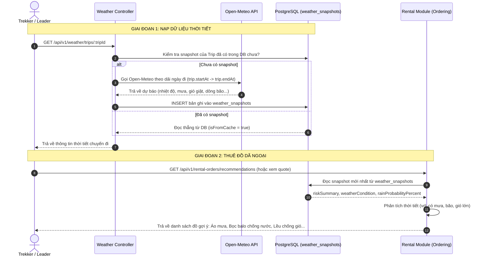

# HƯỚNG DẪN TÍCH HỢP WEATHER API & LUỒNG RENTAL (THUÊ ĐỒ)

Tài liệu này hướng dẫn chi tiết cách thức hoạt động của **Weather API** và cách dữ liệu thời tiết được sử dụng trực tiếp để phục vụ tính năng **Gợi ý thuê đồ (Rental Recommendations)** trong Vina_TrekGO.

---

## 1. TỔNG QUAN KIẾN TRÚC & MỤC ĐÍCH



---

## 2. QUY TẮC NGHIỆP VỤ CỐT LÕI

1. **Dự báo theo đúng dải ngày khởi hành của chuyến đi:**
   - Hệ thống không lấy thời tiết hiện tại lúc bấm API, mà lấy dự báo của **tất cả các ngày đoàn đi trekking** (`startAt` đến `endAt`).
   - Nếu tour 2 ngày 1 đêm (16/10 đến 17/10), hệ thống sẽ gửi `start_date=2026-10-16&end_date=2026-10-17` sang Open-Meteo.
2. **Quy tắc Lưu trữ & Cache (Idempotent):**
   - Nếu chuyến đi **ĐÃ CÓ bản ghi thời tiết trong DB** $\rightarrow$ Trả về ngay từ DB (`isFromCache: true`), **tuyệt đối không gọi lại Open-Meteo**.
   - Nếu **CHƯA CÓ** $\rightarrow$ Mới gọi Open-Meteo, đánh giá rủi ro, lưu vào bảng `weather_snapshots` và trả về.
3. **Decoupled Architecture (Rental không gọi API bên thứ ba):**
   - Theo quy tắc an toàn `RC-BR-11`, module Rental **chỉ đọc từ database**. Rental tuyệt đối không gọi Open-Meteo khi khách tạo đơn thuê đồ để tránh làm nghẽn hoặc sập luồng thanh toán khi mạng chập chờn.

---

## 3. CHI TIẾT API WEATHER

### `GET /api/v1/weather/trips/:tripId`

Lấy thông tin thời tiết và dự báo cho chuyến đi theo ngày khởi hành.

- **URL:** `/api/v1/weather/trips/:tripId`
- **Method:** `GET`
- **Auth:** Bearer Token (`USER`, `LEADER`, `ADMIN` tham gia hoặc sở hữu Trip).
- **Path Param:** `tripId` (UUID).

#### Ví dụ Response (HTTP 200 OK):

```json
{
  "tripId": "eee0133d-2ab0-4d98-9998-28e6ca0bbec4",
  "destinationName": "[DEMO CF01] Núi Bà Đen - Tây Ninh",
  "startDate": "2026-10-16",
  "endDate": "2026-10-17",
  "targetTripDate": "2026-10-16 -> 2026-10-17",
  "durationDays": 2,
  "isFromCache": true,
  "snapshot": {
    "id": "6c0a75e6-76bd-4a6c-8e60-a91bcedeea1f",
    "provider": "OPEN_METEO",
    "observedAt": "2026-10-13T07:19:41.420Z",
    "temperatureC": 27.8,
    "apparentTemperatureC": 34.7,
    "humidityPercent": 89.7,
    "windSpeedMps": 2.55,
    "windGustMps": 5.7,
    "precipitationMm": 7.4,
    "rainProbabilityPercent": 82,
    "weatherCode": 95,
    "weatherCondition": "Dông bão",
    "riskLevel": "SEVERE",
    "riskSummary": "Cảnh báo dông bão. Có khả năng mưa (dông bão), cần chuẩn bị áo mưa."
  },
  "forecast": [
    {
      "date": "2026-10-16",
      "weatherCode": 95,
      "condition": "Dông bão",
      "temperatureMaxC": 31.1,
      "temperatureMinC": 24.4,
      "precipitationSumMm": 7.4,
      "rainProbabilityPercent": 82,
      "windSpeedMaxMps": 2.55,
      "windGustMaxMps": 5.7
    },
    {
      "date": "2026-10-17",
      "weatherCode": 61,
      "condition": "Mưa nhẹ",
      "temperatureMaxC": 30.0,
      "temperatureMinC": 23.5,
      "precipitationSumMm": 4.6,
      "rainProbabilityPercent": 45,
      "windSpeedMaxMps": 3.2,
      "windGustMaxMps": 6.5
    }
  ]
}
```

---

## 4. DỮ LIỆU ĐƯỢC MODULE RENTAL TIÊU THỤ NHƯ THẾ NÀO?

Trong module Rental:

### 1. Adapter đọc dữ liệu từ DB
File: `src/modules/rental/ordering/infrastructure/adapters/prisma-rental-context.adapter.ts`
```typescript
weatherSnapshotsViaTripId: {
  take: 1,
  orderBy: { observedAt: 'desc' },
  select: { riskSummary: true, weatherCondition: true, rainProbabilityPercent: true },
}
...
weatherSummary: weather?.riskSummary ?? weather?.weatherCondition ?? null,
rainProbabilityPercent: weather?.rainProbabilityPercent == null ? null : Number(weather.rainProbabilityPercent),
```

### 2. Logic gợi ý thiết bị thuê (Rental Recommendations)
File: `src/modules/rental/ordering/application/use-cases/get-rental-recommendations.use-case.ts`
- Hệ thống kiểm tra:
  ```typescript
  const weatherText = (input.weatherSummary ?? '').toLowerCase();
  const isRainy = weatherText.includes('mưa') || weatherText.includes('rain');
  ```
- Nếu phát hiện **mưa** hoặc **xác suất mưa cao**:
  - Gắn nhãn khuyến nghị ưu tiên cho các trang bị:
    - 🧥 Áo mưa bộ chuyên dụng trekking
    - 🎒 Bọc trùm balo chống thấm
    - 🏕️ Lều chống thấm nước 2 lớp
    - 🦯 Gậy leo núi (chống trơn trượt bùn lầy)

---

## 5. HƯỚNG DẪN TEST TÍCH HỢP TỪNG BƯỚC (STEP-BY-STEP)

Để kiểm tra trọn vẹn luồng từ Weather đến Rental Recommendations:

### Bước 1: Khởi tạo thời tiết cho chuyến đi
Gọi API Weather với `tripId` bạn muốn test:
```bash
curl -X GET "http://localhost:3000/api/v1/weather/trips/<TRIP_ID>" \
  -H "Authorization: Bearer <ACCESS_TOKEN>"
```
- **Kiểm tra:**
  - Lần 1: Gọi Open-Meteo, trả về `isFromCache: false`, DB có thêm 1 dòng trong bảng `weather_snapshots`.
  - Lần 2: Gọi lại cùng URL, trả về `isFromCache: true` (lấy thẳng từ DB).

### Bước 2: Xem danh sách đồ thuê được gợi ý theo thời tiết
Gọi API Rental Recommendations:
```bash
curl -X GET "http://localhost:3000/api/v1/rental-orders/recommendations?tripId=<TRIP_ID>" \
  -H "Authorization: Bearer <ACCESS_TOKEN>"
```
- **Kiểm tra kết quả:**
  - Dữ liệu `weatherSummary` hiển thị đúng nội dung đã lưu từ Weather API.
  - Các trang bị liên quan đến mưa/thời tiết khắc nghiệt tự động được đẩy lên danh sách khuyến nghị thuê.
