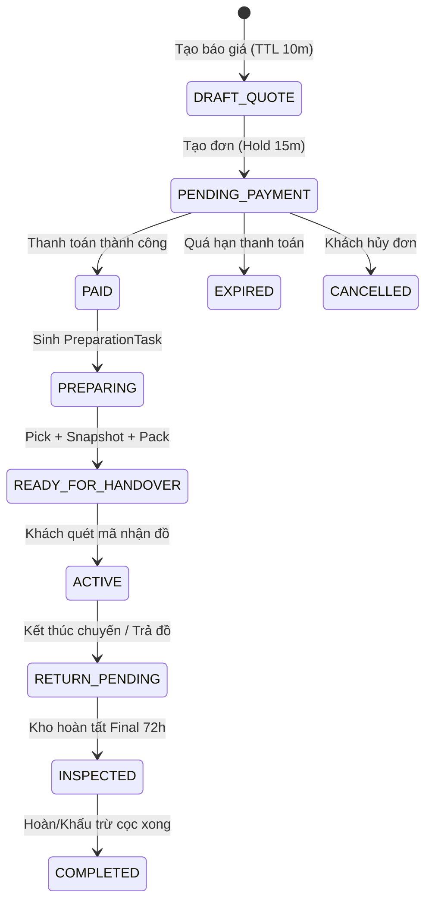
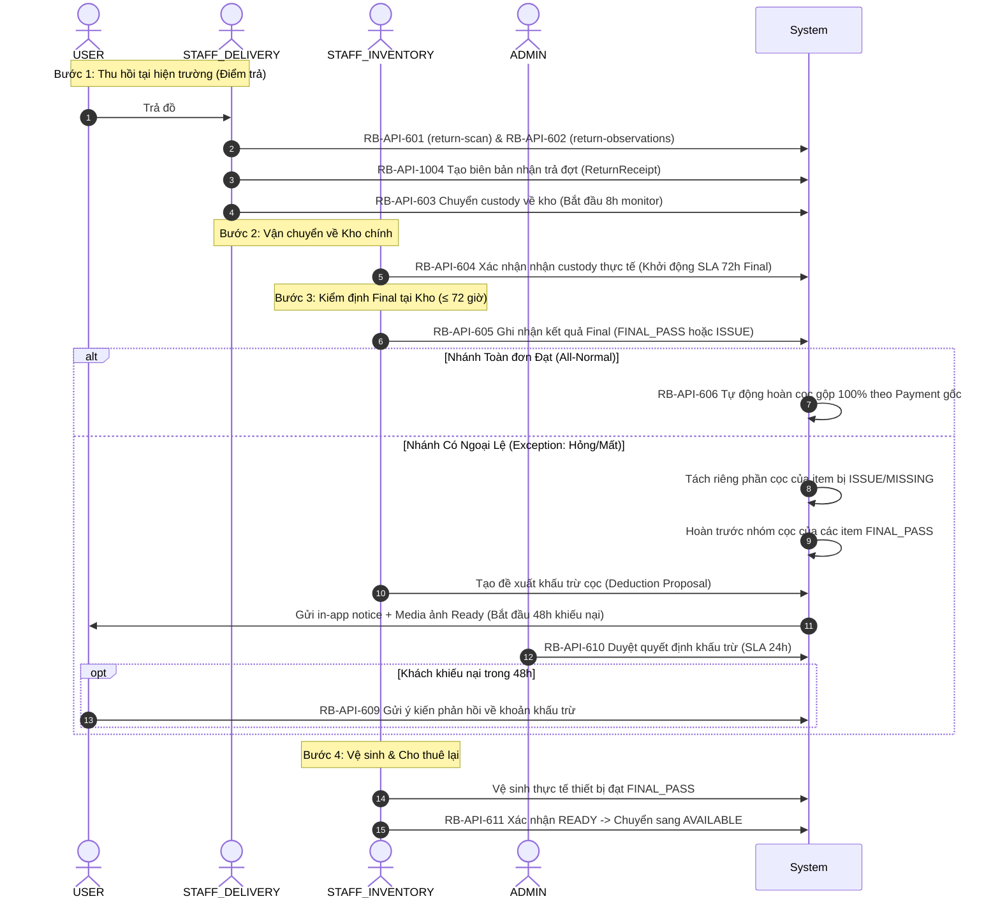

# TREKGO — AREA B FUNCTIONAL REQUIREMENTS & BUSINESS SPECIFICATION
## Mảng Thuê Trang Thiết Bị / Kho / Giao Nhận / Quyết Toán Cọc
### (Rental / Inventory / Warehouse / Logistics / Deposit Settlement)

**Phiên bản:** SOURCE OF TRUTH v1.3.2 | **Chính sách:** Policy v1.5.2  
**Kế thừa và chuẩn hóa:** `BA_ERRATA_01`, `BA_ERRATA_02`, `MVP_SINGLE_LOCATION_01` (Chốt ngày 10/10/2026)  
**Tài liệu tham chiếu chuẩn:**
1. `TrekGo_Rental_Return_Business_Flow_SOURCE_OF_TRUTH_v1.3.2_BA_ERRATA_01_MVP_SINGLE_LOCATION_01.docx`
2. `TrekGo_Area_B_Policy_SOURCE_OF_TRUTH_v1.5.2_BA_ERRATA_01_MVP_SINGLE_LOCATION_01.docx`
3. `TrekGo_Area_B_Functional_Requirements_SOURCE_OF_TRUTH_v1.3.2_BA_ERRATA_01_MVP_SINGLE_LOCATION_01.docx`

---

## 1. MỤC ĐÍCH & PHẠM VI HỆ THỐNG

Tài liệu này là bản đặc tả nghiệp vụ chuẩn hóa cao nhất (Source of Truth) cho Mảng B của TrekGo. Đây là cơ sở duy nhất để thiết kế cơ sở dữ liệu, xây dựng giao diện (Web/Mobile), triển khai mã nguồn Backend (NestJS Hexagonal Architecture), viết kiểm thử tự động (Unit/Integration/E2E) và tích hợp liên miền với Mảng A (Trip/Booking) và Shared Payment/Media.

### 1.1. Phạm vi chu trình nghiệp vụ End-to-End
Mảng B chịu trách nhiệm toàn bộ vòng đời từ:
$$\text{Danh mục thiết bị} \longrightarrow \text{Kiểm tra điều kiện Trip} \longrightarrow \text{Báo giá \& Giữ số lượng} \longrightarrow \text{Thanh toán (Thuê + Cọc)}$$
$$\longrightarrow \text{Kho chuẩn bị \& Gán món vật lý} \longrightarrow \text{Giao nhận tại điểm đón} \longrightarrow \text{Trong chuyến \& Gia hạn}$$
$$\longrightarrow \text{Thu hồi sơ bộ} \longrightarrow \text{Kho nhận \& Kiểm định 72h} \longrightarrow \text{Hoàn/Trừ cọc gộp} \longrightarrow \text{Vệ sinh \& Sẵn sàng}$$

### 1.2. Ba nguyên tắc nghiệp vụ bất biến khi lập trình
1. **Không bao giờ giữ vượt số lượng an toàn theo thời gian (Capacity Safety Gate):** Ở bước tạo đơn/thanh toán, chỉ giữ số lượng theo loại sản phẩm (`RentalQuantityReservation`) trên cửa sổ chiếm chỗ an toàn (`occupiedWindow`); không gán cứng thiết bị vật lý cụ thể.
2. **Chỉ gán món vật lý (`EquipmentUnit`) tại bước Kho chuẩn bị (Preparation):** Sau khi đơn thanh toán thành công (`PAID`), `STAFF_INVENTORY` nhặt thiết bị cụ thể mới tạo `RentalUnitAssignment`. Mọi món vật lý được giao bắt buộc phải truy vết đầy đủ qua `assetCode`/QR và có ảnh chụp tình trạng trước khi bàn giao.
3. **Phân định trách nhiệm thu hồi và hoàn cọc (Hybrid Return):**
   * `STAFF_DELIVERY` tại điểm trả chỉ thực hiện kiểm đếm, ghi nhận ngoại quan sơ bộ (`return-observations`) và lập biên bản nhận trả đợt (`ReturnReceipt`); **tuyệt đối không kết luận FINAL và không hoàn cọc tại chỗ**.
   * `STAFF_INVENTORY` tại kho là role duy nhất xác nhận nhận thực tế (`custody receivedAt`) và thực hiện **FINAL INSPECTION 100% món thực nhận trong thời hạn SLA ≤ 72 giờ**.
   * **Thiết bị sau khi kiểm tra đạt không được tự động chuyển về `AVAILABLE`:** Bắt buộc phải qua bước làm sạch thực tế và xác nhận `READY` qua API chuyên trách (`RB-API-611`).

### 1.3. Phạm vi Single Inventory Location MVP (RB-POL-33)
* Trong giai đoạn MVP, hệ thống vận hành trên **một kho chính duy nhất** được cấu hình bởi biến môi trường `RENTAL_PRIMARY_INVENTORY_LOCATION_ID`.
* USER không được chọn kho. Báo giá, kiểm tra tồn kho, tạo đơn, giữ số lượng, chuẩn bị và bàn giao hoàn trả đều ràng buộc vào kho chính này.
* Thao tác tạo thiết bị của Staff chấp nhận nhãn hiển thị hoặc mã kho nhưng phải khớp với kho chính; nếu sai hoặc thiếu cấu hình kho, hệ thống áp dụng cơ chế **Fail-Closed** để bảo vệ tính toàn vẹn tồn kho.

---

## 2. PHẠM VI DOMAIN & QUYỀN SỞ HỮU (OWNERSHIP)

| Domain / Entity | Đơn vị sở hữu | Quyền của Mảng B | Ranh giới với mảng khác |
| :--- | :--- | :--- | :--- |
| **RentalProduct / Category** | Area B (Rental) | CRUD danh mục, loại sản phẩm, giá thuê/ngày, chính sách cọc, ảnh, thông số kỹ thuật. | Mảng khác chỉ đọc (consume); không sửa trực tiếp. |
| **EquipmentUnit** | Area B (Rental) | CRUD thiết bị vật lý, quản lý `assetCode`/QR, tình trạng (`condition`), trạng thái vòng đời, lịch sử bảo trì. | Trip/Booking/GPS không được sửa trạng thái unit. |
| **RentalOrder / RentalOrderLine** | Area B (Rental) | Tạo đơn, tính quote, quản lý vòng đời đơn thuê, gắn với `tripId` + `TripMembership` (và `bookingId` nếu có để truy vết). | Area A sở hữu Trip/Booking; Booking chỉ mang tính chất nguồn gốc (provenance); không sửa RentalOrder. |
| **RentalQuantityReservation** | Area B (Rental) | Giữ số lượng theo sản phẩm + cửa sổ thời gian (`occupiedWindow`); chống overbooking. | Trip phát sinh sự kiện đổi lịch/hủy. Tuyệt đối không giữ exact unit ở bước checkout. |
| **RentalUnitAssignment** | Area B (Rental) | Gắn `EquipmentUnit` vật lý cụ thể vào từng dòng đơn hàng khi `STAFF_INVENTORY` nhặt đồ (pick). | Chỉ Mảng B quản lý và lưu audit trail khi thay đổi unit. |
| **Preparation Task / Package** *(Prisma InventoryTask)* | Area B (Rental) | Tạo tác vụ kho sau khi đơn `PAID`. `STAFF_INVENTORY` scan nhặt unit, chụp ảnh bằng chứng, đóng gói (`Package`), niêm phong và bàn giao custody. | Thao tác nội bộ của Mảng B. |
| **Delivery Task / Handover / ReturnObservation** | Area B (Rental) | `STAFF_DELIVERY` nhận package từ kho, xác minh khách bằng `pickupCode` dùng 1 lần, bàn giao; khi trả thì scan/đếm, ghi nhận observation và chuyển custody về kho. | Area A cung cấp điểm tập kết (Pickup/Dropoff Point); không sửa tác vụ logistics. |
| **Trip Membership / Trip Context** | Area A (Trip) | Đọc quyền thuê qua `TripRentalContextPort` (`tripId` + `userId`). | Area A là nguồn sự thật duy nhất về tư cách tham gia chuyến đi. |
| **Payment / Refund** | Shared Payment | Tích hợp tạo thanh toán phí thuê + cọc; chia tách dòng tiền (`FEE` & `DEPOSIT`); thực hiện hoàn cọc gộp hoặc hoàn cọc theo món. | Shared Payment giữ giao dịch provider; Mảng B quản lý business state. |
| **Rental Documents** | Area B (Rental) | Tự động sinh biên bản giao nhận gốc (BBGN), phụ lục gia hạn và biên bản nhận trả đợt dạng snapshot bất biến (`immutable`). | Cung cấp tài liệu pháp lý cho User và Staff đối soát. |

---

## 3. VAI TRÒ HỆ THỐNG TRONG MẢNG B (ROLES)

| Vai trò | Trách nhiệm và quyền hạn chuẩn |
| :--- | :--- |
| **USER** | Khám phá/nhận gợi ý thiết bị theo chuyến đi; kiểm tra điều kiện thuê; chọn loại và số lượng; nhận báo giá có TTL 10 phút; thanh toán; nhận mã nhận đồ dùng 1 lần (`pickupCode`); kiểm tra thiết bị khi nhận; xin gia hạn thuê; xem bảng theo dõi cọc theo từng món; gửi khiếu nại trong 48h nếu bị đề xuất trừ cọc. |
| **STAFF_INVENTORY** *(Nhân viên Kho)* | Quản lý sản phẩm và thiết bị vật lý; tạo/in mã QR tài sản; nhận tác vụ chuẩn bị (`PreparationTask`); nhặt thiết bị hợp lệ trong kho; chụp ảnh bằng chứng trước giao (`ConditionSnapshot`); đóng gói và bàn giao custody cho Delivery; **xác nhận nhận custody thực tế khi đồ trả về kho; thực hiện FINAL INSPECTION 100% món trong thời hạn SLA ≤ 72 giờ (nhóm kiểm tra sâu ≤ 24 giờ); vệ sinh thiết bị và xác nhận READY**. |
| **STAFF_DELIVERY** *(Nhân viên Giao nhận)* | Ứng dụng di động (Mobile App): Nhận kiện hàng từ kho; có mặt tại điểm đón; xác minh khách bằng `pickupCode`; bàn giao và kích hoạt đơn sang `ACTIVE`; khi thu hồi tại điểm trả: quét kiểm đếm, ghi nhận ngoại quan sơ bộ (`return-observations`), xuất biên bản nhận trả đợt (`ReturnReceipt`), vận chuyển và bàn giao custody về kho chính. **Không có quyền kết luận FINAL_PASS và không hoàn cọc tại chỗ**. |
| **ADMIN** | Giám sát toàn bộ quy trình; cấu hình chính sách thuê/cọc/buffer thời gian; xem cảnh báo thiếu hụt công suất (`RentalCapacityAlert`); **phê duyệt các đề xuất khấu trừ cọc (deduction proposal > 0) trong thời hạn SLA 24 giờ**; xử lý tranh chấp khiếu nại. |
| **System** | Tự động hóa: Hủy giữ chỗ khi quá hạn thanh toán 15 phút (`HOLD_EXPIRED`); giám sát chuyển kho quá 8 giờ (`transferWatchAt = +8h`); kích hoạt hoàn cọc gộp tự động khi toàn đơn `FINAL_PASS`; kích hoạt đồng hồ khiếu nại 48h cho User; cảnh báo vi phạm SLA của Staff/Admin. |

---

## 4. THUẬT NGỮ & MÔ HÌNH NGHIỆP VỤ CỐT LÕI

| Thuật ngữ | Định nghĩa nghiệp vụ chuẩn |
| :--- | :--- |
| **Rental Product** | Loại sản phẩm cho thuê (ví dụ: Lều 4 người, Balo 50L,...), chứa giá thuê/ngày, chính sách cọc, thông số và metadata gợi ý. |
| **Equipment Unit** | Một món vật lý cụ thể, có mã tài sản duy nhất (`assetCode`), mã quét QR, tình trạng vật lý (`NEW`, `GOOD`, `FAIR`,...) và trạng thái vòng đời riêng. |
| **Rental Order** | Đơn thuê thuộc về một User, bắt buộc liên kết với `tripId` và `TripMembership` hợp lệ (kèm `bookingId` để truy vết). |
| **Rental Quantity Reservation** | Bản ghi khóa tạm **SỐ LƯỢNG** khả dụng của loại sản phẩm trong cửa sổ chiếm chỗ (`occupiedWindow`). Chưa gắn với thiết bị vật lý nào. |
| **Rental Unit Assignment** | Bản ghi chỉ định đích danh `EquipmentUnit` vật lý vào từng dòng đơn hàng khi Staff Kho thực hiện nhặt đồ. |
| **Preparation Task** *(InventoryTask)* | Tác vụ chuẩn bị thiết bị của `STAFF_INVENTORY` sinh ra ngay sau khi đơn hàng được thanh toán (`PAID`). |
| **Package** | Kiện hàng đã được nhặt đủ, chụp ảnh bằng chứng và đóng gói niêm phong, gắn mã `packageCode`/QR riêng. |
| **Delivery Task** *(DeliveryTask)* | Tác vụ giao đồ hoặc thu hồi đồ của `STAFF_DELIVERY` theo chuyến đi và điểm tập trung. |
| **Pickup Code** | Mã xác minh nhận đồ dùng một lần (hoặc có hiệu lực ngắn hạn) hiển thị trên app của User; `STAFF_DELIVERY` quét mã này để xác thực người nhận. |
| **Condition Snapshot** | Bằng chứng ảnh/ghi chú tình trạng thiết bị được chụp trước khi giao hoặc khi nhận trả. Là dữ liệu bất biến không được chỉnh sửa/ghi đè. |
| **Deposit Item Allocation** | Bản ghi phân bổ số tiền cọc cho từng món thiết bị vật lý cụ thể sau khi đã assign unit, dùng làm căn cứ quyết toán và hoàn cọc độc lập. |
| **Return Receipt** | Biên bản nhận trả đồ từng đợt được lập ngay khi `STAFF_DELIVERY` nhận đồ tại hiện trường, ghi nhận số lượng và hiện trạng quan sát được. |
| **Handover Document (BBGN)** | Biên bản giao nhận điện tử gốc có giá trị pháp lý, được sinh tự động sau khi hoàn tất bàn giao thiết bị cho khách. |

---

## 5. MÔ HÌNH TRẠNG THÁI (STATE MODEL BASELINE)

### 5.1. Vòng đời Trạng thái Đơn thuê (Rental Order State)
* `DRAFT_QUOTE`: Báo giá tạm thời có thời hạn hiệu lực 10 phút.
* `PENDING_PAYMENT`: Đơn hàng đã tạo, số lượng được giữ tạm trong 15 phút chờ thanh toán.
* `PAID`: Đã thanh toán đầy đủ phí thuê và tiền cọc; tác vụ chuẩn bị kho được kích hoạt.
* `PREPARING`: Nhân viên kho đang nhặt đồ, chụp ảnh và đóng gói.
* `READY_FOR_HANDOVER`: Kiện hàng đã đóng gói hoàn tất, sẵn sàng bàn giao cho nhân viên giao nhận.
* `ACTIVE`: Đã bàn giao thành công cho khách tại điểm hẹn; khách đang sử dụng đồ.
* `RETURN_PENDING`: Khách đã trả đồ tại điểm thu hồi; đang chuyển về kho hoặc đang chờ kiểm định.
* `INSPECTED`: Kho đã hoàn tất kiểm định FINAL cho toàn bộ các món thực nhận.
* `COMPLETED`: Quyết toán cọc hoàn tất (hoàn trả hoặc khấu trừ xong); đơn kết thúc.
* `CANCELLED` / `EXPIRED`: Hủy đơn hoặc hết hạn thanh toán; giải phóng số lượng giữ chỗ ngay lập tức.

### 5.2. Vòng đời Trạng thái Thiết bị Vật lý (Equipment Unit State)
$$\text{AVAILABLE} \longrightarrow \text{RESERVED} \longrightarrow \text{PICKED} \longrightarrow \text{PACKED} \longrightarrow \text{RENTED} \longrightarrow \text{RETURN\_PENDING}$$
$$\longrightarrow \text{CLEANING} \stackrel{\text{RB-API-611}}{\longrightarrow} \text{AVAILABLE}$$
*(Nếu có hư hỏng hoặc mất mát: chuyển sang `MAINTENANCE`, `DAMAGED` hoặc `LOST`)*.

> **QUY TẮC BẮT BUỘC:** Trạng thái `CLEANING` **không bao giờ tự động chuyển về `AVAILABLE`** chỉ dựa vào thời gian buffer trôi qua. Bắt buộc nhân viên kho phải vệ sinh thực tế và gọi `RB-API-611` để xác nhận `READY`.

---

## 6. PHASE 0 — DANH MỤC THIẾT BỊ & QUẢN TRỊ TỒN KHO MASTER

### 6.1. Yêu cầu chức năng (Functional Requirements)
* **RB-FR-001:** Quản lý danh mục loại sản phẩm thuê (`RentalProduct`, `RentalCategory`), giá thuê theo ngày, chính sách cọc cố định, thông số kỹ thuật và hình ảnh mô tả.
* **RB-FR-002:** Quản lý từng món thiết bị vật lý (`EquipmentUnit`) với mã tài sản duy nhất (`assetCode`), mã QR tương ứng, tình trạng ban đầu và vị trí kho chính.
* **RB-FR-003:** Xem danh sách tồn kho theo bộ lọc sản phẩm, tình trạng, trạng thái vòng đời. Toàn bộ thiết bị nhập mới bắt buộc gán vào kho chính (`RB-POL-33`).
* **RB-FR-004:** Đưa thiết bị vào bảo trì (`MAINTENANCE`) và phục hồi lại trạng thái khi bảo trì xong. Cấm đưa vào bảo trì đối với thiết bị đang `RENTED`.
* **RB-FR-005:** Xem lịch sử vòng đời bất biến của thiết bị (lịch sử cho thuê, biên bản kiểm tra, ảnh bằng chứng hư hại).

### 6.2. Danh mục API Phase 0
| Mã API | Giao thức & Đường dẫn | Quyền truy cập | Mục đích |
| :--- | :--- | :--- | :--- |
| **RB-API-001** | `GET /api/v1/rental-products` | Public / USER | Tìm kiếm, xem danh sách sản phẩm cho thuê (kèm tồn kho tóm tắt). |
| **RB-API-002** | `GET /api/v1/rental-products/:id` | Public / USER | Xem chi tiết sản phẩm, giá thuê, mức cọc, hướng dẫn sử dụng. |
| **RB-API-003** | `POST /api/v1/staff/rental-products` | STAFF_INVENTORY / ADMIN | Tạo mới loại sản phẩm cho thuê (SKU duy nhất). |
| **RB-API-004** | `PATCH /api/v1/staff/rental-products/:id` | STAFF_INVENTORY / ADMIN | Cập nhật thông tin sản phẩm, giá thuê, chính sách cọc. |
| **RB-API-005** | `PATCH /api/v1/staff/rental-products/:id/status` | STAFF_INVENTORY / ADMIN | Kích hoạt hoặc vô hiệu hóa sản phẩm (`ACTIVE` / `INACTIVE`). |
| **RB-API-006** | `GET /api/v1/staff/equipment-units` | STAFF_INVENTORY / ADMIN | Danh sách thiết bị vật lý trong kho, lọc theo tình trạng/vòng đời. |
| **RB-API-007** | `POST /api/v1/staff/equipment-units` | STAFF_INVENTORY | Khởi tạo 1 thiết bị vật lý (tự động gắn vào kho chính cấu hình). |
| **RB-API-008** | `GET /api/v1/staff/equipment-units/:id` | STAFF_INVENTORY / ADMIN | Xem chi tiết thiết bị và lịch sử sử dụng/bảo trì. |
| **RB-API-009** | `PATCH /api/v1/staff/equipment-units/:id` | STAFF_INVENTORY | Cập nhật thông tin mô tả thiết bị (không bypass lifecycle). |
| **RB-API-010** | `POST /api/v1/staff/equipment-units/:id/maintenance` | STAFF_INVENTORY | Bắt đầu hoặc kết thúc quy trình bảo trì thiết bị. |
| **RB-API-013** | `POST /api/v1/staff/equipment-units/batch` | STAFF_INVENTORY | Nhập thiết bị theo lô (batch import) gán vào kho chính. |

---

## 7. PHASE 1 — KIỂM TRA ĐIỀU KIỆN THUÊ & BÁO GIÁ TẠM (QUOTE)

### 7.1. Yêu cầu chức năng (Functional Requirements)
* **RB-FR-101 (Kiểm tra điều kiện):** USER chỉ được thuê đồ khi có xác nhận tham gia chuyến đi hợp lệ từ Mảng A (`TripRentalContextPort`: `tripId` + `userId`, trạng thái `CONFIRMED`) và thời điểm thuê chưa vượt qua giới hạn chốt sổ (`rentalCutoffAt`).
* **RB-FR-102 (Tính khả dụng an toàn - Capacity Safety Gate):** Tồn kho khả dụng được tính trên kho chính duy nhất (`RB-POL-33`) và trên cửa sổ chiếm chỗ:
  $$\text{Cửa sổ chiếm chỗ} = [\text{Trip.startAt} - 12\text{h}, \text{Trip.endAt} + \text{Buffer (24h hoặc 48h)}]$$
  Hệ thống quét các bản ghi `RentalQuantityReservation` đang hiệu lực để đảm bảo không vượt quá tổng số thiết bị `AVAILABLE` thực tế.
* **RB-FR-103 (Báo giá Rental Quote):** Báo giá phí thuê + tiền cọc dựa trên số ngày tính phí (`chargedDays`) và chính sách giá snapshot. Quote có thời hạn sống (TTL) đúng **10 phút**.

### 7.2. Danh mục API Phase 1
| Mã API | Giao thức & Đường dẫn | Quyền truy cập | Mục đích |
| :--- | :--- | :--- | :--- |
| **RB-API-101** | `GET /api/v1/trips/:tripId/rental-eligibility` | USER | Kiểm tra quyền thuê đồ của User theo chuyến đi, lấy deadline thuê và khung ngày mặc định. |
| **RB-API-102** | `GET /api/v1/rentals/availability` | USER | Tra cứu số lượng thiết bị khả dụng theo chuyến đi trên kho chính. |
| **RB-API-103** | `POST /api/v1/rentals/quote` | USER | Tạo báo giá thuê thiết bị (TTL 10 phút, snapshot tiền thuê và tiền cọc). |

---

## 8. PHASE 2 — ĐẶT ĐƠN, GIỮ SỐ LƯỢNG & THANH TOÁN (ORDER & PAYMENT)

### 8.1. Yêu cầu chức năng (Functional Requirements)
* **RB-FR-201 (Tạo đơn hàng):** Khi Quote còn hiệu lực, User tạo `RentalOrder` ở trạng thái `PENDING_PAYMENT`. Cùng transaction đó, hệ thống tạo bản ghi `RentalQuantityReservation` giữ số lượng an toàn trong thời hạn thanh toán **15 phút**.
* **RB-FR-202 (Chống trùng lặp & Idempotency):** Mỗi User trong một Trip chỉ được có tối đa 1 đơn thuê đang hoạt động (`active`). Request tạo đơn bắt buộc gửi kèm `Idempotency-Key`.
* **RB-FR-203 (Thanh toán đơn hàng):** User thanh toán tổng tiền (Phí thuê + Cọc). Shared Payment phân bổ rõ hai khoản: `FEE` và `DEPOSIT`. Khi thanh toán thành công, đơn chuyển sang `PAID` và sinh `PreparationTask` cho kho.
* **RB-FR-204 (Hủy đơn & Timeout):** Nếu quá 15 phút chưa thanh toán hoặc User chủ động hủy, đơn chuyển `EXPIRED` hoặc `CANCELLED`, giải phóng toàn bộ số lượng giữ chỗ ngay lập tức.
* **RB-FR-208 (Gia hạn đơn thuê - Rental Extension):** CẤM sửa trực tiếp ngày trả trên đơn cũ. User muốn gia hạn phải qua luồng tạo `ExtensionQuote` -> giữ thêm số lượng bổ sung (all-or-nothing) -> thanh toán phí gia hạn -> cập nhật phụ lục hợp đồng (`acceptedTermsVersion`).

### 8.2. Danh mục API Phase 2
| Mã API | Giao thức & Đường dẫn | Quyền truy cập | Mục đích |
| :--- | :--- | :--- | :--- |
| **RB-API-201** | `POST /api/v1/rental-orders` | USER | Tạo đơn thuê từ Quote hợp lệ, giữ số lượng trong 15 phút (kèm `Idempotency-Key`). |
| **RB-API-202** | `GET /api/v1/rental-orders` | USER | Danh sách các đơn thuê của tôi (phân trang, lọc trạng thái). |
| **RB-API-203** | `GET /api/v1/rental-orders/:id` | USER / Staff | Chi tiết đơn thuê, dòng sản phẩm, thông tin cọc, tài liệu biên bản liên quan. |
| **RB-API-204** | `POST /api/v1/rental-orders/:id/payments` | USER | Tạo yêu cầu thanh toán cho đơn thuê (kèm `Idempotency-Key`). |
| **RB-API-205** | `POST /api/v1/rental-orders/:id/cancel` | USER / System | Hủy đơn thuê trước khi bàn giao và giải phóng giữ chỗ. |
| **RB-API-206** | `GET /api/v1/rental-orders/:id/payment` | USER | Tra cứu trạng thái thanh toán chuẩn hóa từ cổng thanh toán. |
| **RB-API-801** | `POST /api/v1/rental-orders/:id/extension-quotes` | USER | Tạo báo giá gia hạn thêm ngày thuê và phương án trả. |
| **RB-API-802** | `POST /api/v1/rental-orders/:id/extensions` | USER | Chấp thuận điều khoản và tạo yêu cầu gia hạn đơn hàng. |
| **RB-API-803** | `POST /api/v1/rental-extensions/:id/payments` | USER | Thanh toán phí gia hạn đơn thuê. |
| **RB-API-804** | `GET /api/v1/rental-orders/:id/extensions` | USER / Staff | Lịch sử các lần gia hạn và phụ lục đi kèm của đơn thuê. |

---

## 9. PHASE 3 — KHO CHUẨN BỊ THIẾT BỊ (PREPARATION & PACKING)

### 9.1. Yêu cầu chức năng (Functional Requirements)
* **RB-FR-301 (Tác vụ kho):** Đơn sang `PAID` tự động tạo `InventoryTask` loại `PREPARATION` gán cho kho chính.
* **RB-FR-302 (Nhặt thiết bị - Pick):** `STAFF_INVENTORY` quét mã QR của từng thiết bị vật lý cụ thể để gán vào đơn (`RentalUnitAssignment`). Thiết bị được chọn chuyển từ `AVAILABLE` sang `PICKED`.
* **RB-FR-303 (Chụp ảnh bằng chứng trước giao):** Trước khi đóng gói, nhân viên kho bắt buộc phải chụp ảnh tình trạng ngoại quan thực tế và phụ kiện đi kèm cho từng món thiết bị (`ConditionSnapshot` loại `PRE_HANDOVER`).
* **RB-FR-304 (Đóng gói - Pack):** Sau khi đủ ảnh bằng chứng cho 100% món, nhân viên kho đóng gói, niêm phong kiện hàng và sinh mã kiện `packageCode` / QR kiện hàng.
* **RB-FR-305 (Sẵn sàng bàn giao):** Chuyển trạng thái tác vụ kho sang `READY_FOR_HANDOVER` và tự động kích hoạt `DeliveryTask` cho nhân viên giao nhận.

### 9.2. Danh mục API Phase 3
*(Đường dẫn chính thức `/api/v1/preparation/tasks`, hỗ trợ alias `/api/v1/inventory/tasks` và `/staff/warehouse/tasks`)*
| Mã API | Giao thức & Đường dẫn | Quyền truy cập | Mục đích |
| :--- | :--- | :--- | :--- |
| **RB-API-301** | `GET /api/v1/preparation/tasks` | STAFF_INVENTORY | Hàng đợi công việc chuẩn bị đơn hàng theo ngày đi và điểm tập kết. |
| **RB-API-302** | `GET /api/v1/preparation/tasks/:id` | STAFF_INVENTORY | Chi tiết tác vụ kho, danh sách các loại đồ và số lượng cần lấy. |
| **RB-API-303** | `POST /api/v1/preparation/tasks/:id/pick` | STAFF_INVENTORY | Quét mã `assetCode` thiết bị vật lý để gán vào đơn hàng. |
| **RB-API-304** | `POST /api/v1/preparation/tasks/:id/condition-snapshots` | STAFF_INVENTORY | Tải lên bằng chứng ảnh tình trạng đồ trước khi bàn giao. |
| **RB-API-305** | `POST /api/v1/preparation/tasks/:id/pack` | STAFF_INVENTORY | Hoàn tất đóng gói kiện hàng, tạo mã `packageCode` và QR kiện. |
| **RB-API-306** | `POST /api/v1/preparation/tasks/:id/ready` | STAFF_INVENTORY | Đánh dấu kiện hàng sẵn sàng bàn giao cho Logistics. |

---

## 10. PHASE 4 — GIAO NHẬN TẠI ĐIỂM TẬP KẾT (DELIVERY & HANDOVER)

### 10.1. Yêu cầu chức năng (Functional Requirements)
* **RB-FR-401 (Nhận bàn giao từ kho):** `STAFF_DELIVERY` quét mã kiện hàng tại kho để nhận quyền quản lý (custody transfer) trước khi xuất phát đến điểm đón.
* **RB-FR-402 (Xác minh khách hàng):** Tại điểm đón của chuyến đi, khách xuất trình mã nhận một lần (`pickupCode`). Nhân viên quét mã này để xác minh đúng người, đúng chuyến, đúng đơn hàng.
* **RB-FR-403 (Bàn giao thiết bị & Tạo BBGN):** Nhân viên mở kiện hàng cho khách kiểm tra. Khi khách đồng ý nhận:
  1. Đơn hàng chuyển sang `ACTIVE`.
  2. Toàn bộ thiết bị vật lý trong kiện chuyển sang `RENTED`.
  3. Hệ thống tự động khởi tạo Biên bản giao nhận điện tử gốc (`HandoverDocument` / BBGN) bất biến để cả hai bên tra cứu (`RB-FR-1001`).
* **RB-FR-404 (Xử lý không đến nhận - No-show):** Nếu khách không đến hoặc từ chối nhận đồ, ghi nhận lý do, không kích hoạt đơn sang `ACTIVE` và thực hiện luồn chuyển kiện hàng về kho theo quy định.

### 10.2. Danh mục API Phase 4
*(Đường dẫn chính thức `/api/v1/delivery/tasks`, hỗ trợ alias `/api/v1/logistics/tasks`)*
| Mã API | Giao thức & Đường dẫn | Quyền truy cập | Mục đích |
| :--- | :--- | :--- | :--- |
| **RB-API-401** | `GET /api/v1/delivery/tasks` | STAFF_DELIVERY | Danh sách công việc giao nhận theo ngày, chuyến đi và điểm đón. |
| **RB-API-402** | `POST /api/v1/delivery/tasks/:id/receive-package` | STAFF_DELIVERY | Quét mã kiện hàng để nhận quyền quản lý (custody) từ kho. |
| **RB-API-403** | `POST /api/v1/delivery/tasks/:id/verify-user` | STAFF_DELIVERY | Quét mã `pickupCode` của khách để xác minh quyền nhận đồ. |
| **RB-API-404** | `POST /api/v1/rentals/:rentalId/handover` | STAFF_DELIVERY | Xác nhận bàn giao thành công, kích hoạt đơn `ACTIVE` và sinh BBGN điện tử. |
| **RB-API-405** | `POST /api/v1/rentals/:rentalId/no-show` | STAFF_DELIVERY | Ghi nhận trường hợp khách không đến nhận thiết bị. |
| **RB-API-408** | `POST /api/v1/admin/rental-tasks/:id/assign` | ADMIN | Phân công tác vụ giao nhận cho nhân viên cụ thể. |
| **RB-API-409** | `GET /api/v1/rental-orders/:id/handover-preview` | USER / Người nhận | Xem trước danh sách đồ và ảnh tình trạng trước khi nhận tại điểm hẹn. |
| **RB-API-410** | `GET /api/v1/delivery/tasks/:id` | STAFF_DELIVERY | Xem chi tiết tác vụ giao nhận và thông tin kiện hàng. |

---

## 11. PHASE 5 — TRONG CHUYẾN ĐI & THEO DÕI ĐƠN THUÊ (ACTIVE TRACKING)

### 11.1. Yêu cầu chức năng (Functional Requirements)
* **RB-FR-501:** Khách hàng theo dõi danh sách các thiết bị đang thuê, hạn trả đồ (`dueAt`), phương án trả đồ và xem lại biên bản bàn giao.
* **RB-FR-502 (Tự động tạo tác vụ thu hồi):** Khi chuyến đi hoàn tất (`TRIP_COMPLETED` từ Mảng A) hoặc đến hạn trả đồ, hệ thống tự động sinh `DeliveryTask` loại `RETURN` cho nhân viên giao nhận tại điểm trả quy định.
* **RB-FR-503 (Xử lý khi Trip chính thức đổi lịch):** Phân biệt rõ sự kiện Trip đổi lịch từ Ban tổ chức (cập nhật hạn trả vận hành, không thu thêm tiền của khách, phát cảnh báo nếu xung đột đơn sau) với việc User chủ động xin gia hạn thuê.

### 11.2. Danh mục API Phase 5
| Mã API | Giao thức & Đường dẫn | Quyền truy cập | Mục đích |
| :--- | :--- | :--- | :--- |
| **RB-API-501** | `GET /api/v1/rental-orders` | USER | Danh sách đơn thuê đang hoạt động (`ACTIVE`) kèm thời hạn hoàn trả. |
| **RB-API-502** | `GET /api/v1/rental-orders/:id` | USER / Staff | Chi tiết vòng đời đơn thuê, thời gian bàn giao thực tế và hạn trả. |

---

## 12. PHASE 6 — QUY TRÌNH THU HỒI HYBRID & QUYẾT TOÁN CỌC (HYBRID RETURN & DEPOSIT SETTLEMENT)

Quy trình thu hồi và xử lý tiền cọc tuân thủ nghiêm ngặt **SOT v1.3.2** và chính sách **Policy v1.5.2 (RB-POL-28, RB-POL-29, RB-POL-32)**:

### 12.1. Yêu cầu chức năng chi tiết (Functional Requirements)
* **RB-FR-601 (Thu hồi tại điểm trả):** `STAFF_DELIVERY` quét mã từng món thiết bị tại điểm trả (`return-scan`). Món nào khách không đem trả sẽ được đánh dấu `MISSING_PENDING_REVIEW` (không tự ý chuyển thành `LOST`).
* **RB-FR-602 (Ghi nhận quan sát sơ bộ):** `STAFF_DELIVERY` ghi nhận ngoại quan ban đầu (`return-observations`). **Tuyệt đối không kết luận đạt/hỏng cuối cùng và không hoàn cọc tại chỗ**.
* **RB-FR-603 (Chuyển quyền quản lý về kho):** `STAFF_DELIVERY` xác nhận vận chuyển thiết bị về kho chính (`return-to-inventory-location`). Hệ thống giám sát quá trình vận chuyển, nếu sau **8 giờ** chưa thấy kho xác nhận thì phát cảnh báo `ACTION_REQUIRED`.
* **RB-FR-604 (Kho xác nhận nhận hàng):** `STAFF_INVENTORY` kiểm đếm thực tế và xác nhận nhận bàn giao tại kho chính (bắt buộc truyền `inventoryLocationId`). **Đồng hồ SLA kiểm định 72 giờ chính thức bắt đầu tính từ thời điểm này**.
* **RB-FR-605 (Kiểm định chuyên sâu Final):** `STAFF_INVENTORY` kiểm tra kỹ thuật toàn bộ 100% các món thực nhận trong vòng **72 giờ** (hoặc **24 giờ** đối với thiết bị yêu cầu kiểm tra sâu). Đưa ra kết luận: `FINAL_PASS` hoặc `ISSUE`.
* **RB-FR-606 (Quyết toán cọc kết hợp - Hybrid Settlement):**
  * **Nhánh toàn đơn đạt:** Nếu tất cả các món trong đơn đều đã nhận đủ và đều đạt `FINAL_PASS` $\rightarrow$ Tự động hoàn cọc gộp 1 lần cho User theo đúng phương thức thanh toán ban đầu.
  * **Nhánh ngoại lệ:** Nếu có món bị hỏng (`ISSUE`) hoặc thiếu (`MISSING`) $\rightarrow$ Tách tiền cọc: **Hoàn tiền cọc ngay cho các món đã đạt `FINAL_PASS`**; chỉ phong tỏa phần tiền cọc tương ứng với các món có vấn đề.
* **RB-FR-608 & 610 (Duyệt trừ cọc & Bảo vệ User):**
  * Khi có đề xuất trừ cọc, Admin phải phê duyệt trong SLA **24 giờ**.
  * Hệ thống chỉ kích hoạt đồng hồ khiếu nại **48 giờ** của User khi: Bằng chứng ảnh hư hại từ Shared Media đã ở trạng thái `READY` và thông báo trong app đã được gửi đến User (`evidenceAccessibleAt = max(evidencePublishedAt, inAppNoticePublishedAt)`).
* **RB-FR-611 (Vệ sinh và hoàn trả tồn kho):** Thiết bị đạt `FINAL_PASS` chuyển sang trạng thái `CLEANING`. Chỉ khi nhân viên kho làm vệ sinh xong và gọi `RB-API-611`, thiết bị mới chính thức quay lại trạng thái `AVAILABLE`.

### 12.2. Danh mục API Phase 6
| Mã API | Giao thức & Đường dẫn | Quyền truy cập | Mục đích |
| :--- | :--- | :--- | :--- |
| **RB-API-601** | `POST /api/v1/rental-orders/:id/return-scan` | STAFF_DELIVERY | Bắt đầu quét mã thu hồi thiết bị tại hiện trường. |
| **RB-API-602** | `POST /api/v1/rental-orders/:id/return-observations` | STAFF_DELIVERY | Ghi nhận ngoại quan quan sát sơ bộ tại điểm trả đồ. |
| **RB-API-603** | `POST /api/v1/delivery/tasks/:id/return-to-inventory-location` | STAFF_DELIVERY | Chuyển quyền quản lý thiết bị về kho chính (bắt đầu monitor 8h). |
| **RB-API-604** | `POST /api/v1/staff/returns/:returnId/receive` | STAFF_INVENTORY | Xác nhận nhận hàng thực tế tại kho chính (kích hoạt SLA Final 72h). |
| **RB-API-605** | `POST /api/v1/staff/returns/:returnId/final-inspection` | STAFF_INVENTORY | Kiểm định Final cho 100% món thực nhận (đánh giá `FINAL_PASS`/`ISSUE`). |
| **RB-API-606** | `POST /api/v1/rental-orders/:id/deposit-settlement` | System / ADMIN | Điều phối quyết toán cọc (hoàn gộp toàn đơn hoặc hoàn theo nhóm item). |
| **RB-API-607** | `GET /api/v1/rental-orders/:id/deposit` | USER | Tra cứu trạng thái tiền cọc bóc tách theo từng món thiết bị. |
| **RB-API-608** | `POST /api/v1/staff/returns/:returnId/finalize` | STAFF_INVENTORY | Đóng phiên kiểm tra sau khi hoàn tất kiểm định. |
| **RB-API-609** | `POST /api/v1/rental-orders/:id/assessment-reviews` | USER | Gửi ý kiến phản hồi/khiếu nại về khoản khấu trừ cọc (trong hạn 48h). |
| **RB-API-610** | `POST /api/v1/admin/rental-exceptions/:id/resolve` | ADMIN | Phê duyệt quyết định xử lý đền bù/trừ cọc ngoại lệ (SLA 24h). |
| **RB-API-611** | `POST /api/v1/staff/equipment-units/:id/ready` | STAFF_INVENTORY | **Duy nhất API này đưa thiết bị từ CLEANING -> AVAILABLE sau vệ sinh**. |
| **RB-API-612** | `GET /api/v1/staff/rental-exceptions` | STAFF_INVENTORY / ADMIN | Hàng đợi các trường hợp thiết bị hư hỏng, thiếu phụ kiện, mất mát. |
| **RB-API-613** | `GET /api/v1/staff/returns` | STAFF_INVENTORY | Hàng đợi các đợt hàng thu hồi đang về kho hoặc đang chờ kiểm định. |
| **RB-API-614** | `GET /api/v1/staff/returns/:returnId` | STAFF_INVENTORY / DELIVERY | Xem chi tiết đợt hàng thu hồi và danh sách thiết bị bàn giao. |
| **RB-API-615** | `GET /api/v1/staff/rental-exceptions/:id` | STAFF_INVENTORY / ADMIN | Xem chi tiết hồ sơ sự cố hư hỏng/mất mát thiết bị. |
| **RB-API-616** | `GET /api/v1/rental-orders/:id/assessment` | USER | Xem bảng đánh giá chi tiết tình trạng đồ và đề xuất trừ cọc. |

---

## 13. PHASE 7 — HỒ SƠ & BIÊN BẢN ĐIỆN TỬ BẤT BIẾN (DOCUMENTS)

### 13.1. Yêu cầu chức năng (Functional Requirements)
* **RB-FR-1001 (Biên bản giao nhận gốc - BBGN):** Tự động khởi tạo sau khi `STAFF_DELIVERY` commit bàn giao thành công. Chứa đầy đủ danh sách thiết bị, mã QR, link ảnh chụp tình trạng trước khi giao và chữ ký xác nhận của hai bên.
* **RB-FR-1002 (Phụ lục gia hạn):** Khi đơn hàng được gia hạn thành công, tự động sinh phụ lục hợp đồng ghi nhận thời hạn mới và mức phí phát sinh.
* **RB-FR-1003 (Biên bản nhận trả đợt - ReturnReceipt):** Sinh ra ngay khi `STAFF_DELIVERY` hoàn tất kiểm đếm tại hiện trường, làm bằng chứng xác nhận khách đã bàn giao lại đồ.
* **Tính toàn vẹn:** Tất cả tài liệu đều là bản ghi bất biến (`immutable`), có mã số tài liệu duy nhất (`documentNo`), gắn mã băm (`hash`) và snapshot nội dung tại thời điểm ký kết.

### 13.2. Danh mục API Phase 7
| Mã API | Giao thức & Đường dẫn | Quyền truy cập | Mục đích |
| :--- | :--- | :--- | :--- |
| **RB-API-1001** | `GET /api/v1/rental-orders/:id/documents` | USER / Staff / ADMIN | Danh sách toàn bộ hồ sơ, biên bản, phụ lục của một đơn thuê. |
| **RB-API-1002** | `GET /api/v1/rental-documents/:documentId` | USER / Staff / ADMIN | Xem chi tiết nội dung văn bản và siêu dữ liệu của biên bản. |
| **RB-API-1003** | `GET /api/v1/rental-documents/:documentId/download` | USER / Staff / ADMIN | Lấy đường dẫn tải file PDF biên bản giao nhận có chữ ký số. |
| **RB-API-1004** | `POST /api/v1/rental-orders/:id/return-receipts` | STAFF_DELIVERY | Khởi tạo biên bản nhận trả đồ đợt tại hiện trường. |
| **RB-API-1005** | `GET /api/v1/rental-documents/:documentId/verification` | Public / USER | Tra cứu và xác minh tính toàn vẹn của mã văn bản điện tử. |
| **RB-API-1006** | `POST /api/v1/admin/rental-documents/:documentId/corrections` | ADMIN | Ghi nhận hiệu chỉnh văn bản có lưu vết kiểm toán (audit trail). |
| **RB-API-1007** | `POST /api/v1/admin/rental-documents/:documentId/retry-render` | ADMIN | Yêu cầu sinh lại file PDF nếu quá trình kết xuất trước đó bị lỗi. |

---

## 14. BỘ QUY TẮC CHÍNH SÁCH BẮT BUỘC (POLICY RULES v1.5.2)

| Mã Rule | Nội dung quy tắc chính sách chuẩn | Mức độ |
| :--- | :--- | :---: |
| **RB-POL-01** | Không được tạo đơn thuê nếu không có xác nhận tham gia chuyến đi hợp lệ (`TripMembership` ACTIVE) thuộc tài khoản User. | P0 |
| **RB-POL-02** | Thời gian thuê mặc định bám sát lịch trình chuyến đi; cấm FE tự ý truyền ngày giờ tùy ý để làm sai lệch biểu phí. | P0 |
| **RB-POL-03** | Khóa số lượng an toàn (`RentalQuantityReservation`) phải thực hiện bằng giao dịch cơ sở dữ liệu có khóa nguyên tử; chống tuyệt đối tình trạng đặt vượt tồn kho (overbooking). | P0 |
| **RB-POL-05** | Hết hạn thanh toán 15 phút (`HOLD_EXPIRED`) hoặc khách hủy đơn phải tự động giải phóng số lượng giữ chỗ ngay lập tức. | P0 |
| **RB-POL-10** | Kiểm tra của `STAFF_DELIVERY` khi thu hồi chỉ là quan sát sơ bộ; `STAFF_INVENTORY` chịu trách nhiệm kết luận kiểm định cuối cùng (`FINAL INSPECTION`). | P0 |
| **RB-POL-28** | **SLA Kiểm định Kho:** `STAFF_INVENTORY` phải hoàn tất kiểm định FINAL cho 100% món thực nhận trong vòng tối đa **72 giờ** (hoặc **24 giờ** với đồ kiểm tra sâu) kể từ khi nhận hàng về kho. `STAFF_DELIVERY` không có quyền hoàn cọc tại chỗ. | P0 |
| **RB-POL-29** | **Hoàn cọc kết hợp (Hybrid Deposit):** Đơn đủ 100% món và đạt `FINAL_PASS` được hoàn cọc tự động toàn bộ. Đơn có món hư hại/mất mát chỉ phong tỏa cọc của đúng món đó; các món đạt chuẩn được hoàn trước. | P0 |
| **RB-POL-30** | **Quy tắc Buffer chiếm chỗ:** Khung thời gian chiếm chỗ tính bằng: $12\text{h chuẩn bị} + \text{Thời gian chuyến đi} + \text{Buffer sau chuyến (24h hoặc 48h)}$. Không cộng dồn 8h vận chuyển hay 8h vệ sinh vào `occupiedUntil`. | P0 |
| **RB-POL-31** | **Capacity Safety Gate:** Tồn kho khả dụng chỉ tính trên thiết bị `AVAILABLE` thực tế tại kho; loại bỏ các thiết bị chưa rõ trạng thái hoặc cam kết ảo; cơ chế giữ chỗ all-or-nothing (đủ tất cả mới cho tạo đơn). | P0 |
| **RB-POL-32** | **Bảo vệ User & SLA Xử lý:** Đề xuất trừ cọc phải có bằng chứng ảnh `READY` và gửi thông báo in-app mới kích hoạt hạn khiếu nại **48 giờ** của User; Admin phải phê duyệt đề xuất trừ cọc trong vòng **24 giờ**. | P0 |
| **RB-POL-33** | **Single Inventory Location MVP:** Toàn bộ hệ thống chạy trên một kho chính duy nhất được cấu hình; từ chối mọi thao tác điều chuyển đa kho chưa được hỗ trợ. | P0 |

---

## 15. HỢP ĐỒNG LỖI CHUẨN HÓA (ERROR CONTRACT)

Hệ thống tuân thủ hợp đồng lỗi dùng chung qua `AppError` và `GlobalErrorFilter`:
`{ error: { code, message, details, retryable }, meta: { requestId, serverTime, contractVersion: "1.3.2" } }`

| Mã lỗi (Error Code) | HTTP Status | Diễn giải nghiệp vụ |
| :--- | :---: | :--- |
| `VALIDATION_ERROR` | 400 | Dữ liệu đầu vào sai định dạng, thiếu trường bắt buộc hoặc vi phạm schema Zod. |
| `UNAUTHENTICATED` | 401 | Thiếu Bearer Token, token hết hạn hoặc không hợp lệ. |
| `FORBIDDEN` | 403 | Không đúng Role yêu cầu (`STAFF_INVENTORY`, `STAFF_DELIVERY`, `ADMIN`) hoặc không sở hữu đơn. |
| `RENTAL_NOT_FOUND` | 404 | Đơn thuê, món thiết bị hoặc tác vụ không tồn tại trong hệ thống. |
| `EQUIPMENT_NOT_AVAILABLE` | 409 | Không đủ số lượng khả dụng tại kho chính trong khoảng thời gian yêu cầu. |
| `INVALID_RENTAL_STATE` | 409 | Trạng thái đơn hàng hoặc thiết bị không cho phép thực hiện hành động này. |
| `DUPLICATE_OPERATION` | 409 | Thao tác đã được thực hiện trước đó (vi phạm tính duy nhất hoặc Idempotency-Key). |
| `BOOKING_NOT_RENTAL_ELIGIBLE` | 422 | Chuyến đi hoặc tư cách thành viên không đủ điều kiện thuê trang thiết bị. |
| `RENTAL_CUTOFF_PASSED` | 422 | Đã vượt quá thời hạn cho phép đặt thuê trước ngày khởi hành chuyến đi. |
| `PRIMARY_LOCATION_MISMATCH` | 422 | Thao tác không khớp với kho chính duy nhất được cấu hình trong giai đoạn MVP. |
| `INSPECTION_NOT_FINAL` | 422 | Chưa hoàn tất kiểm định FINAL 100% món mà đã cố tình thực hiện quyết toán. |

---

## 16. KẾT LUẬN & ĐIỀU KIỆN CHẤP NHẬN (DEFINITION OF DONE)

1. **Tính nhất quán tài liệu:** Toàn bộ API, mã trạng thái, tên actor (`STAFF_INVENTORY`, `STAFF_DELIVERY`), thuật ngữ và quy tắc nghiệp vụ trong tài liệu này hoàn toàn đồng nhất với bộ ba tài liệu gốc: Business Flow v1.3.2, Policy v1.5.2 và Functional Requirements v1.3.2 (kèm các phụ lục `BA_ERRATA_01`, `BA_ERRATA_02`, `MVP_SINGLE_LOCATION_01`).
2. **Kiểm thử tích hợp (Integration Gate):** Toàn bộ các Phase từ Phase 00 đến Phase 04 đã vượt qua Integration Gate trên cơ sở dữ liệu thật. Các tính năng thuộc Phase 05 (Preparation), Phase 06 (Delivery), Phase 07 (Hybrid Return & Settlement) và Phase 08 (Biên bản điện tử) phải vượt qua bài kiểm tra SLA (72h, 24h, 48h, 8h) và ma trận kiểm thử tại [docs/area-b/testing/](file:///e:/WDP_PRM_PROJECT/Vina_TrekGO/api/docs/area-b/testing/) trước khi bàn giao đưa vào vận hành.