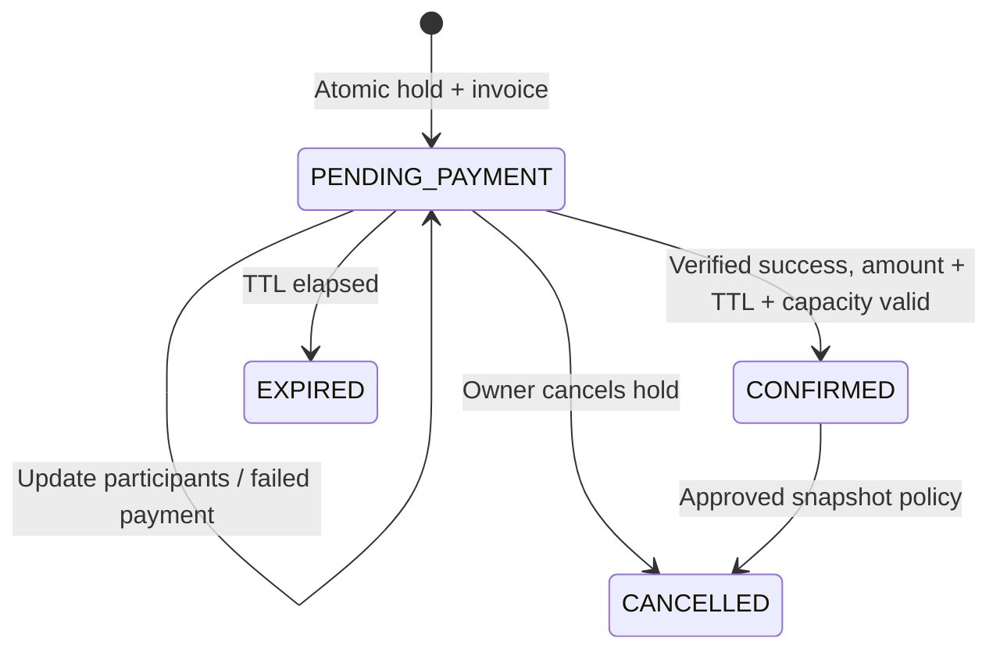

# CF02 Public Booking and Payment

## Plan

- [x] Public discovery API and booking request contracts.
- [x] Transactional holds, participant updates, invoice snapshots, idempotency and expiry.
- [x] Existing payment integration, cancellation, transport privacy and rental context.
- [x] Web discovery, booking, checkout and booking history using real APIs.
- [x] PostgreSQL/HTTP acceptance tests and additive migration verification.
- [x] Wire shared web auth to existing login/refresh/register/OTP APIs, with user authorization.
- [x] Backend build and full frontend production build (webpack).
- [x] Finish browser verification and final regression checks.
- [x] Configure project BookingPolicy: PUBLIC_BOOKING v1, 15-minute hold; user cancellation only before payment confirmation.

## Implementation decisions

Reuse shared authentication, AppError, GlobalErrorFilter, ZodValidationPipe and PaymentsModule.
All booking mutations lock Trip before Booking before Invoice, matching payment application.
Active holds and confirmed participants consume capacity. Expired holds are finalized under the same lock.
Create replay keys are scoped to the authenticated user, and persist the request hash.
Participant updates require the current version and never extend the original hold deadline.
Unresolved or successful payment attempts prevent participant edits; authoritative failed attempts permit a new invoice revision.
Only trip price is charged: no invented fees, insurance or discounts. Hold TTL and cancellation rules are snapshotted from the effective BookingPolicy; BOOKING_POLICY_CODE optionally selects its code.
Confirmed participant edits are not supported. Late success uses the existing technical reversal worker.
Booking outbox events are the durable integration boundary. Rental/notification consumers retain ownership of their own delivery/side effects.
Public API: /api/v1/trips. Existing CF01 /public-trips remains compatible.
Internal rental context uses the existing API-key guard; browser booking detail requires ownership.

## Validation

14 CF02 tests passed on isolated PostgreSQL, and all 82 existing payment tests passed (no skips).
Final regression on 2026-10-07 repeated both suites successfully. Use `connection_limit=5` in isolated test database URLs when running alongside a local preview to avoid exhausting PostgreSQL connections.
Browser verification passed: HTTP login through the shared auth client, public trip detail, a two-person hold, editing to three people, server total changing from VND 500,000 to VND 750,000, payment disabled for unsaved changes, mock checkout, and polling to CONFIRMED after a signed mock result was processed by the backend consumer. Screenshot: `cf02-browser-confirmed.png`.
The browser fixture substitutes Supabase identity and the external payment gateway on an isolated local database. Live Supabase login/OTP delivery and MoMo sandbox acceptance remain environment integration checks, not claims made by this test.
The additive migration `20261007090000_cf02_booking_holds` passed on the isolated database and was applied to the configured project database.
The project database contains an additional rental-team migration not present in this checkout; it was left untouched.
Backend `npm run build` and web `npm run build` pass. Web uses webpack because this machine's Turbopack CSS worker exits during compilation.

## HTTP contract

All paths below have the `/api/v1` prefix. Error responses use the shared `{ error, meta }` contract.
Dates in responses are ISO timestamps; amounts are decimal strings in VND.

| Method | Path | Authentication | Request |
| --- | --- | --- | --- |
| GET | /trips | Public | page, pageSize, destinationId, dateFrom, dateTo, difficulty, price (maximum) |
| GET | /trips/:id | Public | Public, published OPEN/FULL trip before start |
| POST | /trips/:tripId/bookings | Bearer | Idempotency-Key header; participantCount and participants |
| PATCH | /bookings/:id/participants | Owner | expectedVersion, participantCount and participants |
| GET | /bookings | Bearer | page, pageSize, optional status |
| GET | /bookings/:id | Owner | Current booking, trip, participants, amount, payment/refund summaries, transport |
| POST | /bookings/:id/payments | Owner | Existing payment API; Idempotency-Key and paymentMethod QR/REDIRECT |
| POST | /bookings/:id/cancel | Owner | Idempotency-Key and reason; /cancellations remains compatible |
| GET | /internal/bookings/:id/rental-context | Shared x-api-key | Requires CONFIRMED PUBLIC booking |

Create example:

```json
{"participantCount":2,"participants":[{"fullName":"Nguyen Van A","phone":"0900000001"},{"fullName":"Tran Thi B"}]}
```

Participants require fullName; phone, dateOfBirth (YYYY-MM-DD), emergencyContactName and emergencyContactPhone are optional.
For updates, send participant IDs to preserve existing participants. Omitted participants become CANCELLED; participants without IDs are newly added.
Counts must match the array, IDs must belong to this booking, and unknown request fields (including client prices/owner IDs) are rejected.
List responses are `{ items, total, page, pageSize }`.
Booking detail exposes `canCancel` based on the booking's stored policy, departure time and payment eligibility; the web only offers cancellation when this is true. The cancellation endpoint revalidates under locks.
Duplicate active booking errors include `error.details.bookingId` so the web can link to the existing booking.
The expiry worker runs every 5 seconds and can be disabled with `BOOKING_EXPIRY_WORKER_ENABLED=false` for controlled test runs.

## Policy and provider configuration

The project initially had no BookingPolicy. On 2026-10-07 the owner selected a 15-minute hold with unpaid cancellation only. `PUBLIC_BOOKING` v1 was applied to the configured project database with `cancellationRules={}`; confirmed user cancellation is disabled. Future changes create an immutable version:

```powershell
$env:CF02_POLICY_CODE='PUBLIC_BOOKING'
$env:CF02_HOLD_TTL_MINUTES='<chosen minutes>'
$env:CF02_CANCELLATION_RULES='<chosen JSON>'
npm run configure:cf02-policy
```

Cancellation rules use `{ "version": 1, "tiers": [{ "minHoursBeforeStart": 0, "refundPercent": 100 }] }` with owner-approved thresholds and percentages.
An explicit `{}` means confirmed cancellation is not configured; unpaid holds can still be cancelled. It does not silently promise a refund.
Set `BOOKING_POLICY_CODE` to select a particular policy family. Existing bookings retain their snapshots when a new version is configured.

Reuse existing `PAYMENT_PROVIDER=mock` for local verification and the existing MoMo SANDBOX configuration for gateway acceptance.
Browser return URLs never confirm a booking. Only a verified provider result applied by the backend can do that.
For same-origin requests, Next rewrites trips/bookings/auth to `API_INTERNAL_URL`, falling back to `NEXT_PUBLIC_API_URL` or `http://localhost:3000`.
No real payment or email delivery is claimed by the isolated tests.

## State and sequence



```mermaid
sequenceDiagram
  actor User
  participant Web
  participant Booking
  participant DB
  participant Payment
  User->>Web: Select public trip and participants
  Web->>Booking: Create hold + idempotency key
  Booking->>DB: Lock Trip; expire old holds; check capacity/active booking
  Booking->>DB: Commit booking, participants, invoice and price snapshot
  Booking-->>Web: PENDING_PAYMENT, amount, expiresAt
  Web->>Payment: Create checkout for booking
  Payment->>DB: Persist attempt and normalized financial result
  Payment->>Booking: Durable PAYMENT_SUCCEEDED outbox event
  Booking->>DB: Lock Trip/Booking/Invoice; validate amount, TTL and mapping
  alt Eligible
    Booking->>DB: CONFIRMED + BOOKING_CONFIRMED exactly once
  else Expired/cancelled/ineligible
    Booking->>DB: Reject application + request technical reversal
  end
  Web->>Booking: Poll booking detail
  Booking-->>Web: Authoritative status, rental eligibility and safe transport
```

Two users competing for one remaining seat serialize on the same Trip row: the first transaction creates one participant and commits; the second re-counts occupied seats and receives CAPACITY_CONFLICT. Payment application and expiry use the same Trip-first lock order.
