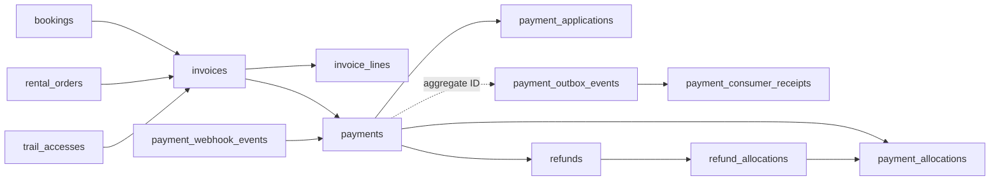

# TrekGo — Bản đồ bảng dữ liệu và checklist CRUD

Ngày đối chiếu: **08/10/2026**. Phạm vi: **94 model/bảng ứng dụng trong `api/prisma/schema.prisma` của working tree hiện tại**, bao gồm thay đổi chưa commit. Đây là tài liệu theo source, chưa đối chiếu trực tiếp database đang chạy. Không khẳng định database triển khai không có bảng bổ sung hoặc schema drift.

Mục tiêu: biết bảng nào lưu gì, liên kết với bảng nào, khi nào cần đọc/ghi, và những bảng dễ bỏ sót khi triển khai một nghiệp vụ.

**Không phải 94 bảng đều cần 94 bộ API CRUD.** Một lệnh nghiệp vụ như đặt chỗ, xác nhận thanh toán hoặc bàn giao thiết bị có thể cập nhật nhiều bảng trong một transaction. Bảng snapshot, lịch sử, outbox và dữ liệu tài chính thường được service/worker quản lý.

## Cách dùng tài liệu

1. Chọn nhóm nghiệp vụ trong mục lục.
2. Đọc bảng chức năng và lưu ý CRUD của nhóm.
3. Dùng checklist theo luồng để biết những bảng phải kiểm tra cùng nhau.
4. Tra phụ lục quan hệ để xác định FK đi ra, bảng con tham chiếu vào, khóa duy nhất và field thực tế.

Tên bảng dùng dạng SQL (`snake_case`); phụ lục ghi cả tên Prisma model và field Prisma (`camelCase`). Ký hiệu chế độ ghi:

| Nhãn | Ý nghĩa |
|---|---|
| Danh mục | Có thể có màn hình quản trị tạo/sửa; ngừng sử dụng qua trạng thái khi đã có tham chiếu. |
| Nghiệp vụ | Ghi qua use case, kiểm tra quyền, trạng thái, version và transaction. |
| Snapshot | Chụp dữ liệu tại thời điểm phát sinh; không tự đồng bộ khi danh mục thay đổi. |
| Lịch sử | Thêm bản ghi để truy vết; không làm CRUD sửa/xóa tùy ý. |
| Hệ thống | Service/worker quản lý; màn hình vận hành chủ yếu đọc và retry qua lệnh có kiểm soát. |

Các hướng dẫn CRUD là khuyến nghị triển khai, không phải lời khẳng định mọi API đều đã có. Những nhóm ngoài CF01–CF04/payment chủ yếu mô tả mục đích theo schema; cần kiểm tra controller/use case của module trước khi kết luận luồng đã triển khai đủ.

## Mục lục nhóm

| Nhóm | Nhiệm vụ | Số bảng |
|---|---|---:|
| [A](#a-tài-khoản-và-năng-lực-leader) | Tài khoản, hồ sơ và duyệt Leader | 6 |
| [B](#b-địa-điểm-checkpoint-và-trail-nguồn) | Địa điểm, checkpoint, trail, ghi hành trình và quyền trail | 11 |
| [C](#c-chuyến-đi-kế-hoạch-và-vận-chuyển) | Trip, kế hoạch snapshot, điều hướng, vận chuyển, yêu cầu hủy | 9 |
| [D](#d-lời-mời-và-thành-viên-private-trip) | Private invite và membership | 2 |
| [E](#e-booking-public-trip) | Policy, booking, người tham gia, hủy và sự kiện | 5 |
| [F](#f-danh-mục-thuê-thiết-bị-và-kho) | Sản phẩm, thiết bị vật lý, kho, giá và policy | 7 |
| [G](#g-báo-giá-đơn-thuê-và-giữ-thiết-bị) | Quote, order, giữ số lượng, gán unit | 6 |
| [H](#h-đóng-gói-giao-nhận-và-chuỗi-bàn-giao) | Package, task, mã nhận, bàn giao và bằng chứng | 9 |
| [I](#i-kiểm-tra-trả-hàng-khiếu-nại-và-quyết-toán-cọc) | Kiểm định, ngoại lệ, quyết toán cọc, bảo trì | 7 |
| [J](#j-gps-check-in-và-dữ-liệu-thực-tế) | Phiên GPS, điểm đo, lệch tuyến, checkpoint, thời tiết | 8 |
| [K](#k-hóa-đơn-thanh-toán-và-hoàn-tiền-dùng-chung) | Invoice, payment, webhook, áp dụng nghiệp vụ, refund | 12 |
| [L](#l-điểm-thưởng-huy-hiệu-và-đánh-giá) | Rank, điểm, badge và review | 8 |
| [M](#m-media-cấu-hình-thông-báo-và-audit) | Media dùng chung, cấu hình, thông báo, audit | 4 |
| **Tổng** | Mỗi bảng được xếp vào đúng một nhóm chính | **94** |

## A. Tài khoản và năng lực Leader

| Bảng | Lưu gì / làm nhiệm vụ gì | Khi dùng và cách ghi |
|---|---|---|
| `users` | Profile TrekGo: `authUserId`, email, tên, role, status. Là chủ thể sở hữu nhiều dữ liệu khác. | Nghiệp vụ: đăng nhập/bootstrap, cập nhật profile, kiểm tra quyền. Password/token xác thực không nằm trong bảng này; dùng identity provider chung. |
| `leader_profiles` | Hồ sơ bổ sung 1–1 với user: xác minh, kinh nghiệm, số chuyến hoàn tất, người duyệt. | Nghiệp vụ: quản lý thông tin/chứng nhận Leader; không tự nâng role bằng CRUD profile. |
| `leader_applications` | Đơn ứng tuyển Leader, động lực, kinh nghiệm, trạng thái xét duyệt và lý do từ chối. | Nghiệp vụ: tạo nháp → nộp → xét duyệt; giữ lịch sử đơn. |
| `leader_tests` | Danh mục bài kiểm tra, điểm tối đa/đạt, giới hạn thời gian/lượt, version. | Danh mục: quản trị bài đánh giá năng lực; thay đổi đề không sửa kết quả cũ. |
| `leader_test_attempts` | Mỗi lượt làm bài: test, user, application tùy chọn, số lần thi, điểm/kết quả và snapshot ngưỡng đạt. | Lịch sử/Snapshot: phát sinh khi làm/chấm bài; tránh ghi đè các lần thi trước. |
| `leader_certificates` | Chứng chỉ của user/application: file, cơ quan cấp, ngày hiệu lực, trạng thái xác minh. | Nghiệp vụ: nộp/duyệt chứng chỉ, kiểm tra hết hạn. |

Quan hệ chính: `users → leader_profiles / leader_applications / leader_certificates`; `leader_tests + users + leader_applications → leader_test_attempts`.

CRUD cần nhớ: ID `users.id` là ID nghiệp vụ; khác `authUserId`. Khi ngừng tài khoản, xem các chuyến, booking, đơn thuê, invoice và lịch sử đang liên kết. Không cascade xóa cả lịch sử giao dịch chỉ vì user ngừng hoạt động.

## B. Địa điểm, checkpoint và trail nguồn

| Bảng | Lưu gì / làm nhiệm vụ gì | Khi dùng và cách ghi |
|---|---|---|
| `destinations` | Địa điểm trekking, vùng, tọa độ trung tâm, trạng thái. | Danh mục: chọn địa điểm cho trail/trip/checkpoint/pickup. |
| `pickup_points` | Điểm tập kết: mã, tên, địa chỉ, tọa độ; destination có thể null. | Danh mục: chọn điểm đón/trả, dùng cho trip, booking, rental và vận chuyển. CF01 cho điểm dùng chung; CF03 yêu cầu đúng destination. |
| `checkpoints` | Checkpoint chuẩn của địa điểm: tọa độ, bán kính, loại, mô tả, trạng thái. | Danh mục: thiết kế System Trail và kế hoạch chuyến. Chưa phải checkpoint snapshot của một trip. |
| `system_trails` | Cung đường chính thức: GeoJSON, độ khó, khoảng cách, giá quyền sử dụng, version, nguồn submission tùy chọn. | Danh mục: lựa chọn tuyến CF01, mua quyền và dùng SYSTEM ở CF03. |
| `trail_checkpoints` | Bảng nối System Trail ↔ checkpoint, có `sequence` và `isRequired`. | Nghiệp vụ: thêm/bớt/sắp xếp checkpoint của trail; không bỏ sót khi sửa tuyến. |
| `personal_trails` | Cung đường cá nhân của user: GeoJSON, thông số, visibility, destination tùy chọn, trạng thái. | Nghiệp vụ: user lưu/điều chỉnh tuyến riêng, chọn PERSONAL cho CF03 hoặc gửi duyệt. |
| `personal_checkpoints` | Checkpoint riêng thuộc Personal Trail, tọa độ, thứ tự, bán kính, ảnh/thông tin. | Nghiệp vụ: sửa cùng trail cá nhân; ID khác checkpoint hệ thống. |
| `trail_submissions` | Hồ sơ gửi Personal Trail để xét duyệt, người gửi/người duyệt, nhận xét và trạng thái. | Nghiệp vụ: quy trình đóng góp tuyến; System Trail có thể tham chiếu submission nguồn. |
| `trail_recordings` | Phiên ghi hành trình cá nhân; thời gian, GeoJSON xử lý, quãng đường, liên kết trail được tạo. | Nghiệp vụ: ghi tuyến mới và chuyển kết quả thành Personal Trail. |
| `trail_recording_points` | Các mẫu GPS thô thuộc một recording: client sample, tọa độ, độ chính xác, tốc độ, thời gian. | Lịch sử: ghi tăng dần, chống gửi trùng sample; khác GPS tracking trong chuyến. |
| `trail_accesses` | Quyền của một user đối với System Trail: nguồn cấp, giá snapshot, trạng thái và thời điểm kích hoạt/thu hồi. | Nghiệp vụ/Snapshot: mua/cấp quyền; CF03 SYSTEM đọc quyền ACTIVE. Thanh toán dùng thêm nhóm K. |

Quan hệ chính: `destinations → system_trails / checkpoints / pickup_points`; `system_trails → trail_checkpoints → checkpoints`; `users → personal_trails → personal_checkpoints`; `personal_trails → trail_submissions → system_trails`; `users + system_trails → trail_accesses`.

CRUD cần nhớ:

- Tạo System Trail phải xét cả `trail_checkpoints`, không chỉ `routeGeojson`.
- Cặp trail/checkpoint và thứ tự trong cùng System Trail là duy nhất. Reorder cần transaction tránh trùng sequence tạm thời.
- Source và snapshot là hai lớp khác nhau: sửa `checkpoints`/`system_trails` không tự sửa `trip_checkpoints`/`trip_trail_plans` của chuyến cũ.
- `trail_accesses.id` khác `system_trails.id`. CF03 nhận `trailRef = systemTrailId`.
- Mua trail không phải đặt public trip; một booking đã trả tiền không thay thế việc kiểm tra TrailAccess.

## C. Chuyến đi, kế hoạch và vận chuyển

| Bảng | Lưu gì / làm nhiệm vụ gì | Khi dùng và cách ghi |
|---|---|---|
| `trips` | Thông tin chuyến PUBLIC/PRIVATE, creator/leader, lịch, sức chứa, giá, pickup, trạng thái và version. | Nghiệp vụ: tạo, sửa, publish, bắt đầu, kết thúc, hủy theo quyền/trạng thái. API `capacity` map sang `maxPax`; `price` sang `pricePerPax`. |
| `trip_trail_plans` | Các tuyến đã chọn cho trip, thứ tự và snapshot GeoJSON/tên/độ khó/thông số; tham chiếu System hoặc Personal Trail. | Snapshot: khi chọn tuyến CF01 hoặc tạo private trip CF03; bảo toàn kế hoạch của chuyến. |
| `trip_checkpoints` | Checkpoint của riêng chuyến: tọa độ/tên snapshot, thứ tự, bắt buộc, mission, điểm thưởng; tham chiếu nguồn hệ thống/cá nhân tùy loại. | Snapshot/Nghiệp vụ: lập kế hoạch, check-in, nhiệm vụ; khác bảng nguồn `checkpoints`. |
| `trip_active_trail_plans` | Tuyến đang được chọn làm tuyến điều hướng của trip, người đổi, thời điểm và version. | Nghiệp vụ: đọc context điều hướng/chọn tuyến hiện hành; không phải danh sách toàn bộ trail trong kế hoạch. |
| `trip_trail_switches` | Lịch sử đổi từ plan nào sang plan nào, lý do và người thao tác. | Lịch sử: mỗi lần đổi tuyến; giữ bản ghi để truy vết. |
| `trip_checkpoint_progress` | Tiến độ checkpoint cấp chuyến, thời điểm đến/hoàn tất, người override và bằng chứng. | Nghiệp vụ: điều phối tiến độ của đoàn; khác `checkpoint_events` của từng user. |
| `transport_providers` | Danh mục đơn vị vận chuyển, liên hệ, trạng thái. | Danh mục: chọn nhà cung cấp cho vận chuyển chuyến. |
| `trip_transports` | Phương án xe từng chuyến: pickup/return, nhà xe, loại xe, sức chứa, biển số/tài xế, lịch và trạng thái. | Nghiệp vụ: bố trí/đổi xe; dữ liệu tài xế không mặc định công khai cho mọi người. |
| `trip_cancellation_requests` | Yêu cầu hủy chuyến, trạng thái trước hủy, lý do/bằng chứng, người duyệt và quyết định. | Nghiệp vụ/Lịch sử: CF01 chuyển CANCEL_PENDING; có thể liên kết đến hủy booking theo chuyến. |

Quan hệ chính: `trips → trip_trail_plans / trip_checkpoints / trip_transports`; `trip_active_trail_plans → trip_trail_plans`; `trip_trail_switches → fromPlan/toPlan`; `trip_checkpoints → trip_checkpoint_progress`.

CRUD cần nhớ:

- CF01 tạo `trips` ở DRAFT, sau đó PUT checkpoint và trail riêng, kiểm tra readiness rồi publish.
- CF03 tạo PRIVATE ở OPEN cùng kế hoạch và HOST; không dùng bước publish của CF01.
- Kế hoạch cần version hiện tại, đúng địa điểm, checkpoint theo thứ tự hợp lệ. Không dùng source checkpoint ID thay cho trip checkpoint ID khi ghi sự kiện trong chuyến.
- Không xóa kế hoạch đã được active-plan, switch, GPS hoặc checkpoint event tham chiếu bằng CRUD đơn giản.
- Không giả định hủy trip tự động hoàn tất mọi booking/rental/refund. Kiểm tra use case, sự kiện và tiến trình từng module.

## D. Lời mời và thành viên private trip

| Bảng | Lưu gì / làm nhiệm vụ gì | Khi dùng và cách ghi |
|---|---|---|
| `private_trip_invites` | Mã mời, trip, người tạo, hạn dùng, trạng thái, giới hạn lượt và số lượt dùng. | Nghiệp vụ: CF03 tạo/đổi/thu hồi link; CF04 preview/join kiểm tra mã. |
| `trip_members` | Membership user ↔ trip: HOST/MEMBER, trạng thái tham gia, invite nguồn, pickup, attendance, version. | Nghiệp vụ: tự thêm HOST, join, leave, remove, đánh dấu tham dự. |

Quan hệ: `trips → private_trip_invites`; `users + trips → trip_members`; `trip_members.joinedByInviteId → private_trip_invites`.

CRUD cần nhớ: một HOST/trip; tối đa một invite ACTIVE/trip theo migration CF04. Join phải kiểm tra capacity trong transaction và tính cả HOST. Leave dùng membership version, không dùng trip version. Revoke invite không xóa người đã tham gia. `memberId` khác `userId`; LEFT và REMOVED là trạng thái nghiệp vụ, không phải DELETE vật lý.

## E. Booking public trip

| Bảng | Lưu gì / làm nhiệm vụ gì | Khi dùng và cách ghi |
|---|---|---|
| `booking_policies` | Chính sách có version: thời gian giữ chỗ, hủy/no-show/participant, khoảng hiệu lực. | Danh mục phiên bản: tạo policy/version mới; không sửa chính sách lịch sử của booking đã có. |
| `bookings` | Người đặt, trip, số người, giá/tổng tiền snapshot, policy snapshot, trạng thái, hạn giữ chỗ, replay key và version. | Nghiệp vụ: giữ chỗ, sửa người tham gia, hết hạn, xác nhận từ payment, hủy. |
| `booking_participants` | Từng người đi trong booking: tên, liên hệ, ngày sinh, thông tin khẩn cấp, mã và trạng thái check-in. | Nghiệp vụ: tạo/sửa danh sách, check-in; `userId` có thể null, người đặt có thể đặt cho nhiều người. |
| `booking_cancellations` | Lần hủy booking: nguồn hủy, người hủy, policy snapshot, số tiền được hoàn, liên kết yêu cầu hủy trip. | Lịch sử/Nghiệp vụ: hủy theo chính sách, là căn cứ cho refund. |
| `booking_outbox_events` | Sự kiện booking bền vững, khóa chống trùng, payload, trạng thái xử lý/retry. | Hệ thống: phát tín hiệu sau thay đổi nghiệp vụ cho các consumer; không phải bảng CRUD của người dùng. |

Quan hệ: `users + trips + booking_policies → bookings → booking_participants`; `bookings → booking_cancellations`; `bookings → invoices` (nhóm K). Outbox tham chiếu aggregate bằng ID/payload, không nhất thiết có FK.

CRUD cần nhớ:

- Tạo booking phải tạo participants, invoice và invoice lines, chụp policy/giá và hạn giữ chỗ; không chỉ INSERT `bookings`.
- Tổng ghế phải xét hold chưa hết hạn và booking chiếm chỗ; không chỉ đếm số dòng booking.
- `participantCount` khớp danh sách; update dùng ID participant cũ, người bị bỏ khỏi danh sách được chuyển trạng thái theo service.
- Sửa participants chỉ trong điều kiện cho phép, dùng version; invoice có thể cần revision mới, không kéo dài hạn giữ chỗ.
- Không sửa thẳng CONFIRMED bằng CRUD: kết quả payment được xác minh và áp dụng nghiệp vụ mới xác nhận booking.
- Khóa transaction trong booking/payment theo thứ tự Trip → Booking → Invoice để phối hợp với code hiện có.

## F. Danh mục thuê thiết bị và kho

| Bảng | Lưu gì / làm nhiệm vụ gì | Khi dùng và cách ghi |
|---|---|---|
| `inventory_locations` | Kho/địa điểm tồn thiết bị, mã, địa chỉ, tọa độ, trạng thái. | Danh mục: nhập kho, phân công đóng gói, bảo trì và custody. |
| `rental_categories` | Nhóm sản phẩm thuê, tên, slug, mô tả, trạng thái. | Danh mục: phân loại catalog. |
| `rental_products` | Loại sản phẩm/SKU, giá ngày, giá thay thế, chính sách cọc, ảnh, thông số, phụ kiện, yêu cầu kiểm định. | Danh mục: chọn thuê và cấu hình nghiệp vụ; chưa phải từng chiếc vật lý. |
| `equipment_units` | Mỗi thiết bị vật lý: asset/QR/serial, product, kho gốc/hiện tại, tình trạng, trạng thái sẵn sàng. | Nghiệp vụ: nhập, chuyển, bảo trì, retire; phải xét assignment/reservation đang tồn tại. |
| `damage_assessment_rules` | Quy tắc đánh giá hư hỏng theo sản phẩm: mức độ, cách khấu trừ, duyệt, version và hiệu lực. | Danh mục phiên bản: kiểm định trả hàng dùng để tính và chụp quyết định. |
| `rental_policies` | Policy thuê có version: TTL báo giá, cutoff, các khoảng đệm chuẩn bị/trả/vệ sinh, quy tắc hủy. | Danh mục phiên bản: tạo quote/order và tính thời gian chiếm dụng. |
| `rental_product_price_history` | Lịch sử giá, giá thay thế/cọc, thời gian hiệu lực, người đổi và lý do. | Lịch sử: khi đổi giá catalog; không ghi đè snapshot của quote/order cũ. |

Quan hệ: `rental_categories → rental_products → equipment_units / damage_assessment_rules / rental_product_price_history`; `equipment_units → inventory_locations` qua kho gốc và kho hiện tại.

CRUD cần nhớ: Product = loại hàng; EquipmentUnit = một chiếc cụ thể. Giá/cọc và tình trạng unit là hai loại dữ liệu khác nhau. Cập nhật tình trạng vật lý phải xét assignment, custody và maintenance; số lượng thuê không suy ra chỉ từ số unit hiện nằm trong kho.

## G. Báo giá, đơn thuê và giữ thiết bị

| Bảng | Lưu gì / làm nhiệm vụ gì | Khi dùng và cách ghi |
|---|---|---|
| `rental_quotes` | Báo giá theo user/trip/booking/người nhận, policy/context snapshot, lịch thuê, tổng phí/cọc, hạn báo giá. | Nghiệp vụ/Snapshot: tính giá trước khi tạo order. |
| `rental_quote_lines` | Dòng sản phẩm báo giá: số lượng, giá ngày/cọc snapshot, số ngày tính phí, tiền dòng. | Snapshot: sinh cùng quote; kiểm tra tổng dòng khớp header. |
| `rental_orders` | Đơn thuê: liên kết quote/booking, người nhận và policy snapshot, pickup/return, lịch thuê/chiếm dụng, trạng thái nghiệp vụ/tài chính/ngoại lệ. | Nghiệp vụ: đặt thuê, thanh toán, giao, trả, đóng đơn; ba nhóm trạng thái không được gộp làm một. |
| `rental_order_lines` | Dòng thuê đã chốt: sản phẩm, số lượng, giá/cọc/giá thay thế snapshot, phí theo ngày. | Snapshot: tạo cùng order, là gốc reservation/assignment và phân bổ tiền. |
| `rental_quantity_reservations` | Giữ số lượng sản phẩm theo khoảng thời gian, chu kỳ giữ, trạng thái HELD/CONFIRMED/... và hạn giữ. | Nghiệp vụ: chống overbooking trước khi chọn unit cụ thể, giải phóng/đóng giữ chỗ. |
| `rental_unit_assignments` | Gán chiếc thiết bị cụ thể cho dòng thuê; trạng thái, các mốc giao/trả, liên kết thay thế assignment. | Nghiệp vụ: kho phân bổ và thay thiết bị; không thay thế bảng giữ số lượng. |

Quan hệ: `bookings + booking_participants + rental_policies → rental_quotes → rental_quote_lines`; `rental_quotes → rental_orders → rental_order_lines → rental_quantity_reservations / rental_unit_assignments → equipment_units`.

CRUD cần nhớ: header, lines, snapshot, giữ chỗ và hạn thanh toán phải đồng bộ. `occupiedStartAt/occupiedEndAt` có thể bao gồm các khoảng đệm ngoài lịch thuê. Sau payment thành công, order và reservation phải chuyển trạng thái cùng nghiệp vụ; không chỉ update payment. Luồng rental payment hiện chỉ nhận booking PUBLIC đã CONFIRMED.

## H. Đóng gói, giao nhận và chuỗi bàn giao

| Bảng | Lưu gì / làm nhiệm vụ gì | Khi dùng và cách ghi |
|---|---|---|
| `packages` | Kiện hàng của order, mã kiện, trạng thái, niêm phong và version. | Nghiệp vụ: đóng gói, niêm phong, bàn giao/trả kiện. |
| `package_items` | Thành phần kiện: assignment và unit cụ thể. | Nghiệp vụ: thêm/bớt trước khi chốt kiện; kiểm tra unit đúng assignment/order. |
| `inventory_tasks` | Công việc kho: order, kho, package, nhân viên, hạn và trạng thái. | Nghiệp vụ: chuẩn bị/đóng gói theo phân công. |
| `delivery_tasks` | Công việc giao/nhận: order, package, trip, điểm phục vụ, nhân viên, loại việc và các mốc giao nhận. | Nghiệp vụ: luồng vận chuyển và bàn giao. |
| `rental_pickup_codes` | Hash mã nhận hàng, tham chiếu xác minh, version kiện snapshot, hạn dùng và mốc verify/use/revoke. | Nghiệp vụ: xác minh người nhận; không lưu/hiển thị mã thô bằng CRUD tùy ý. |
| `rental_handovers` | Biên bản giao: order/package/task/code, người giao, recipient snapshot, ghi chú/vấn đề, idempotency. | Lịch sử/Nghiệp vụ: hoàn tất bàn giao một lần; giữ bằng chứng. |
| `condition_snapshots` | Tình trạng, phụ kiện, ảnh/bằng chứng theo giai đoạn của unit/assignment/package/order. | Snapshot: chụp trước/sau giao, trả để so sánh; không sửa ảnh cũ thành ảnh mới. |
| `custody_events` | Lịch sử ai/kho nào giao và ai/kho nào nhận; trạng thái trước/sau, bằng chứng, thời gian, idempotency. | Lịch sử: truy vết trách nhiệm với tài sản qua từng lần chuyển giao. |
| `rental_outbox_events` | Sự kiện rental và trạng thái gửi/xử lý. | Hệ thống: phối hợp module và tác vụ bất đồng bộ; không xóa để “reset” đơn. |

CRUD cần nhớ: bàn giao cần kiểm tra task, package/version, pickup-code, recipient, assignments và tình trạng unit. Ghi handover/custody cùng thay đổi trạng thái và outbox khi use case yêu cầu. Các mảng `evidenceIds` trong schema là JSON, không tự có FK đến media.

## I. Kiểm tra trả hàng, khiếu nại và quyết toán cọc

| Bảng | Lưu gì / làm nhiệm vụ gì | Khi dùng và cách ghi |
|---|---|---|
| `return_inspections` | Kết quả kiểm tra trả của từng assignment/unit: giai đoạn, kết luận, người kiểm tra, bằng chứng. | Nghiệp vụ/Lịch sử: tiếp nhận/kiểm định đồ trả. |
| `return_inspection_findings` | Từng phát hiện hư hỏng/thiếu, quy tắc áp dụng, số lượng, tiền đánh giá và rule snapshot. | Snapshot: ghi chi tiết làm căn cứ khấu trừ; không chỉ lưu tổng ở inspection. |
| `rental_exception_cases` | Hồ sơ ngoại lệ/tranh chấp: order, unit, assignment, inspection tùy chọn, loại, người xử lý, kết quả, bằng chứng. | Nghiệp vụ: xử lý mất/hỏng/sai lệch/ngoại lệ qua trạng thái và duyệt. |
| `rental_assessment_reviews` | Yêu cầu xem xét của user đối với đánh giá inspection, lý do, bằng chứng, case liên quan. | Nghiệp vụ/Lịch sử: khiếu nại đánh giá, giữ dấu vết. |
| `deposit_settlements` | Quyết toán cọc cấp order: tổng cọc, tổng khấu trừ, tiền hoàn, policy snapshot, trạng thái, người quyết toán. | Nghiệp vụ: chốt nghĩa vụ cọc; khác giao dịch refund qua cổng. |
| `deposit_settlement_items` | Quyết toán từng assignment/unit: cọc, khấu trừ, hoàn, inspection và quyết định snapshot, phê duyệt. | Nghiệp vụ/Snapshot: căn cứ hoàn tiền từng phần, liên kết refund. |
| `maintenance_records` | Phiếu bảo trì unit tại kho, nhân viên, chi phí, thời gian, trạng thái, bằng chứng trước/sau. | Nghiệp vụ: đưa đồ hỏng đi bảo trì và xác định khi sẵn sàng lại. |

Quan hệ chính: `rental_unit_assignments → return_inspections → return_inspection_findings`; `rental_orders → deposit_settlements → deposit_settlement_items`; item gắn assignment/unit/inspection; `refunds` nhóm K gắn settlement/item.

CRUD cần nhớ: trả hàng ≠ đã kiểm định ≠ đã quyết toán ≠ đã hoàn tiền. Cần giữ các bước riêng. Tổng item phải khớp settlement; khấu trừ có căn cứ snapshot. Trước khi đánh dấu đơn hoàn tất phải xét case mở, maintenance, reservation/assignment, refund và tình trạng thiết bị theo use case.

## J. GPS, check-in và dữ liệu thực tế

| Bảng | Lưu gì / làm nhiệm vụ gì | Khi dùng và cách ghi |
|---|---|---|
| `gps_policies` | Policy có version về độ chính xác, chu kỳ sync, lệch tuyến, bán kính checkpoint và thời hạn lưu mẫu thô. | Danh mục phiên bản: mở phiên GPS và đánh giá mẫu/sự kiện. |
| `gps_sessions` | Phiên GPS của user trong trip, thiết bị, policy, thời gian, path tổng hợp, khoảng cách, số mẫu. | Nghiệp vụ: bắt đầu/tạm dừng/kết thúc tracking theo trạng thái được hỗ trợ. |
| `gps_locations` | Mẫu vị trí thô theo session, client sample, tọa độ/độ chính xác/tốc độ/thời gian. | Lịch sử: ingest chống trùng và tổng hợp; retention theo policy, không xóa tùy tiện từ màn hình trip. |
| `route_deviation_events` | Đợt lệch tuyến: user/session/trip/plan, thời gian phát hiện/phục hồi, khoảng lệch, ngưỡng snapshot. | Nghiệp vụ/Lịch sử: phát hiện/cảnh báo và đóng sự kiện khi quay lại tuyến. |
| `checkpoint_events` | User đến checkpoint của trip, vị trí/khoảng cách, role lúc xảy ra, mission/answer/bằng chứng và hoàn tất. | Nghiệp vụ/Lịch sử: check-in và thực hiện nhiệm vụ; chống ghi lặp. |
| `trip_actual_routes` | Đường đi thực tế tổng hợp của trip, session nguồn, GeoJSON và tổng khoảng cách. | Hệ thống: tổng hợp/xem lại chuyến; khác tuyến dự kiến trong plan. |
| `weather_snapshots` | Dữ liệu thời tiết theo trip/checkpoint/tọa độ, nhà cung cấp, rủi ro, thời điểm và hạn dùng. | Snapshot: xem dự báo/cảnh báo tại thời điểm; không coi dữ liệu hết hạn là thời tiết hiện tại. |
| `gps_outbox_events` | Sự kiện GPS/checkpoint/điều hướng cho consumer. | Hệ thống: gửi sự kiện bền vững, retry có chống trùng. |

CRUD cần nhớ: `trail_recording_points` phục vụ tạo tuyến cá nhân, còn `gps_locations` thuộc phiên đi trong trip. `trip_checkpoint_progress` là tiến độ đoàn, `checkpoint_events` là sự kiện từng user; không gộp hai bảng. `clientSampleId` chống trùng trong từng session/recording.

## K. Hóa đơn, thanh toán và hoàn tiền dùng chung

| Bảng | Lưu gì / làm nhiệm vụ gì | Khi dùng và cách ghi |
|---|---|---|
| `invoices` | Nghĩa vụ thanh toán của BOOKING/RENTAL/TRAIL_ACCESS, user, tổng tiền, trạng thái, revision và invoice bị thay thế. | Nghiệp vụ/Snapshot: phát sinh từ đơn; mỗi invoice gắn nguồn phù hợp loại. |
| `invoice_lines` | Chi tiết invoice: loại dòng, số lượng, đơn giá, thành tiền, reference và metadata. | Snapshot: tạo cùng invoice, đối chiếu tổng tiền; không lấy giá catalog mới để sửa invoice cũ. |
| `payments` | Lần thanh toán invoice: số tiền, cổng/môi trường, merchant reference, idempotency, checkout, trạng thái và retry/đối soát. | Nghiệp vụ/Hệ thống: tạo checkout, nhận kết quả, đối soát. Không cho user PATCH SUCCEEDED. |
| `payment_webhook_events` | Sự kiện cổng gửi: payload/hash, event ID, trạng thái xác minh/xử lý, retry, payment/refund liên quan. | Hệ thống: inbox bền vững, chống sự kiện trùng và xử lý lại. |
| `payment_applications` | Quyết định áp dụng một payment vào invoice/nghiệp vụ: PENDING/APPLIED/REJECTED và lý do. | Hệ thống: tách “đã thu tiền” khỏi “đơn đủ điều kiện xác nhận”. |
| `payment_outbox_events` | Sự kiện payment, payload, chống trùng và trạng thái worker. | Hệ thống: chuyển PAYMENT_SUCCEEDED đến consumer booking/trail/rental. |
| `payment_consumer_receipts` | Dấu đã xử lý theo cặp event/consumer. | Hệ thống: tránh consumer áp dụng lại cùng sự kiện. |
| `refunds` | Giao dịch hoàn tiền: payment nguồn, mục đích, số tiền, trạng thái, tham chiếu hủy booking/cọc/rental/trail, retry/đối soát. | Nghiệp vụ/Hệ thống: hoàn theo chính sách hoặc đảo giao dịch không áp dụng được. |
| `payment_allocations` | Phân bổ payment rental vào từng order line và thành phần RENTAL_FEE/RENTAL_DEPOSIT. | Snapshot/Hệ thống: biết khoản thu thuộc phí hay cọc, phục vụ hoàn đúng phần. |
| `refund_allocations` | Phân bổ tiền hoàn về từng payment allocation. | Hệ thống: đối chiếu hoàn một phần và giới hạn tiền đã thu. |
| `trail_purchase_requests` | Ghi nhớ yêu cầu mua trail: user/trail/access/invoice, phương thức và khóa replay. | Hệ thống: retry purchase không tạo lại nghĩa vụ/cấp quyền; trail miễn phí có invoice null. |
| `mock_payment_operations` | Request hash, request/result của provider giả lập cho payment/refund. | Hệ thống: test MOCK và mô phỏng truy vấn/đối soát; không phải dữ liệu thanh toán thật. |

Quan hệ chính:

Sơ đồ biểu diễn liên kết nghiệp vụ; mũi tên không đồng nghĩa tất cả đều là FK theo chiều đó. FK chính xác nằm trong phụ lục.

CRUD cần nhớ:

- Invoice, payment và trạng thái đơn là ba lớp khác nhau. Payment SUCCEEDED nhưng application REJECTED có thể dẫn tới hoàn kỹ thuật.
- Webhook nhận thành công chưa đồng nghĩa consumer đã xác nhận booking/cấp trail access/đánh dấu rental PAID.
- Nếu sửa nghĩa vụ được phép, dùng revision invoice; không sửa âm thầm invoice đã thu tiền.
- Idempotency, request hash, event ID, consumer receipt và unique index là phần nghiệp vụ, không phải dữ liệu phụ có thể bỏ.
- Worker có thể ghi cả payment, invoice, application, outbox, receipt và bảng nguồn. Phải kiểm tra hết các lớp khi debug giao dịch bị treo.
- Tiền do server tính từ snapshot; không tin amount do client gửi trong luồng tạo checkout.
- Không xóa tài chính để thử lại; dùng giao dịch demo mới, hoặc workflow hủy/hoàn phù hợp.

## L. Điểm thưởng, huy hiệu và đánh giá

| Bảng | Lưu gì / làm nhiệm vụ gì | Khi dùng và cách ghi |
|---|---|---|
| `ranks` | Danh mục hạng, ngưỡng điểm, tên, trạng thái. | Danh mục: cấu hình hệ thống xếp hạng. |
| `user_ranks` | Hạng hiện tại và tổng điểm của user, một dòng/user. | Hệ thống/Nghiệp vụ: cập nhật cùng tính điểm; không thay cho sổ lịch sử điểm. |
| `point_transactions` | Các lần cộng/trừ điểm và reference nguồn. | Lịch sử: thưởng/điều chỉnh điểm, giữ căn cứ và chống thưởng lặp ở use case. |
| `badges` | Danh mục huy hiệu, icon, điều kiện JSON và trạng thái. | Danh mục: thiết lập thành tích. |
| `user_badges` | Huy hiệu đã mở cho user, trip nguồn tùy chọn, thời điểm mở. | Nghiệp vụ: cấp huy hiệu khi đủ điều kiện; cặp user/badge duy nhất. |
| `trip_reviews` | Đánh giá trip của user, điểm/nội dung; liên kết booking hoặc membership tùy ngữ cảnh. | Nghiệp vụ: review sau trải nghiệm theo chính sách module, kiểm tra quyền tham gia. |
| `leader_reviews` | Đánh giá Leader trong một trip bởi user. | Nghiệp vụ: một review cho mỗi trip/leader/user. |
| `rental_reviews` | Đánh giá sản phẩm trong đơn thuê, user, điểm, nhận xét và xác minh sử dụng. | Nghiệp vụ: kiểm tra order/product thuộc trải nghiệm thực tế. |

CRUD cần nhớ: sửa hạng tổng mà bỏ `point_transactions` làm mất khả năng đối soát. FK booking/member trong review có thể nullable; service phải kiểm tra tính phù hợp nguồn, không suy ra rằng schema đã đảm bảo toàn bộ quyền review.

## M. Media, cấu hình, thông báo và audit

| Bảng | Lưu gì / làm nhiệm vụ gì | Khi dùng và cách ghi |
|---|---|---|
| `media_assets` | Metadata tài sản media: owner, provider/scope/type, upload status, ID nhà cung cấp, MIME/kích thước, hash, nguồn gốc/EXIF/C2PA và retention. | Nghiệp vụ/Hệ thống: upload intent → hoàn tất/xác minh → dùng ảnh/bằng chứng → xóa theo vòng đời. Binary không được lưu trong các field metadata này. |
| `system_configs` | Cấu hình theo key/group, JSON value/type, người sửa và hiệu lực. | Danh mục quản trị: không dùng thay thế các policy có version của booking/rental/GPS. |
| `notifications` | Thông báo của user, nội dung, loại, reference nguồn, trạng thái đọc. | Hệ thống tạo; user đọc/đánh dấu đã đọc. Reference động không phải FK đến mọi loại đối tượng. |
| `audit_logs` | Ai làm gì, entity, giá trị trước/sau, request ID/IP và thời điểm. | Lịch sử: ghi khi use case cần truy vết; không cho chỉnh/xóa như dữ liệu nội dung. |

CRUD cần nhớ: `imageUrls`, `evidenceUrls`, `evidenceIds` và `referenceId` không tự tạo FK trong schema. Phải kiểm tra quyền sở hữu, scope, READY/retention và liên kết ở application nếu nghiệp vụ dùng media. Không xóa asset còn làm bằng chứng chỉ vì xóa nội dung hiển thị.

## Checklist bảng theo thao tác thực tế

Các cột “đọc” và “ghi” nêu tập bảng cần xem xét; không có nghĩa mọi API luôn ghi tất cả bảng trong cột. Nhóm ngoài luồng đã đối chiếu implementation là checklist thiết kế theo schema.

| Thao tác | Bảng đọc/kiểm tra | Bảng ghi hoặc theo dõi sau thao tác |
|---|---|---|
| CF01 tạo public draft | users, destinations, pickup_points, trips (lịch Leader) | trips |
| CF01 chọn checkpoint/trail | checkpoints, system_trails, trail_checkpoints, trips | trip_checkpoints, trip_trail_plans, trips.version |
| CF01 publish | trips, nguồn checkpoint/trail, kế hoạch và xung đột lịch | trips.status/publishedAt/version; kiểm tra audit theo implementation |
| CF02 đặt chỗ | trips, bookings/participants chiếm chỗ, booking_policies | bookings, booking_participants, invoices, invoice_lines; xử lý hold hết hạn theo service |
| CF02 sửa người tham gia | booking/version/hạn giữ, participants, invoices, payments | bookings, booking_participants, revision invoices + invoice_lines khi áp dụng |
| CF02 thanh toán | booking/trip còn hợp lệ, invoice/lines, payment cũ | payments; webhook → payment_webhook_events → payment_applications/outbox/receipts → bookings, invoices và booking_outbox_events |
| Mua quyền trail | users, system_trails, trail_accesses, trail_purchase_requests | trail_accesses, trail_purchase_requests; nếu có phí thêm invoices/lines/payments và pipeline nhóm K |
| CF03 tạo private trip | user, personal_trails/checkpoints hoặc system_trails/trail_checkpoints/trail_accesses, destination/pickup | trips, trip_trail_plans, trip_checkpoints, trip_members HOST; đối chiếu khởi tạo điều hướng theo store |
| CF03 tạo/đổi/revoke invite | trip, chủ sở hữu, version, lịch/trạng thái | private_trip_invites, trips.version; không xóa membership cũ |
| CF04 join | invite, user, trip, memberships ACTIVE và capacity | trip_members, private_trip_invites.usedCount khi join mới, trips.version theo store |
| CF04 leave/remove | quyền, trip, membership/version | trip_members, trips.version theo store; không tạo booking/payment |
| Hủy public trip/booking | trip request, booking policy snapshot, payment/application, nghĩa vụ rental | trip_cancellation_requests, bookings, booking_cancellations, outbox; refunds khi đủ điều kiện, không hứa tự hoàn tất toàn bộ |
| Báo giá/đặt thuê | booking CONFIRMED, participants, trip/pickup, catalog/policy/giá, tồn và reservation | rental_quotes/lines → rental_orders/lines → rental_quantity_reservations |
| Thanh toán thuê | order/lines, booking/trip, reservation còn hạn | invoices/lines, payments, payment_allocations; success → order PAID, reservation CONFIRMED và pipeline liên quan |
| Gán đồ/đóng gói | order/lines, reservation, unit/kho, task | rental_unit_assignments, packages/items, inventory_tasks, condition_snapshots, custody/outbox khi cần |
| Bàn giao | package/version, delivery task, pickup code, recipient, unit/assignment | rental_handovers, rental_pickup_codes, delivery_tasks, assignments/units/order/package, custody_events, snapshots/outbox theo workflow |
| Nhận trả/kiểm định | assignment/unit, snapshot bàn giao, rule hư hỏng | return_inspections/findings, exception_cases/reviews nếu cần, snapshots, assignments/units/reservation, maintenance khi cần |
| Quyết toán/hoàn cọc | inspections/findings, policy snapshot, allocations, case/duyệt | deposit_settlements/items, refunds, refund_allocations; đối soát trước khi đóng nghĩa vụ |
| Tracking/checkpoint | membership/booking, trip plan/active plan/checkpoint, gps policy | gps_sessions/locations, route_deviation_events, checkpoint_events, progress, gps_outbox_events, actual route theo use case |
| Thưởng/review | điều kiện hoàn thành và nguồn tham gia | point_transactions + user_ranks, user_badges; trip/leader/rental_reviews tương ứng |

## Ràng buộc dễ bỏ sót khi CRUD

1. **Không suy ra toàn bộ ràng buộc từ Prisma schema.** Migration có CHECK, partial unique index và constraint bổ sung. Đọc SQL liên quan trước khi sửa transaction/trạng thái.
2. **CF04:** migration `20260929120000_cf04_private_membership` đặt unique cho một invite ACTIVE và một HOST/trip.
3. **CF03:** migration `20260928120000_cf03_private_trip_sources` bổ sung nguồn Personal Trail/checkpoint cho kế hoạch. Không giả định mọi trip plan luôn có System Trail.
4. **Payment:** migration `20261004090100_booking_payment_foundation` có guard invoice source/amount/revision, một payment đang mở cho invoice, application áp dụng và webhook metadata. Các bước chuyển trạng thái phải thỏa các guard này.
5. **Trail purchase:** migration `20261006030000_trail_purchase_replay` và `20261006030100_trail_invoice_guards` bảo vệ replay và invoice theo quyền trail.
6. **Rental:** migration `20261006060000_rental_payment_allocations` bổ sung phân bổ tiền, guard và liên kết hoàn tiền. Bỏ allocation sẽ làm luồng hoàn phí/cọc không đủ dữ liệu.
7. **CF02:** migration `20261007090000_cf02_booking_holds` bổ sung khóa/hash chống đặt trùng khi retry; cần giữ cùng request payload.
8. **Optimistic lock:** bảng có version cần theo contract của use case. Version trip, booking và membership là các số riêng.
9. **Delete:** FK nullable không có nghĩa được xóa tự do; khi không ghi onDelete trong schema phải đối chiếu SQL/DB. Ưu tiên lệnh archive/cancel/revoke/retire đã có; không tự phát minh cascade.
10. **Tiền và thời gian:** Decimal giữ độ chính xác; payment hiện dùng tiền VND nguyên. Ngày giờ nhận từ API có timezone; start/end, expiry và thời gian chiếm dụng phải nhất quán.
11. **Snapshot:** giá/policy/tuyến/recipient/tình trạng/rule lịch sử không cập nhật theo catalog mới. Khi nghiệp vụ cho phép thay đổi, dùng revision hoặc tạo snapshot mới có kiểm soát.
12. **Bất đồng bộ:** outbox/inbox/receipt là dữ liệu cần giữ để retry và chống trùng; một HTTP 200 không chứng minh mọi bước downstream đã xong.

## Trình tự triển khai CRUD để tránh thiếu bảng

- [ ] Xác định entity gốc và lệnh nghiệp vụ, actor được phép thao tác.
- [ ] Tra các FK đi ra để bảo đảm dữ liệu nguồn tồn tại, ACTIVE và thuộc đúng user/destination/trip.
- [ ] Tra bảng con tham chiếu vào trước khi sửa nguồn hoặc xóa/đổi trạng thái.
- [ ] Kiểm tra bảng nối, thứ tự, snapshot, detail lines; không chỉ sửa header.
- [ ] Xác định transaction, lock/version, idempotency và unique/partial index.
- [ ] Tính lại tổng/ghế/tồn/cọc và giới hạn trạng thái khi có concurrency.
- [ ] Xác định audit, inbox/outbox và consumer cần phát sinh; không tự ghi thay module khác.
- [ ] Xác định màn hình đọc dữ liệu nào chứng minh kết quả nghiệp vụ cuối cùng.
- [ ] Kiểm tra main flow, quyền sở hữu, trạng thái sai, hết hạn, version cũ, retry và cạnh tranh tài nguyên có ý nghĩa.
- [ ] Nếu schema đổi, dùng migration additive; không sửa migration đã áp dụng hoặc reset DB.

## Nguồn và phạm vi kiểm kê

- Nguồn chuẩn của danh sách bảng/field/quan hệ: `api/prisma/schema.prisma` (working tree).
- Nguồn ràng buộc bổ sung: `api/prisma/migrations/`.
- Nguồn hành vi CF01–CF04: `api/src/modules/trips/`, `api/src/modules/bookings/`.
- Nguồn payment/trail purchase/rental checkout: `api/src/modules/payments/`, `api/src/modules/system-trail/application/use-cases/`, `api/src/modules/rental/payments/`.
- Tham khảo luồng hiện có: `api/CF01_CF03_CF04_FRONTEND_SWAGGER.md`, `docs/CF02-implementation.md`.
- Không tính enum là bảng. `_prisma_migrations` là bảng kỹ thuật của Prisma, không thuộc 94 model nghiệp vụ và không CRUD thủ công. Các bảng do Supabase quản lý trong schema auth/storage và bảng bổ sung ngoài Prisma schema chưa nằm trong kiểm kê này.
- Nếu cần kiểm kê database triển khai, đối chiếu read-only danh sách bảng/FK/index thực tế trước khi tuyên bố bao phủ toàn DB.

## Phụ lục — Từ điển field, khóa và quan hệ của toàn bộ 94 bảng

Phần dưới trích từ Prisma schema để không bỏ sót bảng và FK. “Tham chiếu vào” là danh sách quan hệ có FK do các bảng khác khai báo, có thể bao gồm self-reference. Không bao gồm liên kết động nằm trong JSON/referenceId/aggregateId. Các field liệt kê là scalar/enum, không phải tất cả đều được phép nhận từ body API. Khóa Prisma chưa bao gồm CHECK/partial index trong SQL migration.

### media_assets — MediaAsset

Nguồn: [schema.prisma, model MediaAsset](../api/prisma/schema.prisma) (dòng 770).

- **Field lưu trữ** (tên Prisma; `?` là nullable): `id: String`, `ownerUserId: String?`, `provider: MediaProvider`, `scope: MediaScope`, `resourceType: MediaResourceType`, `status: MediaStatus`, `providerAssetId: String?`, `providerPublicId: String?`, `deliveryType: String?`, `originalFileName: String?`, `mimeType: String?`, `format: String?`, `sizeBytes: BigInt?`, `width: Int?`, `height: Int?`, `durationMs: Int?`, `secureUrl: String?`, `sha256: String?`, `perceptualHash: String?`, `captureSource: MediaCaptureSource`, `clientCapturedAt: DateTime?`, `exifCapturedAt: DateTime?`, `exifMetadata: Json?`, `c2paStatus: MediaC2paStatus`, `provenanceStatus: MediaProvenanceStatus`, `provenanceReasons: Json?`, `uploadIntentExpiresAt: DateTime?`, `uploadedAt: DateTime?`, `readyAt: DateTime?`, `retentionUntil: DateTime?`, `deleteRequestedAt: DateTime?`, `deletedAt: DateTime?`, `version: Int`, `createdAt: DateTime`, `updatedAt: DateTime`.
- **Map tên cột SQL khác tên field:** `ownerUserId → owner_user_id`, `resourceType → resource_type`, `providerAssetId → provider_asset_id`, `providerPublicId → provider_public_id`, `deliveryType → delivery_type`, `originalFileName → original_file_name`, `mimeType → mime_type`, `sizeBytes → size_bytes`, `durationMs → duration_ms`, `secureUrl → secure_url`, `perceptualHash → perceptual_hash`, `captureSource → capture_source`, `clientCapturedAt → client_captured_at`, `exifCapturedAt → exif_captured_at`, `exifMetadata → exif_metadata`, `c2paStatus → c2pa_status`, `provenanceStatus → provenance_status`, `provenanceReasons → provenance_reasons`, `uploadIntentExpiresAt → upload_intent_expires_at`, `uploadedAt → uploaded_at`, `readyAt → ready_at`, `retentionUntil → retention_until`, `deleteRequestedAt → delete_requested_at`, `deletedAt → deleted_at`, `createdAt → created_at`, `updatedAt → updated_at`.
- **Khóa chính/duy nhất trong Prisma:** `id @id`; `providerAssetId @unique`; `providerPublicId @unique`.
- **FK đi ra:**
  - `ownerUserId` → `users(id)`, qua relation `owner`; tùy chọn; onDelete: SetNull.
- **Tham chiếu vào:** Không có FK từ model khác trong schema; vẫn có thể được tham chiếu động trong JSON/reference/aggregate.

### users — User

Nguồn: [schema.prisma, model User](../api/prisma/schema.prisma) (dòng 832).

- **Field lưu trữ** (tên Prisma; `?` là nullable): `id: String`, `authUserId: String`, `email: String`, `fullName: String`, `phone: String?`, `avatarUrl: String?`, `role: UserRole`, `status: UserStatus`, `createdAt: DateTime`, `updatedAt: DateTime`, `deactivatedAt: DateTime?`.
- **Map tên cột SQL khác tên field:** `authUserId → auth_user_id`, `fullName → full_name`, `avatarUrl → avatar_url`, `createdAt → created_at`, `updatedAt → updated_at`, `deactivatedAt → deactivated_at`.
- **Khóa chính/duy nhất trong Prisma:** `id @id`; `authUserId @unique`; `email @unique`.
- **FK đi ra:**
  - Không có FK khai báo trong Prisma model này.
- **Tham chiếu vào:** `media_assets.ownerUserId` (relation `owner`); `leader_profiles.userId` (relation `user`); `leader_profiles.verifiedBy` (relation `verifiedByUser`); `leader_applications.userId` (relation `user`); `leader_applications.reviewedBy` (relation `reviewedByUser`); `leader_tests.createdBy` (relation `createdByUser`); `leader_test_attempts.userId` (relation `user`); `leader_certificates.userId` (relation `user`); `leader_certificates.verifiedBy` (relation `verifiedByUser`); `pickup_points.createdBy` (relation `createdByUser`); `personal_trails.userId` (relation `user`); `trail_submissions.submittedBy` (relation `submittedByUser`); `trail_submissions.reviewedBy` (relation `reviewedByUser`); `system_trails.createdBy` (relation `createdByUser`); `trail_accesses.userId` (relation `user`); `trail_recordings.userId` (relation `user`); `trips.creatorId` (relation `creator`); `trips.leaderId` (relation `leader`); `trip_active_trail_plans.changedBy` (relation `changedByUser`); `trip_trail_switches.actorId` (relation `actor`); `trip_checkpoint_progress.updatedBy` (relation `updatedByUser`); `trip_cancellation_requests.requestedBy` (relation `requestedByUser`); `trip_cancellation_requests.reviewedBy` (relation `reviewedByUser`); `private_trip_invites.createdBy` (relation `createdByUser`); `trip_members.userId` (relation `user`); `trip_members.attendanceMarkedBy` (relation `attendanceMarkedByUser`); `booking_policies.createdBy` (relation `createdByUser`); `bookings.userId` (relation `user`); `booking_participants.userId` (relation `user`); `booking_participants.checkedInBy` (relation `checkedInByUser`); `booking_cancellations.cancelledBy` (relation `cancelledByUser`); `rental_policies.createdBy` (relation `createdByUser`); `rental_product_price_history.changedBy` (relation `changedByUser`); `rental_quotes.userId` (relation `user`); `rental_orders.userId` (relation `user`); `inventory_tasks.staffId` (relation `staff`); `delivery_tasks.staffId` (relation `staff`); `rental_pickup_codes.verifiedBy` (relation `verifiedByUser`); `rental_handovers.staffId` (relation `staff`); `condition_snapshots.takenBy` (relation `takenByUser`); `return_inspections.inspectorId` (relation `inspector`); `rental_exception_cases.openedBy` (relation `openedByUser`); `rental_exception_cases.assignedTo` (relation `assignedToUser`); `rental_assessment_reviews.userId` (relation `user`); `deposit_settlements.settledBy` (relation `settledByUser`); `deposit_settlement_items.approvedBy` (relation `approvedByUser`); `maintenance_records.staffId` (relation `staff`); `custody_events.fromUserId` (relation `fromUser`); `custody_events.toUserId` (relation `toUser`); `custody_events.performedBy` (relation `performedByUser`); `gps_policies.createdBy` (relation `createdByUser`); `gps_sessions.userId` (relation `user`); `route_deviation_events.userId` (relation `user`); `checkpoint_events.userId` (relation `user`); `invoices.userId` (relation `user`); `trail_purchase_requests.userId` (relation `user`); `user_ranks.userId` (relation `user`); `point_transactions.userId` (relation `user`); `user_badges.userId` (relation `user`); `trip_reviews.userId` (relation `user`); `leader_reviews.leaderId` (relation `leader`); `leader_reviews.userId` (relation `user`); `rental_reviews.userId` (relation `user`); `system_configs.updatedBy` (relation `updatedByUser`); `notifications.userId` (relation `user`); `audit_logs.userId` (relation `user`).

### leader_profiles — LeaderProfile

Nguồn: [schema.prisma, model LeaderProfile](../api/prisma/schema.prisma) (dòng 919).

- **Field lưu trữ** (tên Prisma; `?` là nullable): `userId: String`, `verifyStatus: VerificationStatus`, `completedTripCount: Int`, `experienceYears: Int`, `verifiedBy: String?`, `verifiedAt: DateTime?`, `createdAt: DateTime`, `updatedAt: DateTime`.
- **Map tên cột SQL khác tên field:** `userId → user_id`, `verifyStatus → verify_status`, `completedTripCount → completed_trip_count`, `experienceYears → experience_years`, `verifiedBy → verified_by`, `verifiedAt → verified_at`, `createdAt → created_at`, `updatedAt → updated_at`.
- **Khóa chính/duy nhất trong Prisma:** `userId @id`.
- **FK đi ra:**
  - `userId` → `users(id)`, qua relation `user`; bắt buộc; onDelete: không khai báo tường minh.
  - `verifiedBy` → `users(id)`, qua relation `verifiedByUser`; tùy chọn; onDelete: không khai báo tường minh.
- **Tham chiếu vào:** Không có FK từ model khác trong schema; vẫn có thể được tham chiếu động trong JSON/reference/aggregate.

### leader_applications — LeaderApplication

Nguồn: [schema.prisma, model LeaderApplication](../api/prisma/schema.prisma) (dòng 935).

- **Field lưu trữ** (tên Prisma; `?` là nullable): `id: String`, `userId: String`, `status: ApplicationStatus`, `motivation: String?`, `experienceSummary: String?`, `submittedAt: DateTime?`, `reviewedBy: String?`, `reviewedAt: DateTime?`, `rejectionReason: String?`, `version: Int`, `createdAt: DateTime`, `updatedAt: DateTime`.
- **Map tên cột SQL khác tên field:** `userId → user_id`, `experienceSummary → experience_summary`, `submittedAt → submitted_at`, `reviewedBy → reviewed_by`, `reviewedAt → reviewed_at`, `rejectionReason → rejection_reason`, `createdAt → created_at`, `updatedAt → updated_at`.
- **Khóa chính/duy nhất trong Prisma:** `id @id`.
- **FK đi ra:**
  - `userId` → `users(id)`, qua relation `user`; bắt buộc; onDelete: không khai báo tường minh.
  - `reviewedBy` → `users(id)`, qua relation `reviewedByUser`; tùy chọn; onDelete: không khai báo tường minh.
- **Tham chiếu vào:** `leader_test_attempts.applicationId` (relation `application`); `leader_certificates.applicationId` (relation `application`).

### leader_tests — LeaderTest

Nguồn: [schema.prisma, model LeaderTest](../api/prisma/schema.prisma) (dòng 961).

- **Field lưu trữ** (tên Prisma; `?` là nullable): `id: String`, `code: String`, `title: String`, `description: String?`, `maxScore: Decimal`, `passingScore: Decimal`, `durationMinutes: Int?`, `maxAttempts: Int?`, `status: RecordStatus`, `version: Int`, `createdBy: String?`, `createdAt: DateTime`, `updatedAt: DateTime`.
- **Map tên cột SQL khác tên field:** `maxScore → max_score`, `passingScore → passing_score`, `durationMinutes → duration_minutes`, `maxAttempts → max_attempts`, `createdBy → created_by`, `createdAt → created_at`, `updatedAt → updated_at`.
- **Khóa chính/duy nhất trong Prisma:** `id @id`; `code @unique`.
- **FK đi ra:**
  - `createdBy` → `users(id)`, qua relation `createdByUser`; tùy chọn; onDelete: không khai báo tường minh.
- **Tham chiếu vào:** `leader_test_attempts.testId` (relation `test`).

### leader_test_attempts — LeaderTestAttempt

Nguồn: [schema.prisma, model LeaderTestAttempt](../api/prisma/schema.prisma) (dòng 984).

- **Field lưu trữ** (tên Prisma; `?` là nullable): `id: String`, `testId: String`, `userId: String`, `applicationId: String?`, `attemptNo: Int`, `testVersionSnapshot: Int`, `passingScoreSnapshot: Decimal`, `score: Decimal`, `maxScore: Decimal`, `result: TestResult`, `startedAt: DateTime?`, `completedAt: DateTime`, `createdAt: DateTime`.
- **Map tên cột SQL khác tên field:** `testId → test_id`, `userId → user_id`, `applicationId → application_id`, `attemptNo → attempt_no`, `testVersionSnapshot → test_version_snapshot`, `passingScoreSnapshot → passing_score_snapshot`, `maxScore → max_score`, `startedAt → started_at`, `completedAt → completed_at`, `createdAt → created_at`.
- **Khóa chính/duy nhất trong Prisma:** `id @id`; `@@unique([userId, testId, attemptNo])`.
- **FK đi ra:**
  - `testId` → `leader_tests(id)`, qua relation `test`; bắt buộc; onDelete: không khai báo tường minh.
  - `userId` → `users(id)`, qua relation `user`; bắt buộc; onDelete: không khai báo tường minh.
  - `applicationId` → `leader_applications(id)`, qua relation `application`; tùy chọn; onDelete: không khai báo tường minh.
- **Tham chiếu vào:** Không có FK từ model khác trong schema; vẫn có thể được tham chiếu động trong JSON/reference/aggregate.

### leader_certificates — LeaderCertificate

Nguồn: [schema.prisma, model LeaderCertificate](../api/prisma/schema.prisma) (dòng 1010).

- **Field lưu trữ** (tên Prisma; `?` là nullable): `id: String`, `userId: String`, `applicationId: String?`, `certificateType: String`, `certificateNumber: String?`, `issuer: String?`, `fileUrl: String`, `issuedAt: DateTime?`, `expiresAt: DateTime?`, `status: CertificateStatus`, `verifiedBy: String?`, `verifiedAt: DateTime?`, `rejectionReason: String?`, `createdAt: DateTime`, `updatedAt: DateTime`.
- **Map tên cột SQL khác tên field:** `userId → user_id`, `applicationId → application_id`, `certificateType → certificate_type`, `certificateNumber → certificate_number`, `fileUrl → file_url`, `issuedAt → issued_at`, `expiresAt → expires_at`, `verifiedBy → verified_by`, `verifiedAt → verified_at`, `rejectionReason → rejection_reason`, `createdAt → created_at`, `updatedAt → updated_at`.
- **Khóa chính/duy nhất trong Prisma:** `id @id`.
- **FK đi ra:**
  - `userId` → `users(id)`, qua relation `user`; bắt buộc; onDelete: không khai báo tường minh.
  - `applicationId` → `leader_applications(id)`, qua relation `application`; tùy chọn; onDelete: không khai báo tường minh.
  - `verifiedBy` → `users(id)`, qua relation `verifiedByUser`; tùy chọn; onDelete: không khai báo tường minh.
- **Tham chiếu vào:** Không có FK từ model khác trong schema; vẫn có thể được tham chiếu động trong JSON/reference/aggregate.

### destinations — Destination

Nguồn: [schema.prisma, model Destination](../api/prisma/schema.prisma) (dòng 1040).

- **Field lưu trữ** (tên Prisma; `?` là nullable): `id: String`, `name: String`, `description: String?`, `region: String?`, `centerLat: Decimal?`, `centerLng: Decimal?`, `status: RecordStatus`, `createdAt: DateTime`, `updatedAt: DateTime`.
- **Map tên cột SQL khác tên field:** `centerLat → center_lat`, `centerLng → center_lng`, `createdAt → created_at`, `updatedAt → updated_at`.
- **Khóa chính/duy nhất trong Prisma:** `id @id`.
- **FK đi ra:**
  - Không có FK khai báo trong Prisma model này.
- **Tham chiếu vào:** `pickup_points.destinationId` (relation `destination`); `personal_trails.destinationId` (relation `destination`); `system_trails.destinationId` (relation `destination`); `checkpoints.destinationId` (relation `destination`); `trips.destinationId` (relation `destination`).

### pickup_points — PickupPoint

Nguồn: [schema.prisma, model PickupPoint](../api/prisma/schema.prisma) (dòng 1062).

- **Field lưu trữ** (tên Prisma; `?` là nullable): `id: String`, `destinationId: String?`, `code: String`, `name: String`, `address: String`, `latitude: Decimal`, `longitude: Decimal`, `note: String?`, `status: RecordStatus`, `createdBy: String`, `createdAt: DateTime`, `updatedAt: DateTime`.
- **Map tên cột SQL khác tên field:** `destinationId → destination_id`, `createdBy → created_by`, `createdAt → created_at`, `updatedAt → updated_at`.
- **Khóa chính/duy nhất trong Prisma:** `id @id`; `code @unique`.
- **FK đi ra:**
  - `destinationId` → `destinations(id)`, qua relation `destination`; tùy chọn; onDelete: không khai báo tường minh.
  - `createdBy` → `users(id)`, qua relation `createdByUser`; bắt buộc; onDelete: không khai báo tường minh.
- **Tham chiếu vào:** `trips.pickupPointId` (relation `pickupPoint`); `trip_transports.pickupPointId` (relation `pickupPoint`); `trip_transports.returnPointId` (relation `returnPoint`); `trip_members.pickupPointId` (relation `pickupPoint`); `bookings.pickupPointId` (relation `pickupPoint`); `bookings.returnPointId` (relation `returnPoint`); `rental_orders.pickupPointId` (relation `pickupPoint`); `rental_orders.returnPointId` (relation `returnPoint`); `delivery_tasks.servicePointId` (relation `servicePoint`).

### personal_trails — PersonalTrail

Nguồn: [schema.prisma, model PersonalTrail](../api/prisma/schema.prisma) (dòng 1094).

- **Field lưu trữ** (tên Prisma; `?` là nullable): `id: String`, `userId: String`, `destinationId: String?`, `title: String`, `description: String?`, `difficulty: DifficultyLevel?`, `distanceKm: Decimal?`, `elevationGainM: Int?`, `routeGeojson: Json`, `visibility: PersonalTrailVisibility`, `status: RecordStatus`, `version: Int`, `createdAt: DateTime`, `updatedAt: DateTime`, `archivedAt: DateTime?`.
- **Map tên cột SQL khác tên field:** `userId → user_id`, `destinationId → destination_id`, `distanceKm → distance_km`, `elevationGainM → elevation_gain_m`, `routeGeojson → route_geojson`, `createdAt → created_at`, `updatedAt → updated_at`, `archivedAt → archived_at`.
- **Khóa chính/duy nhất trong Prisma:** `id @id`.
- **FK đi ra:**
  - `userId` → `users(id)`, qua relation `user`; bắt buộc; onDelete: không khai báo tường minh.
  - `destinationId` → `destinations(id)`, qua relation `destination`; tùy chọn; onDelete: không khai báo tường minh.
- **Tham chiếu vào:** `trail_submissions.personalTrailId` (relation `personalTrail`); `personal_checkpoints.personalTrailId` (relation `personalTrail`); `trail_recordings.createdPersonalTrailId` (relation `createdPersonalTrail`); `trip_trail_plans.personalTrailId` (relation `personalTrail`).

### trail_submissions — TrailSubmission

Nguồn: [schema.prisma, model TrailSubmission](../api/prisma/schema.prisma) (dòng 1124).

- **Field lưu trữ** (tên Prisma; `?` là nullable): `id: String`, `personalTrailId: String`, `submittedBy: String`, `status: TrailSubmissionStatus`, `submissionNote: String?`, `reviewedBy: String?`, `reviewedAt: DateTime?`, `reviewNote: String?`, `version: Int`, `createdAt: DateTime`, `updatedAt: DateTime`.
- **Map tên cột SQL khác tên field:** `personalTrailId → personal_trail_id`, `submittedBy → submitted_by`, `submissionNote → submission_note`, `reviewedBy → reviewed_by`, `reviewedAt → reviewed_at`, `reviewNote → review_note`, `createdAt → created_at`, `updatedAt → updated_at`.
- **Khóa chính/duy nhất trong Prisma:** `id @id`.
- **FK đi ra:**
  - `personalTrailId` → `personal_trails(id)`, qua relation `personalTrail`; bắt buộc; onDelete: không khai báo tường minh.
  - `submittedBy` → `users(id)`, qua relation `submittedByUser`; bắt buộc; onDelete: không khai báo tường minh.
  - `reviewedBy` → `users(id)`, qua relation `reviewedByUser`; tùy chọn; onDelete: không khai báo tường minh.
- **Tham chiếu vào:** `system_trails.sourceSubmissionId` (relation `sourceSubmission`).

### system_trails — SystemTrail

Nguồn: [schema.prisma, model SystemTrail](../api/prisma/schema.prisma) (dòng 1148).

- **Field lưu trữ** (tên Prisma; `?` là nullable): `id: String`, `destinationId: String`, `sourceSubmissionId: String?`, `code: String`, `name: String`, `description: String?`, `difficulty: DifficultyLevel`, `distanceKm: Decimal`, `elevationGainM: Int?`, `estimatedDurationMinutes: Int?`, `routeGeojson: Json`, `price: Decimal`, `status: RecordStatus`, `createdBy: String`, `version: Int`, `createdAt: DateTime`, `updatedAt: DateTime`, `archivedAt: DateTime?`.
- **Map tên cột SQL khác tên field:** `destinationId → destination_id`, `sourceSubmissionId → source_submission_id`, `distanceKm → distance_km`, `elevationGainM → elevation_gain_m`, `estimatedDurationMinutes → estimated_duration_minutes`, `routeGeojson → route_geojson`, `createdBy → created_by`, `createdAt → created_at`, `updatedAt → updated_at`, `archivedAt → archived_at`.
- **Khóa chính/duy nhất trong Prisma:** `id @id`; `code @unique`.
- **FK đi ra:**
  - `destinationId` → `destinations(id)`, qua relation `destination`; bắt buộc; onDelete: không khai báo tường minh.
  - `sourceSubmissionId` → `trail_submissions(id)`, qua relation `sourceSubmission`; tùy chọn; onDelete: không khai báo tường minh.
  - `createdBy` → `users(id)`, qua relation `createdByUser`; bắt buộc; onDelete: không khai báo tường minh.
- **Tham chiếu vào:** `trail_accesses.systemTrailId` (relation `systemTrail`); `trail_checkpoints.systemTrailId` (relation `systemTrail`); `trip_trail_plans.systemTrailId` (relation `systemTrail`); `trail_purchase_requests.systemTrailId` (relation `systemTrail`).

### trail_accesses — TrailAccess

Nguồn: [schema.prisma, model TrailAccess](../api/prisma/schema.prisma) (dòng 1182).

- **Field lưu trữ** (tên Prisma; `?` là nullable): `id: String`, `userId: String`, `systemTrailId: String`, `sourceType: TrailAccessSource`, `priceSnapshot: Decimal`, `status: TrailAccessStatus`, `purchasedAt: DateTime?`, `activatedAt: DateTime?`, `revokedAt: DateTime?`, `createdAt: DateTime`, `updatedAt: DateTime`.
- **Map tên cột SQL khác tên field:** `userId → user_id`, `systemTrailId → system_trail_id`, `sourceType → source_type`, `priceSnapshot → price_snapshot`, `purchasedAt → purchased_at`, `activatedAt → activated_at`, `revokedAt → revoked_at`, `createdAt → created_at`, `updatedAt → updated_at`.
- **Khóa chính/duy nhất trong Prisma:** `id @id`; `@@unique([userId, systemTrailId])`.
- **FK đi ra:**
  - `userId` → `users(id)`, qua relation `user`; bắt buộc; onDelete: không khai báo tường minh.
  - `systemTrailId` → `system_trails(id)`, qua relation `systemTrail`; bắt buộc; onDelete: không khai báo tường minh.
- **Tham chiếu vào:** `invoices.trailAccessId` (relation `trailAccess`); `refunds.trailAccessId` (relation `trailAccess`); `trail_purchase_requests.trailAccessId` (relation `trailAccess`).

### checkpoints — Checkpoint

Nguồn: [schema.prisma, model Checkpoint](../api/prisma/schema.prisma) (dòng 1207).

- **Field lưu trữ** (tên Prisma; `?` là nullable): `id: String`, `destinationId: String`, `code: String?`, `name: String`, `description: String?`, `latitude: Decimal`, `longitude: Decimal`, `defaultRadiusMeters: Int`, `checkpointType: CheckpointType?`, `status: RecordStatus`, `createdAt: DateTime`, `updatedAt: DateTime`.
- **Map tên cột SQL khác tên field:** `destinationId → destination_id`, `defaultRadiusMeters → default_radius_meters`, `checkpointType → checkpoint_type`, `createdAt → created_at`, `updatedAt → updated_at`.
- **Khóa chính/duy nhất trong Prisma:** `id @id`; `code @unique`.
- **FK đi ra:**
  - `destinationId` → `destinations(id)`, qua relation `destination`; bắt buộc; onDelete: không khai báo tường minh.
- **Tham chiếu vào:** `trail_checkpoints.checkpointId` (relation `checkpoint`); `trip_checkpoints.sourceCheckpointId` (relation `sourceCheckpoint`).

### trail_checkpoints — TrailCheckpoint

Nguồn: [schema.prisma, model TrailCheckpoint](../api/prisma/schema.prisma) (dòng 1230).

- **Field lưu trữ** (tên Prisma; `?` là nullable): `id: String`, `systemTrailId: String`, `checkpointId: String`, `sequence: Int`, `isRequired: Boolean`, `createdAt: DateTime`.
- **Map tên cột SQL khác tên field:** `systemTrailId → system_trail_id`, `checkpointId → checkpoint_id`, `isRequired → is_required`, `createdAt → created_at`.
- **Khóa chính/duy nhất trong Prisma:** `id @id`; `@@unique([systemTrailId, sequence])`; `@@unique([systemTrailId, checkpointId])`.
- **FK đi ra:**
  - `systemTrailId` → `system_trails(id)`, qua relation `systemTrail`; bắt buộc; onDelete: không khai báo tường minh.
  - `checkpointId` → `checkpoints(id)`, qua relation `checkpoint`; bắt buộc; onDelete: không khai báo tường minh.
- **Tham chiếu vào:** Không có FK từ model khác trong schema; vẫn có thể được tham chiếu động trong JSON/reference/aggregate.

### personal_checkpoints — PersonalCheckpoint

Nguồn: [schema.prisma, model PersonalCheckpoint](../api/prisma/schema.prisma) (dòng 1246).

- **Field lưu trữ** (tên Prisma; `?` là nullable): `id: String`, `personalTrailId: String`, `name: String`, `latitude: Decimal`, `longitude: Decimal`, `sequence: Int`, `radiusMeters: Int`, `info: String?`, `imageUrls: Json?`, `createdAt: DateTime`, `updatedAt: DateTime`.
- **Map tên cột SQL khác tên field:** `personalTrailId → personal_trail_id`, `radiusMeters → radius_meters`, `imageUrls → image_urls`, `createdAt → created_at`, `updatedAt → updated_at`.
- **Khóa chính/duy nhất trong Prisma:** `id @id`; `@@unique([personalTrailId, sequence])`.
- **FK đi ra:**
  - `personalTrailId` → `personal_trails(id)`, qua relation `personalTrail`; bắt buộc; onDelete: không khai báo tường minh.
- **Tham chiếu vào:** `trip_checkpoints.sourcePersonalCheckpointId` (relation `sourcePersonalCheckpoint`).

### trail_recordings — TrailRecording

Nguồn: [schema.prisma, model TrailRecording](../api/prisma/schema.prisma) (dòng 1266).

- **Field lưu trữ** (tên Prisma; `?` là nullable): `id: String`, `userId: String`, `title: String?`, `status: String`, `startedAt: DateTime`, `endedAt: DateTime?`, `processedGeojson: Json?`, `distanceKm: Decimal?`, `elevationGainM: Int?`, `createdPersonalTrailId: String?`, `createdAt: DateTime`, `updatedAt: DateTime`.
- **Map tên cột SQL khác tên field:** `userId → user_id`, `startedAt → started_at`, `endedAt → ended_at`, `processedGeojson → processed_geojson`, `distanceKm → distance_km`, `elevationGainM → elevation_gain_m`, `createdPersonalTrailId → created_personal_trail_id`, `createdAt → created_at`, `updatedAt → updated_at`.
- **Khóa chính/duy nhất trong Prisma:** `id @id`.
- **FK đi ra:**
  - `userId` → `users(id)`, qua relation `user`; bắt buộc; onDelete: không khai báo tường minh.
  - `createdPersonalTrailId` → `personal_trails(id)`, qua relation `createdPersonalTrail`; tùy chọn; onDelete: không khai báo tường minh.
- **Tham chiếu vào:** `trail_recording_points.recordingId` (relation `recording`).

### trail_recording_points — TrailRecordingPoint

Nguồn: [schema.prisma, model TrailRecordingPoint](../api/prisma/schema.prisma) (dòng 1289).

- **Field lưu trữ** (tên Prisma; `?` là nullable): `id: BigInt`, `recordingId: String`, `clientSampleId: String`, `latitude: Decimal`, `longitude: Decimal`, `accuracyM: Decimal?`, `speedMps: Decimal?`, `headingDeg: Decimal?`, `altitudeM: Decimal?`, `recordedAt: DateTime`, `receivedAt: DateTime`.
- **Map tên cột SQL khác tên field:** `recordingId → recording_id`, `clientSampleId → client_sample_id`, `accuracyM → accuracy_m`, `speedMps → speed_mps`, `headingDeg → heading_deg`, `altitudeM → altitude_m`, `recordedAt → recorded_at`, `receivedAt → received_at`.
- **Khóa chính/duy nhất trong Prisma:** `id @id`; `@@unique([recordingId, clientSampleId])`.
- **FK đi ra:**
  - `recordingId` → `trail_recordings(id)`, qua relation `recording`; bắt buộc; onDelete: không khai báo tường minh.
- **Tham chiếu vào:** Không có FK từ model khác trong schema; vẫn có thể được tham chiếu động trong JSON/reference/aggregate.

### trips — Trip

Nguồn: [schema.prisma, model Trip](../api/prisma/schema.prisma) (dòng 1313).

- **Field lưu trữ** (tên Prisma; `?` là nullable): `pickupPointId: String?`, `id: String`, `tripType: TripType`, `title: String`, `description: String?`, `destinationId: String`, `creatorId: String`, `leaderId: String?`, `startAt: DateTime`, `endAt: DateTime`, `minPax: Int`, `maxPax: Int`, `pricePerPax: Decimal?`, `status: TripStatus`, `publishedAt: DateTime?`, `startedAt: DateTime?`, `completedAt: DateTime?`, `cancelledAt: DateTime?`, `version: Int`, `createdAt: DateTime`, `updatedAt: DateTime`.
- **Map tên cột SQL khác tên field:** `pickupPointId → pickup_point_id`, `tripType → trip_type`, `destinationId → destination_id`, `creatorId → creator_id`, `leaderId → leader_id`, `startAt → start_at`, `endAt → end_at`, `minPax → min_pax`, `maxPax → max_pax`, `pricePerPax → price_per_pax`, `publishedAt → published_at`, `startedAt → started_at`, `completedAt → completed_at`, `cancelledAt → cancelled_at`, `createdAt → created_at`, `updatedAt → updated_at`.
- **Khóa chính/duy nhất trong Prisma:** `id @id`.
- **FK đi ra:**
  - `pickupPointId` → `pickup_points(id)`, qua relation `pickupPoint`; tùy chọn; onDelete: Restrict.
  - `destinationId` → `destinations(id)`, qua relation `destination`; bắt buộc; onDelete: không khai báo tường minh.
  - `creatorId` → `users(id)`, qua relation `creator`; bắt buộc; onDelete: không khai báo tường minh.
  - `leaderId` → `users(id)`, qua relation `leader`; tùy chọn; onDelete: không khai báo tường minh.
- **Tham chiếu vào:** `trip_trail_plans.tripId` (relation `trip`); `trip_active_trail_plans.tripId` (relation `trip`); `trip_trail_switches.tripId` (relation `trip`); `trip_checkpoints.tripId` (relation `trip`); `trip_transports.tripId` (relation `trip`); `trip_cancellation_requests.tripId` (relation `trip`); `private_trip_invites.tripId` (relation `trip`); `trip_members.tripId` (relation `trip`); `bookings.tripId` (relation `trip`); `rental_quotes.tripId` (relation `trip`); `rental_orders.tripId` (relation `trip`); `delivery_tasks.tripId` (relation `trip`); `gps_sessions.tripId` (relation `trip`); `route_deviation_events.tripId` (relation `trip`); `checkpoint_events.tripId` (relation `trip`); `trip_actual_routes.tripId` (relation `trip`); `weather_snapshots.tripId` (relation `trip`); `user_badges.tripId` (relation `trip`); `trip_reviews.tripId` (relation `trip`); `leader_reviews.tripId` (relation `trip`).

### trip_trail_plans — TripTrailPlan

Nguồn: [schema.prisma, model TripTrailPlan](../api/prisma/schema.prisma) (dòng 1373).

- **Field lưu trữ** (tên Prisma; `?` là nullable): `sourceTrailVersion: Int?`, `snapshotCheckpointIds: Json?`, `id: String`, `tripId: String`, `systemTrailId: String?`, `personalTrailId: String?`, `sequence: Int`, `snapshotName: String`, `snapshotDifficulty: DifficultyLevel?`, `snapshotGeojson: Json`, `snapshotDistanceKm: Decimal?`, `snapshotElevationGainM: Int?`, `createdAt: DateTime`.
- **Map tên cột SQL khác tên field:** `sourceTrailVersion → source_trail_version`, `snapshotCheckpointIds → snapshot_checkpoint_ids`, `tripId → trip_id`, `systemTrailId → system_trail_id`, `personalTrailId → personal_trail_id`, `snapshotName → snapshot_name`, `snapshotDifficulty → snapshot_difficulty`, `snapshotGeojson → snapshot_geojson`, `snapshotDistanceKm → snapshot_distance_km`, `snapshotElevationGainM → snapshot_elevation_gain_m`, `createdAt → created_at`.
- **Khóa chính/duy nhất trong Prisma:** `id @id`; `@@unique([tripId, sequence])`; `@@unique([tripId, id])`.
- **FK đi ra:**
  - `tripId` → `trips(id)`, qua relation `trip`; bắt buộc; onDelete: không khai báo tường minh.
  - `systemTrailId` → `system_trails(id)`, qua relation `systemTrail`; tùy chọn; onDelete: Restrict.
  - `personalTrailId` → `personal_trails(id)`, qua relation `personalTrail`; tùy chọn; onDelete: Restrict.
- **Tham chiếu vào:** `trip_active_trail_plans.tripId, trailPlanId` (relation `tripTrailPlan`); `trip_trail_switches.fromPlanId` (relation `fromPlan`); `trip_trail_switches.toPlanId` (relation `toPlan`); `route_deviation_events.tripTrailPlanId` (relation `tripTrailPlan`).

### trip_active_trail_plans — TripActiveTrailPlan

Nguồn: [schema.prisma, model TripActiveTrailPlan](../api/prisma/schema.prisma) (dòng 1403).

- **Field lưu trữ** (tên Prisma; `?` là nullable): `tripId: String`, `trailPlanId: String`, `changedBy: String`, `changedAt: DateTime`, `version: Int`.
- **Map tên cột SQL khác tên field:** `tripId → trip_id`, `trailPlanId → trail_plan_id`, `changedBy → changed_by`, `changedAt → changed_at`.
- **Khóa chính/duy nhất trong Prisma:** `tripId @id`; `@@unique([tripId, trailPlanId], map: "uq_trip_active_trail_plan_trip_plan")`.
- **FK đi ra:**
  - `tripId` → `trips(id)`, qua relation `trip`; bắt buộc; onDelete: không khai báo tường minh.
  - `changedBy` → `users(id)`, qua relation `changedByUser`; bắt buộc; onDelete: không khai báo tường minh.
  - `tripId, trailPlanId` → `trip_trail_plans(tripId, id)`, qua relation `tripTrailPlan`; bắt buộc; onDelete: không khai báo tường minh.
- **Tham chiếu vào:** Không có FK từ model khác trong schema; vẫn có thể được tham chiếu động trong JSON/reference/aggregate.

### trip_trail_switches — TripTrailSwitch

Nguồn: [schema.prisma, model TripTrailSwitch](../api/prisma/schema.prisma) (dòng 1420).

- **Field lưu trữ** (tên Prisma; `?` là nullable): `id: String`, `tripId: String`, `fromPlanId: String?`, `toPlanId: String`, `reason: String?`, `actorId: String`, `switchedAt: DateTime`.
- **Map tên cột SQL khác tên field:** `tripId → trip_id`, `fromPlanId → from_plan_id`, `toPlanId → to_plan_id`, `actorId → actor_id`, `switchedAt → switched_at`.
- **Khóa chính/duy nhất trong Prisma:** `id @id`.
- **FK đi ra:**
  - `tripId` → `trips(id)`, qua relation `trip`; bắt buộc; onDelete: không khai báo tường minh.
  - `fromPlanId` → `trip_trail_plans(id)`, qua relation `fromPlan`; tùy chọn; onDelete: không khai báo tường minh.
  - `toPlanId` → `trip_trail_plans(id)`, qua relation `toPlan`; bắt buộc; onDelete: không khai báo tường minh.
  - `actorId` → `users(id)`, qua relation `actor`; bắt buộc; onDelete: không khai báo tường minh.
- **Tham chiếu vào:** Không có FK từ model khác trong schema; vẫn có thể được tham chiếu động trong JSON/reference/aggregate.

### trip_checkpoints — TripCheckpoint

Nguồn: [schema.prisma, model TripCheckpoint](../api/prisma/schema.prisma) (dòng 1439).

- **Field lưu trữ** (tên Prisma; `?` là nullable): `sourcePersonalCheckpointId: String?`, `id: String`, `tripId: String`, `sourceCheckpointId: String?`, `name: String`, `description: String?`, `latitude: Decimal`, `longitude: Decimal`, `sequence: Int`, `isRequired: Boolean`, `radiusMeters: Int`, `missionTitle: String?`, `missionDescription: String?`, `missionType: String?`, `rewardPoints: Int`, `isEnabled: Boolean`, `createdAt: DateTime`, `updatedAt: DateTime`.
- **Map tên cột SQL khác tên field:** `sourcePersonalCheckpointId → source_personal_checkpoint_id`, `tripId → trip_id`, `sourceCheckpointId → source_checkpoint_id`, `isRequired → is_required`, `radiusMeters → radius_meters`, `missionTitle → mission_title`, `missionDescription → mission_description`, `missionType → mission_type`, `rewardPoints → reward_points`, `isEnabled → is_enabled`, `createdAt → created_at`, `updatedAt → updated_at`.
- **Khóa chính/duy nhất trong Prisma:** `id @id`; `@@unique([tripId, sequence])`.
- **FK đi ra:**
  - `sourcePersonalCheckpointId` → `personal_checkpoints(id)`, qua relation `sourcePersonalCheckpoint`; tùy chọn; onDelete: Restrict.
  - `tripId` → `trips(id)`, qua relation `trip`; bắt buộc; onDelete: không khai báo tường minh.
  - `sourceCheckpointId` → `checkpoints(id)`, qua relation `sourceCheckpoint`; tùy chọn; onDelete: không khai báo tường minh.
- **Tham chiếu vào:** `trip_checkpoint_progress.tripCheckpointId` (relation `tripCheckpoint`); `checkpoint_events.tripCheckpointId` (relation `tripCheckpoint`); `weather_snapshots.tripCheckpointId` (relation `tripCheckpoint`).

### trip_checkpoint_progress — TripCheckpointProgress

Nguồn: [schema.prisma, model TripCheckpointProgress](../api/prisma/schema.prisma) (dòng 1472).

- **Field lưu trữ** (tên Prisma; `?` là nullable): `id: String`, `tripCheckpointId: String`, `status: TripCheckpointStatus`, `reachedAt: DateTime?`, `completedAt: DateTime?`, `updatedBy: String?`, `overrideReason: String?`, `overrideEvidenceUrls: Json?`, `createdAt: DateTime`, `updatedAt: DateTime`.
- **Map tên cột SQL khác tên field:** `tripCheckpointId → trip_checkpoint_id`, `reachedAt → reached_at`, `completedAt → completed_at`, `updatedBy → updated_by`, `overrideReason → override_reason`, `overrideEvidenceUrls → override_evidence_urls`, `createdAt → created_at`, `updatedAt → updated_at`.
- **Khóa chính/duy nhất trong Prisma:** `id @id`; `tripCheckpointId @unique`.
- **FK đi ra:**
  - `tripCheckpointId` → `trip_checkpoints(id)`, qua relation `tripCheckpoint`; bắt buộc; onDelete: không khai báo tường minh.
  - `updatedBy` → `users(id)`, qua relation `updatedByUser`; tùy chọn; onDelete: không khai báo tường minh.
- **Tham chiếu vào:** Không có FK từ model khác trong schema; vẫn có thể được tham chiếu động trong JSON/reference/aggregate.

### transport_providers — TransportProvider

Nguồn: [schema.prisma, model TransportProvider](../api/prisma/schema.prisma) (dòng 1490).

- **Field lưu trữ** (tên Prisma; `?` là nullable): `id: String`, `name: String`, `contactName: String?`, `phone: String?`, `email: String?`, `status: RecordStatus`, `createdAt: DateTime`, `updatedAt: DateTime`.
- **Map tên cột SQL khác tên field:** `contactName → contact_name`, `createdAt → created_at`, `updatedAt → updated_at`.
- **Khóa chính/duy nhất trong Prisma:** `id @id`.
- **FK đi ra:**
  - Không có FK khai báo trong Prisma model này.
- **Tham chiếu vào:** `trip_transports.providerId` (relation `provider`).

### trip_transports — TripTransport

Nguồn: [schema.prisma, model TripTransport](../api/prisma/schema.prisma) (dòng 1507).

- **Field lưu trữ** (tên Prisma; `?` là nullable): `id: String`, `tripId: String`, `pickupPointId: String`, `returnPointId: String?`, `sequence: Int`, `sourceType: TransportSourceType`, `providerId: String?`, `vehicleType: String`, `seatCapacity: Int`, `plateNumber: String?`, `driverName: String?`, `driverPhone: String?`, `providerName: String?`, `meetingAt: DateTime`, `departureAt: DateTime?`, `returnAt: DateTime?`, `status: VehicleStatus`, `note: String?`, `version: Int`, `createdAt: DateTime`, `updatedAt: DateTime`.
- **Map tên cột SQL khác tên field:** `tripId → trip_id`, `pickupPointId → pickup_point_id`, `returnPointId → return_point_id`, `sourceType → source_type`, `providerId → provider_id`, `vehicleType → vehicle_type`, `seatCapacity → seat_capacity`, `plateNumber → plate_number`, `driverName → driver_name`, `driverPhone → driver_phone`, `providerName → provider_name`, `meetingAt → meeting_at`, `departureAt → departure_at`, `returnAt → return_at`, `createdAt → created_at`, `updatedAt → updated_at`.
- **Khóa chính/duy nhất trong Prisma:** `id @id`; `@@unique([tripId, sequence])`.
- **FK đi ra:**
  - `tripId` → `trips(id)`, qua relation `trip`; bắt buộc; onDelete: không khai báo tường minh.
  - `pickupPointId` → `pickup_points(id)`, qua relation `pickupPoint`; bắt buộc; onDelete: không khai báo tường minh.
  - `returnPointId` → `pickup_points(id)`, qua relation `returnPoint`; tùy chọn; onDelete: không khai báo tường minh.
  - `providerId` → `transport_providers(id)`, qua relation `provider`; tùy chọn; onDelete: không khai báo tường minh.
- **Tham chiếu vào:** Không có FK từ model khác trong schema; vẫn có thể được tham chiếu động trong JSON/reference/aggregate.

### trip_cancellation_requests — TripCancellationRequest

Nguồn: [schema.prisma, model TripCancellationRequest](../api/prisma/schema.prisma) (dòng 1542).

- **Field lưu trữ** (tên Prisma; `?` là nullable): `previousTripStatus: TripStatus?`, `id: String`, `tripId: String`, `requestedBy: String`, `reason: String`, `evidenceUrls: Json?`, `status: CancellationRequestStatus`, `reviewedBy: String?`, `reviewNote: String?`, `requestedAt: DateTime`, `reviewedAt: DateTime?`, `version: Int`.
- **Map tên cột SQL khác tên field:** `previousTripStatus → previous_trip_status`, `tripId → trip_id`, `requestedBy → requested_by`, `evidenceUrls → evidence_urls`, `reviewedBy → reviewed_by`, `reviewNote → review_note`, `requestedAt → requested_at`, `reviewedAt → reviewed_at`.
- **Khóa chính/duy nhất trong Prisma:** `id @id`.
- **FK đi ra:**
  - `tripId` → `trips(id)`, qua relation `trip`; bắt buộc; onDelete: không khai báo tường minh.
  - `requestedBy` → `users(id)`, qua relation `requestedByUser`; bắt buộc; onDelete: không khai báo tường minh.
  - `reviewedBy` → `users(id)`, qua relation `reviewedByUser`; tùy chọn; onDelete: không khai báo tường minh.
- **Tham chiếu vào:** `booking_cancellations.tripCancellationRequestId` (relation `tripCancellationRequest`).

### private_trip_invites — PrivateTripInvite

Nguồn: [schema.prisma, model PrivateTripInvite](../api/prisma/schema.prisma) (dòng 1567).

- **Field lưu trữ** (tên Prisma; `?` là nullable): `id: String`, `tripId: String`, `code: String`, `maxUses: Int?`, `usedCount: Int`, `status: InviteStatus`, `expiresAt: DateTime`, `createdBy: String`, `createdAt: DateTime`, `revokedAt: DateTime?`.
- **Map tên cột SQL khác tên field:** `tripId → trip_id`, `maxUses → max_uses`, `usedCount → used_count`, `expiresAt → expires_at`, `createdBy → created_by`, `createdAt → created_at`, `revokedAt → revoked_at`.
- **Khóa chính/duy nhất trong Prisma:** `id @id`; `code @unique`.
- **FK đi ra:**
  - `tripId` → `trips(id)`, qua relation `trip`; bắt buộc; onDelete: không khai báo tường minh.
  - `createdBy` → `users(id)`, qua relation `createdByUser`; bắt buộc; onDelete: không khai báo tường minh.
- **Tham chiếu vào:** `trip_members.joinedByInviteId` (relation `joinedByInvite`).

### trip_members — TripMember

Nguồn: [schema.prisma, model TripMember](../api/prisma/schema.prisma) (dòng 1590).

- **Field lưu trữ** (tên Prisma; `?` là nullable): `id: String`, `tripId: String`, `userId: String`, `joinedByInviteId: String?`, `pickupPointId: String?`, `role: TripMemberRole`, `status: TripMemberStatus`, `joinedAt: DateTime`, `leftAt: DateTime?`, `attendanceStatus: AttendanceStatus`, `attendedAt: DateTime?`, `attendanceMarkedBy: String?`, `version: Int`, `createdAt: DateTime`, `updatedAt: DateTime`.
- **Map tên cột SQL khác tên field:** `tripId → trip_id`, `userId → user_id`, `joinedByInviteId → joined_by_invite_id`, `pickupPointId → pickup_point_id`, `joinedAt → joined_at`, `leftAt → left_at`, `attendanceStatus → attendance_status`, `attendedAt → attended_at`, `attendanceMarkedBy → attendance_marked_by`, `createdAt → created_at`, `updatedAt → updated_at`.
- **Khóa chính/duy nhất trong Prisma:** `id @id`; `@@unique([tripId, userId])`.
- **FK đi ra:**
  - `tripId` → `trips(id)`, qua relation `trip`; bắt buộc; onDelete: không khai báo tường minh.
  - `userId` → `users(id)`, qua relation `user`; bắt buộc; onDelete: không khai báo tường minh.
  - `joinedByInviteId` → `private_trip_invites(id)`, qua relation `joinedByInvite`; tùy chọn; onDelete: không khai báo tường minh.
  - `pickupPointId` → `pickup_points(id)`, qua relation `pickupPoint`; tùy chọn; onDelete: không khai báo tường minh.
  - `attendanceMarkedBy` → `users(id)`, qua relation `attendanceMarkedByUser`; tùy chọn; onDelete: không khai báo tường minh.
- **Tham chiếu vào:** `trip_reviews.memberId` (relation `member`).

### booking_policies — BookingPolicy

Nguồn: [schema.prisma, model BookingPolicy](../api/prisma/schema.prisma) (dòng 1623).

- **Field lưu trữ** (tên Prisma; `?` là nullable): `id: String`, `policyCode: String`, `versionNo: Int`, `holdTtlMinutes: Int`, `cancellationRules: Json`, `noShowRules: Json?`, `participantRules: Json?`, `effectiveFrom: DateTime`, `effectiveTo: DateTime?`, `isActive: Boolean`, `createdBy: String?`, `createdAt: DateTime`.
- **Map tên cột SQL khác tên field:** `policyCode → policy_code`, `versionNo → version_no`, `holdTtlMinutes → hold_ttl_minutes`, `cancellationRules → cancellation_rules`, `noShowRules → no_show_rules`, `participantRules → participant_rules`, `effectiveFrom → effective_from`, `effectiveTo → effective_to`, `isActive → is_active`, `createdBy → created_by`, `createdAt → created_at`.
- **Khóa chính/duy nhất trong Prisma:** `id @id`; `@@unique([policyCode, versionNo])`.
- **FK đi ra:**
  - `createdBy` → `users(id)`, qua relation `createdByUser`; tùy chọn; onDelete: không khai báo tường minh.
- **Tham chiếu vào:** `bookings.bookingPolicyId` (relation `bookingPolicy`).

### bookings — Booking

Nguồn: [schema.prisma, model Booking](../api/prisma/schema.prisma) (dòng 1651).

- **Field lưu trữ** (tên Prisma; `?` là nullable): `createIdempotencyKey: String?`, `createRequestHash: String?`, `id: String`, `tripId: String`, `userId: String`, `pickupPointId: String`, `returnPointId: String`, `bookingPolicyId: String`, `status: BookingStatus`, `participantCount: Int`, `pricePerPaxSnapshot: Decimal`, `subtotalAmount: Decimal`, `discountAmount: Decimal`, `insuranceAmount: Decimal`, `totalAmount: Decimal`, `currency: String`, `policySnapshot: Json`, `confirmationIdempotencyKey: String?`, `expiresAt: DateTime`, `confirmedAt: DateTime?`, `cancelledAt: DateTime?`, `completedAt: DateTime?`, `version: Int`, `createdAt: DateTime`, `updatedAt: DateTime`.
- **Map tên cột SQL khác tên field:** `createIdempotencyKey → create_idempotency_key`, `createRequestHash → create_request_hash`, `tripId → trip_id`, `userId → user_id`, `pickupPointId → pickup_point_id`, `returnPointId → return_point_id`, `bookingPolicyId → booking_policy_id`, `participantCount → participant_count`, `pricePerPaxSnapshot → price_per_pax_snapshot`, `subtotalAmount → subtotal_amount`, `discountAmount → discount_amount`, `insuranceAmount → insurance_amount`, `totalAmount → total_amount`, `policySnapshot → policy_snapshot`, `confirmationIdempotencyKey → confirmation_idempotency_key`, `expiresAt → expires_at`, `confirmedAt → confirmed_at`, `cancelledAt → cancelled_at`, `completedAt → completed_at`, `createdAt → created_at`, `updatedAt → updated_at`.
- **Khóa chính/duy nhất trong Prisma:** `createIdempotencyKey @unique`; `id @id`; `confirmationIdempotencyKey @unique`.
- **FK đi ra:**
  - `tripId` → `trips(id)`, qua relation `trip`; bắt buộc; onDelete: không khai báo tường minh.
  - `userId` → `users(id)`, qua relation `user`; bắt buộc; onDelete: không khai báo tường minh.
  - `pickupPointId` → `pickup_points(id)`, qua relation `pickupPoint`; bắt buộc; onDelete: không khai báo tường minh.
  - `returnPointId` → `pickup_points(id)`, qua relation `returnPoint`; bắt buộc; onDelete: không khai báo tường minh.
  - `bookingPolicyId` → `booking_policies(id)`, qua relation `bookingPolicy`; bắt buộc; onDelete: không khai báo tường minh.
- **Tham chiếu vào:** `booking_participants.bookingId` (relation `booking`); `booking_cancellations.bookingId` (relation `booking`); `rental_quotes.bookingId` (relation `booking`); `rental_orders.bookingId` (relation `booking`); `invoices.bookingId` (relation `booking`); `trip_reviews.bookingId` (relation `booking`).

### booking_participants — BookingParticipant

Nguồn: [schema.prisma, model BookingParticipant](../api/prisma/schema.prisma) (dòng 1703).

- **Field lưu trữ** (tên Prisma; `?` là nullable): `id: String`, `bookingId: String`, `userId: String?`, `fullName: String`, `phone: String?`, `dateOfBirth: DateTime?`, `idDocumentNo: String?`, `emergencyContactName: String?`, `emergencyContactPhone: String?`, `status: ParticipantStatus`, `checkinCode: String`, `checkinStatus: CheckinStatus`, `checkinMethod: CheckinMethod?`, `checkedInAt: DateTime?`, `checkedInBy: String?`, `createdAt: DateTime`, `updatedAt: DateTime`.
- **Map tên cột SQL khác tên field:** `bookingId → booking_id`, `userId → user_id`, `fullName → full_name`, `dateOfBirth → date_of_birth`, `idDocumentNo → id_document_no`, `emergencyContactName → emergency_contact_name`, `emergencyContactPhone → emergency_contact_phone`, `checkinCode → checkin_code`, `checkinStatus → checkin_status`, `checkinMethod → checkin_method`, `checkedInAt → checked_in_at`, `checkedInBy → checked_in_by`, `createdAt → created_at`, `updatedAt → updated_at`.
- **Khóa chính/duy nhất trong Prisma:** `id @id`; `checkinCode @unique`.
- **FK đi ra:**
  - `bookingId` → `bookings(id)`, qua relation `booking`; bắt buộc; onDelete: không khai báo tường minh.
  - `userId` → `users(id)`, qua relation `user`; tùy chọn; onDelete: không khai báo tường minh.
  - `checkedInBy` → `users(id)`, qua relation `checkedInByUser`; tùy chọn; onDelete: không khai báo tường minh.
- **Tham chiếu vào:** `rental_quotes.recipientParticipantId` (relation `recipientParticipant`); `rental_orders.recipientParticipantId` (relation `recipientParticipant`).

### booking_cancellations — BookingCancellation

Nguồn: [schema.prisma, model BookingCancellation](../api/prisma/schema.prisma) (dòng 1735).

- **Field lưu trữ** (tên Prisma; `?` là nullable): `source: BookingCancellationSource?`, `idempotencyKey: String?`, `tripCancellationRequestId: String?`, `id: String`, `bookingId: String`, `cancelledBy: String?`, `reason: String?`, `policySnapshot: Json`, `refundableAmount: Decimal`, `cancelledAt: DateTime`, `createdAt: DateTime`.
- **Map tên cột SQL khác tên field:** `idempotencyKey → idempotency_key`, `tripCancellationRequestId → trip_cancellation_request_id`, `bookingId → booking_id`, `cancelledBy → cancelled_by`, `policySnapshot → policy_snapshot`, `refundableAmount → refundable_amount`, `cancelledAt → cancelled_at`, `createdAt → created_at`.
- **Khóa chính/duy nhất trong Prisma:** `idempotencyKey @unique`; `id @id`.
- **FK đi ra:**
  - `tripCancellationRequestId` → `trip_cancellation_requests(id)`, qua relation `tripCancellationRequest`; tùy chọn; onDelete: Restrict.
  - `bookingId` → `bookings(id)`, qua relation `booking`; bắt buộc; onDelete: không khai báo tường minh.
  - `cancelledBy` → `users(id)`, qua relation `cancelledByUser`; tùy chọn; onDelete: không khai báo tường minh.
- **Tham chiếu vào:** `refunds.bookingCancellationId` (relation `bookingCancellation`).

### booking_outbox_events — BookingOutboxEvent

Nguồn: [schema.prisma, model BookingOutboxEvent](../api/prisma/schema.prisma) (dòng 1760).

- **Field lưu trữ** (tên Prisma; `?` là nullable): `id: String`, `deduplicationKey: String`, `eventType: String`, `aggregateType: String`, `aggregateId: String`, `payload: Json`, `status: EventStatus`, `retryCount: Int`, `lastError: String?`, `createdAt: DateTime`, `publishedAt: DateTime?`, `processedAt: DateTime?`.
- **Map tên cột SQL khác tên field:** `deduplicationKey → deduplication_key`, `eventType → event_type`, `aggregateType → aggregate_type`, `aggregateId → aggregate_id`, `retryCount → retry_count`, `lastError → last_error`, `createdAt → created_at`, `publishedAt → published_at`, `processedAt → processed_at`.
- **Khóa chính/duy nhất trong Prisma:** `id @id`; `deduplicationKey @unique`.
- **FK đi ra:**
  - Không có FK khai báo trong Prisma model này.
- **Tham chiếu vào:** Không có FK từ model khác trong schema; vẫn có thể được tham chiếu động trong JSON/reference/aggregate.

### inventory_locations — InventoryLocation

Nguồn: [schema.prisma, model InventoryLocation](../api/prisma/schema.prisma) (dòng 1787).

- **Field lưu trữ** (tên Prisma; `?` là nullable): `id: String`, `code: String`, `name: String`, `address: String`, `latitude: Decimal?`, `longitude: Decimal?`, `status: RecordStatus`, `createdAt: DateTime`, `updatedAt: DateTime`.
- **Map tên cột SQL khác tên field:** `createdAt → created_at`, `updatedAt → updated_at`.
- **Khóa chính/duy nhất trong Prisma:** `id @id`; `code @unique`.
- **FK đi ra:**
  - Không có FK khai báo trong Prisma model này.
- **Tham chiếu vào:** `equipment_units.homeInventoryLocationId` (relation `homeInventoryLocation`); `equipment_units.currentInventoryLocationId` (relation `currentInventoryLocation`); `inventory_tasks.inventoryLocationId` (relation `inventoryLocation`); `maintenance_records.inventoryLocationId` (relation `inventoryLocation`); `custody_events.fromInventoryLocationId` (relation `fromInventoryLocation`); `custody_events.toInventoryLocationId` (relation `toInventoryLocation`).

### rental_categories — RentalCategory

Nguồn: [schema.prisma, model RentalCategory](../api/prisma/schema.prisma) (dòng 1809).

- **Field lưu trữ** (tên Prisma; `?` là nullable): `id: String`, `name: String`, `slug: String`, `description: String?`, `status: RecordStatus`, `createdAt: DateTime`, `updatedAt: DateTime`.
- **Map tên cột SQL khác tên field:** `createdAt → created_at`, `updatedAt → updated_at`.
- **Khóa chính/duy nhất trong Prisma:** `id @id`; `slug @unique`.
- **FK đi ra:**
  - Không có FK khai báo trong Prisma model này.
- **Tham chiếu vào:** `rental_products.categoryId` (relation `category`).

### rental_products — RentalProduct

Nguồn: [schema.prisma, model RentalProduct](../api/prisma/schema.prisma) (dòng 1823).

- **Field lưu trữ** (tên Prisma; `?` là nullable): `id: String`, `categoryId: String`, `sku: String`, `name: String`, `description: String?`, `dailyPrice: Decimal`, `currency: String`, `replacementValue: Decimal`, `depositPolicyType: DepositPolicyType`, `depositValue: Decimal`, `usageGroup: String?`, `images: Json?`, `specifications: Json?`, `recommendationTags: Json?`, `requiredAccessories: Json?`, `requiresDeepReturnInspection: Boolean`, `status: RentalProductStatus`, `version: Int`, `createdAt: DateTime`, `updatedAt: DateTime`.
- **Map tên cột SQL khác tên field:** `categoryId → category_id`, `dailyPrice → daily_price`, `replacementValue → replacement_value`, `depositPolicyType → deposit_policy_type`, `depositValue → deposit_value`, `usageGroup → usage_group`, `recommendationTags → recommendation_tags`, `requiredAccessories → required_accessories`, `requiresDeepReturnInspection → requires_deep_return_inspection`, `createdAt → created_at`, `updatedAt → updated_at`.
- **Khóa chính/duy nhất trong Prisma:** `id @id`; `sku @unique`.
- **FK đi ra:**
  - `categoryId` → `rental_categories(id)`, qua relation `category`; bắt buộc; onDelete: không khai báo tường minh.
- **Tham chiếu vào:** `damage_assessment_rules.productId` (relation `product`); `equipment_units.productId` (relation `product`); `rental_product_price_history.productId` (relation `product`); `rental_quote_lines.productId` (relation `product`); `rental_order_lines.productId` (relation `product`); `rental_quantity_reservations.productId` (relation `product`); `rental_reviews.productId` (relation `product`).

### damage_assessment_rules — DamageAssessmentRule

Nguồn: [schema.prisma, model DamageAssessmentRule](../api/prisma/schema.prisma) (dòng 1862).

- **Field lưu trữ** (tên Prisma; `?` là nullable): `id: String`, `productId: String`, `ruleCode: String`, `name: String`, `description: String?`, `severity: DamageSeverity`, `deductionType: DamageDeductionType`, `deductionValue: Decimal`, `requiresApproval: Boolean`, `versionNo: Int`, `effectiveFrom: DateTime`, `effectiveTo: DateTime?`, `isActive: Boolean`, `createdAt: DateTime`, `updatedAt: DateTime`.
- **Map tên cột SQL khác tên field:** `productId → product_id`, `ruleCode → rule_code`, `deductionType → deduction_type`, `deductionValue → deduction_value`, `requiresApproval → requires_approval`, `versionNo → version_no`, `effectiveFrom → effective_from`, `effectiveTo → effective_to`, `isActive → is_active`, `createdAt → created_at`, `updatedAt → updated_at`.
- **Khóa chính/duy nhất trong Prisma:** `id @id`; `@@unique([productId, ruleCode, versionNo])`.
- **FK đi ra:**
  - `productId` → `rental_products(id)`, qua relation `product`; bắt buộc; onDelete: không khai báo tường minh.
- **Tham chiếu vào:** `return_inspection_findings.ruleId` (relation `rule`).

### equipment_units — EquipmentUnit

Nguồn: [schema.prisma, model EquipmentUnit](../api/prisma/schema.prisma) (dòng 1891).

- **Field lưu trữ** (tên Prisma; `?` là nullable): `id: String`, `productId: String`, `homeInventoryLocationId: String`, `currentInventoryLocationId: String?`, `assetCode: String`, `qrCode: String?`, `serialNumber: String?`, `status: EquipmentUnitStatus`, `condition: EquipmentCondition`, `expectedReadyAt: DateTime?`, `acquiredAt: DateTime?`, `retiredAt: DateTime?`, `version: Int`, `createdAt: DateTime`, `updatedAt: DateTime`.
- **Map tên cột SQL khác tên field:** `productId → product_id`, `homeInventoryLocationId → home_inventory_location_id`, `currentInventoryLocationId → current_inventory_location_id`, `assetCode → asset_code`, `qrCode → qr_code`, `serialNumber → serial_number`, `expectedReadyAt → expected_ready_at`, `acquiredAt → acquired_at`, `retiredAt → retired_at`, `createdAt → created_at`, `updatedAt → updated_at`.
- **Khóa chính/duy nhất trong Prisma:** `id @id`; `assetCode @unique`; `qrCode @unique`.
- **FK đi ra:**
  - `productId` → `rental_products(id)`, qua relation `product`; bắt buộc; onDelete: không khai báo tường minh.
  - `homeInventoryLocationId` → `inventory_locations(id)`, qua relation `homeInventoryLocation`; bắt buộc; onDelete: không khai báo tường minh.
  - `currentInventoryLocationId` → `inventory_locations(id)`, qua relation `currentInventoryLocation`; tùy chọn; onDelete: không khai báo tường minh.
- **Tham chiếu vào:** `rental_unit_assignments.equipmentUnitId` (relation `equipmentUnit`); `package_items.equipmentUnitId` (relation `equipmentUnit`); `condition_snapshots.unitId` (relation `unit`); `return_inspections.unitId` (relation `unit`); `rental_exception_cases.unitId` (relation `unit`); `deposit_settlement_items.unitId` (relation `unit`); `maintenance_records.unitId` (relation `unit`); `custody_events.unitId` (relation `unit`).

### rental_policies — RentalPolicy

Nguồn: [schema.prisma, model RentalPolicy](../api/prisma/schema.prisma) (dòng 1929).

- **Field lưu trữ** (tên Prisma; `?` là nullable): `id: String`, `policyCode: String`, `versionNo: Int`, `quoteTtlMinutes: Int`, `cutoffHoursBeforeTrip: Int`, `prepBufferMinutes: Int`, `returnBufferMinutes: Int`, `cleaningBufferMinutes: Int`, `cancellationRules: Json`, `effectiveFrom: DateTime`, `effectiveTo: DateTime?`, `isActive: Boolean`, `createdBy: String?`, `createdAt: DateTime`.
- **Map tên cột SQL khác tên field:** `policyCode → policy_code`, `versionNo → version_no`, `quoteTtlMinutes → quote_ttl_minutes`, `cutoffHoursBeforeTrip → cutoff_hours_before_trip`, `prepBufferMinutes → prep_buffer_minutes`, `returnBufferMinutes → return_buffer_minutes`, `cleaningBufferMinutes → cleaning_buffer_minutes`, `cancellationRules → cancellation_rules`, `effectiveFrom → effective_from`, `effectiveTo → effective_to`, `isActive → is_active`, `createdBy → created_by`, `createdAt → created_at`.
- **Khóa chính/duy nhất trong Prisma:** `id @id`; `@@unique([policyCode, versionNo])`.
- **FK đi ra:**
  - `createdBy` → `users(id)`, qua relation `createdByUser`; tùy chọn; onDelete: không khai báo tường minh.
- **Tham chiếu vào:** `rental_quotes.rentalPolicyId` (relation `rentalPolicy`); `rental_orders.rentalPolicyId` (relation `rentalPolicy`); `deposit_settlements.rentalPolicyId` (relation `rentalPolicy`).

### rental_product_price_history — RentalProductPriceHistory

Nguồn: [schema.prisma, model RentalProductPriceHistory](../api/prisma/schema.prisma) (dòng 1957).

- **Field lưu trữ** (tên Prisma; `?` là nullable): `id: String`, `productId: String`, `dailyPrice: Decimal`, `replacementValue: Decimal`, `depositPolicyType: DepositPolicyType`, `depositValue: Decimal`, `currency: String`, `effectiveFrom: DateTime`, `effectiveTo: DateTime?`, `changedBy: String?`, `reason: String?`, `createdAt: DateTime`.
- **Map tên cột SQL khác tên field:** `productId → product_id`, `dailyPrice → daily_price`, `replacementValue → replacement_value`, `depositPolicyType → deposit_policy_type`, `depositValue → deposit_value`, `effectiveFrom → effective_from`, `effectiveTo → effective_to`, `changedBy → changed_by`, `createdAt → created_at`.
- **Khóa chính/duy nhất trong Prisma:** `id @id`.
- **FK đi ra:**
  - `productId` → `rental_products(id)`, qua relation `product`; bắt buộc; onDelete: không khai báo tường minh.
  - `changedBy` → `users(id)`, qua relation `changedByUser`; tùy chọn; onDelete: không khai báo tường minh.
- **Tham chiếu vào:** Không có FK từ model khác trong schema; vẫn có thể được tham chiếu động trong JSON/reference/aggregate.

### rental_quotes — RentalQuote

Nguồn: [schema.prisma, model RentalQuote](../api/prisma/schema.prisma) (dòng 1983).

- **Field lưu trữ** (tên Prisma; `?` là nullable): `id: String`, `userId: String`, `tripId: String`, `bookingId: String`, `recipientParticipantId: String?`, `recipientSnapshot: Json`, `contextVersion: Int`, `rentalPolicyId: String`, `rentalStartAt: DateTime`, `rentalEndAt: DateTime`, `rentalFee: Decimal`, `totalDeposit: Decimal`, `totalAmount: Decimal`, `currency: String`, `policySnapshot: Json`, `status: RentalQuoteStatus`, `expiresAt: DateTime`, `version: Int`, `createdAt: DateTime`, `updatedAt: DateTime`.
- **Map tên cột SQL khác tên field:** `userId → user_id`, `tripId → trip_id`, `bookingId → booking_id`, `recipientParticipantId → recipient_participant_id`, `recipientSnapshot → recipient_snapshot`, `contextVersion → context_version`, `rentalPolicyId → rental_policy_id`, `rentalStartAt → rental_start_at`, `rentalEndAt → rental_end_at`, `rentalFee → rental_fee`, `totalDeposit → total_deposit`, `totalAmount → total_amount`, `policySnapshot → policy_snapshot`, `expiresAt → expires_at`, `createdAt → created_at`, `updatedAt → updated_at`.
- **Khóa chính/duy nhất trong Prisma:** `id @id`.
- **FK đi ra:**
  - `userId` → `users(id)`, qua relation `user`; bắt buộc; onDelete: không khai báo tường minh.
  - `tripId` → `trips(id)`, qua relation `trip`; bắt buộc; onDelete: không khai báo tường minh.
  - `bookingId` → `bookings(id)`, qua relation `booking`; bắt buộc; onDelete: không khai báo tường minh.
  - `recipientParticipantId` → `booking_participants(id)`, qua relation `recipientParticipant`; tùy chọn; onDelete: không khai báo tường minh.
  - `rentalPolicyId` → `rental_policies(id)`, qua relation `rentalPolicy`; bắt buộc; onDelete: không khai báo tường minh.
- **Tham chiếu vào:** `rental_quote_lines.quoteId` (relation `quote`); `rental_orders.quoteId` (relation `quote`).

### rental_quote_lines — RentalQuoteLine

Nguồn: [schema.prisma, model RentalQuoteLine](../api/prisma/schema.prisma) (dòng 2022).

- **Field lưu trữ** (tên Prisma; `?` là nullable): `id: String`, `quoteId: String`, `productId: String`, `quantity: Int`, `dailyPriceSnapshot: Decimal`, `depositPerUnitSnapshot: Decimal`, `chargedDays: Int`, `lineRentalFee: Decimal`, `lineDeposit: Decimal`, `createdAt: DateTime`.
- **Map tên cột SQL khác tên field:** `quoteId → quote_id`, `productId → product_id`, `dailyPriceSnapshot → daily_price_snapshot`, `depositPerUnitSnapshot → deposit_per_unit_snapshot`, `chargedDays → charged_days`, `lineRentalFee → line_rental_fee`, `lineDeposit → line_deposit`, `createdAt → created_at`.
- **Khóa chính/duy nhất trong Prisma:** `id @id`; `@@unique([quoteId, productId])`.
- **FK đi ra:**
  - `quoteId` → `rental_quotes(id)`, qua relation `quote`; bắt buộc; onDelete: không khai báo tường minh.
  - `productId` → `rental_products(id)`, qua relation `product`; bắt buộc; onDelete: không khai báo tường minh.
- **Tham chiếu vào:** Không có FK từ model khác trong schema; vẫn có thể được tham chiếu động trong JSON/reference/aggregate.

### rental_orders — RentalOrder

Nguồn: [schema.prisma, model RentalOrder](../api/prisma/schema.prisma) (dòng 2043).

- **Field lưu trữ** (tên Prisma; `?` là nullable): `id: String`, `quoteId: String`, `rentalPolicyId: String`, `userId: String`, `tripId: String`, `bookingId: String`, `recipientParticipantId: String?`, `recipientSnapshot: Json`, `pickupPointId: String`, `returnPointId: String`, `contextVersionSnapshot: Int`, `rentalStartAt: DateTime`, `rentalEndAt: DateTime`, `occupiedStartAt: DateTime`, `occupiedEndAt: DateTime`, `status: RentalOrderStatus`, `exceptionStatus: RentalOrderExceptionStatus`, `financialStatus: RentalFinancialStatus`, `rentalFee: Decimal`, `totalDeposit: Decimal`, `totalAmount: Decimal`, `currency: String`, `policySnapshot: Json`, `paymentExpiresAt: DateTime`, `paidAt: DateTime?`, `cancelledAt: DateTime?`, `completedAt: DateTime?`, `version: Int`, `createdAt: DateTime`, `updatedAt: DateTime`.
- **Map tên cột SQL khác tên field:** `quoteId → quote_id`, `rentalPolicyId → rental_policy_id`, `userId → user_id`, `tripId → trip_id`, `bookingId → booking_id`, `recipientParticipantId → recipient_participant_id`, `recipientSnapshot → recipient_snapshot`, `pickupPointId → pickup_point_id`, `returnPointId → return_point_id`, `contextVersionSnapshot → context_version_snapshot`, `rentalStartAt → rental_start_at`, `rentalEndAt → rental_end_at`, `occupiedStartAt → occupied_start_at`, `occupiedEndAt → occupied_end_at`, `exceptionStatus → exception_status`, `financialStatus → financial_status`, `rentalFee → rental_fee`, `totalDeposit → total_deposit`, `totalAmount → total_amount`, `policySnapshot → policy_snapshot`, `paymentExpiresAt → payment_expires_at`, `paidAt → paid_at`, `cancelledAt → cancelled_at`, `completedAt → completed_at`, `createdAt → created_at`, `updatedAt → updated_at`.
- **Khóa chính/duy nhất trong Prisma:** `id @id`; `quoteId @unique`.
- **FK đi ra:**
  - `quoteId` → `rental_quotes(id)`, qua relation `quote`; bắt buộc; onDelete: không khai báo tường minh.
  - `rentalPolicyId` → `rental_policies(id)`, qua relation `rentalPolicy`; bắt buộc; onDelete: không khai báo tường minh.
  - `userId` → `users(id)`, qua relation `user`; bắt buộc; onDelete: không khai báo tường minh.
  - `tripId` → `trips(id)`, qua relation `trip`; bắt buộc; onDelete: không khai báo tường minh.
  - `bookingId` → `bookings(id)`, qua relation `booking`; bắt buộc; onDelete: không khai báo tường minh.
  - `recipientParticipantId` → `booking_participants(id)`, qua relation `recipientParticipant`; tùy chọn; onDelete: không khai báo tường minh.
  - `pickupPointId` → `pickup_points(id)`, qua relation `pickupPoint`; bắt buộc; onDelete: không khai báo tường minh.
  - `returnPointId` → `pickup_points(id)`, qua relation `returnPoint`; bắt buộc; onDelete: không khai báo tường minh.
- **Tham chiếu vào:** `rental_order_lines.orderId` (relation `order`); `packages.orderId` (relation `order`); `inventory_tasks.orderId` (relation `order`); `delivery_tasks.orderId` (relation `order`); `rental_pickup_codes.orderId` (relation `order`); `rental_handovers.orderId` (relation `order`); `condition_snapshots.orderId` (relation `order`); `return_inspections.orderId` (relation `order`); `rental_exception_cases.orderId` (relation `order`); `rental_assessment_reviews.orderId` (relation `order`); `deposit_settlements.orderId` (relation `order`); `custody_events.orderId` (relation `order`); `invoices.rentalOrderId` (relation `rentalOrder`); `refunds.rentalOrderId` (relation `rentalOrder`); `rental_reviews.rentalOrderId` (relation `rentalOrder`).

### rental_order_lines — RentalOrderLine

Nguồn: [schema.prisma, model RentalOrderLine](../api/prisma/schema.prisma) (dòng 2110).

- **Field lưu trữ** (tên Prisma; `?` là nullable): `id: String`, `orderId: String`, `productId: String`, `quantity: Int`, `dailyPriceSnapshot: Decimal`, `depositPerUnitSnapshot: Decimal`, `replacementValueSnapshot: Decimal`, `chargedDays: Int`, `lineRentalFee: Decimal`, `lineDeposit: Decimal`, `createdAt: DateTime`.
- **Map tên cột SQL khác tên field:** `orderId → order_id`, `productId → product_id`, `dailyPriceSnapshot → daily_price_snapshot`, `depositPerUnitSnapshot → deposit_per_unit_snapshot`, `replacementValueSnapshot → replacement_value_snapshot`, `chargedDays → charged_days`, `lineRentalFee → line_rental_fee`, `lineDeposit → line_deposit`, `createdAt → created_at`.
- **Khóa chính/duy nhất trong Prisma:** `id @id`; `@@unique([orderId, productId])`.
- **FK đi ra:**
  - `orderId` → `rental_orders(id)`, qua relation `order`; bắt buộc; onDelete: không khai báo tường minh.
  - `productId` → `rental_products(id)`, qua relation `product`; bắt buộc; onDelete: không khai báo tường minh.
- **Tham chiếu vào:** `rental_quantity_reservations.orderLineId` (relation `orderLine`); `rental_unit_assignments.orderLineId` (relation `orderLine`); `payment_allocations.rentalOrderLineId` (relation `rentalOrderLine`).

### rental_quantity_reservations — RentalQuantityReservation

Nguồn: [schema.prisma, model RentalQuantityReservation](../api/prisma/schema.prisma) (dòng 2138).

- **Field lưu trữ** (tên Prisma; `?` là nullable): `id: String`, `orderLineId: String`, `productId: String`, `reservationCycle: Int`, `quantity: Int`, `occupiedFrom: DateTime`, `occupiedUntil: DateTime`, `status: ReservationStatus`, `holdExpiresAt: DateTime?`, `reservedAt: DateTime`, `confirmedAt: DateTime?`, `releasedAt: DateTime?`, `closedAt: DateTime?`, `version: Int`, `createdAt: DateTime`, `updatedAt: DateTime`.
- **Map tên cột SQL khác tên field:** `orderLineId → order_line_id`, `productId → product_id`, `reservationCycle → reservation_cycle`, `occupiedFrom → occupied_from`, `occupiedUntil → occupied_until`, `holdExpiresAt → hold_expires_at`, `reservedAt → reserved_at`, `confirmedAt → confirmed_at`, `releasedAt → released_at`, `closedAt → closed_at`, `createdAt → created_at`, `updatedAt → updated_at`.
- **Khóa chính/duy nhất trong Prisma:** `id @id`; `@@unique([orderLineId, reservationCycle])`.
- **FK đi ra:**
  - `orderLineId` → `rental_order_lines(id)`, qua relation `orderLine`; bắt buộc; onDelete: không khai báo tường minh.
  - `productId` → `rental_products(id)`, qua relation `product`; bắt buộc; onDelete: không khai báo tường minh.
- **Tham chiếu vào:** Không có FK từ model khác trong schema; vẫn có thể được tham chiếu động trong JSON/reference/aggregate.

### rental_unit_assignments — RentalUnitAssignment

Nguồn: [schema.prisma, model RentalUnitAssignment](../api/prisma/schema.prisma) (dòng 2167).

- **Field lưu trữ** (tên Prisma; `?` là nullable): `id: String`, `orderLineId: String`, `equipmentUnitId: String`, `status: RentalUnitAssignmentStatus`, `replacedFromId: String?`, `assignedAt: DateTime`, `packedAt: DateTime?`, `handedOverAt: DateTime?`, `returnedAt: DateTime?`, `closedAt: DateTime?`, `version: Int`, `createdAt: DateTime`, `updatedAt: DateTime`.
- **Map tên cột SQL khác tên field:** `orderLineId → order_line_id`, `equipmentUnitId → equipment_unit_id`, `replacedFromId → replaced_from_id`, `assignedAt → assigned_at`, `packedAt → packed_at`, `handedOverAt → handed_over_at`, `returnedAt → returned_at`, `closedAt → closed_at`, `createdAt → created_at`, `updatedAt → updated_at`.
- **Khóa chính/duy nhất trong Prisma:** `id @id`.
- **FK đi ra:**
  - `orderLineId` → `rental_order_lines(id)`, qua relation `orderLine`; bắt buộc; onDelete: không khai báo tường minh.
  - `equipmentUnitId` → `equipment_units(id)`, qua relation `equipmentUnit`; bắt buộc; onDelete: không khai báo tường minh.
  - `replacedFromId` → `rental_unit_assignments(id)`, qua relation `replacedFrom`; tùy chọn; onDelete: không khai báo tường minh.
- **Tham chiếu vào:** `rental_unit_assignments.replacedFromId` (relation `replacedFrom`); `package_items.assignmentId` (relation `assignment`); `condition_snapshots.assignmentId` (relation `assignment`); `return_inspections.assignmentId` (relation `assignment`); `rental_exception_cases.assignmentId` (relation `assignment`); `deposit_settlement_items.assignmentId` (relation `assignment`).

### packages — Package

Nguồn: [schema.prisma, model Package](../api/prisma/schema.prisma) (dòng 2199).

- **Field lưu trữ** (tên Prisma; `?` là nullable): `id: String`, `packageCode: String`, `orderId: String`, `status: PackageStatus`, `sealedAt: DateTime?`, `version: Int`, `createdAt: DateTime`, `updatedAt: DateTime`.
- **Map tên cột SQL khác tên field:** `packageCode → package_code`, `orderId → order_id`, `sealedAt → sealed_at`, `createdAt → created_at`, `updatedAt → updated_at`.
- **Khóa chính/duy nhất trong Prisma:** `id @id`; `packageCode @unique`; `orderId @unique`.
- **FK đi ra:**
  - `orderId` → `rental_orders(id)`, qua relation `order`; bắt buộc; onDelete: không khai báo tường minh.
- **Tham chiếu vào:** `package_items.packageId` (relation `package`); `inventory_tasks.packageId` (relation `package`); `delivery_tasks.packageId` (relation `package`); `rental_handovers.packageId` (relation `package`); `condition_snapshots.packageId` (relation `package`); `custody_events.packageId` (relation `package`).

### package_items — PackageItem

Nguồn: [schema.prisma, model PackageItem](../api/prisma/schema.prisma) (dòng 2222).

- **Field lưu trữ** (tên Prisma; `?` là nullable): `id: String`, `packageId: String`, `assignmentId: String`, `equipmentUnitId: String`, `addedAt: DateTime`.
- **Map tên cột SQL khác tên field:** `packageId → package_id`, `assignmentId → assignment_id`, `equipmentUnitId → equipment_unit_id`, `addedAt → added_at`.
- **Khóa chính/duy nhất trong Prisma:** `id @id`; `assignmentId @unique`; `@@unique([packageId, equipmentUnitId])`.
- **FK đi ra:**
  - `packageId` → `packages(id)`, qua relation `package`; bắt buộc; onDelete: không khai báo tường minh.
  - `assignmentId` → `rental_unit_assignments(id)`, qua relation `assignment`; bắt buộc; onDelete: không khai báo tường minh.
  - `equipmentUnitId` → `equipment_units(id)`, qua relation `equipmentUnit`; bắt buộc; onDelete: không khai báo tường minh.
- **Tham chiếu vào:** Không có FK từ model khác trong schema; vẫn có thể được tham chiếu động trong JSON/reference/aggregate.

### inventory_tasks — InventoryTask

Nguồn: [schema.prisma, model InventoryTask](../api/prisma/schema.prisma) (dòng 2240).

- **Field lưu trữ** (tên Prisma; `?` là nullable): `id: String`, `orderId: String`, `inventoryLocationId: String`, `packageId: String?`, `staffId: String?`, `status: InventoryTaskStatus`, `deadline: DateTime?`, `startedAt: DateTime?`, `completedAt: DateTime?`, `version: Int`, `createdAt: DateTime`, `updatedAt: DateTime`.
- **Map tên cột SQL khác tên field:** `orderId → order_id`, `inventoryLocationId → inventory_location_id`, `packageId → package_id`, `staffId → staff_id`, `startedAt → started_at`, `completedAt → completed_at`, `createdAt → created_at`, `updatedAt → updated_at`.
- **Khóa chính/duy nhất trong Prisma:** `id @id`; `orderId @unique`.
- **FK đi ra:**
  - `orderId` → `rental_orders(id)`, qua relation `order`; bắt buộc; onDelete: không khai báo tường minh.
  - `inventoryLocationId` → `inventory_locations(id)`, qua relation `inventoryLocation`; bắt buộc; onDelete: không khai báo tường minh.
  - `packageId` → `packages(id)`, qua relation `package`; tùy chọn; onDelete: không khai báo tường minh.
  - `staffId` → `users(id)`, qua relation `staff`; tùy chọn; onDelete: không khai báo tường minh.
- **Tham chiếu vào:** Không có FK từ model khác trong schema; vẫn có thể được tham chiếu động trong JSON/reference/aggregate.

### delivery_tasks — DeliveryTask

Nguồn: [schema.prisma, model DeliveryTask](../api/prisma/schema.prisma) (dòng 2264).

- **Field lưu trữ** (tên Prisma; `?` là nullable): `id: String`, `orderId: String`, `packageId: String`, `tripId: String`, `servicePointId: String`, `staffId: String?`, `taskType: DeliveryTaskType`, `status: DeliveryTaskStatus`, `scheduledAt: DateTime?`, `packageReceivedAt: DateTime?`, `recipientVerifiedAt: DateTime?`, `handoverAt: DateTime?`, `returnedAt: DateTime?`, `inventoryReceivedAt: DateTime?`, `noShowReason: String?`, `version: Int`, `createdAt: DateTime`, `updatedAt: DateTime`.
- **Map tên cột SQL khác tên field:** `orderId → order_id`, `packageId → package_id`, `tripId → trip_id`, `servicePointId → service_point_id`, `staffId → staff_id`, `taskType → task_type`, `scheduledAt → scheduled_at`, `packageReceivedAt → package_received_at`, `recipientVerifiedAt → recipient_verified_at`, `handoverAt → handover_at`, `returnedAt → returned_at`, `inventoryReceivedAt → inventory_received_at`, `noShowReason → no_show_reason`, `createdAt → created_at`, `updatedAt → updated_at`.
- **Khóa chính/duy nhất trong Prisma:** `id @id`; `@@unique([orderId, taskType])`.
- **FK đi ra:**
  - `orderId` → `rental_orders(id)`, qua relation `order`; bắt buộc; onDelete: không khai báo tường minh.
  - `packageId` → `packages(id)`, qua relation `package`; bắt buộc; onDelete: không khai báo tường minh.
  - `tripId` → `trips(id)`, qua relation `trip`; bắt buộc; onDelete: không khai báo tường minh.
  - `servicePointId` → `pickup_points(id)`, qua relation `servicePoint`; bắt buộc; onDelete: không khai báo tường minh.
  - `staffId` → `users(id)`, qua relation `staff`; tùy chọn; onDelete: không khai báo tường minh.
- **Tham chiếu vào:** `rental_handovers.deliveryTaskId` (relation `deliveryTask`); `custody_events.deliveryTaskId` (relation `deliveryTask`).

### rental_pickup_codes — RentalPickupCode

Nguồn: [schema.prisma, model RentalPickupCode](../api/prisma/schema.prisma) (dòng 2302).

- **Field lưu trữ** (tên Prisma; `?` là nullable): `id: String`, `orderId: String`, `codeHash: String`, `verificationRef: String?`, `packageVersionSnapshot: Int?`, `expiresAt: DateTime`, `verifiedAt: DateTime?`, `verifiedBy: String?`, `usedAt: DateTime?`, `revokedAt: DateTime?`, `createdAt: DateTime`.
- **Map tên cột SQL khác tên field:** `orderId → order_id`, `codeHash → code_hash`, `verificationRef → verification_ref`, `packageVersionSnapshot → package_version_snapshot`, `expiresAt → expires_at`, `verifiedAt → verified_at`, `verifiedBy → verified_by`, `usedAt → used_at`, `revokedAt → revoked_at`, `createdAt → created_at`.
- **Khóa chính/duy nhất trong Prisma:** `id @id`; `codeHash @unique`; `verificationRef @unique`.
- **FK đi ra:**
  - `orderId` → `rental_orders(id)`, qua relation `order`; bắt buộc; onDelete: không khai báo tường minh.
  - `verifiedBy` → `users(id)`, qua relation `verifiedByUser`; tùy chọn; onDelete: không khai báo tường minh.
- **Tham chiếu vào:** `rental_handovers.pickupCodeId` (relation `pickupCode`).

### rental_handovers — RentalHandover

Nguồn: [schema.prisma, model RentalHandover](../api/prisma/schema.prisma) (dòng 2326).

- **Field lưu trữ** (tên Prisma; `?` là nullable): `id: String`, `orderId: String`, `packageId: String`, `deliveryTaskId: String`, `pickupCodeId: String`, `staffId: String`, `verificationRef: String`, `recipientSnapshot: Json`, `recipientNotes: String?`, `reportedIssues: Json?`, `idempotencyKey: String`, `handedOverAt: DateTime`, `createdAt: DateTime`.
- **Map tên cột SQL khác tên field:** `orderId → order_id`, `packageId → package_id`, `deliveryTaskId → delivery_task_id`, `pickupCodeId → pickup_code_id`, `staffId → staff_id`, `verificationRef → verification_ref`, `recipientSnapshot → recipient_snapshot`, `recipientNotes → recipient_notes`, `reportedIssues → reported_issues`, `idempotencyKey → idempotency_key`, `handedOverAt → handed_over_at`, `createdAt → created_at`.
- **Khóa chính/duy nhất trong Prisma:** `id @id`; `orderId @unique`; `packageId @unique`; `deliveryTaskId @unique`; `pickupCodeId @unique`; `verificationRef @unique`; `idempotencyKey @unique`.
- **FK đi ra:**
  - `orderId` → `rental_orders(id)`, qua relation `order`; bắt buộc; onDelete: không khai báo tường minh.
  - `packageId` → `packages(id)`, qua relation `package`; bắt buộc; onDelete: không khai báo tường minh.
  - `deliveryTaskId` → `delivery_tasks(id)`, qua relation `deliveryTask`; bắt buộc; onDelete: không khai báo tường minh.
  - `pickupCodeId` → `rental_pickup_codes(id)`, qua relation `pickupCode`; bắt buộc; onDelete: không khai báo tường minh.
  - `staffId` → `users(id)`, qua relation `staff`; bắt buộc; onDelete: không khai báo tường minh.
- **Tham chiếu vào:** Không có FK từ model khác trong schema; vẫn có thể được tham chiếu động trong JSON/reference/aggregate.

### condition_snapshots — ConditionSnapshot

Nguồn: [schema.prisma, model ConditionSnapshot](../api/prisma/schema.prisma) (dòng 2352).

- **Field lưu trữ** (tên Prisma; `?` là nullable): `id: String`, `orderId: String`, `assignmentId: String`, `unitId: String`, `packageId: String?`, `snapshotStage: SnapshotStage`, `condition: EquipmentCondition`, `notes: String?`, `accessories: Json?`, `evidenceIds: Json?`, `takenBy: String`, `createdAt: DateTime`.
- **Map tên cột SQL khác tên field:** `orderId → order_id`, `assignmentId → assignment_id`, `unitId → unit_id`, `packageId → package_id`, `snapshotStage → snapshot_stage`, `evidenceIds → evidence_ids`, `takenBy → taken_by`, `createdAt → created_at`.
- **Khóa chính/duy nhất trong Prisma:** `id @id`; `@@unique([assignmentId, snapshotStage])`.
- **FK đi ra:**
  - `orderId` → `rental_orders(id)`, qua relation `order`; bắt buộc; onDelete: không khai báo tường minh.
  - `assignmentId` → `rental_unit_assignments(id)`, qua relation `assignment`; bắt buộc; onDelete: không khai báo tường minh.
  - `unitId` → `equipment_units(id)`, qua relation `unit`; bắt buộc; onDelete: không khai báo tường minh.
  - `packageId` → `packages(id)`, qua relation `package`; tùy chọn; onDelete: không khai báo tường minh.
  - `takenBy` → `users(id)`, qua relation `takenByUser`; bắt buộc; onDelete: không khai báo tường minh.
- **Tham chiếu vào:** Không có FK từ model khác trong schema; vẫn có thể được tham chiếu động trong JSON/reference/aggregate.

### return_inspections — ReturnInspection

Nguồn: [schema.prisma, model ReturnInspection](../api/prisma/schema.prisma) (dòng 2380).

- **Field lưu trữ** (tên Prisma; `?` là nullable): `id: String`, `orderId: String`, `assignmentId: String`, `unitId: String`, `inspectorId: String`, `stage: InspectionStage`, `outcome: ReturnInspectionOutcome`, `receivedAt: DateTime?`, `notes: String?`, `evidenceIds: Json?`, `version: Int`, `createdAt: DateTime`.
- **Map tên cột SQL khác tên field:** `orderId → order_id`, `assignmentId → assignment_id`, `unitId → unit_id`, `inspectorId → inspector_id`, `receivedAt → received_at`, `evidenceIds → evidence_ids`, `createdAt → created_at`.
- **Khóa chính/duy nhất trong Prisma:** `id @id`; `@@unique([assignmentId, stage])`.
- **FK đi ra:**
  - `orderId` → `rental_orders(id)`, qua relation `order`; bắt buộc; onDelete: không khai báo tường minh.
  - `assignmentId` → `rental_unit_assignments(id)`, qua relation `assignment`; bắt buộc; onDelete: không khai báo tường minh.
  - `unitId` → `equipment_units(id)`, qua relation `unit`; bắt buộc; onDelete: không khai báo tường minh.
  - `inspectorId` → `users(id)`, qua relation `inspector`; bắt buộc; onDelete: không khai báo tường minh.
- **Tham chiếu vào:** `return_inspection_findings.inspectionId` (relation `inspection`); `rental_exception_cases.inspectionId` (relation `inspection`); `rental_assessment_reviews.inspectionId` (relation `inspection`); `deposit_settlement_items.inspectionId` (relation `inspection`).

### return_inspection_findings — ReturnInspectionFinding

Nguồn: [schema.prisma, model ReturnInspectionFinding](../api/prisma/schema.prisma) (dòng 2413).

- **Field lưu trữ** (tên Prisma; `?` là nullable): `id: String`, `inspectionId: String`, `ruleId: String`, `quantity: Int`, `assessedAmount: Decimal`, `notes: String?`, `evidenceIds: Json?`, `ruleSnapshot: Json`, `createdAt: DateTime`.
- **Map tên cột SQL khác tên field:** `inspectionId → inspection_id`, `ruleId → rule_id`, `assessedAmount → assessed_amount`, `evidenceIds → evidence_ids`, `ruleSnapshot → rule_snapshot`, `createdAt → created_at`.
- **Khóa chính/duy nhất trong Prisma:** `id @id`; `@@unique([inspectionId, ruleId])`.
- **FK đi ra:**
  - `inspectionId` → `return_inspections(id)`, qua relation `inspection`; bắt buộc; onDelete: không khai báo tường minh.
  - `ruleId` → `damage_assessment_rules(id)`, qua relation `rule`; bắt buộc; onDelete: không khai báo tường minh.
- **Tham chiếu vào:** Không có FK từ model khác trong schema; vẫn có thể được tham chiếu động trong JSON/reference/aggregate.

### rental_exception_cases — RentalExceptionCase

Nguồn: [schema.prisma, model RentalExceptionCase](../api/prisma/schema.prisma) (dòng 2433).

- **Field lưu trữ** (tên Prisma; `?` là nullable): `id: String`, `orderId: String`, `assignmentId: String?`, `unitId: String?`, `inspectionId: String?`, `caseType: RentalExceptionType`, `status: RentalExceptionCaseStatus`, `openedBy: String?`, `assignedTo: String?`, `reason: String`, `evidenceIds: Json?`, `resolution: String?`, `approvalRef: String?`, `dueAt: DateTime?`, `resolvedAt: DateTime?`, `version: Int`, `createdAt: DateTime`, `updatedAt: DateTime`.
- **Map tên cột SQL khác tên field:** `orderId → order_id`, `assignmentId → assignment_id`, `unitId → unit_id`, `inspectionId → inspection_id`, `caseType → case_type`, `openedBy → opened_by`, `assignedTo → assigned_to`, `evidenceIds → evidence_ids`, `approvalRef → approval_ref`, `dueAt → due_at`, `resolvedAt → resolved_at`, `createdAt → created_at`, `updatedAt → updated_at`.
- **Khóa chính/duy nhất trong Prisma:** `id @id`.
- **FK đi ra:**
  - `orderId` → `rental_orders(id)`, qua relation `order`; bắt buộc; onDelete: không khai báo tường minh.
  - `assignmentId` → `rental_unit_assignments(id)`, qua relation `assignment`; tùy chọn; onDelete: không khai báo tường minh.
  - `unitId` → `equipment_units(id)`, qua relation `unit`; tùy chọn; onDelete: không khai báo tường minh.
  - `inspectionId` → `return_inspections(id)`, qua relation `inspection`; tùy chọn; onDelete: không khai báo tường minh.
  - `openedBy` → `users(id)`, qua relation `openedByUser`; tùy chọn; onDelete: không khai báo tường minh.
  - `assignedTo` → `users(id)`, qua relation `assignedToUser`; tùy chọn; onDelete: không khai báo tường minh.
- **Tham chiếu vào:** `rental_assessment_reviews.exceptionCaseId` (relation `exceptionCase`).

### rental_assessment_reviews — RentalAssessmentReview

Nguồn: [schema.prisma, model RentalAssessmentReview](../api/prisma/schema.prisma) (dòng 2470).

- **Field lưu trữ** (tên Prisma; `?` là nullable): `id: String`, `orderId: String`, `inspectionId: String`, `userId: String`, `exceptionCaseId: String`, `reason: String`, `evidenceUrls: Json?`, `createdAt: DateTime`.
- **Map tên cột SQL khác tên field:** `orderId → order_id`, `inspectionId → inspection_id`, `userId → user_id`, `exceptionCaseId → exception_case_id`, `evidenceUrls → evidence_urls`, `createdAt → created_at`.
- **Khóa chính/duy nhất trong Prisma:** `id @id`; `@@unique([inspectionId, userId])`.
- **FK đi ra:**
  - `orderId` → `rental_orders(id)`, qua relation `order`; bắt buộc; onDelete: không khai báo tường minh.
  - `inspectionId` → `return_inspections(id)`, qua relation `inspection`; bắt buộc; onDelete: không khai báo tường minh.
  - `userId` → `users(id)`, qua relation `user`; bắt buộc; onDelete: không khai báo tường minh.
  - `exceptionCaseId` → `rental_exception_cases(id)`, qua relation `exceptionCase`; bắt buộc; onDelete: không khai báo tường minh.
- **Tham chiếu vào:** Không có FK từ model khác trong schema; vẫn có thể được tham chiếu động trong JSON/reference/aggregate.

### deposit_settlements — DepositSettlement

Nguồn: [schema.prisma, model DepositSettlement](../api/prisma/schema.prisma) (dòng 2491).

- **Field lưu trữ** (tên Prisma; `?` là nullable): `id: String`, `orderId: String`, `rentalPolicyId: String`, `idempotencyKey: String`, `totalDeposit: Decimal`, `totalDeduction: Decimal`, `refundAmount: Decimal`, `status: DepositSettlementStatus`, `outcome: DepositSettlementOutcome?`, `reason: String?`, `policySnapshot: Json`, `settledBy: String?`, `settledAt: DateTime?`, `version: Int`, `createdAt: DateTime`, `updatedAt: DateTime`.
- **Map tên cột SQL khác tên field:** `orderId → order_id`, `rentalPolicyId → rental_policy_id`, `idempotencyKey → idempotency_key`, `totalDeposit → total_deposit`, `totalDeduction → total_deduction`, `refundAmount → refund_amount`, `policySnapshot → policy_snapshot`, `settledBy → settled_by`, `settledAt → settled_at`, `createdAt → created_at`, `updatedAt → updated_at`.
- **Khóa chính/duy nhất trong Prisma:** `id @id`; `orderId @unique`; `idempotencyKey @unique`.
- **FK đi ra:**
  - `orderId` → `rental_orders(id)`, qua relation `order`; bắt buộc; onDelete: không khai báo tường minh.
  - `rentalPolicyId` → `rental_policies(id)`, qua relation `rentalPolicy`; bắt buộc; onDelete: không khai báo tường minh.
  - `settledBy` → `users(id)`, qua relation `settledByUser`; tùy chọn; onDelete: không khai báo tường minh.
- **Tham chiếu vào:** `deposit_settlement_items.settlementId` (relation `settlement`); `refunds.depositSettlementId` (relation `depositSettlement`).

### deposit_settlement_items — DepositSettlementItem

Nguồn: [schema.prisma, model DepositSettlementItem](../api/prisma/schema.prisma) (dòng 2521).

- **Field lưu trữ** (tên Prisma; `?` là nullable): `id: String`, `settlementId: String`, `assignmentId: String`, `unitId: String`, `inspectionId: String?`, `depositAmount: Decimal`, `deductionAmount: Decimal`, `refundAmount: Decimal`, `status: DepositItemStatus`, `outcome: DepositSettlementOutcome?`, `reason: String?`, `decisionSnapshot: Json?`, `approvedBy: String?`, `approvedAt: DateTime?`, `settledAt: DateTime?`, `version: Int`, `createdAt: DateTime`, `updatedAt: DateTime`.
- **Map tên cột SQL khác tên field:** `settlementId → settlement_id`, `assignmentId → assignment_id`, `unitId → unit_id`, `inspectionId → inspection_id`, `depositAmount → deposit_amount`, `deductionAmount → deduction_amount`, `refundAmount → refund_amount`, `decisionSnapshot → decision_snapshot`, `approvedBy → approved_by`, `approvedAt → approved_at`, `settledAt → settled_at`, `createdAt → created_at`, `updatedAt → updated_at`.
- **Khóa chính/duy nhất trong Prisma:** `id @id`; `assignmentId @unique`; `@@unique([settlementId, unitId])`.
- **FK đi ra:**
  - `settlementId` → `deposit_settlements(id)`, qua relation `settlement`; bắt buộc; onDelete: không khai báo tường minh.
  - `assignmentId` → `rental_unit_assignments(id)`, qua relation `assignment`; bắt buộc; onDelete: không khai báo tường minh.
  - `unitId` → `equipment_units(id)`, qua relation `unit`; bắt buộc; onDelete: không khai báo tường minh.
  - `inspectionId` → `return_inspections(id)`, qua relation `inspection`; tùy chọn; onDelete: không khai báo tường minh.
  - `approvedBy` → `users(id)`, qua relation `approvedByUser`; tùy chọn; onDelete: không khai báo tường minh.
- **Tham chiếu vào:** `refunds.depositSettlementItemId` (relation `depositSettlementItem`).

### maintenance_records — MaintenanceRecord

Nguồn: [schema.prisma, model MaintenanceRecord](../api/prisma/schema.prisma) (dòng 2555).

- **Field lưu trữ** (tên Prisma; `?` là nullable): `id: String`, `unitId: String`, `inventoryLocationId: String`, `staffId: String?`, `reason: String`, `cost: Decimal`, `status: MaintenanceStatus`, `startAt: DateTime`, `completedAt: DateTime?`, `notes: String?`, `beforeEvidenceIds: Json?`, `afterEvidenceIds: Json?`, `version: Int`, `createdAt: DateTime`, `updatedAt: DateTime`.
- **Map tên cột SQL khác tên field:** `unitId → unit_id`, `inventoryLocationId → inventory_location_id`, `staffId → staff_id`, `startAt → start_at`, `completedAt → completed_at`, `beforeEvidenceIds → before_evidence_ids`, `afterEvidenceIds → after_evidence_ids`, `createdAt → created_at`, `updatedAt → updated_at`.
- **Khóa chính/duy nhất trong Prisma:** `id @id`.
- **FK đi ra:**
  - `unitId` → `equipment_units(id)`, qua relation `unit`; bắt buộc; onDelete: không khai báo tường minh.
  - `inventoryLocationId` → `inventory_locations(id)`, qua relation `inventoryLocation`; bắt buộc; onDelete: không khai báo tường minh.
  - `staffId` → `users(id)`, qua relation `staff`; tùy chọn; onDelete: không khai báo tường minh.
- **Tham chiếu vào:** Không có FK từ model khác trong schema; vẫn có thể được tham chiếu động trong JSON/reference/aggregate.

### custody_events — CustodyEvent

Nguồn: [schema.prisma, model CustodyEvent](../api/prisma/schema.prisma) (dòng 2584).

- **Field lưu trữ** (tên Prisma; `?` là nullable): `id: String`, `idempotencyKey: String`, `orderId: String`, `packageId: String?`, `unitId: String?`, `deliveryTaskId: String?`, `eventType: CustodyEventType`, `fromActorType: CustodyActorType`, `fromUserId: String?`, `fromInventoryLocationId: String?`, `toActorType: CustodyActorType`, `toUserId: String?`, `toInventoryLocationId: String?`, `orderStatusBefore: RentalOrderStatus?`, `orderStatusAfter: RentalOrderStatus?`, `packageStatusBefore: PackageStatus?`, `packageStatusAfter: PackageStatus?`, `unitStatusBefore: EquipmentUnitStatus?`, `unitStatusAfter: EquipmentUnitStatus?`, `deliveryStatusBefore: DeliveryTaskStatus?`, `deliveryStatusAfter: DeliveryTaskStatus?`, `performedBy: String`, `evidenceIds: Json?`, `note: String?`, `occurredAt: DateTime`.
- **Map tên cột SQL khác tên field:** `idempotencyKey → idempotency_key`, `orderId → order_id`, `packageId → package_id`, `unitId → unit_id`, `deliveryTaskId → delivery_task_id`, `eventType → event_type`, `fromActorType → from_actor_type`, `fromUserId → from_user_id`, `fromInventoryLocationId → from_inventory_location_id`, `toActorType → to_actor_type`, `toUserId → to_user_id`, `toInventoryLocationId → to_inventory_location_id`, `orderStatusBefore → order_status_before`, `orderStatusAfter → order_status_after`, `packageStatusBefore → package_status_before`, `packageStatusAfter → package_status_after`, `unitStatusBefore → unit_status_before`, `unitStatusAfter → unit_status_after`, `deliveryStatusBefore → delivery_status_before`, `deliveryStatusAfter → delivery_status_after`, `performedBy → performed_by`, `evidenceIds → evidence_ids`, `occurredAt → occurred_at`.
- **Khóa chính/duy nhất trong Prisma:** `id @id`; `idempotencyKey @unique`.
- **FK đi ra:**
  - `orderId` → `rental_orders(id)`, qua relation `order`; bắt buộc; onDelete: không khai báo tường minh.
  - `packageId` → `packages(id)`, qua relation `package`; tùy chọn; onDelete: không khai báo tường minh.
  - `unitId` → `equipment_units(id)`, qua relation `unit`; tùy chọn; onDelete: không khai báo tường minh.
  - `deliveryTaskId` → `delivery_tasks(id)`, qua relation `deliveryTask`; tùy chọn; onDelete: không khai báo tường minh.
  - `fromUserId` → `users(id)`, qua relation `fromUser`; tùy chọn; onDelete: không khai báo tường minh.
  - `fromInventoryLocationId` → `inventory_locations(id)`, qua relation `fromInventoryLocation`; tùy chọn; onDelete: không khai báo tường minh.
  - `toUserId` → `users(id)`, qua relation `toUser`; tùy chọn; onDelete: không khai báo tường minh.
  - `toInventoryLocationId` → `inventory_locations(id)`, qua relation `toInventoryLocation`; tùy chọn; onDelete: không khai báo tường minh.
  - `performedBy` → `users(id)`, qua relation `performedByUser`; bắt buộc; onDelete: không khai báo tường minh.
- **Tham chiếu vào:** Không có FK từ model khác trong schema; vẫn có thể được tham chiếu động trong JSON/reference/aggregate.

### rental_outbox_events — RentalOutboxEvent

Nguồn: [schema.prisma, model RentalOutboxEvent](../api/prisma/schema.prisma) (dòng 2630).

- **Field lưu trữ** (tên Prisma; `?` là nullable): `id: String`, `deduplicationKey: String`, `eventType: String`, `aggregateType: String`, `aggregateId: String`, `payload: Json`, `status: EventStatus`, `retryCount: Int`, `lastError: String?`, `createdAt: DateTime`, `publishedAt: DateTime?`, `processedAt: DateTime?`.
- **Map tên cột SQL khác tên field:** `deduplicationKey → deduplication_key`, `eventType → event_type`, `aggregateType → aggregate_type`, `aggregateId → aggregate_id`, `retryCount → retry_count`, `lastError → last_error`, `createdAt → created_at`, `publishedAt → published_at`, `processedAt → processed_at`.
- **Khóa chính/duy nhất trong Prisma:** `id @id`; `deduplicationKey @unique`.
- **FK đi ra:**
  - Không có FK khai báo trong Prisma model này.
- **Tham chiếu vào:** Không có FK từ model khác trong schema; vẫn có thể được tham chiếu động trong JSON/reference/aggregate.

### gps_policies — GpsPolicy

Nguồn: [schema.prisma, model GpsPolicy](../api/prisma/schema.prisma) (dòng 2655).

- **Field lưu trữ** (tên Prisma; `?` là nullable): `id: String`, `policyCode: String`, `versionNo: Int`, `maxAcceptedAccuracyM: Decimal?`, `syncIntervalSeconds: Int`, `deviationThresholdM: Decimal`, `deviationConsecutiveSamples: Int`, `defaultCheckpointRadiusM: Int`, `rawLocationRetentionDays: Int`, `effectiveFrom: DateTime`, `effectiveTo: DateTime?`, `isActive: Boolean`, `createdBy: String?`, `createdAt: DateTime`.
- **Map tên cột SQL khác tên field:** `policyCode → policy_code`, `versionNo → version_no`, `maxAcceptedAccuracyM → max_accepted_accuracy_m`, `syncIntervalSeconds → sync_interval_seconds`, `deviationThresholdM → deviation_threshold_m`, `deviationConsecutiveSamples → deviation_consecutive_samples`, `defaultCheckpointRadiusM → default_checkpoint_radius_m`, `rawLocationRetentionDays → raw_location_retention_days`, `effectiveFrom → effective_from`, `effectiveTo → effective_to`, `isActive → is_active`, `createdBy → created_by`, `createdAt → created_at`.
- **Khóa chính/duy nhất trong Prisma:** `id @id`; `@@unique([policyCode, versionNo])`.
- **FK đi ra:**
  - `createdBy` → `users(id)`, qua relation `createdByUser`; tùy chọn; onDelete: không khai báo tường minh.
- **Tham chiếu vào:** `gps_sessions.gpsPolicyId` (relation `gpsPolicy`).

### gps_sessions — GpsSession

Nguồn: [schema.prisma, model GpsSession](../api/prisma/schema.prisma) (dòng 2681).

- **Field lưu trữ** (tên Prisma; `?` là nullable): `id: String`, `userId: String`, `tripId: String`, `gpsPolicyId: String`, `status: GpsSessionStatus`, `startedAt: DateTime`, `endedAt: DateTime?`, `deviceId: String?`, `actualPathGeojson: Json?`, `totalDistanceMeters: Decimal?`, `sampleCount: Int`, `version: Int`, `createdAt: DateTime`, `updatedAt: DateTime`.
- **Map tên cột SQL khác tên field:** `userId → user_id`, `tripId → trip_id`, `gpsPolicyId → gps_policy_id`, `startedAt → started_at`, `endedAt → ended_at`, `deviceId → device_id`, `actualPathGeojson → actual_path_geojson`, `totalDistanceMeters → total_distance_meters`, `sampleCount → sample_count`, `createdAt → created_at`, `updatedAt → updated_at`.
- **Khóa chính/duy nhất trong Prisma:** `id @id`.
- **FK đi ra:**
  - `userId` → `users(id)`, qua relation `user`; bắt buộc; onDelete: không khai báo tường minh.
  - `tripId` → `trips(id)`, qua relation `trip`; bắt buộc; onDelete: không khai báo tường minh.
  - `gpsPolicyId` → `gps_policies(id)`, qua relation `gpsPolicy`; bắt buộc; onDelete: không khai báo tường minh.
- **Tham chiếu vào:** `gps_locations.sessionId` (relation `session`); `route_deviation_events.sessionId` (relation `session`); `checkpoint_events.sessionId` (relation `session`); `trip_actual_routes.sourceSessionId` (relation `sourceSession`).

### gps_locations — GpsLocation

Nguồn: [schema.prisma, model GpsLocation](../api/prisma/schema.prisma) (dòng 2713).

- **Field lưu trữ** (tên Prisma; `?` là nullable): `id: BigInt`, `sessionId: String`, `clientSampleId: String`, `latitude: Decimal`, `longitude: Decimal`, `accuracyM: Decimal?`, `speedMps: Decimal?`, `headingDeg: Decimal?`, `altitudeM: Decimal?`, `recordedAt: DateTime`, `receivedAt: DateTime`.
- **Map tên cột SQL khác tên field:** `sessionId → session_id`, `clientSampleId → client_sample_id`, `accuracyM → accuracy_m`, `speedMps → speed_mps`, `headingDeg → heading_deg`, `altitudeM → altitude_m`, `recordedAt → recorded_at`, `receivedAt → received_at`.
- **Khóa chính/duy nhất trong Prisma:** `id @id`; `@@unique([sessionId, clientSampleId])`.
- **FK đi ra:**
  - `sessionId` → `gps_sessions(id)`, qua relation `session`; bắt buộc; onDelete: không khai báo tường minh.
- **Tham chiếu vào:** Không có FK từ model khác trong schema; vẫn có thể được tham chiếu động trong JSON/reference/aggregate.

### route_deviation_events — RouteDeviationEvent

Nguồn: [schema.prisma, model RouteDeviationEvent](../api/prisma/schema.prisma) (dòng 2734).

- **Field lưu trữ** (tên Prisma; `?` là nullable): `id: String`, `tripId: String`, `userId: String`, `sessionId: String`, `tripTrailPlanId: String`, `status: DeviationStatus`, `startAt: DateTime`, `recoveredAt: DateTime?`, `maxDeviationDistanceM: Decimal?`, `lastLatitude: Decimal?`, `lastLongitude: Decimal?`, `thresholdMSnapshot: Decimal?`, `createdAt: DateTime`, `updatedAt: DateTime`.
- **Map tên cột SQL khác tên field:** `tripId → trip_id`, `userId → user_id`, `sessionId → session_id`, `tripTrailPlanId → trip_trail_plan_id`, `startAt → start_at`, `recoveredAt → recovered_at`, `maxDeviationDistanceM → max_deviation_distance_m`, `lastLatitude → last_latitude`, `lastLongitude → last_longitude`, `thresholdMSnapshot → threshold_m_snapshot`, `createdAt → created_at`, `updatedAt → updated_at`.
- **Khóa chính/duy nhất trong Prisma:** `id @id`.
- **FK đi ra:**
  - `tripId` → `trips(id)`, qua relation `trip`; bắt buộc; onDelete: không khai báo tường minh.
  - `userId` → `users(id)`, qua relation `user`; bắt buộc; onDelete: không khai báo tường minh.
  - `sessionId` → `gps_sessions(id)`, qua relation `session`; bắt buộc; onDelete: không khai báo tường minh.
  - `tripTrailPlanId` → `trip_trail_plans(id)`, qua relation `tripTrailPlan`; bắt buộc; onDelete: không khai báo tường minh.
- **Tham chiếu vào:** Không có FK từ model khác trong schema; vẫn có thể được tham chiếu động trong JSON/reference/aggregate.

### checkpoint_events — CheckpointEvent

Nguồn: [schema.prisma, model CheckpointEvent](../api/prisma/schema.prisma) (dòng 2762).

- **Field lưu trữ** (tên Prisma; `?` là nullable): `id: String`, `idempotencyKey: String`, `tripId: String`, `tripCheckpointId: String`, `userId: String`, `sessionId: String?`, `roleAtEvent: UserRole`, `arrivalLatitude: Decimal?`, `arrivalLongitude: Decimal?`, `distanceToCheckpointM: Decimal?`, `arrivalAt: DateTime`, `missionStatus: MissionStatus`, `missionAnswer: String?`, `evidenceUrls: Json?`, `completedAt: DateTime?`, `createdAt: DateTime`.
- **Map tên cột SQL khác tên field:** `idempotencyKey → idempotency_key`, `tripId → trip_id`, `tripCheckpointId → trip_checkpoint_id`, `userId → user_id`, `sessionId → session_id`, `roleAtEvent → role_at_event`, `arrivalLatitude → arrival_latitude`, `arrivalLongitude → arrival_longitude`, `distanceToCheckpointM → distance_to_checkpoint_m`, `arrivalAt → arrival_at`, `missionStatus → mission_status`, `missionAnswer → mission_answer`, `evidenceUrls → evidence_urls`, `completedAt → completed_at`, `createdAt → created_at`.
- **Khóa chính/duy nhất trong Prisma:** `id @id`; `idempotencyKey @unique`; `@@unique([tripId, tripCheckpointId, userId])`.
- **FK đi ra:**
  - `tripId` → `trips(id)`, qua relation `trip`; bắt buộc; onDelete: không khai báo tường minh.
  - `tripCheckpointId` → `trip_checkpoints(id)`, qua relation `tripCheckpoint`; bắt buộc; onDelete: không khai báo tường minh.
  - `userId` → `users(id)`, qua relation `user`; bắt buộc; onDelete: không khai báo tường minh.
  - `sessionId` → `gps_sessions(id)`, qua relation `session`; tùy chọn; onDelete: không khai báo tường minh.
- **Tham chiếu vào:** Không có FK từ model khác trong schema; vẫn có thể được tham chiếu động trong JSON/reference/aggregate.

### trip_actual_routes — TripActualRoute

Nguồn: [schema.prisma, model TripActualRoute](../api/prisma/schema.prisma) (dòng 2791).

- **Field lưu trữ** (tên Prisma; `?` là nullable): `id: String`, `tripId: String`, `sourceSessionId: String?`, `routeGeojson: Json`, `totalDistanceMeters: Decimal?`, `generatedAt: DateTime`, `createdAt: DateTime`, `updatedAt: DateTime`.
- **Map tên cột SQL khác tên field:** `tripId → trip_id`, `sourceSessionId → source_session_id`, `routeGeojson → route_geojson`, `totalDistanceMeters → total_distance_meters`, `generatedAt → generated_at`, `createdAt → created_at`, `updatedAt → updated_at`.
- **Khóa chính/duy nhất trong Prisma:** `id @id`; `tripId @unique`.
- **FK đi ra:**
  - `tripId` → `trips(id)`, qua relation `trip`; bắt buộc; onDelete: không khai báo tường minh.
  - `sourceSessionId` → `gps_sessions(id)`, qua relation `sourceSession`; tùy chọn; onDelete: không khai báo tường minh.
- **Tham chiếu vào:** Không có FK từ model khác trong schema; vẫn có thể được tham chiếu động trong JSON/reference/aggregate.

### weather_snapshots — WeatherSnapshot

Nguồn: [schema.prisma, model WeatherSnapshot](../api/prisma/schema.prisma) (dòng 2807).

- **Field lưu trữ** (tên Prisma; `?` là nullable): `id: String`, `tripId: String`, `tripCheckpointId: String?`, `latitude: Decimal`, `longitude: Decimal`, `provider: String`, `temperatureC: Decimal?`, `humidityPercent: Decimal?`, `windSpeedMps: Decimal?`, `rainProbabilityPercent: Decimal?`, `weatherCondition: String?`, `riskLevel: WeatherRiskLevel`, `riskSummary: String?`, `observedAt: DateTime`, `expiresAt: DateTime?`, `createdAt: DateTime`.
- **Map tên cột SQL khác tên field:** `tripId → trip_id`, `tripCheckpointId → trip_checkpoint_id`, `temperatureC → temperature_c`, `humidityPercent → humidity_percent`, `windSpeedMps → wind_speed_mps`, `rainProbabilityPercent → rain_probability_percent`, `weatherCondition → weather_condition`, `riskLevel → risk_level`, `riskSummary → risk_summary`, `observedAt → observed_at`, `expiresAt → expires_at`, `createdAt → created_at`.
- **Khóa chính/duy nhất trong Prisma:** `id @id`.
- **FK đi ra:**
  - `tripId` → `trips(id)`, qua relation `trip`; bắt buộc; onDelete: không khai báo tường minh.
  - `tripCheckpointId` → `trip_checkpoints(id)`, qua relation `tripCheckpoint`; tùy chọn; onDelete: không khai báo tường minh.
- **Tham chiếu vào:** Không có FK từ model khác trong schema; vẫn có thể được tham chiếu động trong JSON/reference/aggregate.

### gps_outbox_events — GpsOutboxEvent

Nguồn: [schema.prisma, model GpsOutboxEvent](../api/prisma/schema.prisma) (dòng 2834).

- **Field lưu trữ** (tên Prisma; `?` là nullable): `id: String`, `deduplicationKey: String`, `eventType: String`, `aggregateType: String`, `aggregateId: String`, `payload: Json`, `status: EventStatus`, `retryCount: Int`, `lastError: String?`, `createdAt: DateTime`, `publishedAt: DateTime?`, `processedAt: DateTime?`.
- **Map tên cột SQL khác tên field:** `deduplicationKey → deduplication_key`, `eventType → event_type`, `aggregateType → aggregate_type`, `aggregateId → aggregate_id`, `retryCount → retry_count`, `lastError → last_error`, `createdAt → created_at`, `publishedAt → published_at`, `processedAt → processed_at`.
- **Khóa chính/duy nhất trong Prisma:** `id @id`; `deduplicationKey @unique`.
- **FK đi ra:**
  - Không có FK khai báo trong Prisma model này.
- **Tham chiếu vào:** Không có FK từ model khác trong schema; vẫn có thể được tham chiếu động trong JSON/reference/aggregate.

### invoices — Invoice

Nguồn: [schema.prisma, model Invoice](../api/prisma/schema.prisma) (dòng 2858).

- **Field lưu trữ** (tên Prisma; `?` là nullable): `revisionNo: Int?`, `supersedesInvoiceId: String?`, `id: String`, `invoiceNo: String`, `userId: String`, `invoiceType: InvoiceType`, `bookingId: String?`, `rentalOrderId: String?`, `trailAccessId: String?`, `subtotalAmount: Decimal`, `discountAmount: Decimal`, `totalAmount: Decimal`, `currency: String`, `status: InvoiceStatus`, `expiresAt: DateTime?`, `paidAt: DateTime?`, `version: Int`, `createdAt: DateTime`, `updatedAt: DateTime`.
- **Map tên cột SQL khác tên field:** `revisionNo → revision_no`, `supersedesInvoiceId → supersedes_invoice_id`, `invoiceNo → invoice_no`, `userId → user_id`, `invoiceType → invoice_type`, `bookingId → booking_id`, `rentalOrderId → rental_order_id`, `trailAccessId → trail_access_id`, `subtotalAmount → subtotal_amount`, `discountAmount → discount_amount`, `totalAmount → total_amount`, `expiresAt → expires_at`, `paidAt → paid_at`, `createdAt → created_at`, `updatedAt → updated_at`.
- **Khóa chính/duy nhất trong Prisma:** `id @id`; `invoiceNo @unique`; `@@unique([bookingId, revisionNo])`; `@@unique([trailAccessId, revisionNo])`; `@@unique([rentalOrderId, revisionNo])`.
- **FK đi ra:**
  - `supersedesInvoiceId` → `invoices(id)`, qua relation `supersedesInvoice`; tùy chọn; onDelete: Restrict.
  - `userId` → `users(id)`, qua relation `user`; bắt buộc; onDelete: không khai báo tường minh.
  - `bookingId` → `bookings(id)`, qua relation `booking`; tùy chọn; onDelete: Restrict.
  - `rentalOrderId` → `rental_orders(id)`, qua relation `rentalOrder`; tùy chọn; onDelete: không khai báo tường minh.
  - `trailAccessId` → `trail_accesses(id)`, qua relation `trailAccess`; tùy chọn; onDelete: không khai báo tường minh.
- **Tham chiếu vào:** `invoices.supersedesInvoiceId` (relation `supersedesInvoice`); `invoice_lines.invoiceId` (relation `invoice`); `payments.invoiceId` (relation `invoice`); `trail_purchase_requests.invoiceId` (relation `invoice`); `payment_applications.invoiceId` (relation `invoice`).

### invoice_lines — InvoiceLine

Nguồn: [schema.prisma, model InvoiceLine](../api/prisma/schema.prisma) (dòng 2904).

- **Field lưu trữ** (tên Prisma; `?` là nullable): `id: String`, `invoiceId: String`, `lineCode: String`, `description: String`, `quantity: Decimal`, `unitAmount: Decimal`, `lineAmount: Decimal`, `referenceType: String?`, `referenceId: String?`, `metadata: Json?`, `createdAt: DateTime`.
- **Map tên cột SQL khác tên field:** `invoiceId → invoice_id`, `lineCode → line_code`, `unitAmount → unit_amount`, `lineAmount → line_amount`, `referenceType → reference_type`, `referenceId → reference_id`, `createdAt → created_at`.
- **Khóa chính/duy nhất trong Prisma:** `id @id`.
- **FK đi ra:**
  - `invoiceId` → `invoices(id)`, qua relation `invoice`; bắt buộc; onDelete: không khai báo tường minh.
- **Tham chiếu vào:** Không có FK từ model khác trong schema; vẫn có thể được tham chiếu động trong JSON/reference/aggregate.

### payments — Payment

Nguồn: [schema.prisma, model Payment](../api/prisma/schema.prisma) (dòng 2924).

- **Field lưu trữ** (tên Prisma; `?` là nullable): `providerEnvironment: PaymentEnvironment?`, `merchantAccountKey: String?`, `merchantRequestRef: String?`, `requestHash: String?`, `requestHashVersion: Int?`, `paymentMethod: String?`, `checkoutData: Json?`, `expiresAt: DateTime?`, `reconcileStatus: PaymentReconcileStatus`, `lastCheckedAt: DateTime?`, `nextRetryAt: DateTime?`, `leaseUntil: DateTime?`, `leaseToken: String?`, `retryCount: Int`, `lastErrorCode: String?`, `id: String`, `invoiceId: String`, `amount: Decimal`, `currency: String`, `transactionRef: String?`, `paymentGateway: String`, `status: PaymentStatus`, `idempotencyKey: String`, `gatewayPayload: Json?`, `paidAt: DateTime?`, `version: Int`, `createdAt: DateTime`, `updatedAt: DateTime`.
- **Map tên cột SQL khác tên field:** `providerEnvironment → provider_environment`, `merchantAccountKey → merchant_account_key`, `merchantRequestRef → merchant_request_ref`, `requestHash → request_hash`, `requestHashVersion → request_hash_version`, `paymentMethod → payment_method`, `checkoutData → checkout_data`, `expiresAt → expires_at`, `reconcileStatus → reconcile_status`, `lastCheckedAt → last_checked_at`, `nextRetryAt → next_retry_at`, `leaseUntil → lease_until`, `leaseToken → lease_token`, `retryCount → retry_count`, `lastErrorCode → last_error_code`, `invoiceId → invoice_id`, `transactionRef → transaction_ref`, `paymentGateway → payment_gateway`, `idempotencyKey → idempotency_key`, `gatewayPayload → gateway_payload`, `paidAt → paid_at`, `createdAt → created_at`, `updatedAt → updated_at`.
- **Khóa chính/duy nhất trong Prisma:** `id @id`; `idempotencyKey @unique`; `@@unique([id, invoiceId])`; `@@unique([paymentGateway, providerEnvironment, merchantAccountKey, merchantRequestRef], map: "uq_payments_merchant_request")`; `@@unique([paymentGateway, providerEnvironment, merchantAccountKey, transactionRef], map: "uq_payments_provider_transaction")`.
- **FK đi ra:**
  - `invoiceId` → `invoices(id)`, qua relation `invoice`; bắt buộc; onDelete: không khai báo tường minh.
- **Tham chiếu vào:** `payment_webhook_events.paymentId` (relation `payment`); `refunds.paymentId` (relation `payment`); `payment_allocations.paymentId` (relation `payment`); `payment_applications.paymentId, invoiceId` (relation `payment`).

### payment_webhook_events — PaymentWebhookEvent

Nguồn: [schema.prisma, model PaymentWebhookEvent](../api/prisma/schema.prisma) (dòng 2972).

- **Field lưu trữ** (tên Prisma; `?` là nullable): `providerEnvironment: PaymentEnvironment?`, `merchantAccountKey: String?`, `eventKind: PaymentWebhookKind?`, `refundId: String?`, `payloadHash: String?`, `processingStatus: PaymentWebhookProcessingStatus?`, `verifiedAt: DateTime?`, `attemptCount: Int`, `nextRetryAt: DateTime?`, `leaseUntil: DateTime?`, `leaseToken: String?`, `id: String`, `paymentGateway: String`, `providerEventId: String`, `paymentId: String?`, `payload: Json`, `processed: Boolean`, `processedAt: DateTime?`, `errorMessage: String?`, `receivedAt: DateTime`.
- **Map tên cột SQL khác tên field:** `providerEnvironment → provider_environment`, `merchantAccountKey → merchant_account_key`, `eventKind → event_kind`, `refundId → refund_id`, `payloadHash → payload_hash`, `processingStatus → processing_status`, `verifiedAt → verified_at`, `attemptCount → attempt_count`, `nextRetryAt → next_retry_at`, `leaseUntil → lease_until`, `leaseToken → lease_token`, `paymentGateway → payment_gateway`, `providerEventId → provider_event_id`, `paymentId → payment_id`, `processedAt → processed_at`, `errorMessage → error_message`, `receivedAt → received_at`.
- **Khóa chính/duy nhất trong Prisma:** `id @id`; `@@unique([paymentGateway, providerEnvironment, merchantAccountKey, providerEventId], map: "uq_payment_webhooks_provider_event")`.
- **FK đi ra:**
  - `refundId` → `refunds(id)`, qua relation `refund`; tùy chọn; onDelete: Restrict.
  - `paymentId` → `payments(id)`, qua relation `payment`; tùy chọn; onDelete: không khai báo tường minh.
- **Tham chiếu vào:** Không có FK từ model khác trong schema; vẫn có thể được tham chiếu động trong JSON/reference/aggregate.

### refunds — Refund

Nguồn: [schema.prisma, model Refund](../api/prisma/schema.prisma) (dòng 3006).

- **Field lưu trữ** (tên Prisma; `?` là nullable): `reasonCode: String?`, `businessActionId: String?`, `requestHash: String?`, `requestHashVersion: Int?`, `paymentGateway: String?`, `providerEnvironment: PaymentEnvironment?`, `merchantAccountKey: String?`, `merchantRefundRef: String?`, `reconcileStatus: PaymentReconcileStatus`, `lastCheckedAt: DateTime?`, `nextRetryAt: DateTime?`, `leaseUntil: DateTime?`, `leaseToken: String?`, `retryCount: Int`, `lastErrorCode: String?`, `id: String`, `paymentId: String`, `purpose: RefundPurpose`, `amount: Decimal`, `currency: String`, `reason: String?`, `status: RefundStatus`, `idempotencyKey: String`, `refundTransactionRef: String?`, `depositSettlementId: String?`, `depositSettlementItemId: String?`, `bookingCancellationId: String?`, `rentalOrderId: String?`, `trailAccessId: String?`, `providerPayload: Json?`, `refundedAt: DateTime?`, `version: Int`, `createdAt: DateTime`, `updatedAt: DateTime`.
- **Map tên cột SQL khác tên field:** `reasonCode → reason_code`, `businessActionId → business_action_id`, `requestHash → request_hash`, `requestHashVersion → request_hash_version`, `paymentGateway → payment_gateway`, `providerEnvironment → provider_environment`, `merchantAccountKey → merchant_account_key`, `merchantRefundRef → merchant_refund_ref`, `reconcileStatus → reconcile_status`, `lastCheckedAt → last_checked_at`, `nextRetryAt → next_retry_at`, `leaseUntil → lease_until`, `leaseToken → lease_token`, `retryCount → retry_count`, `lastErrorCode → last_error_code`, `paymentId → payment_id`, `idempotencyKey → idempotency_key`, `refundTransactionRef → refund_transaction_ref`, `depositSettlementId → deposit_settlement_id`, `depositSettlementItemId → deposit_settlement_item_id`, `bookingCancellationId → booking_cancellation_id`, `rentalOrderId → rental_order_id`, `trailAccessId → trail_access_id`, `providerPayload → provider_payload`, `refundedAt → refunded_at`, `createdAt → created_at`, `updatedAt → updated_at`.
- **Khóa chính/duy nhất trong Prisma:** `id @id`; `idempotencyKey @unique`; `depositSettlementItemId @unique`; `@@unique([paymentId, businessActionId])`; `@@unique([paymentGateway, providerEnvironment, merchantAccountKey, merchantRefundRef], map: "uq_refunds_merchant_request")`; `@@unique([paymentGateway, providerEnvironment, merchantAccountKey, refundTransactionRef], map: "uq_refunds_provider_transaction")`.
- **FK đi ra:**
  - `paymentId` → `payments(id)`, qua relation `payment`; bắt buộc; onDelete: không khai báo tường minh.
  - `depositSettlementId` → `deposit_settlements(id)`, qua relation `depositSettlement`; tùy chọn; onDelete: không khai báo tường minh.
  - `depositSettlementItemId` → `deposit_settlement_items(id)`, qua relation `depositSettlementItem`; tùy chọn; onDelete: không khai báo tường minh.
  - `bookingCancellationId` → `booking_cancellations(id)`, qua relation `bookingCancellation`; tùy chọn; onDelete: Restrict.
  - `rentalOrderId` → `rental_orders(id)`, qua relation `rentalOrder`; tùy chọn; onDelete: không khai báo tường minh.
  - `trailAccessId` → `trail_accesses(id)`, qua relation `trailAccess`; tùy chọn; onDelete: không khai báo tường minh.
- **Tham chiếu vào:** `payment_webhook_events.refundId` (relation `refund`); `refund_allocations.refundId` (relation `refund`).

### payment_allocations — PaymentAllocation

Nguồn: [schema.prisma, model PaymentAllocation](../api/prisma/schema.prisma) (dòng 3079).

- **Field lưu trữ** (tên Prisma; `?` là nullable): `id: String`, `paymentId: String`, `rentalOrderLineId: String`, `component: PaymentAllocationComponent`, `amount: Decimal`, `createdAt: DateTime`.
- **Map tên cột SQL khác tên field:** `paymentId → payment_id`, `rentalOrderLineId → rental_order_line_id`, `createdAt → created_at`.
- **Khóa chính/duy nhất trong Prisma:** `id @id`; `@@unique([paymentId, rentalOrderLineId, component])`.
- **FK đi ra:**
  - `paymentId` → `payments(id)`, qua relation `payment`; bắt buộc; onDelete: Restrict.
  - `rentalOrderLineId` → `rental_order_lines(id)`, qua relation `rentalOrderLine`; bắt buộc; onDelete: Restrict.
- **Tham chiếu vào:** `refund_allocations.paymentAllocationId` (relation `paymentAllocation`).

### refund_allocations — RefundAllocation

Nguồn: [schema.prisma, model RefundAllocation](../api/prisma/schema.prisma) (dòng 3094).

- **Field lưu trữ** (tên Prisma; `?` là nullable): `id: String`, `refundId: String`, `paymentAllocationId: String`, `amount: Decimal`, `createdAt: DateTime`.
- **Map tên cột SQL khác tên field:** `refundId → refund_id`, `paymentAllocationId → payment_allocation_id`, `createdAt → created_at`.
- **Khóa chính/duy nhất trong Prisma:** `id @id`; `@@unique([refundId, paymentAllocationId])`.
- **FK đi ra:**
  - `refundId` → `refunds(id)`, qua relation `refund`; bắt buộc; onDelete: Restrict.
  - `paymentAllocationId` → `payment_allocations(id)`, qua relation `paymentAllocation`; bắt buộc; onDelete: Restrict.
- **Tham chiếu vào:** Không có FK từ model khác trong schema; vẫn có thể được tham chiếu động trong JSON/reference/aggregate.

### trail_purchase_requests — TrailPurchaseRequest

Nguồn: [schema.prisma, model TrailPurchaseRequest](../api/prisma/schema.prisma) (dòng 3108).

- **Field lưu trữ** (tên Prisma; `?` là nullable): `id: String`, `userId: String`, `systemTrailId: String`, `trailAccessId: String`, `invoiceId: String?`, `paymentMethod: String`, `createdAt: DateTime`.
- **Map tên cột SQL khác tên field:** `userId → user_id`, `systemTrailId → system_trail_id`, `trailAccessId → trail_access_id`, `invoiceId → invoice_id`, `paymentMethod → payment_method`, `createdAt → created_at`.
- **Khóa chính/duy nhất trong Prisma:** `id @id`.
- **FK đi ra:**
  - `userId` → `users(id)`, qua relation `user`; bắt buộc; onDelete: Restrict.
  - `systemTrailId` → `system_trails(id)`, qua relation `systemTrail`; bắt buộc; onDelete: Restrict.
  - `trailAccessId` → `trail_accesses(id)`, qua relation `trailAccess`; bắt buộc; onDelete: Restrict.
  - `invoiceId` → `invoices(id)`, qua relation `invoice`; tùy chọn; onDelete: Restrict.
- **Tham chiếu vào:** Không có FK từ model khác trong schema; vẫn có thể được tham chiếu động trong JSON/reference/aggregate.

### mock_payment_operations — MockPaymentOperation

Nguồn: [schema.prisma, model MockPaymentOperation](../api/prisma/schema.prisma) (dòng 3125).

- **Field lưu trữ** (tên Prisma; `?` là nullable): `id: String`, `kind: PaymentWebhookKind`, `requestHash: String`, `request: Json`, `result: Json`, `createdAt: DateTime`, `updatedAt: DateTime`.
- **Map tên cột SQL khác tên field:** `requestHash → request_hash`, `createdAt → created_at`, `updatedAt → updated_at`.
- **Khóa chính/duy nhất trong Prisma:** `id @id`.
- **FK đi ra:**
  - Không có FK khai báo trong Prisma model này.
- **Tham chiếu vào:** Không có FK từ model khác trong schema; vẫn có thể được tham chiếu động trong JSON/reference/aggregate.

### payment_applications — PaymentApplication

Nguồn: [schema.prisma, model PaymentApplication](../api/prisma/schema.prisma) (dòng 3140).

- **Field lưu trữ** (tên Prisma; `?` là nullable): `id: String`, `paymentId: String`, `invoiceId: String`, `status: PaymentApplicationStatus`, `reasonCode: String?`, `appliedAt: DateTime?`, `decidedAt: DateTime?`, `createdAt: DateTime`, `updatedAt: DateTime`.
- **Map tên cột SQL khác tên field:** `paymentId → payment_id`, `invoiceId → invoice_id`, `reasonCode → reason_code`, `appliedAt → applied_at`, `decidedAt → decided_at`, `createdAt → created_at`, `updatedAt → updated_at`.
- **Khóa chính/duy nhất trong Prisma:** `id @id`; `paymentId @unique`; `@@unique([paymentId, invoiceId])`.
- **FK đi ra:**
  - `paymentId, invoiceId` → `payments(id, invoiceId)`, qua relation `payment`; bắt buộc; onDelete: Restrict.
  - `invoiceId` → `invoices(id)`, qua relation `invoice`; bắt buộc; onDelete: Restrict.
- **Tham chiếu vào:** Không có FK từ model khác trong schema; vẫn có thể được tham chiếu động trong JSON/reference/aggregate.

### payment_outbox_events — PaymentOutboxEvent

Nguồn: [schema.prisma, model PaymentOutboxEvent](../api/prisma/schema.prisma) (dòng 3160).

- **Field lưu trữ** (tên Prisma; `?` là nullable): `id: String`, `deduplicationKey: String`, `eventType: String`, `aggregateType: String`, `aggregateId: String`, `payload: Json`, `status: EventStatus`, `retryCount: Int`, `lastError: String?`, `nextRetryAt: DateTime?`, `leaseUntil: DateTime?`, `leaseToken: String?`, `createdAt: DateTime`, `publishedAt: DateTime?`, `processedAt: DateTime?`.
- **Map tên cột SQL khác tên field:** `deduplicationKey → deduplication_key`, `eventType → event_type`, `aggregateType → aggregate_type`, `aggregateId → aggregate_id`, `retryCount → retry_count`, `lastError → last_error`, `nextRetryAt → next_retry_at`, `leaseUntil → lease_until`, `leaseToken → lease_token`, `createdAt → created_at`, `publishedAt → published_at`, `processedAt → processed_at`.
- **Khóa chính/duy nhất trong Prisma:** `id @id`; `deduplicationKey @unique`.
- **FK đi ra:**
  - Không có FK khai báo trong Prisma model này.
- **Tham chiếu vào:** `payment_consumer_receipts.eventId` (relation `event`).

### payment_consumer_receipts — PaymentConsumerReceipt

Nguồn: [schema.prisma, model PaymentConsumerReceipt](../api/prisma/schema.prisma) (dòng 3183).

- **Field lưu trữ** (tên Prisma; `?` là nullable): `eventId: String`, `consumerName: String`, `processedAt: DateTime`.
- **Map tên cột SQL khác tên field:** `eventId → event_id`, `consumerName → consumer_name`, `processedAt → processed_at`.
- **Khóa chính/duy nhất trong Prisma:** `@@id([eventId, consumerName])`.
- **FK đi ra:**
  - `eventId` → `payment_outbox_events(id)`, qua relation `event`; bắt buộc; onDelete: Restrict.
- **Tham chiếu vào:** Không có FK từ model khác trong schema; vẫn có thể được tham chiếu động trong JSON/reference/aggregate.

### ranks — Rank

Nguồn: [schema.prisma, model Rank](../api/prisma/schema.prisma) (dòng 3193).

- **Field lưu trữ** (tên Prisma; `?` là nullable): `id: String`, `code: String`, `name: String`, `minPoints: Int`, `maxPoints: Int?`, `description: String?`, `status: RecordStatus`, `createdAt: DateTime`, `updatedAt: DateTime`.
- **Map tên cột SQL khác tên field:** `minPoints → min_points`, `maxPoints → max_points`, `createdAt → created_at`, `updatedAt → updated_at`.
- **Khóa chính/duy nhất trong Prisma:** `id @id`; `code @unique`.
- **FK đi ra:**
  - Không có FK khai báo trong Prisma model này.
- **Tham chiếu vào:** `user_ranks.rankId` (relation `rank`).

### user_ranks — UserRank

Nguồn: [schema.prisma, model UserRank](../api/prisma/schema.prisma) (dòng 3209).

- **Field lưu trữ** (tên Prisma; `?` là nullable): `userId: String`, `rankId: String`, `currentPoints: Int`, `updatedAt: DateTime`.
- **Map tên cột SQL khác tên field:** `userId → user_id`, `rankId → rank_id`, `currentPoints → current_points`, `updatedAt → updated_at`.
- **Khóa chính/duy nhất trong Prisma:** `userId @id`.
- **FK đi ra:**
  - `userId` → `users(id)`, qua relation `user`; bắt buộc; onDelete: không khai báo tường minh.
  - `rankId` → `ranks(id)`, qua relation `rank`; bắt buộc; onDelete: không khai báo tường minh.
- **Tham chiếu vào:** Không có FK từ model khác trong schema; vẫn có thể được tham chiếu động trong JSON/reference/aggregate.

### point_transactions — PointTransaction

Nguồn: [schema.prisma, model PointTransaction](../api/prisma/schema.prisma) (dòng 3221).

- **Field lưu trữ** (tên Prisma; `?` là nullable): `id: String`, `userId: String`, `points: Int`, `transactionType: String`, `referenceType: String?`, `referenceId: String?`, `description: String?`, `createdAt: DateTime`.
- **Map tên cột SQL khác tên field:** `userId → user_id`, `transactionType → transaction_type`, `referenceType → reference_type`, `referenceId → reference_id`, `createdAt → created_at`.
- **Khóa chính/duy nhất trong Prisma:** `id @id`.
- **FK đi ra:**
  - `userId` → `users(id)`, qua relation `user`; bắt buộc; onDelete: không khai báo tường minh.
- **Tham chiếu vào:** Không có FK từ model khác trong schema; vẫn có thể được tham chiếu động trong JSON/reference/aggregate.

### badges — Badge

Nguồn: [schema.prisma, model Badge](../api/prisma/schema.prisma) (dòng 3238).

- **Field lưu trữ** (tên Prisma; `?` là nullable): `id: String`, `code: String`, `name: String`, `iconUrl: String?`, `requiredCondition: Json?`, `status: RecordStatus`, `createdAt: DateTime`, `updatedAt: DateTime`.
- **Map tên cột SQL khác tên field:** `iconUrl → icon_url`, `requiredCondition → required_condition`, `createdAt → created_at`, `updatedAt → updated_at`.
- **Khóa chính/duy nhất trong Prisma:** `id @id`; `code @unique`.
- **FK đi ra:**
  - Không có FK khai báo trong Prisma model này.
- **Tham chiếu vào:** `user_badges.badgeId` (relation `badge`).

### user_badges — UserBadge

Nguồn: [schema.prisma, model UserBadge](../api/prisma/schema.prisma) (dòng 3253).

- **Field lưu trữ** (tên Prisma; `?` là nullable): `userId: String`, `badgeId: String`, `tripId: String?`, `unlockedAt: DateTime`.
- **Map tên cột SQL khác tên field:** `userId → user_id`, `badgeId → badge_id`, `tripId → trip_id`, `unlockedAt → unlocked_at`.
- **Khóa chính/duy nhất trong Prisma:** `@@id([userId, badgeId])`.
- **FK đi ra:**
  - `userId` → `users(id)`, qua relation `user`; bắt buộc; onDelete: không khai báo tường minh.
  - `badgeId` → `badges(id)`, qua relation `badge`; bắt buộc; onDelete: không khai báo tường minh.
  - `tripId` → `trips(id)`, qua relation `trip`; tùy chọn; onDelete: không khai báo tường minh.
- **Tham chiếu vào:** Không có FK từ model khác trong schema; vẫn có thể được tham chiếu động trong JSON/reference/aggregate.

### trip_reviews — TripReview

Nguồn: [schema.prisma, model TripReview](../api/prisma/schema.prisma) (dòng 3268).

- **Field lưu trữ** (tên Prisma; `?` là nullable): `id: String`, `tripId: String`, `userId: String`, `bookingId: String?`, `memberId: String?`, `rating: Int`, `comment: String?`, `createdAt: DateTime`, `updatedAt: DateTime`.
- **Map tên cột SQL khác tên field:** `tripId → trip_id`, `userId → user_id`, `bookingId → booking_id`, `memberId → member_id`, `createdAt → created_at`, `updatedAt → updated_at`.
- **Khóa chính/duy nhất trong Prisma:** `id @id`; `@@unique([tripId, userId])`.
- **FK đi ra:**
  - `tripId` → `trips(id)`, qua relation `trip`; bắt buộc; onDelete: không khai báo tường minh.
  - `userId` → `users(id)`, qua relation `user`; bắt buộc; onDelete: không khai báo tường minh.
  - `bookingId` → `bookings(id)`, qua relation `booking`; tùy chọn; onDelete: không khai báo tường minh.
  - `memberId` → `trip_members(id)`, qua relation `member`; tùy chọn; onDelete: không khai báo tường minh.
- **Tham chiếu vào:** Không có FK từ model khác trong schema; vẫn có thể được tham chiếu động trong JSON/reference/aggregate.

### leader_reviews — LeaderReview

Nguồn: [schema.prisma, model LeaderReview](../api/prisma/schema.prisma) (dòng 3289).

- **Field lưu trữ** (tên Prisma; `?` là nullable): `id: String`, `tripId: String`, `leaderId: String`, `userId: String`, `rating: Int`, `comment: String?`, `createdAt: DateTime`, `updatedAt: DateTime`.
- **Map tên cột SQL khác tên field:** `tripId → trip_id`, `leaderId → leader_id`, `userId → user_id`, `createdAt → created_at`, `updatedAt → updated_at`.
- **Khóa chính/duy nhất trong Prisma:** `id @id`; `@@unique([tripId, leaderId, userId])`.
- **FK đi ra:**
  - `tripId` → `trips(id)`, qua relation `trip`; bắt buộc; onDelete: không khai báo tường minh.
  - `leaderId` → `users(id)`, qua relation `leader`; bắt buộc; onDelete: không khai báo tường minh.
  - `userId` → `users(id)`, qua relation `user`; bắt buộc; onDelete: không khai báo tường minh.
- **Tham chiếu vào:** Không có FK từ model khác trong schema; vẫn có thể được tham chiếu động trong JSON/reference/aggregate.

### rental_reviews — RentalReview

Nguồn: [schema.prisma, model RentalReview](../api/prisma/schema.prisma) (dòng 3308).

- **Field lưu trữ** (tên Prisma; `?` là nullable): `id: String`, `rentalOrderId: String`, `userId: String`, `productId: String`, `rating: Int`, `comment: String?`, `verifiedUsage: Boolean`, `createdAt: DateTime`, `updatedAt: DateTime`.
- **Map tên cột SQL khác tên field:** `rentalOrderId → rental_order_id`, `userId → user_id`, `productId → product_id`, `verifiedUsage → verified_usage`, `createdAt → created_at`, `updatedAt → updated_at`.
- **Khóa chính/duy nhất trong Prisma:** `id @id`; `@@unique([rentalOrderId, productId, userId])`.
- **FK đi ra:**
  - `rentalOrderId` → `rental_orders(id)`, qua relation `rentalOrder`; bắt buộc; onDelete: không khai báo tường minh.
  - `userId` → `users(id)`, qua relation `user`; bắt buộc; onDelete: không khai báo tường minh.
  - `productId` → `rental_products(id)`, qua relation `product`; bắt buộc; onDelete: không khai báo tường minh.
- **Tham chiếu vào:** Không có FK từ model khác trong schema; vẫn có thể được tham chiếu động trong JSON/reference/aggregate.

### system_configs — SystemConfig

Nguồn: [schema.prisma, model SystemConfig](../api/prisma/schema.prisma) (dòng 3329).

- **Field lưu trữ** (tên Prisma; `?` là nullable): `id: String`, `configKey: String`, `groupName: String`, `value: Json`, `valueType: String`, `description: String?`, `isActive: Boolean`, `updatedBy: String?`, `createdAt: DateTime`, `updatedAt: DateTime`.
- **Map tên cột SQL khác tên field:** `configKey → config_key`, `groupName → group_name`, `valueType → value_type`, `isActive → is_active`, `updatedBy → updated_by`, `createdAt → created_at`, `updatedAt → updated_at`.
- **Khóa chính/duy nhất trong Prisma:** `id @id`; `configKey @unique`.
- **FK đi ra:**
  - `updatedBy` → `users(id)`, qua relation `updatedByUser`; tùy chọn; onDelete: không khai báo tường minh.
- **Tham chiếu vào:** Không có FK từ model khác trong schema; vẫn có thể được tham chiếu động trong JSON/reference/aggregate.

### notifications — Notification

Nguồn: [schema.prisma, model Notification](../api/prisma/schema.prisma) (dòng 3347).

- **Field lưu trữ** (tên Prisma; `?` là nullable): `id: String`, `userId: String`, `title: String`, `content: String`, `notificationType: String`, `referenceType: String?`, `referenceId: String?`, `status: NotificationStatus`, `readAt: DateTime?`, `createdAt: DateTime`.
- **Map tên cột SQL khác tên field:** `userId → user_id`, `notificationType → notification_type`, `referenceType → reference_type`, `referenceId → reference_id`, `readAt → read_at`, `createdAt → created_at`.
- **Khóa chính/duy nhất trong Prisma:** `id @id`.
- **FK đi ra:**
  - `userId` → `users(id)`, qua relation `user`; bắt buộc; onDelete: không khai báo tường minh.
- **Tham chiếu vào:** Không có FK từ model khác trong schema; vẫn có thể được tham chiếu động trong JSON/reference/aggregate.

### audit_logs — AuditLog

Nguồn: [schema.prisma, model AuditLog](../api/prisma/schema.prisma) (dòng 3366).

- **Field lưu trữ** (tên Prisma; `?` là nullable): `id: BigInt`, `userId: String?`, `action: String`, `entityType: String`, `entityId: String?`, `oldValues: Json?`, `newValues: Json?`, `requestId: String?`, `ipAddress: String?`, `createdAt: DateTime`.
- **Map tên cột SQL khác tên field:** `userId → user_id`, `entityType → entity_type`, `entityId → entity_id`, `oldValues → old_values`, `newValues → new_values`, `requestId → request_id`, `ipAddress → ip_address`, `createdAt → created_at`.
- **Khóa chính/duy nhất trong Prisma:** `id @id`.
- **FK đi ra:**
  - `userId` → `users(id)`, qua relation `user`; tùy chọn; onDelete: không khai báo tường minh.
- **Tham chiếu vào:** Không có FK từ model khác trong schema; vẫn có thể được tham chiếu động trong JSON/reference/aggregate.

## Kết quả kiểm tra độ bao phủ

Đã đối chiếu tự động: **94/94 model** có đúng một dòng mô tả trong nhóm nghiệp vụ và đúng một mục phụ lục. Không thiếu bảng, không có bảng thừa hoặc bảng bị phân nhóm lặp. Danh sách FK trong phụ lục được trích từ các relation có `fields`/`references` của schema; không suy diễn FK từ tên cột. Đây là độ bao phủ source schema, không phải xác nhận hiện trạng database triển khai.
