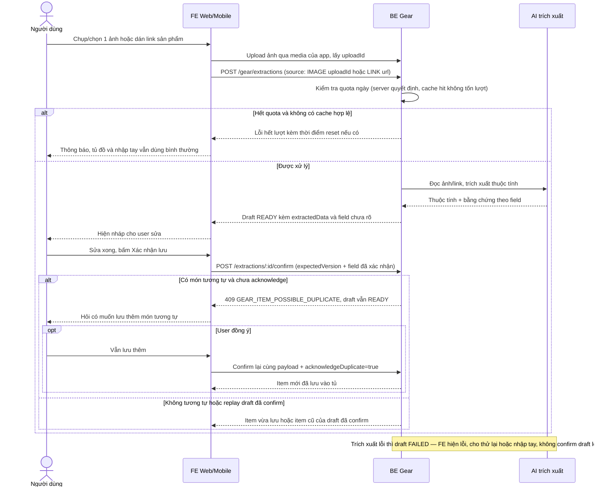
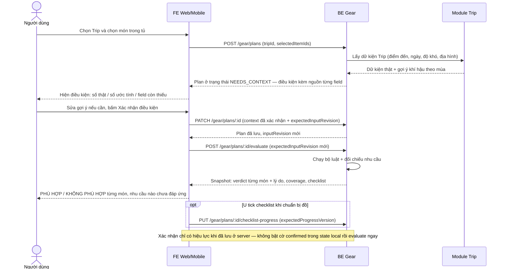
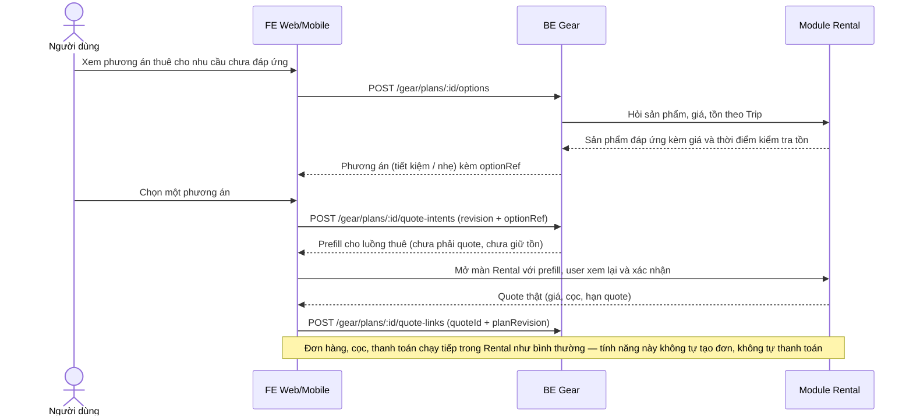

# "Chuẩn bị đồ cho chuyến đi" — Đặc tả cho Frontend (Web + Mobile)

Phiên bản đồng bộ: V3.1.5 — 23/10/2026. Nguồn: MASTER V3.1.5, mục1.1.G.

## 1. Tính năng và màn hình

Khách khai đồ trekking mình có → chọn Trip mình là thành viên → xem, bổ sung và **xác nhận** điều kiện chuyến → chọn đồ → hệ thống đánh giá từng món **PHÙ HỢP / KHÔNG PHÙ HỢP + lý do cụ thể** → nhu cầu chưa đáp ứng được gợi ý phương án thuê → chuyển sang luồng Rental có sẵn. Không điểm số, không mức "tạm được", không chế độ chuyến mô phỏng/MANUAL (nhập tay thông số món đồ vẫn bình thường — đó là nguồn của item, không phải chế độ chuyến). Mọi verdict, coverage và giá do backend tính; frontend chỉ hiển thị.

| Nhóm màn hình                 | Nội dung phải có                                                                                                                                       |
| ----------------------------- | ------------------------------------------------------------------------------------------------------------------------------------------------------ |
| Tủ đồ                         | Danh sách món, lọc theo loại; ảnh đại diện; tên, tình trạng, nguồn; báo thông số còn thiếu; thêm/sửa/xóa; trạng thái trống/đang tải/lỗi                |
| Form món đồ                   | Form theo loại đồ (bảng thuộc tính ở mục 4); thông số chưa biết để trống; quản lý tối đa 3 ảnh                                                         |
| Trích xuất & review           | Chọn 1 ảnh hoặc 1 link → xử lý → nháp + bằng chứng + field chưa rõ → user sửa → xác nhận lưu vào tủ                                                    |
| Tạo / mở plan                 | Chọn Trip hợp lệ, chọn đồ của mình (chọn rỗng vẫn hợp lệ), khai thêm nhu cầu nếu có                                                                    |
| Điều kiện chuyến              | Dữ kiện thật của Trip, gợi ý khí hậu gắn nhãn "ước tính", field còn thiếu, nguồn từng field, bước xác nhận (mục 6)                                     |
| Chi tiết plan & kết quả       | isReady từ server; verdict + lý do từng món; nhu cầu bắt buộc/tùy chọn và mức đáp ứng; checklist theo nhu cầu                                          |
| Phương án thuê & so sánh      | Phương án tiết kiệm / nhẹ; món tận dụng được; dòng thuê + số lượng; phí, cọc; khối lượng đã biết/thiếu; tồn + thời điểm kiểm tra                       |
| Tư vấn                        | Tải riêng, không chặn xem kết quả; nhãn nguồn AI / cache / theo quy tắc; bỏ qua phản hồi về trễ                                                        |
| Lịch sử / revision            | Danh sách plan, snapshot từng lần đánh giá, chi tiết một revision; Trip đã kết thúc chỉ xem                                                            |
| Xem lại theo Trip trong tủ đồ | Nhóm theo Trip: mỗi Trip list các món đã kiểm tra + verdict của lần đánh giá gần nhất; trong chi tiết món đồ: các Trip món đó đã được kiểm tra (mục 8) |
| Chuyển sang Rental            | Chọn phương án → intent → xem lại trong Rental → quote thật → liên kết quote về plan                                                                   |

Verdict là của một lần kiểm tra trong một ngữ cảnh cụ thể — không hiển thị verdict như thuộc tính cố định trên thẻ món đồ trong tủ; muốn xem lại verdict thì xem theo từng Trip như mục 8.

## 2. Luồng chạy (sequence diagram)

### 2.1. Thêm đồ bằng ảnh / link



### 2.2. Kiểm tra đồ theo chuyến đi (luồng chính)



### 2.3. Từ kết quả sang thuê đồ



## 3. Quyền theo thao tác → hành vi giao diện

| Thao tác                                             | Điều kiện / FE xử lý                                                                                        |
| ---------------------------------------------------- | ----------------------------------------------------------------------------------------------------------- |
| Tủ đồ: xem / thêm / sửa / xóa; trích xuất và confirm | Chỉ cần đăng nhập, tài nguyên của chính mình; **không cần có Trip**                                         |
| Xem lịch sử plan của mình                            | Luôn xem được kể cả khi không còn Trip đang hoạt động                                                       |
| Tạo / sửa plan, evaluate, tick checklist             | Là thành viên của Trip đó + Trip **chưa kết thúc**; backend kiểm tra lại từng thao tác                      |
| Xem plan của Trip đã kết thúc                        | Chỉ đọc snapshot đã lưu; không tạo options/advice/quote mới từ dữ liệu lịch sử                              |
| Thuê từ phương án                                    | Qua luồng Rental chuẩn; có Trip chưa kết thúc **chưa đồng nghĩa** đủ điều kiện thuê — Rental kiểm tra riêng |
| ADMIN / LEADER nhóm                                  | Không mặc nhiên xem được tủ đồ cá nhân của user khác                                                        |

## 4. Form món đồ và ảnh

| Category      | Nhãn         | Attributes (mọi field đều có thể null)                                                        |
| ------------- | ------------ | --------------------------------------------------------------------------------------------- |
| JACKET        | Áo khoác     | waterproof_mm: int; temp_rating_c: int; weight_g: int; windproof: bool                        |
| FOOTWEAR      | Giày         | waterproof: bool; ankle_support: bool; grip_level: int 1–5; weight_g: int                     |
| PANTS         | Quần         | waterproof_mm: int; temp_rating_c: int; insulated: bool                                       |
| BACKPACK      | Balo         | capacity_l: int; rain_cover: bool; waterproof: bool; weight_g: int                            |
| SLEEPING_BAG  | Túi ngủ      | temp_rating_c: int; weight_g: int                                                             |
| TENT          | Lều          | sleeping_places: int ≥1; flysheet_waterproof_mm: int; floor_waterproof_mm: int; weight_g: int |
| TREKKING_POLE | Gậy trekking | adjustable: bool; length_min_cm: số; length_max_cm: số; weight_g: int                         |
| RAIN_GEAR     | Đồ đi mưa    | waterproof_mm: int; coverage: UPPER_BODY/FULL_BODY; weight_g: int                             |

- 5 loại đầu là nhóm cơ bản; TENT / TREKKING_POLE / RAIN_GEAR là nhóm mở rộng, chỉ đánh giá qua nhu cầu của plan (mục 7) — không chạy bộ luật cơ bản, không tự hiện PHÙ HỢP khi chưa được đánh giá.
- `condition`: `new | good | worn | poor`. `source`: `manual | ai_image | ai_link` do server gán, FE không cho user chọn nguồn.
- Ô trống = chưa biết (null). **Không biến trống thành 0** (0 là giá trị thật, backend chấm theo 0). Field đúng/sai dùng 3 lựa chọn Có / Không / Chưa biết — không dùng checkbox mặc định "Không" cho dữ kiện chưa biết. Nhiệt độ được nhập số âm.
- Sửa món: bỏ trống một field khi gửi = giữ giá trị cũ; gửi null = xóa về "chưa biết". Đổi loại đồ thì attributes làm mới theo loại mới, không giữ field của loại cũ. Chỉ gửi field thuộc loại đồ đó.
- Giới hạn vận hành do backend cấu hình (mặc định: 50 món/user, 3 ảnh/món, 5MB/ảnh, JPEG/PNG/WebP) — FE hiển thị và xử lý theo lỗi server trả, không hardcode thành logic chặn tuyệt đối. Ảnh đầu (vị trí 0) là ảnh đại diện. Upload qua media của app và chỉ dùng uploadId của chính user; upload chưa xong thì chưa gọi trích xuất. Mỗi lần trích xuất chỉ 1 ảnh hoặc 1 link, do user chủ động bấm.
- Backend gửi ảnh cho nhà cung cấp AI ở cạnh dài tối đa 1024px; FE không cần tự nén thay backend.
- **Cảnh báo trùng mềm khi tạo món (cả nhập tay ở mục này và confirm nháp ở mục 5):** backend đối chiếu món sắp tạo với tủ hiện tại; nếu cùng category, cùng condition, mọi attribute mà cả hai bên biết đều bằng nhau và có ít nhất một field chung đã biết thì trả `409` kèm mã `GEAR_ITEM_POSSIBLE_DUPLICATE` và chi tiết món tương tự. FE hiện hộp hỏi "Tủ đã có một món tương tự — vẫn lưu thêm bản nữa?" kèm tên món đã có: user đồng ý → gửi lại đúng dữ liệu kèm `acknowledgeDuplicate=true`; user hủy → giữ nguyên form đang nhập, chưa có món nào được tạo. Đây không phải lỗi nhập liệu — không tô đỏ field, không xóa dữ liệu form.

### 4.1. Hộp cảnh báo món tương tự — dùng chung cho tạo tay và confirm

Cho nhập hai món cùng loại hoặc giống hệt. Cảnh báo là để user quyết định; không tự gộp và không đổi quantity. Backend quyết định hoàn toàn, FE không tự so dữ liệu hoặc gọi AI kiểm trùng.

- So sánh mọi attribute hợp lệ của category; name/brand/photo/source không tham gia. Cùng category + condition là chưa đủ. Mỗi field cả hai đều biết phải bằng nhau tuyệt đối, cần ít nhất một field chung khớp. Chỉ một field chung mâu thuẫn thì không hỏi lại.
- null/undefined = chưa biết, bỏ qua;0/false = đã biết. Hai bên toàn trống, một bên toàn trống hoặc known fields không giao nhau → không cảnh báo.
- Error details: `similarItem:{id,name}`, `matchedFields:string[]`, `similarCount:number`; mapping vào envelope repo. Backend trả item tương tự mới tạo gần nhất (tie id ASC), FE không tự tìm món thay thế. Hiện tên món và field khớp; nhiều matches có thể ghi “và N món tương tự khác” với N=similarCount−1. Đây là món **có thông số tương tự**, không khẳng định cùng vật thật.
- Hộp hỏi: **“Tủ đã có một món có thông số tương tự. Bạn có muốn lưu thêm?”** Nút “Quay lại chỉnh sửa” giữ form/draft, không tạo món; “Vẫn lưu thêm” gửi cùng payload với `acknowledgeDuplicate:true`. Không gửi cờ trước khi user đồng ý.
- Cờ chỉ dùng cho lần gửi lại đó. Sửa dữ liệu, đổi draft hoặc bắt đầu thêm món mới → bỏ cờ. Server vẫn có thể trả lỗi limit/validation/version/media; true không bỏ qua các lỗi này.
- `409 GEAR_ITEM_POSSIBLE_DUPLICATE` mở hộp hỏi;409 version conflict dùng UX xung đột, không tự thêm true. Trong lúc gửi khóa nút chống double-click. Không tự retry POST tạo tay khi timeout chưa biết đã lưu hay chưa; dùng idempotency của backend nếu contract có. Cờ true không phải idempotency key.
- Confirm draft mới bị cảnh báo thì giữ READY và expectedVersion hiện có. Confirm lại draft CONFIRMED theo replay trả item cũ, không mở cảnh báo, không tạo món thứ hai. Nếu cùng draft đã bị sửa đồng thời, xử lý version conflict, không tự tăng version.
- PATCH sửa item không chạy cảnh báo. Cảnh báo không gọi provider, không trừ quota extraction.

**Ví dụ:** áo cũ AI: JACKET/good, chống nước5000, nhiệt độ5°C, nặng500g. Áo mới nhập tay: cùng loại/tình trạng,5000 và5°C, chưa biết cân nặng → hỏi lại; matchedFields gồm waterproof_mm và temp_rating_c. Đổi5°C thành6°C → không hỏi, vì thông số chung mâu thuẫn. Tên/hãng/nguồn khác không ảnh hưởng.

### 4.2. Nguồn danh sách loại đồ và hành vi xóa món

- **Loại đồ của form lấy từ contract Gear** — đúng 8 loại ở bảng đầu mục 4. **Không** gọi `GET /api/v1/rental-categories` của Rental để làm loại đồ tủ: đó là danh mục hiển thị của catalog thuê (9 danh mục), khác hệ với loại đồ của tủ — phía thuê không có PANTS và không có áo khoác giữ ấm riêng, lại thừa các nhóm tủ không chấm (đèn, nấu ăn, sinh tồn). Hai hệ chỉ gặp nhau ở tầng gợi ý thuê qua bảng ánh xạ trong MASTER (mục 1.1.I), FE không tự ánh xạ.
- **Xóa món là xóa thật (xóa cứng), không có thùng rác/khôi phục:** bấm xóa phải hiện hộp xác nhận ghi rõ "xóa hẳn, không khôi phục được". Xóa thành công → món biến mất khỏi tủ ngay, giải phóng hạn mức 50 ngay (đang đầy 50, xóa 1 là thêm mới được), và không còn gây cảnh báo tương tự khi tạo lại món giống hệt.
- Lịch sử kiểm tra không bị xóa theo: các snapshot cũ vẫn hiển thị món đã xóa kèm nhãn "đã xóa khỏi tủ" (mục 8) — hộp xác nhận xóa nên nói rõ điều này để user không tưởng xóa món là xóa luôn lịch sử.

## 5. Trích xuất và quota

Trạng thái nháp: `PENDING` (đang xử lý, nếu backend chạy bất đồng bộ) → `READY` (chờ user review) / `FAILED` → `CONFIRMED` (đã thành item). Chỉ hỏi lại trạng thái nháp khi contract thật có bất đồng bộ; backend xử lý đồng bộ thì trả thẳng trạng thái cuối.

- Màn review phải hiện: giá trị trích xuất, bằng chứng theo từng field, và field nào **chưa rõ** (giữ null) — không nhìn hình dáng rồi tự điền chỉ số chống nước/nhiệt độ/cân nặng hộ AI. User sửa ở màn này; sửa của user không xóa dấu vết bản trích xuất gốc.
- Link: hiển thị URL nguồn và thời điểm đọc; nội dung lấy từ cache vẫn phải qua user review/confirm như thường.
- Confirm gửi `expectedVersion` của nháp + các field user đã xác nhận. Bấm confirm lại cùng nội dung thì trả về item cũ, không tạo món trùng; nếu nháp đã bị thay đổi thì xử lý như xung đột (mục 10).
- Confirm nháp mới cũng chịu cảnh báo trùng mềm như ở mục 4: nhận `409` mã `GEAR_ITEM_POSSIBLE_DUPLICATE` thì hiện cùng hộp hỏi; đồng ý → confirm lại kèm `acknowledgeDuplicate=true`; trong lúc chờ user quyết định, nháp vẫn ở trạng thái READY. Riêng confirm lại nháp đã CONFIRMED thì trả item cũ ngay, không hiện cảnh báo.
- Quota mặc định **20 lượt/user/ngày (giờ Asia/Saigon), server là nơi quyết định**:

| Trường hợp                                                 | Tính lượt?               |
| ---------------------------------------------------------- | ------------------------ |
| Nhà cung cấp AI có phản hồi (kể cả phản hồi thiếu dữ kiện) | Có                       |
| Trúng cache                                                | Không                    |
| Lỗi nhà cung cấp / timeout / không có phản hồi             | Không — server hoàn lượt |

FE không tự đếm quota và **không tự khóa toàn bộ trích xuất tới hôm sau**: hết lượt thì chỉ chặn lượt gọi mới theo thông báo server (nếu server trả số lượt còn lại/thời điểm reset thì hiển thị theo đó); tủ đồ, nhập tay và kiểm tra đồ không bị ảnh hưởng.

## 6. Điều kiện chuyến và bước xác nhận

| Field                                       | Nguồn / cách xử lý                                                                                                                   |
| ------------------------------------------- | ------------------------------------------------------------------------------------------------------------------------------------ |
| destination, ngày đi/về, days               | Dữ kiện thật của Trip; days do backend suy ra từ lịch; không sửa lịch bằng form của tính năng này                                    |
| difficulty, terrain                         | Từ Trip/tour nếu có; thiếu thì backend báo field cần bổ sung (user khai, ghi nguồn USER_DECLARED) — không bịa giá trị mặc định       |
| temp_min_c, temp_min_night_c, rain_prob_pct | Gợi ý khí hậu theo điểm đến + tháng đi, gắn nhãn **"Ước tính theo mùa"** (không gọi là dự báo thời tiết); user xem, sửa, xác nhận    |
| temp_max_c                                  | Field bắt buộc của bộ điều kiện; backend cung cấp hoặc yêu cầu bổ sung — thiếu thì chưa đánh giá được, FE không tự gán bằng temp_min |

Mỗi field mang nguồn `TRIP_FACT / CLIMATE_ESTIMATE / USER_DECLARED`, hiển thị theo nguồn backend trả. Trình tự bắt buộc: tạo/mở plan → hiện điều kiện kèm field thiếu → user sửa (nếu cần) và bấm xác nhận → **lưu lên server qua PATCH plan, nhận inputRevision mới** → mới evaluate bằng revision đó. Chưa xác nhận hoặc còn thiếu field: backend trả trạng thái cần bổ sung điều kiện, FE khóa nút kiểm tra và **không hiển thị verdict giả**. Sửa điều kiện sau khi đã có kết quả thì kết quả cũ được gắn nhãn cần đánh giá lại.

## 7. Kết quả: hai tầng core và plan — không trộn

|                     | Kiểm tra core (`/gear/check`)                                         | Plan (đường chính của UI)                                                      |
| ------------------- | --------------------------------------------------------------------- | ------------------------------------------------------------------------------ |
| Loại đồ             | Chỉ 5 loại cơ bản                                                     | 5 loại cơ bản + nhóm mở rộng theo nhu cầu                                      |
| Checklist           | Đúng 5 dòng cố định theo 5 loại cơ bản                                | Theo danh sách nhu cầu thực tế của plan (thứ tự ổn định, không cố định 5 dòng) |
| Kết quả             | Verdict từng món, lý do, gap, isReady                                 | Thêm: mức đáp ứng từng nhu cầu, món được dùng, snapshot theo revision          |
| Gợi ý thuê / tư vấn | Ở tầng core thuần: không có (`rentalSuggestions=[]`, `aiAdvice=null`) | Tải riêng qua options/advice khi capability sẵn sàng                           |

- NOT_SUITABLE luôn kèm lý do: FE hiển thị `ruleId` + `message` nguyên văn backend trả, không tự viết lại câu, không tự chạy luật để sinh lý do.
- Thiếu thông số: chỉ khi field thiếu thuộc một luật **áp dụng cho chuyến này** thì món mới KHÔNG PHÙ HỢP kèm lý do thiếu dữ liệu (R25) + nút "Bổ sung thông số" trỏ đúng field thiếu. Field null không liên quan tới chuyến thì không phạt.
- condition=poor → KHÔNG PHÙ HỢP (R24), không có mức trung gian.
- Gap thiếu loại đồ bắt buộc (R26) chỉ cho JACKET / FOOTWEAR / BACKPACK. Thiếu PANTS / SLEEPING_BAG không tự sinh gap này.
- **Hai áo một tốt một xấu:** cả hai giữ verdict riêng; cảnh báo theo kết quả backend trả được giữ nguyên ở tầng core, nhưng ở plan, nhu cầu áo được coi là đáp ứng bởi áo tốt — **không gợi ý thuê thêm áo**. Tương tự với mọi loại đồ: luôn tận dụng món đã chọn đáp ứng được trước khi tính thuê.
- Chọn rỗng (`selectedItemIds=[]`) là hợp lệ: hiển thị nhu cầu/gap, không ép user tạo đồ trước, không bịa verdict cho món không tồn tại.
- Checklist là tiến độ chuẩn bị của user, lưu riêng — tick hay bỏ tick **không** đổi verdict, mức đáp ứng hay isReady.

Mức đáp ứng từng nhu cầu (coverage) backend trả, FE hiển thị nhãn tương ứng:

| Giá trị                 | Nhãn UI                                              |
| ----------------------- | ---------------------------------------------------- |
| COVERED_BY_OWNED        | Đã có món đồ đáp ứng                                 |
| PLANNED_RENTAL          | Dự định thuê — chưa giữ chỗ, chưa thanh toán         |
| USER_DECLARED_PROVISION | Bạn khai đã có nguồn chuẩn bị — TrekGo chưa xác nhận |
| NEEDS_REPLACEMENT       | Cần thay bằng món phù hợp                            |
| MISSING                 | Chưa có món đáp ứng                                  |
| UNKNOWN                 | Chưa đủ thông tin để xác minh                        |

Nhu cầu tùy chọn (OPTIONAL) chưa đáp ứng không hiển thị như thiếu nhu cầu bắt buộc (REQUIRED).

## 8. Xem lại kết quả kiểm tra theo Trip ngay trong Tủ đồ

Hai view dưới đây chỉ là cách **xem lại** những bản đánh giá đã lưu, không phải một lần kiểm tra mới. Nguồn dữ liệu duy nhất là plan + revision đã có (mục 11: `GET /gear/plans`, `GET /gear/plans/:id`, `GET /gear/plans/:id/revisions`) — FE gom từ **revision mới nhất của từng plan**, không cần endpoint mới và tuyệt đối không tự chạy lại bộ luật ở FE. Nếu backend sau này cấp endpoint tổng hợp thì chỉ đổi tầng dữ liệu, cách hiển thị giữ nguyên.

Nguyên tắc cốt lõi: verdict thuộc về bộ ba **món đồ × Trip × lần đánh giá**, không thuộc về món đồ. Cùng một món ở hai Trip khác nhau cho hai kết quả khác nhau là bình thường và phải hiển thị cạnh nhau, không gộp thành một kết luận chung cho món đó.

### 8.1. View theo Trip

Danh sách các Trip mà user đã có plan (đặt trong khu Tủ đồ hoặc khu Lịch sử đều được, miễn cùng một dữ liệu):

- Mỗi dòng Trip hiển thị: tên Trip; trạng thái Trip (chưa kết thúc → mở plan sửa/evaluate tiếp được; đã kết thúc → chỉ xem); thời điểm đánh giá gần nhất; số món đã kiểm tra ở lần gần nhất; số món PHÙ HỢP / KHÔNG PHÙ HỢP; `isReady` của revision gần nhất.
- Mở một Trip → danh sách các món đã chọn kiểm tra trong revision gần nhất của plan đó: tên món, verdict, `ruleId` + `message` nguyên văn như ở mục 7.
- Món đã bị xóa khỏi tủ vẫn hiện trong danh sách này (vì snapshot bất biến), gắn nhãn "đã xóa khỏi tủ", không link sang form sửa món.
- Các lần đánh giá cũ hơn xem qua lịch sử revision của plan — không trộn vào view tổng hợp.

### 8.2. View theo món (trong chi tiết món đồ)

Thêm mục "Đã kiểm tra cho các chuyến" trong màn chi tiết món đồ:

- Mỗi dòng là một Trip: tên Trip, verdict của lần đánh giá gần nhất **cho Trip đó**, số revision, thời điểm đánh giá; bấm vào mở đúng plan/revision tương ứng.
- Món chưa từng được kiểm tra chuyến nào → hiện "Chưa kiểm tra cho chuyến nào" + nút đi tới tạo plan.

### 8.3. Quy tắc hiển thị bắt buộc

- Thẻ món trong danh sách tủ **không** ghim badge PHÙ HỢP / KHÔNG PHÙ HỢP cố định (giữ nguyên tắc ở cuối mục 1). Chỉ được hiện thông tin trung tính, ví dụ "Đã kiểm tra cho 2 chuyến".
- Mọi verdict ở cả hai view đều kèm tên Trip + số revision + thời điểm đánh giá — không hiện verdict trần không ngữ cảnh.
- Món đã bị sửa sau lần đánh giá gần nhất → verdict cũ gắn nhãn "cần đánh giá lại" theo cơ chế ở mục 10; không tự tính lại và không lặng lẽ thay verdict.
- Plan đã tạo nhưng chưa đánh giá được (điều kiện chuyến chưa xác nhận) → dòng Trip hiện "Chưa đánh giá — cần xác nhận điều kiện chuyến", không hiện verdict trống.
- Plan chọn rỗng (`selectedItemIds=[]`) → Trip vẫn có dòng riêng, ghi chú "Chưa chọn món nào", hiển thị gap/mức đáp ứng như revision đã lưu.
- Quyền xem: chỉ chủ sở hữu; xem lại không cần Trip đang hoạt động, Trip đã kết thúc vẫn xem được snapshot (theo bảng quyền ở mục 3).

## 9. Phương án thuê và tư vấn

- Hai mục tiêu phương án: **tiết kiệm phí thuê** (MIN_RENTAL_FEE) và **nhẹ nhất theo dữ kiện đã biết** (MIN_KNOWN_TOTAL_WEIGHT). Đổi mục tiêu/preferences là thay đổi đầu vào — lưu revision mới trước khi lấy phương án.
- Mỗi phương án hiển thị từ dữ kiện backend trả: món sở hữu được tận dụng; sản phẩm thuê + số lượng; nhu cầu được đáp ứng và phần còn thiếu/chưa rõ; **phí thuê và tiền cọc tách riêng**, tổng và loại tiền; khối lượng đã biết và món nào chưa có cân nặng (chưa biết thì ghi chưa biết, không hiện 0g, không ghi "nhẹ nhất" khi dữ kiện cân nặng chưa đủ); tồn khả dụng + thời điểm kiểm tra + nhãn "chưa giữ chỗ".
- Chọn phương án bằng `optionRef` backend cấp; không gửi ngược lại toàn bộ dữ liệu phương án hay giá do client giữ làm căn cứ.
- Không có phương án: phân biệt "không tìm được phương án khả thi (có lý do)" với "chưa đủ dữ kiện để xác minh" — không lấy sản phẩm mẫu lấp vào khi chạy dữ kiện thật.
- Riêng nhu cầu PANTS chưa đáp ứng: hiển thị trạng thái "chưa có danh mục thuê tương ứng" theo dữ kiện backend trả (phía catalog thuê hiện chưa có nhóm cho quần — xem bảng ánh xạ ở MASTER mục 1.1.I), tách bạch với trạng thái "có sản phẩm nhưng hết hàng/không đạt yêu cầu".
- Tư vấn: hiển thị nhãn nguồn backend trả (AI / cache / theo quy tắc — bản theo quy tắc không dán nhãn AI), kèm dòng miễn trừ. Tư vấn tải lỗi/chậm không chặn xem kết quả và phương án; phản hồi về sau khi user đã đổi Trip/đồ/phương án thì bỏ hoặc gắn nhãn cũ. AI không bao giờ ghi đè verdict, giá, tồn.

## 10. Phiên bản dữ liệu, xung đột, trạng thái lỗi

| Cơ chế                              | FE dùng                                                                                                    |
| ----------------------------------- | ---------------------------------------------------------------------------------------------------------- |
| `expectedInputRevision`             | Gửi kèm khi PATCH plan và khi evaluate/options theo revision                                               |
| `expectedProgressVersion`           | Gửi kèm khi tick checklist                                                                                 |
| `expectedVersion` (nháp trích xuất) | Gửi kèm khi confirm nháp                                                                                   |
| Item khi sửa                        | Chỉ gửi expectedVersion nếu DTO item thật của backend có field này — không tự thêm field lạ vào DTO strict |

- Lỗi 409 (xung đột phiên bản): giữ nguyên nội dung user đang sửa, báo dữ liệu đã thay đổi, tải bản mới và để user quyết định áp lại phần sửa. Không tự gửi lại vô hạn. Server trả revision mới nào thì dùng đúng số đó, không tự cộng version ở client. Phân biệt bằng mã lỗi: `409` kèm mã `GEAR_ITEM_POSSIBLE_DUPLICATE` là cảnh báo trùng mềm (mục 4), xử lý bằng hộp hỏi user — không áp quy trình xung đột phiên bản ở đây.
- Item trong tủ bị sửa, điều kiện Trip đổi, hoặc có revision mới hơn → kết quả cũ gắn nhãn cần đánh giá lại; snapshot lịch sử giữ nguyên, không vẽ lại bằng dữ kiện hiện tại.
- Lỗi theo mã: 400 → báo đúng field/loại dữ liệu sai. 401 → đăng nhập lại rồi quay về ngữ cảnh. 403/404 → không có quyền/không tồn tại, không lộ tài nguyên user khác. Hết quota/timeout/lỗi nhà cung cấp → báo đúng nguyên nhân, giữ form đang nhập, nhập tay vẫn dùng được. Mất mạng → dữ kiện đã tải chỉ để xem, không khẳng định thao tác đã lưu khi server chưa xác nhận.

## 11. Bảng API đích

Path chưa gồm prefix `/api/v1`. Đây là đặc tả đích theo MASTER V3.1.5; **wire chính xác (envelope, mã lỗi, tên field, phân trang) chốt theo API_CONTRACT_V3/OpenAPI của repo khi nối thật** — V3.1.5 là phiên bản đặc tả Gear, khác với contractVersion của Rental.

| Method + path                                                              | Dùng để                                                                                                                                                           |
| -------------------------------------------------------------------------- | ----------------------------------------------------------------------------------------------------------------------------------------------------------------- |
| GET/POST `/gear/items`; PATCH/DELETE `/gear/items/:id`                     | Tủ đồ của owner                                                                                                                                                   |
| GET `/gear/requirement-rules`                                              | Metadata 28 luật để hiển thị giải thích (user không sửa được)                                                                                                     |
| POST `/gear/check`                                                         | Kiểm tra core 5 loại cơ bản: `{tripId, itemIds}`; chứa loại mở rộng → lỗi `GEAR_CATEGORY_REQUIRES_PLAN`                                                           |
| POST `/gear/extractions`                                                   | Tạo nháp: `source` là một object phân biệt loại — `{kind:"IMAGE", uploadId}` hoặc `{kind:"LINK", productUrl}` (dạng lồng trong `source`, chốt theo contract thật) |
| GET `/gear/extractions/:id`                                                | Đọc nháp/trạng thái/bằng chứng của owner                                                                                                                          |
| POST `/gear/extractions/:id/confirm`                                       | expectedVersion + field user đã xác nhận (+ `acknowledgeDuplicate` khi user đồng ý lưu món tương tự) → item                                                       |
| POST `/gear/plans`; GET `/gear/plans`; GET `/gear/plans/:id`               | Tạo / danh sách / chi tiết plan (đầu vào dùng `selectedItemIds`)                                                                                                  |
| PATCH `/gear/plans/:id`                                                    | expectedInputRevision + đầu vào sửa được, gồm context/confirmation/preferences                                                                                    |
| PUT `/gear/plans/:id/checklist-progress`                                   | expectedProgressVersion + tick theo requirementId                                                                                                                 |
| POST `/gear/plans/:id/evaluate`                                            | expectedInputRevision → snapshot kết quả hoặc trạng thái thiếu điều kiện                                                                                          |
| GET `/gear/plans/:id/revisions`; GET `/gear/plans/:id/revisions/:revision` | Lịch sử snapshot và chi tiết một revision                                                                                                                         |
| POST `/gear/plans/:id/options`                                             | Phương án thuê cho revision hiện tại                                                                                                                              |
| POST `/gear/plans/:id/advice`                                              | Tư vấn theo revision/optionRef; không gửi verdict/giá tự khai                                                                                                     |
| POST `/gear/plans/:id/quote-intents`                                       | revision + optionRef + số lượng → prefill Rental                                                                                                                  |
| POST `/gear/plans/:id/quote-links`                                         | quoteId + planRevision → liên kết quote thật về plan (backend tự xác minh)                                                                                        |

API Rental dùng lại nguyên trạng: `GET /trips/:tripId/rental-eligibility` (101 — lưu ý `eligible=false` vẫn có thể là phản hồi thành công kèm lý do), `GET /rentals/availability` (102), `POST /rentals/quote` (103), `GET /trips/:tripId/rental-recommendations` (104). Quote không giữ tồn; tạo đơn sẽ kiểm tra lại. Quote hết hạn hiển thị nhãn hết hạn trong lịch sử, không dùng lại như quote còn hiệu lực. Nếu tạo quote thành công nhưng liên kết về plan lỗi: giữ quoteId, cho liên kết lại — không tạo quote/đơn mới để che lỗi.

FE không gửi các field thuộc về server: owner, source của item, verdict/score/result, giá, timestamps hệ thống.

## 12. Khu quản trị hồ sơ kỹ thuật (phạm vi riêng, phải có người phụ trách)

STAFF_INVENTORY/ADMIN quản lý hồ sơ kỹ thuật của sản phẩm catalog (thuộc tính chuẩn hóa + nguồn/bằng chứng), độc lập với Trip và không xem được tủ đồ của user. Nếu backend chốt capability riêng thì dùng `GET/PUT /staff/gear/product-profiles/:productId` (ghi kèm expectedVersion); nếu màn/API thông số sản phẩm hiện có đã đủ thì tái dùng. Form này không sửa giá/cọc/tồn/trạng thái của sản phẩm thuê. Nhóm phân công rõ người làm phần này hoặc ghi nhận là việc treo — không gộp vào nghiệm thu phía user.

## 13. Mock data pack

Toàn bộ mục này là fixture phục vụ dựng UI và kiểm thử FE — là kỳ vọng theo đặc tả, không phải dữ kiện runtime đã chạy, không seed vào tài khoản thật. Tách mock khỏi API client production.

**Điều kiện chuyến mẫu (Bidoup)** — bộ điều kiện đầy đủ, đã xác nhận:

```json
{
  "temp_min_c": 8,
  "temp_max_c": 16,
  "temp_min_night_c": 9,
  "rain_prob_pct": 85,
  "difficulty": 3,
  "days": 2,
  "terrain": ["muddy", "rocky"]
}
```

**Năm món mẫu** (condition=good, source=manual) và **kết quả kỳ vọng**:
| Loại | Attributes | Kỳ vọng |
| --- | --- | --- |
| JACKET | waterproof_mm=2000; temp_rating_c=12; weight_g=500; windproof=true | KHÔNG PHÙ HỢP — R01 + R03 |
| FOOTWEAR | waterproof=false; ankle_support=true; grip_level=4; weight_g=600 | KHÔNG PHÙ HỢP — R07 |
| PANTS | waterproof_mm=5000; temp_rating_c=5; insulated=true | PHÙ HỢP |
| BACKPACK | capacity_l=40; rain_cover=true; waterproof=false; weight_g=900 | PHÙ HỢP |
| SLEEPING_BAG | temp_rating_c=13; weight_g=1200 | KHÔNG PHÙ HỢP — R20 |

Tổng: đúng 3 KHÔNG PHÙ HỢP; `isReady=false`; gap R28; không R26/R27; không thiếu thông số; checklist core đúng 5 dòng; `rentalSuggestions=[]`; `aiAdvice=null`. Đổi túi ngủ thành temp_rating_c=11 → lý do đổi thành **R21**, còn lại giữ nguyên. Ví dụ một lý do đã render: `{ "ruleId": "R20", "message": "Đêm lạnh nhất 9°C mà túi ngủ chỉ chịu được 13°C — nguy cơ mất ngủ vì lạnh." }` — FE hiển thị nguyên văn message backend trả.

**Các ca mock bổ sung để dựng đủ trạng thái:**

| Ca                               | Kỳ vọng UI                                                                                                                                                                                                          |
| -------------------------------- | ------------------------------------------------------------------------------------------------------------------------------------------------------------------------------------------------------------------- |
| Tất cả đạt                       | Giữ điều kiện trên; JACKET waterproof_mm=10000, temp_rating_c=5; FOOTWEAR waterproof=true; SLEEPING_BAG temp_rating_c=5 → 5 PHÙ HỢP, isReady=true, không gap                                                        |
| Không chọn đồ                    | selectedItemIds=[] → không verdict từng món; gap R26 cho JACKET/FOOTWEAR/BACKPACK                                                                                                                                   |
| Thiếu điều kiện                  | Ước tính chưa xác nhận hoặc thiếu temp_max_c → trạng thái cần bổ sung điều kiện; không verdict giả                                                                                                                  |
| Thiếu thông số                   | Field thiếu thuộc luật áp dụng cho chuyến → R25 + chỉ rõ field cần bổ sung                                                                                                                                          |
| Áo tốt + áo xấu                  | Cả hai có verdict riêng; plan dùng áo tốt, không gợi ý thuê áo                                                                                                                                                      |
| Đồ mở rộng                       | TENT có nhu cầu số chỗ do user xác nhận; thiếu dữ kiện ràng buộc → UNKNOWN, không tự gắn PHÙ HỢP                                                                                                                    |
| Tick checklist                   | Tick hết vẫn không đổi verdict/coverage/isReady; chỉ tiến độ đổi                                                                                                                                                    |
| Nháp trích xuất READY            | Có nguồn ảnh/link + thời điểm đọc (với link), bằng chứng, field chưa rõ, version nháp                                                                                                                               |
| Nháp FAILED / hết quota          | Không confirm được; có đường nhập tay; cache hit không bị trừ lượt hiển thị                                                                                                                                         |
| Phương án thiếu cân nặng         | Phí/cọc hiển thị bình thường; cân nặng ghi PARTIAL/chưa biết — không 0g, không nhãn "nhẹ nhất"                                                                                                                      |
| Không có phương án               | Phân biệt "không khả thi, có lý do" với "chưa đủ dữ kiện xác minh"                                                                                                                                                  |
| Tư vấn fallback / về trễ         | Nhãn RULE_FALLBACK; phản hồi của revision cũ không thay thế bản hiện tại                                                                                                                                            |
| Xung đột 409                     | Giữ nội dung đang sửa, cho tải bản mới                                                                                                                                                                              |
| Trip đã kết thúc                 | Xem snapshot; khóa sửa/evaluate/tick/options/advice/quote mới                                                                                                                                                       |
| Quote hết hạn / liên kết lỗi     | Nhãn hết hạn; hoặc giữ quoteId và cho liên kết lại                                                                                                                                                                  |
| Cùng món, hai Trip khác kết quả  | Túi ngủ temp_rating_c=13: với Bidoup (đêm 9°C) → KHÔNG PHÙ HỢP R20; Trip thứ hai có đêm 18°C → PHÙ HỢP. Chi tiết món hiện cả hai dòng theo từng Trip; thẻ món trong tủ không ghim badge verdict                     |
| Xem lại theo Trip trong tủ đồ    | Nhóm theo Trip lấy revision mới nhất của từng plan; món đã xóa khỏi tủ vẫn hiện kèm nhãn "đã xóa khỏi tủ"; plan chưa xác nhận điều kiện → dòng Trip hiện "Chưa đánh giá — cần xác nhận điều kiện chuyến"            |
| Món sửa sau khi đã kiểm tra      | Verdict cũ ở cả hai view gắn nhãn "cần đánh giá lại", không tự đổi theo thuộc tính mới của món                                                                                                                      |
| Tạo món trùng món đã có          | Nhập tay áo5000/5°C, weight=null khi món AI cũ5000/5°C/500g (cùng loại/tình trạng) → 409 GEAR_ITEM_POSSIBLE_DUPLICATE + hộp hỏi; đồng ý → lưu thành món thứ hai; hủy → không tạo món nào, form giữ nguyên           |
| Thông số chung khác nhau         | Một field chung khớp nhưng nhiệt độ5 so6 → tạo thẳng, không cảnh báo                                                                                                                                                |
| Không đủ bằng chứng              | Toàn null hoặc các field biết không giao nhau → tạo thẳng                                                                                                                                                           |
| Giá trị0/false                   | weight_g=0 hoặc windproof=false ở cả hai → là field khớp thật                                                                                                                                                       |
| Sửa sau cảnh báo                 | User đổi dữ liệu → bỏ acknowledgeDuplicate, lần lưu sau server kiểm lại                                                                                                                                             |
| Nhiều món tương tự / lỗi khác409 | Hiện similarCount và item đại diện server trả; version conflict không mở hộp lưu thêm                                                                                                                               |
| Xóa món khi tủ đầy               | Tủ đủ 50 → tạo mới bị lỗi giới hạn; xóa 1 món (hộp xác nhận ghi rõ xóa thật, không khôi phục được, lịch sử kiểm tra vẫn giữ) → tạo mới thành công ngay; tạo lại món giống hệt bản vừa xóa → không cảnh báo tương tự |
| Gợi ý thuê cho PANTS             | Nhu cầu PANTS chưa đáp ứng → hiện "chưa có danh mục thuê tương ứng", không hiện chung chung "hết hàng"                                                                                                              |

## 14. Riêng mobile

Mobile là client thứ hai của cùng backend — cùng API, cùng mock ở mục 13, không contract riêng, không logic riêng.

1. Làm trên project/stack mobile thật của nhóm (router, auth, API client, thư viện chọn ảnh đang dùng sẵn). Chưa có project mobile → báo lại ngay, không tự dựng project giả.
2. Trích xuất ảnh lấy **camera làm lối vào chính**: chụp trực tiếp hoặc chọn thư viện; xin quyền **đúng lúc bấm nút**; bị từ chối vẫn nhập tay bình thường. Không nhúng key nhà cung cấp AI/đọc link vào app. Không tự chạy trích xuất nền khi user chưa bấm.
3. **Deep-link chỉ mang định danh** (tripId/planId/productId) — không giá tiền, không token. Mở link khi chưa đăng nhập → qua login rồi quay lại đúng ngữ cảnh, server kiểm tra lại quyền sở hữu; không mở link là tự tạo quote/đơn/thanh toán.
4. Mất mạng: dữ kiện đã tải chỉ để xem; không tạo yêu cầu thuê từ giá/tồn đã lưu cũ. Phản hồi tư vấn bất đồng bộ về trễ sau khi đổi ngữ cảnh thì bỏ.
5. Chống tạo lặp do retry: confirm cùng draft theo replay chỉ có một item; mobile khóa nút khi đang gửi và dùng cơ chế idempotency đúng contract cho các mutation có hỗ trợ. Tạo tay chưa có idempotency thì không tự retry khi kết quả mạng chưa rõ; không claim khóa nút bảo đảm exactly-once. Hai món tương tự được user chủ động đồng ý lưu vẫn là hai item hợp lệ. Quay lại màn hình khôi phục đúng nháp đang sửa + trạng thái server mới nhất.
6. Màn nhỏ: một cột; vùng bấm đủ lớn; so sánh phương án xếp dọc; bàn phím số cho field số và cho nhập nhiệt độ âm; lý do tiếng Việt dài không tràn/cắt cụt — kiểm tra trên màn hình nhỏ nhất nhóm hỗ trợ.

**Tự kiểm mobile:** quyền camera bị từ chối · upload lỗi giữa chừng · confirm 2 lần · mất mạng rồi có lại · deep-link khi chưa đăng nhập · tư vấn cũ về sau khi đã đổi Trip · chữ dài trên màn nhỏ · back/resume giữ đúng nháp.

## 15. Tiêu chí nghiệm thu phía FE

- [ ] Không có chuyến mô phỏng/MANUAL, không điểm số, không verdict trung gian; nhập tay item vẫn hoạt động.
- [ ] Không có Trip vẫn dùng được tủ đồ, trích xuất và xem lịch sử của mình.
- [ ] Điều kiện đủ field, có nguồn từng field; xác nhận được **lưu ở server** rồi mới evaluate.
- [ ] Chọn rỗng hợp lệ; core 5 loại tách khỏi plan theo nhu cầu; đồ mở rộng không bị giả PHÙ HỢP.
- [ ] Chưa biết khác 0, khác false; sửa món không làm mất thông số ngoài ý muốn; đổi loại đồ không giữ field cũ.
- [ ] Giới hạn ảnh/món và lỗi upload có UX; trích xuất đủ trạng thái, double confirm không tạo trùng.
- [ ] Cảnh báo trùng mềm chạy ở cả hai đường nạp (nhập tay + confirm nháp): 409 đúng mã GEAR_ITEM_POSSIBLE_DUPLICATE, đồng ý thì lưu kèm acknowledgeDuplicate, hủy thì không tạo món nào; confirm lại nháp đã CONFIRMED không hiện cảnh báo.
- [ ] So theo backend, không so tên/AI;0/false known, thiếu một bên bỏ qua, all-null/disjoint không hỏi; đổi field sau cảnh báo bỏ cờ; true không bypass limit/version; PATCH không hỏi.
- [ ] Loại đồ của form lấy từ contract Gear (8 loại ở mục 4), không gọi /rental-categories; xóa món là xóa thật có hộp xác nhận, xóa xong giải phóng hạn mức 50 ngay; snapshot cũ vẫn hiện món đã xóa kèm nhãn.
- [ ] Fixture core khớp kỳ vọng; có đủ ca mock ở mục 13.
- [ ] Tick checklist không đổi kết quả; 409 giữ nội dung đang sửa; snapshot lịch sử không bị dữ kiện hiện tại ghi đè.
- [ ] Xem lại theo Trip (mục 8): view theo Trip và view theo món đều lấy revision mới nhất của từng plan; verdict luôn kèm tên Trip + số revision + thời điểm; không ghim badge verdict cố định lên thẻ món; món đã xóa vẫn xem được trong snapshot.
- [ ] Phương án hiển thị tách phí/cọc, cân nặng thiếu ghi rõ, thời điểm kiểm tra tồn; không hứa giữ chỗ.
- [ ] Tư vấn có nhãn nguồn; phản hồi cũ không ghi vào ngữ cảnh mới.
- [ ] Handoff qua intent → xem lại ở Rental → quote thật → liên kết quote; không tự tạo đơn/thanh toán, deep-link không chứa giá.
- [ ] Trip kết thúc chỉ xem; quote hết hạn có nhãn; hồ sơ kỹ thuật có người phụ trách hoặc ghi rõ là việc treo.
- [ ] Khi bàn giao ghi rõ: phần nào chạy mock, API nào đã nối thật, đã kiểm thử những gì — không gọi UI chạy mock là hoàn thành end-to-end.
