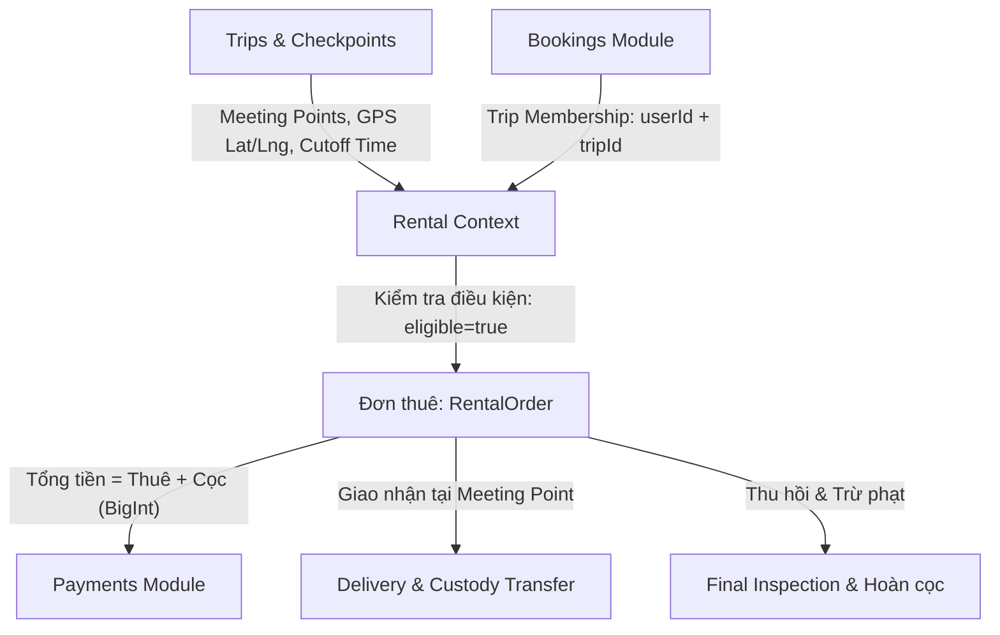
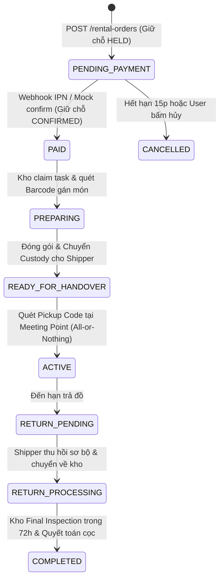
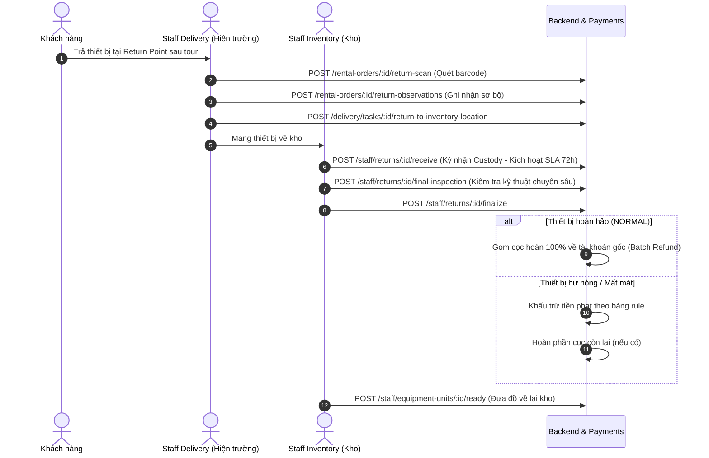

# HƯỚNG DẪN TÍCH HỢP TOÀN DIỆN MẢNG RENTAL (THUÊ THIẾT BỊ) DÀNH CHO FRONTEND

> **Tài liệu bàn giao kỹ thuật & Hợp đồng API (Authoritative Backend Flow)**  
> **Phiên bản nghiệp vụ SOT:** `Policy: 1.5.2` · `Business Flow: 1.3.2` · `Functional Requirements: 1.3.2`  
> **Nguồn trích xuất:** 100% mã nguồn thực tế tại `api/src/modules/rental/`, `bookings/`, `trips/`, `payments/`.  
> **Quy ước chung:** Tất cả API đều có tiền tố `/api/v1`, yêu cầu header `Authorization: Bearer <token>` (trừ khi có ghi chú khác) và dữ liệu gửi nhận dạng JSON.

---

## 1. MỐI LIÊN KẾT GIỮA RENTAL VÀ CÁC MODULE KHÁC (BẮT BUỘC HIỂU ĐÚNG)

Frontend **không được** thiết kế Rental như một giỏ hàng thương mại điện tử độc lập. Toàn bộ logic thuê đồ được neo chặt vào các module hệ thống:



### 1.1. Liên kết với `trips` & `checkpoint` (Lịch trình, Tọa độ GPS & Điểm hẹn)

- **Thời gian thuê (`rentalStartAt` / `rentalEndAt`)**:
  - `rentalStartAt` bắt buộc neo theo giờ hẹn tập kết đi (`pickup.scheduledAt`) của chuyến đi.
  - `rentalEndAt` mặc định neo theo giờ kết thúc tại điểm trả (`dropoff.scheduledAt`), hoặc theo `returnOptionId` được server cấp.
  - **Buffer công suất kho**: Backend tự động trừ lùi **12 giờ** trước `rentalStartAt` để kho chuẩn bị (`RENTAL_PREP_BUFFER_MINUTES = 720`), và cộng thêm **24 giờ** (thông thường) hoặc **48 giờ** (đối với thiết bị kiểm định sâu `requiresDeepReturnInspection = true`) sau giờ trả để vệ sinh/bảo dưỡng.
- **Tọa độ GPS & Chỉ đường**: Điểm giao và điểm trả trả về `lat`, `lng`, `address` từ `TripServicePoint`. FE dùng tọa độ này để hiển thị bản đồ dẫn đường cho User và Shipper ngoài hiện trường.
- **Thời hạn chốt đơn (`rentalCutoffAt`)**: Chuyến đi có mốc cutoff. Nếu thời gian hiện tại `now >= rentalCutoffAt`, backend lập tức từ chối tạo đơn mới với mã lỗi `RENTAL_CUTOFF_PASSED`.

### 1.2. Liên kết với `bookings` (Tư cách hội viên & Ranh giới tài khoản)

- **Phân quyền dựa trên `TripMember` (`RB-TBD-02`)**: Quyền đặt thuê được kiểm tra qua cặp `(userId, tripId)`. **Tuyệt đối không dùng `bookingId` để phân quyền**.
- **Người đi cùng (Companion) tự thuê**: Nếu người đặt tour (A) đặt vé hộ người đi cùng (B), và người B đã có tài khoản liên kết với `booking_participants.userId`, thì **B được quyền tự tạo đơn thuê riêng cho chính mình**, tự thanh toán và tự nhận đồ. FE không chặn B chỉ vì B không phải chủ booking.

### 1.3. Liên kết với `payments` (Thanh toán & Quyết toán cọc)

- **Thu tiền gộp 1 lần**: Khi checkout ban đầu, hệ thống thu gộp `totalAmount = rentalFee + totalDeposit`.
- **Hoàn cọc đúng nguồn gốc (`RB-POL-22`, `RB-POL-29`)**: Cọc hoàn về đúng tài khoản/nguồn thanh toán ban đầu đã thu. Không hoàn cọc vào thẻ khác.
- **Payment Truth $\neq$ Business Truth**: Trạng thái thanh toán của cổng (`Payment SUCCEEDED`) chưa phải là xong; đơn chỉ hợp lệ khi Backend kích hoạt nghiệp vụ chuyển sang `orderStatus = PAID` và `Reservation = CONFIRMED`.

---

## 2. BẢN ĐỒ MÀN HÌNH FRONTEND (THEO 3 NHÓM ACTORS)

| Nhóm Đối tượng (Actor)                   | Tên màn hình / Chức năng             | URL Route Frontend đề xuất           | API Backend cốt lõi                                                                                                                                                                                                          |
| ---------------------------------------- | ------------------------------------ | ------------------------------------ | ---------------------------------------------------------------------------------------------------------------------------------------------------------------------------------------------------------------------------- |
| **Khách hàng (User / Leader)**           | 1. Báo giá & Chọn thiết bị theo Tour | `/trips/:tripId/rentals`             | `GET /trips/:tripId/rental-eligibility`<br/>`GET /rentals/availability`<br/>`POST /rentals/quote`                                                                                                                            |
|                                          | 2. Chi tiết đơn & Checkout           | `/rentals/:orderId/checkout`         | `POST /rental-orders`<br/>`POST /rental-orders/:id/payments`<br/>`GET /rental-orders/:id/payment`                                                                                                                            |
|                                          | 3. Hủy đơn trước khi giao            | `/rentals/:orderId/cancel`           | `GET /rental-orders/:id/cancellation-preview`<br/>`POST /rental-orders/:id/cancel`                                                                                                                                           |
|                                          | 4. Lấy mã nhận hàng (OTP/QR)         | `/rentals/:orderId/pickup`           | `GET /rental-orders/:id/pickup-code`                                                                                                                                                                                         |
|                                          | 5. Xin gia hạn đơn thuê              | `/rentals/:orderId/extend`           | `POST /rental-orders/:id/extension-quotes`<br/>`POST /rental-orders/:id/extensions`<br/>`POST /rental-extensions/:id/payments`                                                                                               |
|                                          | 6. Bảng kê cọc & Khiếu nại hư hại    | `/rentals/:orderId/deposit`          | `GET /rental-orders/:id/deposit`<br/>`POST /rental-orders/:id/assessment-reviews`                                                                                                                                            |
|                                          | 7. Xem & Tải hợp đồng/chứng từ       | `/rentals/:orderId/documents`        | `GET /rental-orders/:id/documents`<br/>`GET /rental-documents/:documentId/download`                                                                                                                                          |
| **Nhân viên Kho (Staff Inventory)**      | 8. Danh sách đơn cần soạn đồ         | `/staff/warehouse/tasks`             | `GET /staff/warehouse/tasks`<br/>`POST /staff/warehouse/tasks/:id/claim`                                                                                                                                                     |
|                                          | 9. Quét Barcode gán món & Đóng gói   | `/staff/warehouse/tasks/:id`         | `POST /staff/warehouse/tasks/:id/pick`<br/>`POST /staff/warehouse/tasks/:id/condition`<br/>`POST /staff/warehouse/tasks/:id/pack`<br/>`POST /staff/warehouse/tasks/:id/ready`<br/>`POST /staff/warehouse/tasks/:id/transfer` |
|                                          | 10. Tiếp nhận đồ trả về kho & SLA    | `/staff/returns`                     | `GET /staff/returns`<br/>`POST /staff/returns/:id/receive` _(Kích hoạt SLA 72h)_                                                                                                                                             |
|                                          | 11. Giám định Final Inspection       | `/staff/returns/:id/inspect`         | `POST /staff/returns/:id/final-inspection`<br/>`POST /staff/returns/:id/finalize`<br/>`POST /staff/equipment-units/:id/ready`                                                                                                |
| **Nhân viên Giao nhận (Staff Delivery)** | 12. Danh sách nhiệm vụ giao nhận     | `/staff/delivery/tasks`              | `GET /delivery/tasks`<br/>`POST /delivery/tasks/:id/claim`<br/>`POST /delivery/tasks/:id/receive` _(ACK Custody)_                                                                                                            |
|                                          | 13. Giao đồ tại điểm hẹn (Handover)  | `/staff/delivery/tasks/:id/handover` | `POST /delivery/tasks/:id/verify-recipient`<br/>`POST /rental-orders/:id/handover`<br/>`POST /rental-orders/:id/no-show`                                                                                                     |
|                                          | 14. Thu hồi đồ sau tour tại điểm hẹn | `/staff/delivery/tasks/:id/return`   | `POST /rental-orders/:id/return-scan`<br/>`POST /rental-orders/:id/return-observations`<br/>`POST /delivery/tasks/:id/return-to-inventory-location`                                                                          |

---

## 3. QUY TRÌNH TỪNG BƯỚC & HỢP ĐỒNG API CHI TIẾT



---

### BƯỚC 1: KIỂM TRA ĐIỀU KIỆN & LẤY BÁO GIÁ (QUOTE)

#### 1. Kiểm tra quyền thuê của thành viên (`RB-API-101`)

- **Method & Route**: `GET /api/v1/trips/:tripId/rental-eligibility`
- **Headers**: `Authorization: Bearer <token>`
- **Response**:

```json
{
  "eligible": true,
  "reason": null,
  "rentalCutoffAt": "2026-12-01T12:00:00.000Z",
  "allowedActions": ["CREATE_ORDER", "VIEW_CATALOG"],
  "existingOpenOrderId": null,
  "recipientOptions": [
    {
      "memberId": "member-uuid",
      "userId": "user-uuid",
      "fullName": "Nguyễn Văn A",
      "status": "ACTIVE"
    }
  ]
}
```

- **Xử lý UI**: Nếu `eligible === false`, hiển thị `reason` và khóa form thuê. Nếu `existingOpenOrderId !== null`, dẫn user về đơn đang mở.

#### 2. Kiểm tra tồn kho khả dụng thời gian thực (`RB-API-102`)

- **Method & Route**: `GET /api/v1/rentals/availability`
- **Query Params**:
  - `tripId`: UUID (bắt buộc)
  - `productId`: UUID (bắt buộc)
  - `requestedReturnAt`: ISO8601 (tùy chọn)
  - `returnOptionId`: string (tùy chọn)
- **Response**: Trả về `availableCount` (tính bằng thuật toán Sweep-line nửa mở `[start, end)` có cộng buffer).

#### 3. Tạo báo giá (`RB-API-103`)

- **Method & Route**: `POST /api/v1/rentals/quote`
- **Request Body**:

```json
{
  "tripId": "550e8400-e29b-41d4-a716-446655440101",
  "recipientTripMemberId": "member-uuid",
  "requestedReturnAt": "2026-12-03T18:00:00.000Z",
  "returnOptionId": "RETURN_AT_BASE",
  "items": [
    { "productId": "550e8400-e29b-41d4-a716-446655440102", "quantity": 1 }
  ]
}
```

- **Response (HTTP 201)**:

```json
{
  "id": "quote-uuid-abc",
  "tripId": "550e8400-e29b-41d4-a716-446655440101",
  "amounts": {
    "feeAmount": 360000,
    "depositAmount": 300000,
    "totalAmount": 660000,
    "currency": "VND"
  },
  "chargedDays": 3,
  "expiresAt": "2026-10-22T23:00:00.000Z"
}
```

- **Bất biến**: Quote có hạn hiệu lực 15 phút, **chưa giữ chỗ trong kho**, **chưa gán món đồ vật lý**.

---

### BƯỚC 2: TẠO ĐƠN THUÊ & CHECKOUT THANH TOÁN

#### 1. Tạo đơn hàng từ Quote (`RB-API-201`)

- **Method & Route**: `POST /api/v1/rental-orders`
- **Headers**:
  - `Authorization: Bearer <token>`
  - `Idempotency-Key: <UUID>` _(bắt buộc để chống tạo đơn trùng)_
- **Request Body**:

```json
{
  "quoteId": "quote-uuid-abc"
}
```

- **Xử lý Backend**: Tạo đơn hàng ở trạng thái `PENDING_PAYMENT`, đồng thời giữ chỗ công suất kho nguyên tử (`RentalQuantityReservation` ở trạng thái `HELD`). Hạn giữ chỗ thanh toán: 15 phút (`paymentExpiresAt`).

#### 2. Khởi tạo phiên thanh toán (`RB-API-204`)

- **Method & Route**: `POST /api/v1/rental-orders/:id/payments`
- **Headers**:
  - `Authorization: Bearer <token>`
  - `Idempotency-Key: <UUID>`
- **Request Body**:

```json
{
  "paymentMethod": "REDIRECT",
  "gateway": "vnpay"
}
```

> [!CAUTION]
> **LƯU Ý ĐẶC BIỆT KHI DEMO/DEV:** Khi backend chạy cấu hình `PAYMENT_PROVIDER=mock`, trường `gateway` **BẮT BUỘC ĐỂ TRỐNG HOẶC KHÔNG TRUYỀN**. Nếu cố tình truyền `"vnpay"` hay `"momo"` khi backend chưa cấu hình sandbox keys, server sẽ trả lỗi HTTP 503 `PAYMENT_PROVIDER_UNAVAILABLE`.

- **Response (HTTP 201)**:

```json
{
  "paymentId": "payment-uuid-123",
  "invoiceId": "invoice-uuid-456",
  "invoiceType": "RENTAL",
  "status": "PENDING",
  "amount": "660000",
  "currency": "VND",
  "checkout": {
    "type": "REDIRECT",
    "url": "https://sandbox.vnpayment.vn/paymentv2/vpcpay.html?...",
    "qrData": null
  },
  "expiresAt": "2026-10-22T23:15:00.000Z"
}
```

#### 3. Giả lập thanh toán tức thì (Dành cho Test / Demo môi trường Mock)

- **Method & Route**: `POST /api/v1/payments/:paymentId/mock-confirm`
- **Headers**: `Authorization: Bearer <token>` _(chính user tạo đơn)_
- **Response**: HTTP 202 `{ "accepted": true, "paymentId": "...", "paymentStatus": "PENDING" }`. Backend worker xử lý bất đồng bộ để kích hoạt đơn hàng sang `PAID` mà không cần tài khoản ngân hàng thật.

#### 4. Polling trạng thái thanh toán từ Backend (`RB-API-206`)

- **Method & Route**: `GET /api/v1/rental-orders/:id/payment`
- **Quy tắc FE tại trang `/payment-return`**: Khi trình duyệt redirect về, **không được** tin query params trên URL. Gọi API này lặp lại mỗi 2.5s (tối đa 5 lần) cho đến khi:
  - `status === "SUCCEEDED"` VÀ `orderStatus === "PAID"`.

#### 5. Hủy đơn trước khi giao (Tùy chọn - `RB-API-207` & `RB-API-205`)

- **Bước A (Xem trước chi phí hoàn lại)**: `GET /api/v1/rental-orders/:id/cancellation-preview` $\rightarrow$ Nhận về `previewVersion`, `refundPercentage`, `refundAmount`.
- **Bước B (Thực hiện hủy)**: `POST /api/v1/rental-orders/:id/cancel`

```json
{
  "reason": "Tôi bận việc đột xuất",
  "previewVersion": "preview-ver-123",
  "expectedVersion": 1
}
```

---

### BƯỚC 3: KHO CHUẨN BỊ, GÁN MÃ VẬT LÝ & CHUYỂN CUSTODY

_(Dành cho Nhân viên Kho `STAFF_INVENTORY`)_

#### 1. Nhận task chuẩn bị:

- **Xem task**: `GET /api/v1/staff/warehouse/tasks` (Hỗ trợ lọc theo `status`, `tripId`, `date`).
- **Claim task**: `POST /api/v1/staff/warehouse/tasks/:id/claim` với `{ "expectedVersion": 1 }`.

#### 2. Quét Barcode gán món vật lý (Paid Post-Pick - `RB-API-303`):

- **Method & Route**: `POST /api/v1/staff/warehouse/tasks/:id/pick`
- **Body**:

```json
{
  "assetCodes": ["LEU-EUR-001", "GAY-LEK-002"],
  "expectedVersion": 2
}
```

_Logic_: Backend kiểm tra các thiết bị mang mã `assetCode` này có đang `AVAILABLE` tại kho chính không, sau đó chuyển trạng thái sang `PICKED`.

#### 3. Chụp ảnh tình trạng trước khi xuất kho (`RB-API-304`):

- **Method & Route**: `POST /api/v1/staff/warehouse/tasks/:id/condition`
- **Body**:

```json
{
  "unitId": "unit-uuid",
  "condition": "GOOD",
  "notes": "Lều sạch, đủ cọc ghim",
  "accessories": [
    { "name": "Cọc ghim lều", "expectedQuantity": 10, "actualQuantity": 10 }
  ],
  "evidenceIds": ["media-uuid-1"],
  "expectedVersion": 3
}
```

#### 4. Đóng thùng & Sẵn sàng bàn giao (`RB-API-305` & `RB-API-306`):

- **Đóng thùng**: `POST /api/v1/staff/warehouse/tasks/:id/pack` với `{ "unitIds": ["unit-1", "unit-2"], "expectedVersion": 4 }` $\rightarrow$ Trả về `packageId`.
- **Sẵn sàng**: `POST /api/v1/staff/warehouse/tasks/:id/ready` với `{ "packageId": "package-uuid", "expectedVersion": 5 }`.
  - _Response_: Trả về `deliveryTaskId` (Nhiệm vụ giao hàng được tự động sinh cho Shipper), đơn hàng chuyển sang `READY_FOR_HANDOVER`.

#### 5. Yêu cầu chuyển giao quyền quản lý tài sản (`RB-API-308`):

- **Method & Route**: `POST /api/v1/staff/warehouse/tasks/:id/transfer`
- **Body**: `{ "packageId": "package-uuid", "toStaffId": "delivery-staff-uuid", "expectedVersion": 6 }`.

---

### BƯỚC 4: GIAO NHẬN TẠI ĐIỂM HẸN (HANDOVER TẠI MEETING POINT)

_(Dành cho Khách hàng & Nhân viên Giao nhận `STAFF_DELIVERY`)_

#### 1. Khách hàng mở app lấy mã nhận hàng (`RB-API-407`):

- **Method & Route**: `GET /api/v1/rental-orders/:id/pickup-code`
- **Response**: `{ "pickupCode": "TREK-8821", "expiresAt": "...", "qrCode": "data:image/png;base64,..." }`.

#### 2. Shipper nhận kiện hàng từ Kho (Ký nhận Custody - `RB-API-408`):

- **Method & Route**: `POST /api/v1/delivery/tasks/:id/receive`
- **Headers**: `Idempotency-Key: <UUID>`
- **Body**: `{ "custodyTransferId": "transfer-uuid", "packageCode": "PKG-001", "expectedVersion": 1 }`.
- _Quy tắc_: Shipper chính thức nắm giữ tài sản vật lý (`Custody`).

#### 3. Xác thực khách tại Điểm hẹn (Quy trình 2 bước bắt buộc):

**Bước A — Xác thực mã nhận đồ (`RB-API-403`)**:

- **API**: `POST /api/v1/delivery/tasks/:id/verify-recipient`
- **Body**: `{ "pickupCode": "TREK-8821", "expectedVersion": 2 }`
- **Response**: Trả về chuỗi mã xác minh **`verificationRef`** (ví dụ: `"VRF-8A3F-2026"`).

**Bước B — Cam kết Bàn giao Nguyên gói (All-or-Nothing - `RB-API-404`)**:

- **API**: `POST /api/v1/rental-orders/:id/handover`
- **Headers**: `Idempotency-Key: <UUID>`
- **Body**:

```json
{
  "packageId": "package-uuid",
  "verificationRef": "VRF-8A3F-2026",
  "recipientNotes": "Khách đã kiểm tra đầy đủ phụ kiện",
  "reportedIssues": [],
  "expectedVersion": 3
}
```

> [!IMPORTANT]
> **BẤT BIẾN BÀN GIAO NGUYÊN GÓI (`RB-TBD-04`):** Nếu tại điểm hẹn phát hiện lều rách hoặc thiếu gậy mà không có đồ thay thế ngay: **CẤM giao 1 phần**. Shipper phải gọi `POST /api/v1/rental-orders/:id/no-show` với lý do `SYSTEM_DAMAGED_EQUIPMENT` hoặc `SYSTEM_MISSING_EQUIPMENT`. Hệ thống sẽ hủy đơn và hoàn 100% tiền + cọc cho khách.

Khi bàn giao thành công: Đơn chuyển sang **`ACTIVE`**, thiết bị chuyển sang **`RENTED`**, Custody chuyển sang `USER`.

---

### BƯỚC 5: GIA HẠN ĐƠN THUÊ TRONG TOUR (RENTAL EXTENSION)

_(Khách muốn giữ đồ thêm ngày khi đang đi tour)_

1. **Lấy báo giá gia hạn**:
   - `POST /api/v1/rental-orders/:id/extension-quotes`
   - Body: `{ "requestedReturnAt": "2026-12-05T18:00:00.000Z", "returnOptionId": "RETURN_AT_BASE" }`
   - _Response_: Trả về `extensionQuoteId`, `termsVersion`, `termsHash`, `additionalFee`.
2. **Xác nhận gia hạn**:
   - `POST /api/v1/rental-orders/:id/extensions`
   - Headers: `Idempotency-Key: <UUID>`
   - Body:

```json
{
  "extensionQuoteId": "ext-quote-uuid",
  "expectedVersion": 1,
  "acceptedTermsVersion": "v1.5.2",
  "termsHash": "terms-hash-string-64-chars"
}
```

3. **Thanh toán phí gia hạn (nếu phát sinh chi phí `additionalFee > 0`)**:
   - `POST /api/v1/rental-extensions/:extensionId/payments` với `{ "paymentMethod": "REDIRECT" }`.
   - _Lưu ý_: Thanh toán gia hạn **chỉ thu phí thuê thêm**, **không thu lại cọc**.
   - Poll trạng thái qua `GET /api/v1/rental-extensions/:extensionId/payment` cho đến khi `extensionStatus === "APPLIED"`. Backend tự động sinh phụ lục hợp đồng (`EXTENSION_APPENDIX`).

---

### BƯỚC 6: THU HỒI, KIỂM ĐỊNH FINAL & QUYẾT TOÁN CỌC (SETTLEMENT)



#### 1. Shipper quét thu hồi tại điểm hẹn:

- **Quét mã từng món (`RB-API-601`)**: `POST /api/v1/rental-orders/:id/return-scan`

```json
{
  "assetCodes": ["LEU-EUR-001", "GAY-LEK-002"],
  "operationId": "op-scan-123456",
  "expectedVersion": 1
}
```

- **Lập biên bản quan sát ngoại quan (`RB-API-602`)**: `POST /api/v1/rental-orders/:id/return-observations`

```json
{
  "items": [
    { "unitId": "unit-1", "visibleDamage": false, "notes": "Nguyên vẹn" },
    {
      "unitId": "unit-2",
      "visibleDamage": true,
      "notes": "Cán gậy cong nhẹ",
      "evidenceIds": ["media-uuid-2"]
    }
  ],
  "expectedVersion": 2
}
```

> [!WARNING]
> **QUY TẮC HIỆN TRƯỜNG (`RB-TBD-08`):** Shipper **tuyệt đối không được kết luận trừ cọc hay hứa hẹn hoàn cọc** cho khách tại hiện trường. Toàn bộ quyền kiểm định thuộc về Kho.

- **Shipper mang đồ về trả kho (`RB-API-603`)**: `POST /api/v1/delivery/tasks/:id/return-to-inventory-location` với `{ "unitIds": ["unit-1", "unit-2"], "expectedVersion": 3 }`.

#### 2. Kho tiếp nhận & Giám định FINAL (SLA 72 giờ - `RB-POL-28`):

- **Ký nhận vào kho (`RB-API-604`)**: `POST /api/v1/staff/returns/:returnId/receive`
  - Body: `{ "pendingTransferId": "transfer-uuid", "inventoryLocationId": "warehouse-uuid", "scannedUnitIds": ["unit-1", "unit-2"], "expectedVersion": 1 }`.
  - _Hệ thống kích hoạt đồng hồ đếm ngược SLA 72 giờ không thể bị reset._
- **Ghi nhận kết quả giám định chuyên sâu (`RB-API-605`)**: `POST /api/v1/staff/returns/:returnId/final-inspection`

```json
{
  "items": [
    {
      "unitId": "unit-1",
      "outcome": "PASS",
      "condition": "GOOD",
      "notes": "Lều tốt, không rách",
      "evidenceIds": []
    },
    {
      "unitId": "unit-2",
      "outcome": "ISSUE",
      "condition": "DAMAGED",
      "damage": [
        {
          "ruleId": "damage-rule-cong-gay-uuid",
          "quantity": 1,
          "notes": "Cong 30 độ"
        }
      ],
      "evidenceIds": ["media-uuid-3"]
    }
  ],
  "expectedVersion": 2
}
```

- **Chốt kết quả kiểm định (`RB-API-608`)**: `POST /api/v1/staff/returns/:returnId/finalize`

```json
{
  "unitOutcomes": [
    { "unitId": "unit-1", "outcome": "NORMAL" },
    { "unitId": "unit-2", "outcome": "DAMAGED" }
  ],
  "inspectionVersion": 1,
  "expectedVersion": 3
}
```

- **Xử lý hoàn tiền cọc tự động**:
  - Món `NORMAL` được gom lại tạo lệnh hoàn tiền tự động (`Batch Refund`) về tài khoản thanh toán ban đầu.
  - Món `DAMAGED` bị trừ tiền cọc tương ứng theo bảng giá hư hại, phần dư (nếu có) được hoàn tiếp.
- **Đưa thiết bị về lại trạng thái sẵn sàng cho thuê (`RB-API-611`)**:
  - `POST /api/v1/staff/equipment-units/:id/ready`
  - Body: `{ "accessoriesChecked": true, "expectedVersion": 7 }`. Thiết bị chuyển sang `AVAILABLE`.

#### 3. User xem phân bổ cọc & Khiếu nại (nếu có):

- **Xem bảng kê cọc**: `GET /api/v1/rental-orders/:id/deposit`
- **Gửi khiếu nại nếu không đồng ý mức phạt**: `POST /api/v1/rental-orders/:id/assessment-reviews`

```json
{
  "assessmentId": "assessment-uuid",
  "reason": "Gậy đã bị cong nhẹ từ trước khi nhận đồ, tôi có chụp ảnh lúc nhận",
  "evidenceIds": ["media-uuid-proof"]
}
```

---

## 4. TỔNG HỢP MÃ LỖI CHUẨN BACKEND (ERROR CODES)

Tất cả các lỗi nghiệp vụ được trả về qua `GlobalErrorFilter` theo format chuẩn:

```json
{
  "error": {
    "code": "MÃ_LỖI",
    "message": "Mô tả nguyên nhân",
    "details": {},
    "retryable": false
  },
  "meta": {
    "requestId": "uuid",
    "serverTime": "2026-10-22T15:30:00.000Z"
  }
}
```

| Mã lỗi (`error.code`)             | HTTP Status | Màn hình phát sinh         | Hướng dẫn hiển thị & Xử lý phía Frontend                                         |
| --------------------------------- | :---------: | -------------------------- | -------------------------------------------------------------------------------- |
| `TRIP_MEMBERSHIP_NOT_FOUND`       |     404     | Eligibility                | User chưa có tên trong danh sách chuyến đi. Yêu cầu đặt tour trước.              |
| `TRIP_MEMBERSHIP_NOT_ELIGIBLE`    |     422     | Eligibility                | Vé tour chưa thanh toán hoặc đang bị hủy.                                        |
| `RENTAL_CUTOFF_PASSED`            |     422     | Eligibility / Quote        | Đã quá giờ cho phép đặt thuê thiết bị. Khóa nút tạo đơn.                         |
| `INSUFFICIENT_AVAILABLE_QUANTITY` |     422     | Availability / Quote       | Kho không đủ số lượng cho khung giờ yêu cầu. Báo user giảm số lượng.             |
| `RENTAL_DURATION_NOT_ALLOWED`     |     422     | Quote / Extension          | Ngày trả vượt quá giới hạn tối đa cho phép sau tour (`maxRentalAfterTripHours`). |
| `ORDER_NOT_CANCELLABLE`           |     422     | Cancel Order               | Đơn đã qua thời điểm cho phép hủy (sau khi đã đóng gói hoặc đang giao).          |
| `VERSION_CONFLICT`                |     409     | Mọi lệnh mutation          | `expectedVersion` không khớp (dữ liệu đã bị người khác cập nhật). Tải lại trang. |
| `IDEMPOTENCY_CONFLICT`            |     409     | Order / Payment / Handover | Gửi cùng `Idempotency-Key` nhưng body khác nhau. Yêu cầu sinh key mới.           |
| `PAYMENT_PROVIDER_UNAVAILABLE`    |     503     | Checkout                   | Cổng thanh toán chưa cấu hình keys (nhớ bỏ trống field `gateway` khi test Mock). |
| `HANDOVER_INCOMPLETE`             |     422     | Handover                   | Phát hiện thiết bị thiếu/hỏng tại điểm hẹn. Kích hoạt xử lý All-or-Nothing.      |
| `EXTENSION_LIMIT_EXCEEDED`        |     422     | Extension                  | Đã hết số lượt xin gia hạn cho phép (tối đa 2 lần).                              |
| `EXTENSION_TOO_LATE`              |     422     | Extension                  | Đã qua thời hạn cutoff được phép xin gia hạn trước giờ trả.                      |
| `CUSTODY_TRANSFER_REQUIRED`       |     403     | Delivery / Return          | Người thực hiện chưa bấm ký nhận bàn giao tài sản (`ACK Custody`).               |

---

## 5. BỘ NGUYÊN TẮC BẤT BIẾN KHI CODE FRONTEND

1. **Kiểm soát đồng thời bằng `expectedVersion`**: Mọi màn hình thao tác của Staff (Kho, Giao hàng) và User (Hủy đơn, Gia hạn) bắt buộc phải lấy `version` từ chi tiết đơn hiện tại và gửi lên trong body dưới tên `expectedVersion`.
2. **Khóa nút bấm và Header `Idempotency-Key`**: Các nút "Tạo đơn", "Thanh toán", "Bàn giao", "Ký nhận" bắt buộc sinh UUID v4 cho `Idempotency-Key`. Khi bấm, khóa nút (disable) để chống click đúp.
3. **Tiền tệ nguyên bản (Whole VND)**: Giá tiền luôn là số nguyên VND từ server. Không parse sang `float` rồi tự cộng trừ nhân chia ở client để tránh sai lệch dù chỉ 1 đồng.
4. **Không tin URL params**: Mọi quyết định hiển thị thành công tại màn hình thanh toán hay bàn giao phải dựa trên kết quả trả về từ API backend, không dựa trên query params trình duyệt.
